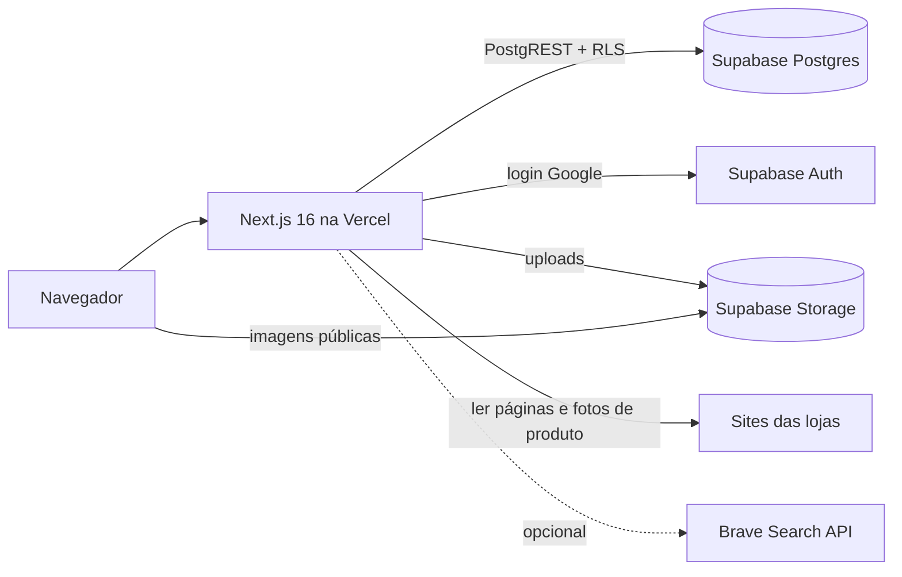

# MyVitri

> 📚 **Documentação:** [arquitetura](docs/architecture.md) e [banco de dados](docs/database.md).

O **MyVitri** (`myvitri.com`) é uma plataforma onde **creators** montam uma **vitrine pública** com os **cupons de desconto** das marcas que divulgam, os **produtos** que indicam (com o preço já calculado com o cupom) e **kits** de produtos. A vitrine fica num link curto (`myvitri.com/seunome`) para a bio do Instagram/TikTok. O seguidor copia o cupom e vai direto para a loja oficial da marca — o MyVitri não vende nada.

| | |
|---|---|
| **Stack** | Next.js 16 (App Router, Cache Components) · React 19 · TypeScript · Tailwind CSS v4 · Zod 4 |
| **Backend** | Supabase: Postgres com RLS, Auth (login Google), Storage |
| **Hospedagem** | Vercel (inferido: Web Analytics + integração) |
| **Idioma do produto e do código** | Português do Brasil |

> ⚠️ **Este projeto usa Next.js 16**, que mudou APIs e convenções (ex.: `proxy.ts` no lugar de `middleware.ts`, `updateTag`, `"use cache"`). Antes de escrever código, leia o guia correspondente em `node_modules/next/dist/docs/` — veja [`AGENTS.md`](AGENTS.md).

---

## Como rodar o projeto

### 1. Pré-requisitos

| Ferramenta | Versão / observação |
|---|---|
| Node.js | `>= 20.9.0` (exigência do Next 16) |
| npm | o repositório tem `package-lock.json` |
| Conta no [Supabase](https://supabase.com) | um projeto para desenvolvimento (recomendado) — ou Docker + Supabase CLI para rodar local |
| Projeto no Google Cloud | OAuth Client "Web" para o login com Google |
| Chave da [Brave Search API](https://brave.com/search/api/) | **opcional** (melhora a importação de produtos por link) |

### 2. Banco (Supabase)

O repositório traz as migrações em `supabase/migrations/` e um seed em `supabase/seed.sql`, mas **não** traz `supabase/config.toml`. O caminho mais simples é usar um projeto Supabase na nuvem só para desenvolvimento.

**Opção A — projeto na nuvem (recomendado)**

1. Crie um projeto no Supabase.
2. Aplique as migrações **em ordem de nome**. Pelo CLI (pode pedir `npx supabase init` antes, por causa da falta do `config.toml`):

```bash
npx supabase link --project-ref <project-ref>
```

```bash
npx supabase db push
```

   Ou cole cada arquivo de `supabase/migrations/` no **SQL Editor**, do mais antigo para o mais novo.

3. (Opcional) Crie a vitrine de demonstração `/marinacosta`. O `supabase/seed.sql` atual usa as colunas antigas `tab`/`title` de `kits` e precisa ser ajustado para `name` antes de rodar.

**Opção B — Supabase local (Docker)**

```bash
npx supabase init
```

```bash
npx supabase start
```

```bash
npx supabase db reset
```

O `start` imprime a URL da API e a chave publicável para o `.env.local`. O `db reset` aplica as migrações e roda o seed — que hoje falha (veja acima); corrija o seed antes. Para o login com Google funcionar localmente, configure `[auth.external.google]`, `site_url` e `additional_redirect_urls` no `supabase/config.toml` gerado.

Detalhes do schema: [docs/database.md](docs/database.md).

### 3. Login com Google

1. No Google Cloud Console, crie um OAuth Client (Web) com o redirect URI `https://<project-ref>.supabase.co/auth/v1/callback`.
2. No Supabase: **Authentication → Providers → Google** (Client ID e Secret).
3. No Supabase: **Authentication → URL Configuration**: *Site URL* `http://localhost:3000` e *Redirect URLs* com `http://localhost:3000/auth/callback`.

### 4. Variáveis de ambiente

Copie o exemplo e preencha:

```bash
cp .env.example .env.local
```

| Variável | Obrigatória | Onde achar | Para quê |
|---|---|---|---|
| `NEXT_PUBLIC_SUPABASE_URL` | sim | Supabase → Project Settings → API | URL do projeto (`https://<ref>.supabase.co`) |
| `NEXT_PUBLIC_SUPABASE_PUBLISHABLE_KEY` | sim | Supabase → Project Settings → API Keys | Chave publicável (`sb_publishable_…`). Não existe chave de serviço no projeto. |
| `BRAVE_SEARCH_API_KEY` | não | brave.com/search/api | Fallback quando a loja bloqueia a leitura da página do produto |
| `TRACK_SALT` | não em dev, recomendada em produção | string aleatória longa, só do servidor | Reservada para o hash diário anônimo de visitante (`events.visitor`). O código de `/api/t` ainda não a usa. |

### 5. Instalar e subir o servidor

```bash
npm ci
```

```bash
npm run dev
```

Abra [http://localhost:3000](http://localhost:3000).

### 6. Primeiro acesso ("usuário admin")

**Não existe usuário administrador nem painel admin** no app. Para ter uma vitrine de teste:

1. Acesse [http://localhost:3000/criar-vitrine](http://localhost:3000/criar-vitrine), escolha nome e link e clique em **Criar com Google**.
2. Depois do login você cai no editor (`/editor`). Em logins seguintes (botão **Entrar** do site, que abre um modal com "Entrar com Google"), o destino padrão é a home logada (`/inicio`), de onde se chega ao editor. Cadastre um cupom, um produto e clique em **Publicar**.
3. Veja a vitrine em `http://localhost:3000/<seu-link>`.

Tarefas administrativas (editar dados, excluir contas, liberar links) são feitas no painel do Supabase.

### 7. Outros comandos

| Comando | O que faz |
|---|---|
| `npm run dev` | Servidor de desenvolvimento (Turbopack). Também reescreve o bloco do `AGENTS.md` (`experimental.agentFeedback`). |
| `npm run build` | Build de produção |
| `npm start` | Sobe o build de produção |
| `npm run lint` | ESLint (`eslint-config-next` core-web-vitals + TypeScript) |

Não há testes automatizados, CI, Docker, filas ou workers. O único serviço auxiliar é o Supabase.

---

## Arquitetura e infraestrutura (resumo)



- **Páginas:** landing com hero de um look ilustrado (`LookHero`, imagens em `public/hero/`), vitrines, cupons, categorias e marcas (`/`, estática; quem tem sessão é redirecionado para `/inicio`), home logada (`/inicio`, que sem sessão mostra o login em página cheia; o **Entrar** do site abre o login num modal, `LoginButton`), criação de conta/vitrine (`/criar-vitrine`, só o formulário com prévia ao vivo; a venda e o FAQ ficam no fim da landing), vitrine pública (`/{handle}`), editor (`/editor`), páginas legais (`/privacidade`, `/termos`).
- **Mutações:** todas em Server Actions (`app/actions.ts`); a autorização é feita pelo banco (RLS), o app nunca usa chave de serviço.
- **Leitura pública** com `"use cache"` + tags (`vitrine:{handle}`, `home`) e `cacheLife("hours")`; a publicação invalida com `updateTag`.
- **Editor:** rascunho salvo automaticamente em `vitrine_drafts`; **Publicar** grava tudo de uma vez pela função `publish_vitrine()` do Postgres.
- **Métricas:** eventos anônimos via `POST /api/t` na tabela `events`, agregados por `vitrine_stats()`.

Mais em [docs/architecture.md](docs/architecture.md).

### Estrutura de pastas

```text
app/                 rotas (páginas, route handlers, imagens OG) + actions.ts + layout
components/          auth/, editor/, storefront/, home/, brand/
lib/                 brand.ts, supabase/ (clientes e tipos), vitrine/ (domínio)
supabase/            migrations/ (SQL em ordem) e seed.sql
proxy.ts             proxy do Next 16 (sessão, retorno do OAuth, / → /inicio logado)
docs/                architecture.md e database.md
```

