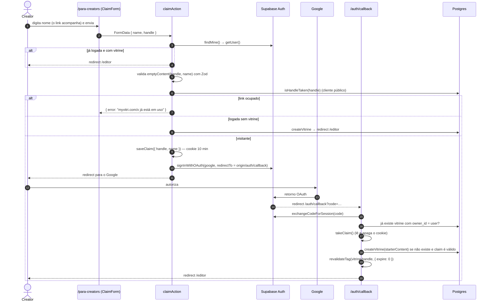
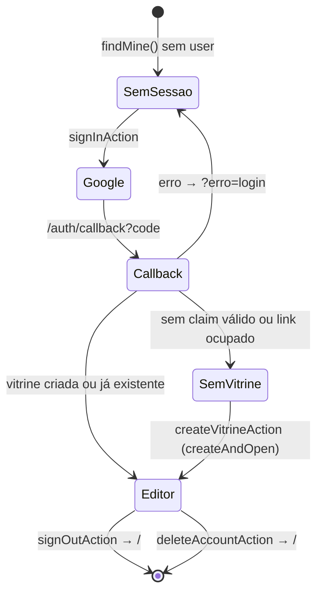
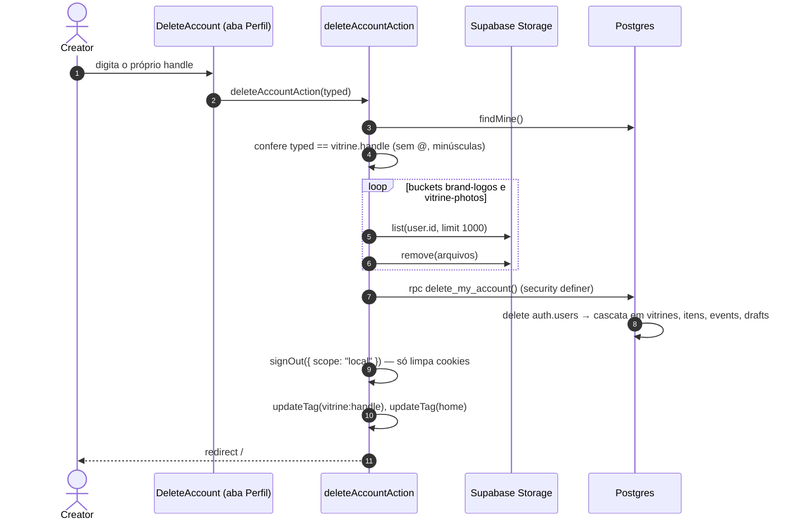
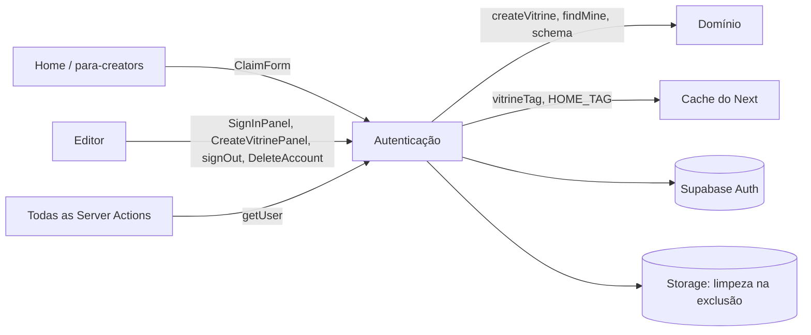

# Módulo: Autenticação e conta

## Visão geral (sem jargão)

Para criar e editar uma vitrine é preciso **entrar com a conta Google** — não existe cadastro com senha. Funciona como a portaria de um prédio que aceita a "carteirinha" do Google:

1. Na página **Para creators**, a pessoa digita o **nome** e escolhe o **link** (`myvitri.com/seunome`).
2. O site guarda essa escolha num **bilhete temporário** (um cookie de 10 minutos) e manda a pessoa para o Google.
3. O Google confirma quem ela é e devolve para o MyVitri.
4. O MyVitri lê o bilhete, **cria a vitrine** com aquele link (e já usa a foto do Google como foto de perfil) e abre o editor.

Se a pessoa entrar direto pelo editor (sem passar pela landing), ou se o link escolhido tiver sido ocupado nesse meio-tempo, o editor pede o link de novo. A pessoa também pode **sair** e **excluir a conta** — a exclusão apaga tudo de uma vez.

## Responsabilidades

- Iniciar o login com Google (OAuth via Supabase Auth) e concluir no callback.
- Manter a sessão viva (cookies) e corrigir o retorno do OAuth quando ele cai na home.
- Criar a vitrine na primeira entrada (com o link escolhido na landing).
- Sair e excluir a conta (com limpeza de arquivos).
- Fornecer os clientes Supabase do servidor para o resto do app.

## Estrutura de arquivos

| Arquivo | Papel |
|---|---|
| [`proxy.ts`](../../proxy.ts) | Renova a sessão (`auth.getClaims()`) e redireciona `/?code=…` para `/auth/callback` |
| [`app/auth/callback/route.ts`](../../app/auth/callback/route.ts) | `GET`: troca o `code` pela sessão e cria a vitrine reservada |
| [`lib/supabase/server.ts`](../../lib/supabase/server.ts) | `createSupabase()` (com cookies), `createPublicSupabase()` (anônimo), `getUser()` |
| [`lib/vitrine/claim.ts`](../../lib/vitrine/claim.ts) | Cookie `vitri_claim` (`saveClaim`, `takeClaim`) e `starterContent()` |
| [`components/auth/forms.tsx`](../../components/auth/forms.tsx) | `ClaimForm` (landing), `SignInPanel` e `CreateVitrinePanel` (editor), campos e aviso de aceite |
| [`app/actions.ts`](../../app/actions.ts) | `claimAction`, `signInAction`, `createVitrineAction`, `signOutAction`, `deleteAccountAction` e os auxiliares `readClaim`, `startGoogle`, `createAndOpen` |
| [`components/editor/DeleteAccount.tsx`](../../components/editor/DeleteAccount.tsx) | UI de exclusão no fim da aba Perfil |
| [`supabase/migrations/20261102000900_delete_account.sql`](../../supabase/migrations/20261102000900_delete_account.sql) | RPC `delete_my_account()` |

## Entidades

| Entidade | Onde | Observação |
|---|---|---|
| Usuário | `auth.users` (Supabase Auth) | `user_metadata.name` e `user_metadata.avatar_url` vêm do Google |
| Vínculo usuário → vitrine | `vitrines.owner_id` (`UNIQUE`) | Uma vitrine por conta. Ver [database.md](../database.md#publicvitrines) |
| "Claim" (reserva temporária) | Cookie `vitri_claim` | JSON `{ handle, name }`, `httpOnly`, `sameSite=lax`, `secure` em produção, `maxAge` 600 s, `path=/` (`lib/vitrine/claim.ts:12-20`) |
| Sessão | Cookies do `@supabase/ssr` | Lidos/escritos pelos clientes em `lib/supabase/server.ts` e pelo `proxy.ts` |

## Rotas e ações

| Rota / Action | Handler | O que faz |
|---|---|---|
| `GET /auth/callback` | `app/auth/callback/route.ts:10` | Sem `code`: volta ao editor (com `?erro=login` se veio `error`). Com `code`: `exchangeCodeForSession`; se o usuário ainda não tem vitrine e há claim válido, cria a vitrine; sempre termina em `/editor` |
| `GET /?code=…` | `proxy.ts:11-15` | Redireciona para `/auth/callback` mantendo a query |
| `/editor` sem sessão | `app/editor/page.tsx:16-18` | Mostra `SignInPanel` (`?erro=login` mostra o aviso de falha) |
| `/editor` logado sem vitrine | `app/editor/page.tsx:19-22` | Mostra `CreateVitrinePanel` com o nome sugerido do Google |
| `claimAction` | `app/actions.ts:47` | Formulário da landing |
| `signInAction` | `app/actions.ts:64` | Botão "Entrar com Google" do editor |
| `createVitrineAction` | `app/actions.ts:69` | Formulário "Escolha o link da sua vitrine" |
| `signOutAction` | `app/actions.ts:76` | `auth.signOut()` e `redirect("/")` |
| `deleteAccountAction` | `app/actions.ts:86` | Exclusão de conta |

## Fluxos principais

### 1. Nova creator pela landing

Detalhes:

- `readClaim` (`app/actions.ts:16-21`) normaliza: `trim`, minúsculas, tira `@` do começo.
- No formulário, o link **acompanha o nome** (`toHandle`: remove acentos, minúsculas, só `[a-z0-9_.]`, até 30) até a pessoa editar o link; se ela apagar o link, volta a acompanhar (`components/auth/forms.tsx:65-123`).
- `starterContent` (`lib/vitrine/claim.ts:37-40`) usa `emptyContent` + a foto do Google se começar com `https://`.
- `HandleTakenError` no callback é engolido: a pessoa cai no `CreateVitrinePanel` e escolhe outro link.

### 2. Estados do editor conforme a sessão

### 3. Renovação de sessão

`proxy.ts` roda em `/`, `/para-creators` e `/editor/*` (inclusive nas chamadas de Server Action, que são POST para a URL da página). Ele cria um cliente Supabase sobre os cookies e chama `auth.getClaims()`; se o token foi renovado, o `setAll` (`proxy.ts:21-25`) grava os cookies novos tanto na requisição (para o restante do processamento) quanto na resposta.

Dentro das actions, `getUser()` (`lib/supabase/server.ts:32-36`) chama `supabase.auth.getUser()`, que **valida o token no servidor do Supabase Auth** a cada chamada.

### 4. Excluir conta

## Integração com outros módulos

## Pegadinhas e dívidas técnicas

1. **O link escolhido não fica reservado** durante o login com Google. Se alguém ocupar o link nesse meio-tempo, a creator cai no `CreateVitrinePanel` **sem aviso** do motivo e sem o link/nome que tinha digitado (o cookie já foi apagado por `takeClaim`; o formulário começa com o nome do Google).
2. **Claim expira em 10 minutos** e é por navegador. Login demorado ou terminado em outro navegador/aparelho perde a escolha (e, como o fluxo OAuth do `@supabase/ssr` guarda o verificador do `code` em cookie, terminar em outro navegador costuma dar `?erro=login`).
3. **Já logada e com vitrine, a landing ignora o link digitado** e só redireciona para o editor (`app/actions.ts:51-52`).
4. **`redirectTo` depende dos headers** `origin`/`x-forwarded-proto`/`host` (`app/actions.ts:26`). Cada domínio (localhost, preview, produção) precisa estar nas *Redirect URLs* do Supabase; senão o retorno cai em `/?code=` e só funciona graças ao proxy.
5. **Exclusão de conta não é atômica:** os arquivos são apagados **antes** da RPC. Se a RPC falhar, a conta continua com imagens quebradas. Erros de `list`/`remove` são ignorados e só os primeiros 1000 arquivos de cada bucket são considerados.
6. **Sem vitrine, a exclusão não pede confirmação** (`app/actions.ts:89` só confere quando há vitrine) — na UI o botão só aparece dentro do editor, então na prática há sempre vitrine.
7. **Nomes reservados incompletos:** `RESERVED_HANDLES` não inclui `auth` nem `icon.svg` (este casa com a regex por ter ponto). Uma vitrine `icon.svg` ficaria inacessível porque a rota do ícone (`app/icon.svg`) tem prioridade. O banco não conhece a lista de reservados.
8. **`getUser()` faz uma chamada de rede ao Supabase Auth em toda action** (inclusive no autosave a cada pausa de 800 ms). Correto para segurança, mas custa latência.
9. **Só Google.** Não há login por e-mail, nem troca de conta Google vinculada à vitrine.
