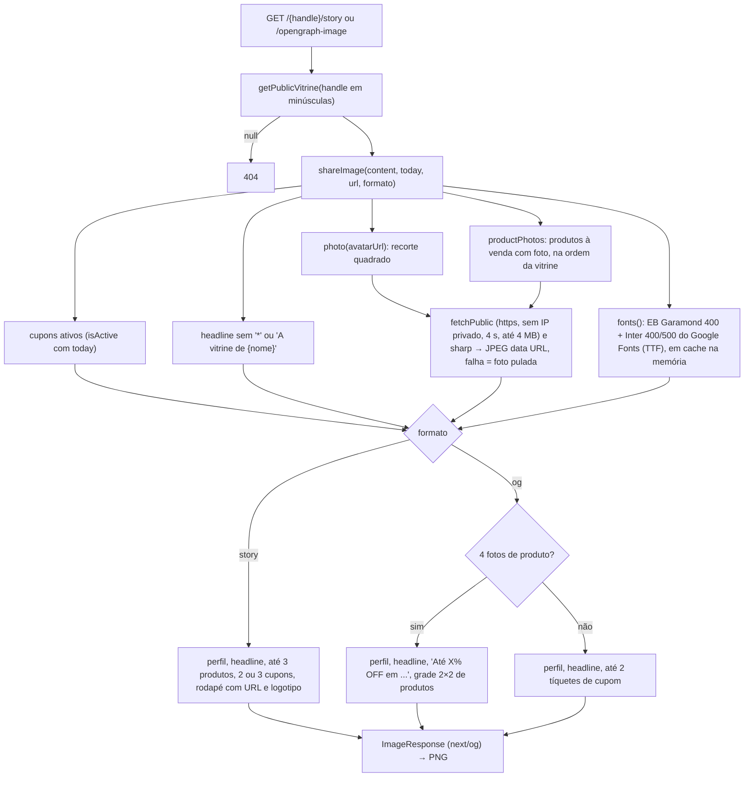
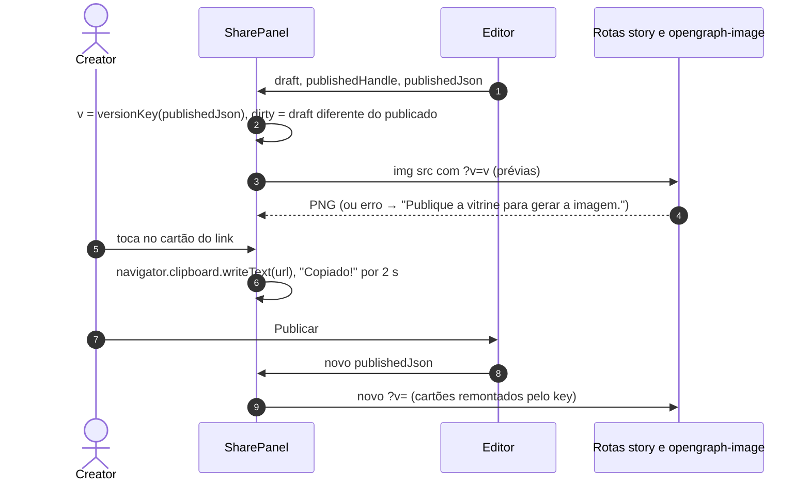
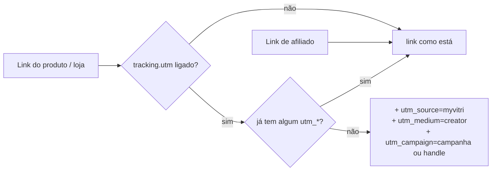
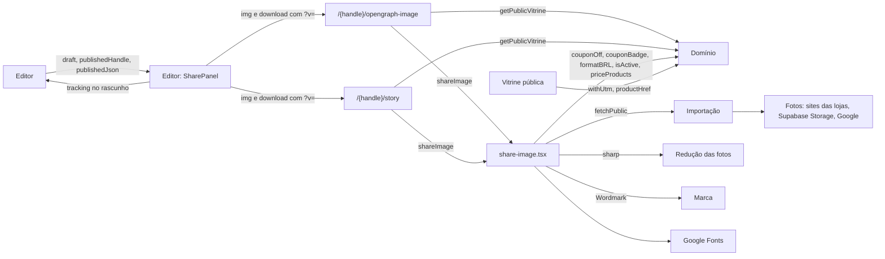

# Módulo: Divulgação

## Visão geral (sem jargão)

Uma vitrine só funciona se as pessoas chegarem nela. A aba **Divulgar** do editor junta o "kit de divulgação" da creator:

- o **link** da vitrine num cartão grande com a foto dela: um toque copia o endereço (para colar na bio);
- um aviso de **situação da publicação**: "No ar com a última versão" ou "Você tem mudanças não publicadas";
- um **passo a passo de onde colar o link**, uma rede por vez (Instagram, TikTok e Stories), como um manual de bolso;
- duas **imagens prontas**, com prévia e botão de baixar:
  - a **imagem para stories** (vertical, com a foto e o nome da creator, os primeiros produtos com foto e os cupons; ela posta e cola por cima a figurinha de link do Instagram);
  - a **prévia do link** — aquela que aparece sozinha quando alguém manda o link no WhatsApp;
- a opção de **identificar as vendas** nos links das lojas (UTM), para a marca enxergar no analytics dela que o cliente veio da creator.

As imagens são **geradas na hora** a partir da versão publicada da vitrine, sem precisar de designer. É como uma gráfica automática: a cada pedido ela pega a vitrine que está no ar, busca a foto de perfil e as fotos dos produtos e monta o cartaz. Se uma foto não chegar a tempo, o cartaz sai sem ela.

Não há mais QR code: quem vê um story já está no celular, então a imagem traz o endereço escrito e espaço livre para a figurinha de link.

## Responsabilidades

- Gerar as imagens OG (1200×630) e de stories (1080×1920) da vitrine publicada, com foto de perfil, produtos com foto e cupons.
- Baixar e preparar essas fotos no servidor com segurança (mesma proteção contra rede interna da importação por link) e com tempo máximo por foto.
- Oferecer no editor o link com cópia em um toque, o status de publicação, o passo a passo por rede e as prévias/downloads das imagens.
- Configurar UTM (liga/desliga e nome da campanha), aplicada pelos links da vitrine.

## Estrutura de arquivos

| Arquivo | Papel |
|---|---|
| [`lib/vitrine/share-image.tsx`](../../lib/vitrine/share-image.tsx) | `shareImage(content, today, url, format)`, `SHARE_SIZES`, download/redução das fotos (`photo`, `productPhotos`), carregamento e cache das fontes |
| [`app/[handle]/opengraph-image.tsx`](../../app/%5Bhandle%5D/opengraph-image.tsx) | Convenção de metadata do Next: imagem OG da rota `/{handle}` |
| [`app/[handle]/story/route.ts`](../../app/%5Bhandle%5D/story/route.ts) | `GET /{handle}/story` → PNG para stories |
| [`components/editor/SharePanel.tsx`](../../components/editor/SharePanel.tsx) | Aba Divulgar |
| [`components/editor/Editor.tsx`](../../components/editor/Editor.tsx) | Passa `publishedHandle` e `publishedJson` (`JSON.stringify(published)`) para o `SharePanel` (`Editor.tsx:271`) |
| [`lib/vitrine/import-link.ts`](../../lib/vitrine/import-link.ts) | `fetchPublic` (exportado), usado para baixar as fotos com a proteção contra SSRF — ver [importação](importacao.md) |
| [`lib/vitrine/links.ts`](../../lib/vitrine/links.ts) | `withUtm` / `productHref` (ver [domínio](dominio.md#regras-de-links-libvitrinelinksts)) |
| [`components/brand/Logo.tsx`](../../components/brand/Logo.tsx) | `Wordmark` desenhado dentro das imagens |

### Dependências

| Pacote | Uso aqui |
|---|---|
| `next/og` (`ImageResponse`) | Desenha o JSX das imagens e devolve o PNG |
| `sharp` (`^0.35.5`, dependência direta) | Reduz as fotos baixadas e compõe o produto sobre o fundo creme, devolvendo JPEG em *data URL* |

## Entidades

- Lê a vitrine publicada via `getPublicVitrine` (cacheada): `avatarUrl`, `name`, `handle`, `headline`, cupons ativos e produtos (`imageUrl`, `soldOut`, preço e cupom).
- Grava `vitrines.tracking` (`{ utm, campaign }`) — pelo rascunho e pela publicação, como qualquer outro campo. Ver [database.md](../database.md#publicvitrines).

## Rotas

| Rota | Handler | O que faz |
|---|---|---|
| `GET /{handle}/opengraph-image` | `app/[handle]/opengraph-image.tsx:9` | PNG 1200×630, `alt` "Vitrine de cupons no MyVitri". O Next liga essa imagem automaticamente às meta tags `og:image` da página `/{handle}`. URL final = `x-forwarded-proto` (padrão `https`) + `host` + `/{handle}`. 404 sem vitrine. |
| `GET /{handle}/story` | `app/[handle]/story/route.ts:5` | PNG 1080×1920. URL final = origem de `request.url` + `/{handle}`. 404 "Vitrine não encontrada". |

Ambas respondem com `cache-control: public, max-age=600` (`share-image.tsx:246`). O editor pede as duas com `?v={hash da versão publicada}` só para furar o cache do navegador; as rotas ignoram o parâmetro.

## Fluxos principais

### Geração das imagens

#### Fotos (`share-image.tsx:26-56`)

| Passo | Perfil (`avatar`) | Produto (`product`) |
|---|---|---|
| Quais | `content.avatarUrl`, se houver | `priceProducts(products, cupons ativos)` filtrados por `!soldOut && imageUrl`; pega os primeiros `count + 2` (story: 3 + 2, og: 4 + 2) para cobrir as que falharem e fica com os `count` primeiros que deram certo |
| Download | `fetchPublic(url, { accept: "image/*", maxBytes: 4_000_000, timeoutMs: 4000 })` — só URLs `https://`; resposta cortada (`complete = false`) é descartada | idem |
| Redução (`sharp`, `limitInputPixels: 40_000_000`) | `resize` quadrado com `fit: "cover"`, fundo branco; 240 px (story) ou 144 px (og) | `fit: "contain"` sobre branco e depois composto com `blend: "multiply"` num quadrado creme (`#F7F4EF`) — o mesmo efeito da vitrine, em que o fundo branco da foto some no card; 572 px (story) ou 500 px (og) |
| Saída | JPEG q 82 em *data URL* | idem |
| Falha | Qualquer erro → `null` e a imagem usa a inicial do nome num círculo areia | Qualquer erro → produto pulado |

Avatar e produtos são baixados **em paralelo** (`Promise.all`). O tamanho pedido é o dobro do desenhado, para a foto não ficar borrada.

#### Conteúdo de cada formato (`share-image.tsx:86-248`)

| Formato | Conteúdo | Regras |
|---|---|---|
| `og` (1200×630) | À esquerda: perfil (foto 72 px ou inicial, nome, `@handle`), headline (serifa, 72–76), embaixo URL curta + logotipo. À direita: **grade 2×2** de produtos (quadrados de 250 px com o selo do cupom, `couponBadge`) **ou** até 2 tíquetes de cupom | A grade só entra com **exatamente 4 fotos**; com ela, os cupons não aparecem um a um e no lugar vem o resumo "Até {maior %}% OFF em {até 3 marcas}" ("Cupons em …" se só houver cupons em R$) |
| `story` (1080×1920) | Perfil (foto 120 px, nome, `@handle`), headline (serifa, 104), até **3 produtos** em linha (286 px, selo do cupom, preço final e preço cheio riscado quando `price > 0`), tíquetes de cupom, rodapé com "Todos os cupons no link", URL curta e logotipo | Com pelo menos 1 foto de produto: 2 cupons; sem fotos: 3 cupons. O fim da imagem fica livre para a figurinha de link |

O tíquete de cupom traz marca, desconto (`couponOff`, em serifa) e o código com borda tracejada.

Decisão de projeto registrada no código (`share-image.tsx:9-14` e `:25-31`): as imagens **trazem a cara da pessoa** (foto, nome, produtos), e a lentidão/instabilidade de buscar fotos externas é contida com o tempo máximo por foto e com a regra de pular a foto que falhar.

As fontes vêm da API CSS do Google Fonts em tempo de execução (o gerador não lê WOFF2, por isso o código procura a URL `truetype`/`opentype`). Ficam num `Map` em memória por instância do servidor; se falhar, a entrada sai do cache e a imagem usa a fonte padrão (`share-image.tsx:58-84`).

### Aba Divulgar (`SharePanel.tsx`)

| Bloco | Comportamento | Linhas |
|---|---|---|
| Seu link | Cartão inteiro é um botão: foto de perfil do rascunho (ou inicial), endereço sem `https://` e "Toque para copiar". Copia `window.location.origin + "/" + handlePublicado` com `navigator.clipboard`; mostra "Copiado! Agora é só colar na bio." por 2 s e anuncia "Link copiado" para leitor de tela. Desabilitado até a origem existir (no servidor ela é vazia) | `SharePanel.tsx:10`, `:170-178`, `:186-216` |
| Status da publicação | `dirty = JSON.stringify(draft) !== publishedJson`. Diferente: aviso laranja "Você tem mudanças não publicadas. Publique para elas aparecerem no link e nas imagens."; igual: ponto verde "No ar com a última versão" | `SharePanel.tsx:164`, `:217-229` |
| Onde colar | Abas (`role="tablist"`) Instagram, TikTok e Stories, cada uma com 3 passos numerados (`WHERE`, `WhereToPaste`) | `SharePanel.tsx:34-115` |
| Imagens prontas | Dois cartões `ShareImage`: **Stories** (`/{handle}/story?v={v}`, baixa como `stories-{handle}.png`) e **Prévia do link** (`/{handle}/opengraph-image?v={v}`, `vitrine-{handle}.png`). Prévia pequena com esqueleto enquanto carrega; se a imagem falhar, mostra "Publique a vitrine para gerar a imagem." e desabilita "Baixar" | `SharePanel.tsx:118-150`, `:236-256` |
| Identificar minhas vendas (UTM) | `Switch` liga/desliga `tracking.utm`; campo "Nome da campanha" (espaços viram `-`, até 60, padrão = handle). Mostra o exemplo dos parâmetros | fim do arquivo |

`v` é um hash curto (estilo djb2, em base 36) do JSON da versão publicada (`versionKey`, `SharePanel.tsx:27-31`). Quando a creator publica, `published` muda no editor, o hash muda, a URL das imagens muda e o navegador baixa a versão nova em vez de mostrar a antiga do cache. O `key` de cada cartão inclui `v`, então uma versão nova também recomeça o carregamento e sai de um erro anterior.

O link e as imagens usam **o handle publicado** e a versão publicada, não o rascunho.

### UTM

Aplicado na vitrine pública em: link da marca e botão do cupom (`withUtm(storeUrl)`), botão/foto do produto e itens do kit (`productHref`).

## Integração com outros módulos

## Pegadinhas e dívidas técnicas

1. **Prévia do link desatualizada em apps de mensagem:** além do `max-age=600` e do cache de horas do `getPublicVitrine`, WhatsApp e redes guardam a prévia por conta própria. Mudanças publicadas podem demorar a aparecer. O `?v=` do editor só resolve o cache do navegador da creator.
2. **Dependência de rede em tempo de execução** para as fontes **e para as fotos**. Cada geração que não vem de cache baixa a foto de perfil e até 5 (story) ou 6 (og) fotos de produto direto das lojas, do Supabase Storage ou do Google, com até 4 MB cada. O limite de 4 s vale **por requisição** dentro do `fetchPublic`, então uma foto com redirecionamentos pode levar mais (até 4 saltos). A imagem demora tanto quanto a foto mais lenta, e robôs de prévia com tempo curto podem desistir (a verificar).
3. **O servidor faz requisições a lojas externas a cada geração** — inclusive quando um robô ou visitante qualquer abre `/{handle}/opengraph-image`. Não há cache das fotos além da resposta inteira (`max-age=600`) nem rate limit: dá para usar a rota para fazer o servidor buscar as fotos várias vezes. As lojas veem o user-agent `VitriBot/1.0`.
4. **Fotos `http://` e de endereços privados são puladas.** Com o Supabase local (`http://127.0.0.1:54321`, opção B do README), nenhuma foto enviada aparece nas imagens em desenvolvimento: o `photo()` exige `https://` e o `fetchPublic` recusa IP privado.
5. **"Publique a vitrine para gerar a imagem." aparece para qualquer falha** da imagem (404, 500, tempo esgotado), não só quando falta publicar. Como a vitrine publicada existe desde a criação da conta (ver [autenticação](autenticacao.md)), na prática a mensagem quase sempre esconde um erro de geração.
6. **A grade de produtos da prévia do link é tudo ou nada:** com 1 a 3 fotos que deram certo, a imagem volta aos tíquetes de cupom. Uma foto que falhou numa geração pode trocar o layout da prévia entre uma geração e outra.
7. **Duas formas de descobrir a origem:** a imagem OG usa headers (`x-forwarded-proto`/`host`), a de stories usa `request.url`. Atrás de um proxy mal configurado, o endereço escrito no story pode apontar para o host interno.
8. **Status de publicação depende do `published` local do editor**: publicar em outra aba não atualiza o aviso nem o `?v=` até recarregar (ver [editor](editor.md#pegadinhas-e-dívidas-técnicas)).
9. **UTM e campanha só valem depois de publicar** — o switch muda o rascunho.
10. **`navigator.clipboard` só funciona em contexto seguro** (HTTPS ou localhost); em outros casos o cartão do link não copia nada (o erro é ignorado e o texto continua "Toque para copiar").
11. **Cupons "vencendo" aparecem nas imagens** com o mesmo critério da vitrine (`isActive` com `today` em UTC e cacheado).
