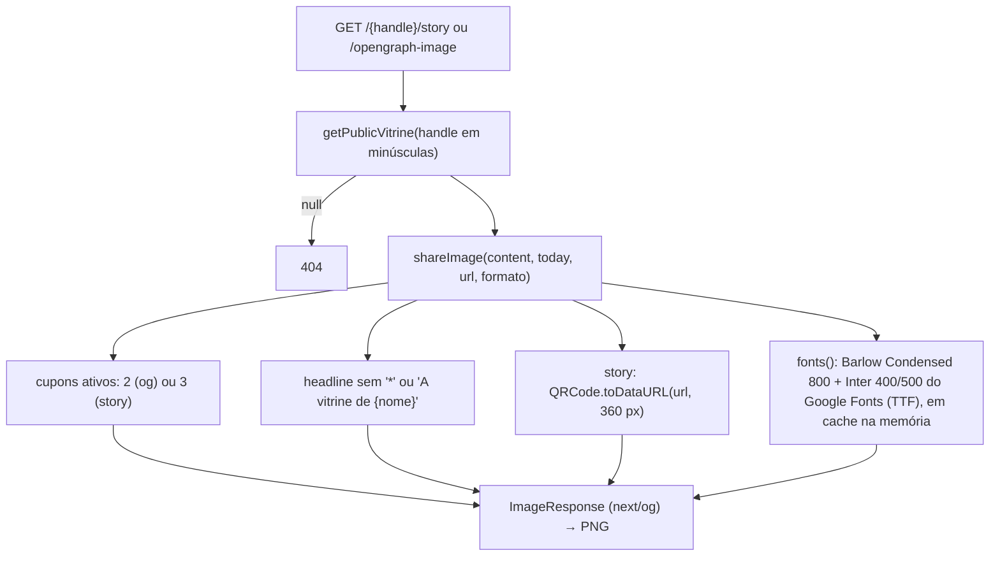
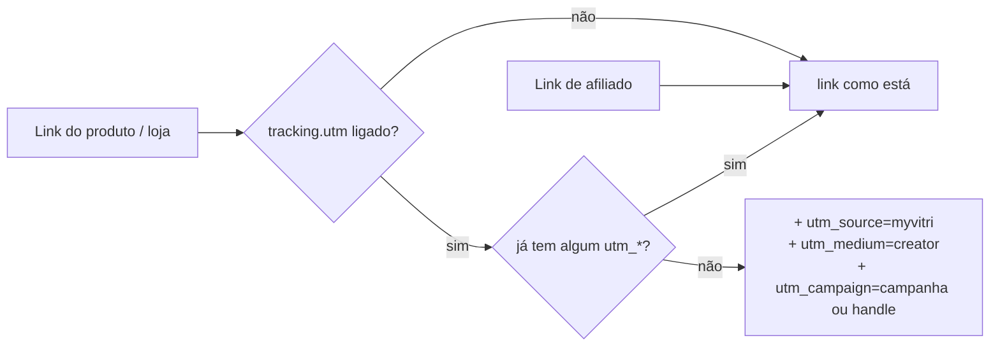
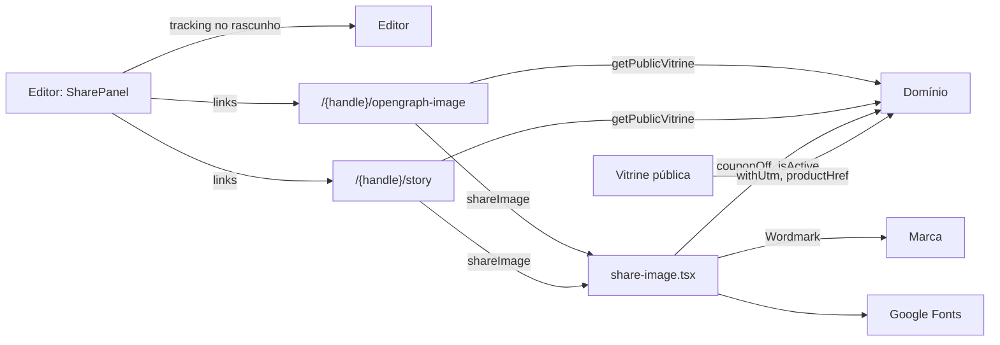

# Módulo: Divulgação

## Visão geral (sem jargão)

Uma vitrine só funciona se as pessoas chegarem nela. A aba **Divulgar** do editor junta o "kit de divulgação" da creator:

- o **link** da vitrine, com botão de copiar (para colar na bio);
- um **QR code** (para embalagem, evento, fim de vídeo), com download em PNG;
- uma **imagem para stories** (vertical, com os cupons e o QR code);
- a **imagem de prévia do link** — aquela que aparece quando alguém manda o link no WhatsApp;
- a opção de **identificar as vendas** nos links das lojas (UTM), para a marca enxergar no analytics dela que o cliente veio da creator.

As imagens são **geradas na hora** a partir da versão publicada da vitrine, sem precisar de designer.

## Responsabilidades

- Gerar as imagens OG (1200×630) e de stories (1080×1920) da vitrine publicada.
- Oferecer link, QR code (SVG e PNG) e downloads no editor.
- Configurar UTM (liga/desliga e nome da campanha), aplicada pelos links da vitrine.

## Estrutura de arquivos

| Arquivo | Papel |
|---|---|
| [`lib/vitrine/share-image.tsx`](../../lib/vitrine/share-image.tsx) | `shareImage(content, today, url, format)`, `SHARE_SIZES`, carregamento e cache das fontes |
| [`app/[handle]/opengraph-image.tsx`](../../app/%5Bhandle%5D/opengraph-image.tsx) | Convenção de metadata do Next: imagem OG da rota `/{handle}` |
| [`app/[handle]/story/route.ts`](../../app/%5Bhandle%5D/story/route.ts) | `GET /{handle}/story` → PNG para stories |
| [`components/editor/SharePanel.tsx`](../../components/editor/SharePanel.tsx) | Aba Divulgar |
| [`lib/vitrine/links.ts`](../../lib/vitrine/links.ts) | `withUtm` / `productHref` (ver [domínio](dominio.md#regras-de-links-libvitrinelinksts)) |
| [`components/brand/Logo.tsx`](../../components/brand/Logo.tsx) | `Wordmark` desenhado dentro das imagens |

## Entidades

- Lê a vitrine publicada via `getPublicVitrine` (cacheada).
- Grava `vitrines.tracking` (`{ utm, campaign }`) — pelo rascunho e pela publicação, como qualquer outro campo. Ver [database.md](../database.md#publicvitrines).

## Rotas

| Rota | Handler | O que faz |
|---|---|---|
| `GET /{handle}/opengraph-image` | `app/[handle]/opengraph-image.tsx:9` | PNG 1200×630, `alt` "Vitrine de cupons no MyVitri". O Next liga essa imagem automaticamente às meta tags `og:image` da página `/{handle}`. URL final = `x-forwarded-proto` (padrão `https`) + `host` + `/{handle}`. 404 sem vitrine. |
| `GET /{handle}/story` | `app/[handle]/story/route.ts:5` | PNG 1080×1920 com QR. URL final = origem de `request.url` + `/{handle}`. 404 "Vitrine não encontrada". |

Ambas respondem com `cache-control: public, max-age=600` (`share-image.tsx:120`).

## Fluxos principais

### Geração das imagens

| Formato | Conteúdo | Tamanhos de fonte principais |
|---|---|---|
| `og` | À esquerda: logotipo, headline, URL curta; à direita: até 2 "tíquetes" de cupom (marca, desconto, código) | headline 88, desconto 60 |
| `story` | Logotipo, headline, "Os cupons de {nome}", até 3 tíquetes, QR code 260 px + "Aponte a câmera" + URL curta | headline 132, desconto 96 |

Decisão de projeto registrada no código (`share-image.tsx:8-13`): **só texto e blocos de cor**, sem fotos das lojas, porque buscar fotos externas deixaria a geração lenta e sujeita a falhas.

As fontes vêm da API CSS do Google Fonts em tempo de execução (o gerador não lê WOFF2, por isso o código procura a URL `truetype`/`opentype`). Ficam num `Map` em memória por instância do servidor; se falhar, a entrada sai do cache e a imagem usa a fonte padrão (`share-image.tsx:25-48`).

### Aba Divulgar (`SharePanel.tsx`)

| Bloco | Comportamento |
|---|---|
| Seu link | `window.location.origin + "/" + handlePublicado` (a origem real: localhost, preview ou produção). Botão "Copiar" usa `navigator.clipboard` |
| QR code | SVG gerado no navegador (`QRCode.toString`); "Baixar PNG" gera 1024 px (`qr-{handle}.png`) |
| Imagens para divulgar | Links com `download` para `/{handle}/story` (`stories-{handle}.png`) e `/{handle}/opengraph-image` (`vitrine-{handle}.png`) |
| Identificar minhas vendas (UTM) | `Switch` liga/desliga `tracking.utm`; campo "Nome da campanha" (espaços viram `-`, até 60, padrão = handle). Mostra o exemplo dos parâmetros |

O link, o QR e as imagens usam **o handle publicado**, não o do rascunho ("Os outros recursos daqui usam a versão publicada").

### UTM

Aplicado na vitrine pública em: link da marca e botão do cupom (`withUtm(storeUrl)`), botão/foto do produto e itens do kit (`productHref`).

## Integração com outros módulos

## Pegadinhas e dívidas técnicas

1. **Prévia do link desatualizada em apps de mensagem:** além do `max-age=600` e do cache de horas do `getPublicVitrine`, WhatsApp e redes guardam a prévia por conta própria. Mudanças publicadas podem demorar a aparecer.
2. **Dependência de rede em tempo de execução** para as fontes das imagens. A primeira geração por instância é mais lenta e uma mudança no formato do CSS do Google Fonts derruba silenciosamente para a fonte padrão.
3. **Duas formas de descobrir a origem:** a imagem OG usa headers (`x-forwarded-proto`/`host`), a de stories usa `request.url`. Atrás de um proxy mal configurado, o QR do story pode apontar para o host interno.
4. **UTM e campanha só valem depois de publicar** — o switch muda o rascunho.
5. **`navigator.clipboard` só funciona em contexto seguro** (HTTPS ou localhost); em outros casos o botão "Copiar" não faz nada (o erro é ignorado).
6. **Cupons "vencendo" aparecem nas imagens** com o mesmo critério da vitrine (`isActive` com `today` em UTC e cacheado).
