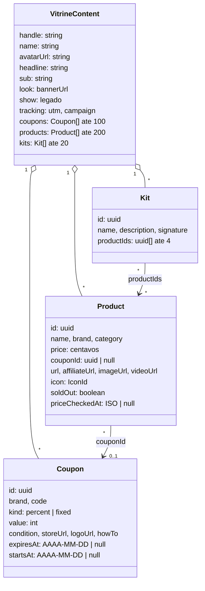
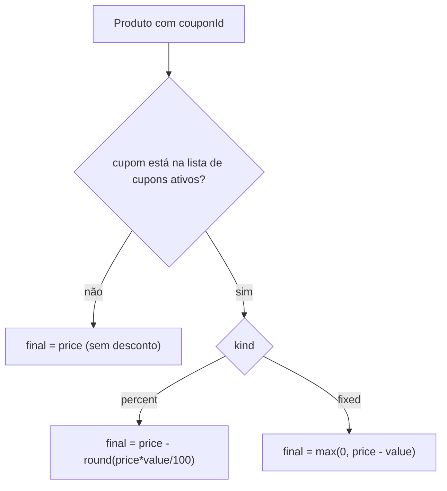
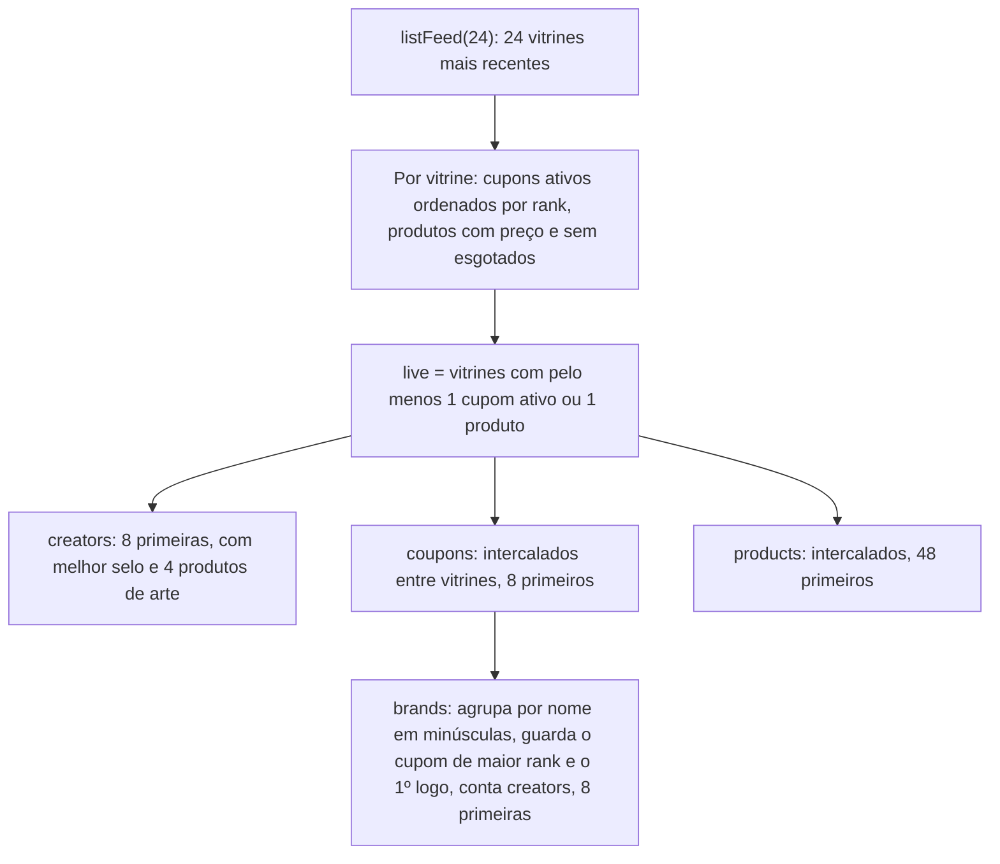
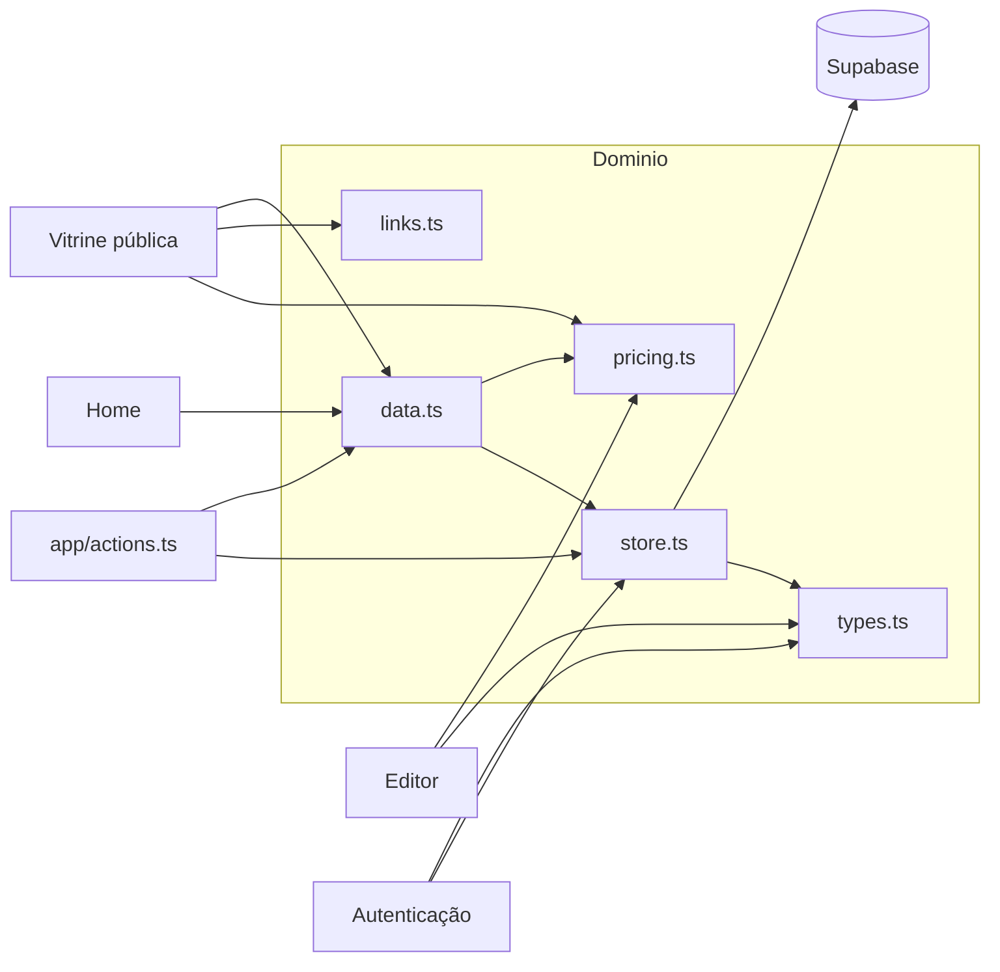

# Módulo: Domínio (`lib/vitrine`)

## Visão geral (sem jargão)

Este é o "cérebro" do MyVitri: o lugar onde estão as **regras do negócio**, independentes de tela. Se o resto do sistema fosse uma loja, este módulo seria o **manual de procedimentos** do gerente:

- o que é um cupom válido (tem marca, código, desconto entre 1% e 100%…);
- como calcular o preço com desconto ("R$ 189,90 com 15% OFF = R$ 161,42");
- quando um cupom está **ativo**, **agendado** ou **vencido**;
- como acrescentar a "etiqueta de rastreio" (UTM) nos links das lojas;
- como guardar e buscar uma vitrine no banco;
- o que mostrar na home (as vitrines mais recentes, os melhores cupons…).

Telas (editor, vitrine, home) só **usam** essas regras; elas não decidem nada sozinhas.

## Responsabilidades

- Definir o **formato** de uma vitrine (`VitrineContent`) e validá-lo com Zod antes de publicar.
- Regras de **preço e cupom** (desconto, validade, selos, totais de kit, parse de moeda).
- Regras de **links** (UTM, link de afiliado).
- **Persistência**: converter entre o banco (`snake_case`) e o app (`camelCase`), criar/publicar vitrine, rascunho.
- **Leitura pública cacheada** (vitrine por handle e feed da home).

## Estrutura de arquivos

| Arquivo | Papel | Roda em |
|---|---|---|
| [`lib/vitrine/types.ts`](../../lib/vitrine/types.ts) | Schemas Zod, tipos, constantes (`ICONS`, `SECTION_IDS`, `RESERVED_HANDLES`, `HANDLE_RE`), campos "extra" para dados antigos, `emptyContent()` | servidor e cliente |
| [`lib/vitrine/pricing.ts`](../../lib/vitrine/pricing.ts) | Preço, cupom, validade, formatação BRL, kits | servidor e cliente |
| [`lib/vitrine/links.ts`](../../lib/vitrine/links.ts) | `withUtm`, `productHref` | servidor e cliente |
| [`lib/vitrine/store.ts`](../../lib/vitrine/store.ts) | Toda leitura/escrita no Supabase | só servidor (`server-only`) |
| [`lib/vitrine/data.ts`](../../lib/vitrine/data.ts) | Leituras públicas com `"use cache"` e tags | só servidor |
| [`lib/supabase/database.types.ts`](../../lib/supabase/database.types.ts) | Tipos gerados do schema `public` | — |

Os outros arquivos de `lib/vitrine/` pertencem a módulos específicos: `claim.ts` → [autenticação](autenticacao.md), `import-link.ts` → [importação](importacao.md), `share-image.tsx` → [divulgação](divulgacao.md).

## Entidades

O app trabalha com **um documento** por vitrine, `VitrineContent` (`lib/vitrine/types.ts:70-96`), que agrega a vitrine e suas listas. No banco isso vira 4 tabelas (`vitrines`, `coupons`, `products`, `kits`) — ver [database.md](../database.md).

### Regras de validação (Zod, `lib/vitrine/types.ts`)

| Campo | Regra | Linha |
|---|---|---|
| URLs (`storeUrl`, `logoUrl`, `url`, `imageUrl`, `affiliateUrl`, `videoUrl`, `avatarUrl`, `look.bannerUrl`) | `trim`, até 2000 chars, vazio **ou** começa com `http://`/`https://` | 13-17 |
| Datas (`expiresAt`, `startsAt`) | regex `^\d{4}-\d{2}-\d{2}$` ou `null` | 20 |
| `coupon.brand` | 1–60 | 25 |
| `coupon.code` | 1–40, convertido para MAIÚSCULAS | 26 |
| `coupon.value` | inteiro positivo (o teto de 100 para `%` só existe no banco) | 29 |
| `coupon.condition` | até 120 | 30 |
| `coupon.howTo` | até 400 | 36 |
| cupom | `startsAt <= expiresAt` ("O cupom vence antes de começar") | 40 |
| `product.name` | 1–80 | 44 |
| `product.brand` / `category` | até 60 / até 30 | 45-46 |
| `product.price` | inteiro ≥ 0 (centavos) | 48 |
| `product.icon` | um de `ICONS` | 52 |
| `product.priceCheckedAt` | string até 40 ou `null` (não valida formato ISO) | 59 |
| `kit.name` | 1–60 | 64 |
| `kit.productIds` | até 4 UUIDs | 67 |
| `handle` | `trim`, minúsculas, `^[a-z0-9_.]{3,30}$`, fora de `RESERVED_HANDLES` | 71-76 |
| `name` | 1–60 | 77 |
| listas | até 100 cupons, 200 produtos, 20 kits | 93-95 |

`RESERVED_HANDLES` (`types.ts:6-9`): `editor, api, admin, login, entrar, sair, cadastro, app, www, vitri, myvitri, ajuda, termos, privacidade, _next, favicon.ico`.

### Compatibilidade com dados antigos

| Constante | Valor | Usada para |
|---|---|---|
| `COUPON_EXTRA` (`types.ts:99`) | `{ logoUrl: "", howTo: "", startsAt: null }` | completar cupons de rascunhos antigos e cupons novos |
| `PRODUCT_EXTRA` (`types.ts:100`) | `{ affiliateUrl: "", videoUrl: "", soldOut: false, priceCheckedAt: null }` | idem para produtos |
| `TRACKING` (`types.ts:101`) | `{ utm: true, campaign: "" }` | completar `vitrines.tracking = '{}'` |

## Regras de preço e cupom (`lib/vitrine/pricing.ts`)

| Função | Linha | Regra |
|---|---|---|
| `formatBRL(cents)` | 5 | `Intl.NumberFormat("pt-BR", BRL)`, troca espaço por espaço não-quebrável |
| `couponOff(c)` | 11 | `"15% OFF"` ou `"R$30 OFF"` (sem centavos quando inteiro) |
| `couponBadge(c)` | 15 | `"-15%"` ou `"-R$30"` |
| `applyCoupon(price, c)` | 19 | `%`: `round(price * value / 100)` de desconto; fixo: `value` centavos; **nunca abaixo de 0** |
| `couponStatus(c, today)` | 26 | `agendado` se `startsAt > today`; `vencido` se `expiresAt < today`; senão `ativo` (comparação de strings `AAAA-MM-DD`) |
| `isActive(c, today)` | 33 | `couponStatus === "ativo"` |
| `daysLeft(c, today)` | 36 | dias até `expiresAt` (0 = hoje), `null` sem validade |
| `expiryLabel(c, today)` | 42 | "Sem validade" / "Vence hoje" (≤ 0) / "Vence amanhã" / "Vence em N dias" (≤ 7) / "Válido até DD/MM" |
| `priceProducts(products, coupons)` | 53 | anexa `coupon` e `final` a cada produto. **Só acha cupons da lista passada** — quem chama passa só os ativos. |
| `kitTotals(kit, priced)` | 61 | itens encontrados, `total` (cheio), `final` (com cupom), `save`, `codes` (códigos únicos) |
| `parseBRL(input)` | 72 | `"189,90"`, `"R$ 1.189,90"`, `"189.90"` → centavos |
| `centsToInput(cents)` | 80 | `18990` → `"189,90"` |

## Regras de links (`lib/vitrine/links.ts`)

- `withUtm(url, content)` (linha 7): se `tracking.utm` está ligado e a URL é válida e **ainda não tem nenhum `utm_*`**, acrescenta `utm_source=myvitri`, `utm_medium=creator`, `utm_campaign=<campaign ou handle>`.
- `productHref(p, content)` (linha 22): `affiliateUrl` **como veio** (redirecionadores de afiliado quebram com parâmetros extras) ou `withUtm(url)`.

## Persistência (`lib/vitrine/store.ts`)

Comentário do próprio arquivo: "Toda leitura/escrita passa por aqui; a autorização de escrita é garantida pelas policies RLS".

| Função | Linha | O que faz | Cliente Supabase esperado |
|---|---|---|---|
| `HandleTakenError` | 17 | Erro de domínio para "link em uso" | — |
| `isUniqueViolation` | 19 | `error.code === "23505"` | — |
| `pickLook` | 25 | Mantém só `bannerUrl` do `look` | — |
| `toCoupon` / `toProduct` | 29 / 43 | linha → objeto do app | — |
| `loadContent(db, row)` | 59 | 3 consultas em paralelo (cupons, produtos, kits ordenados por `position`) → `VitrineContent` | qualquer |
| `findByHandle(db, handle)` | 92 | Vitrine pública por handle (ou `null`) | público |
| `listFeed(db, limit)` | 101 | As `limit` vitrines com `updated_at` mais recente + todos os cupons/produtos delas em **3 consultas** (não N+1) | público |
| `isHandleTaken(db, handle)` | 126 | `count` com `head: true` | público |
| `findMine()` | 133 | Usuário logado + vitrine dele (ou `null`) | sessão (cria o próprio) |
| `findDraft(db, ownerId, published)` | 145 | Lê o rascunho, confere o formato mínimo (3 arrays), migra kits antigos (`tab`/`title` → `name`), remove `color`/`style`, completa campos novos e mescla sobre a versão publicada | sessão |
| `saveDraft` / `deleteDraft` | 167 / 174 | `upsert` / `delete` em `vitrine_drafts` | sessão |
| `createVitrine(db, ownerId, content)` | 179 | `insert` em `vitrines` (sem itens). `23505` → `HandleTakenError` | sessão |
| `publishVitrine(db, ownerId, content)` | 195 | Lê o handle atual e chama a RPC `publish_vitrine`. Devolve `prevHandle` (para invalidar o cache do link antigo) e `updatedAt` | sessão |

## Leitura pública cacheada (`lib/vitrine/data.ts`)

| Export | Linha | Descrição |
|---|---|---|
| `vitrineTag(handle)` | 8 | `"vitrine:" + handle` |
| `HOME_TAG` | 10 | `"home"` |
| `getPublicVitrine(handle)` | 15 | `"use cache"`, `cacheTag(vitrineTag)`, `cacheLife("hours")`. Retorna `{ content, today }` ou `null`. O `null` também é cacheado — por isso criar uma vitrine invalida a tag do handle novo. |
| `getHomeFeed()` | 51 | `"use cache"`, `cacheTag("home")`, `cacheLife("hours")`. Monta o feed da home. |

Algoritmo de `getHomeFeed`:

- `rank(c)` (linha 41): cupom percentual **sempre** vale mais que valor fixo; dentro do tipo, o maior.
- `interleave` (linha 44): 1º item de cada vitrine, depois o 2º de cada… — para uma creator não tomar a seção inteira.

## Rotas / endpoints

Este módulo **não expõe rotas**. É consumido por:

| Consumidor | Usa |
|---|---|
| `app/actions.ts` | `vitrineContentSchema`, `emptyContent`, `store.*`, `vitrineTag`, `HOME_TAG` |
| `app/[handle]/*` | `getPublicVitrine` |
| `app/page.tsx` | `getHomeFeed`, `pricing` |
| `app/editor/page.tsx` | `findMine`, `findDraft` |
| `app/auth/callback/route.ts` | `createVitrine`, `vitrineContentSchema`, `vitrineTag` |
| `components/storefront/Storefront.tsx` | `pricing`, `links` |
| `components/editor/*` | `pricing`, tipos e `*_EXTRA` |

## Integração com outros módulos

## Pegadinhas e dívidas técnicas

1. **Validação só na publicação.** O rascunho não passa pelo Zod (pode ter itens pela metade) e a **leitura** do banco também não revalida nada. Como a RLS deixa a dona da vitrine escrever direto nas tabelas via API do Supabase (sem passar pela Server Action), um valor fora das regras do Zod — por exemplo, uma URL que não é `http(s)` — pode chegar à vitrine pública. Em especial, `openStore` (`components/storefront/Storefront.tsx:43-45`) faz `window.open(url)` sem checar o protocolo. **Risco de segurança a verificar**; o caminho mais simples é validar o protocolo em `toCoupon`/`toProduct` ou criar `CHECK`s no banco.
2. **Percentual acima de 100 passa no Zod** (`value` só exige positivo) e só é barrado pelo `CHECK` do banco, que vira a mensagem genérica "Erro ao salvar". A UI limita a 100 (`PercentInput`), então só acontece com chamadas diretas.
3. **Datas impossíveis** (`2026-02-31`) passam na regex e quebram no `::date` da RPC com erro genérico. Idem `priceCheckedAt` com texto que não é data.
4. **`isUniqueViolation` não olha qual constraint** estourou: qualquer `23505` vira "link já está em uso" (`store.ts:19`, `:199`).
5. **`listFeed` pode ser truncado** pela API do Supabase: busca cupons e produtos de 24 vitrines numa consulta só (`.in("vitrine_id", ids)`), e o PostgREST do Supabase devolve no máximo o *Max Rows* configurado no projeto (1000 por padrão). Com vitrines grandes, produtos de algumas creators somem da home em silêncio.
6. **`today` em UTC e cacheado** dentro de `getPublicVitrine`/`getHomeFeed`: a validade dos cupons depende do fuso UTC e da revalidação do cache (ver [arquitetura](../architecture.md#datas-e-fuso-horário)).
7. **`show` e quase todo `look` são legado**, mantidos só porque a RPC grava as colunas (`types.ts:81-90`).
8. **`rank` compara tipos diferentes de forma arbitrária**: 5% OFF é considerado "melhor" que R$ 100 OFF no selo da home e na escolha da marca (`data.ts:41`).
9. **`parseBRL` e separador de milhar sem vírgula:** `"1.189"` vira R$ 1,19 (o ponto é tratado como decimal quando não há vírgula, `pricing.ts:75`).
10. **`database.types.ts` parece editado à mão** (colunas fora de ordem); regenere após migrações.
