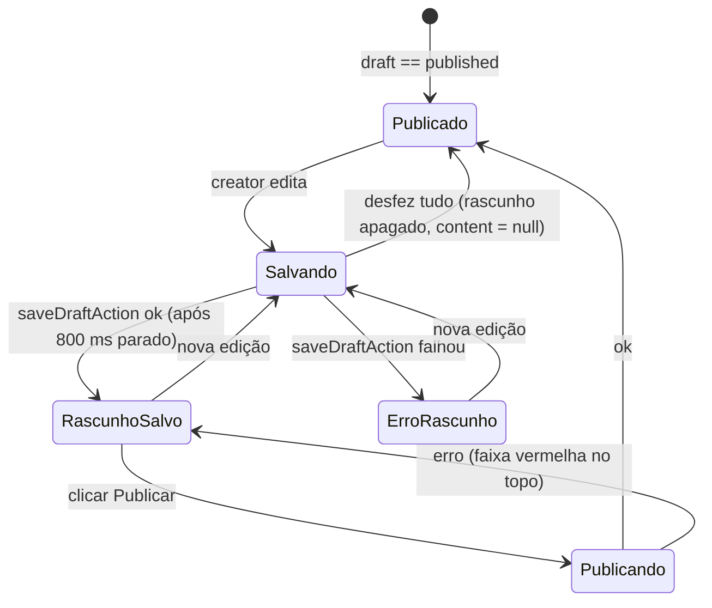
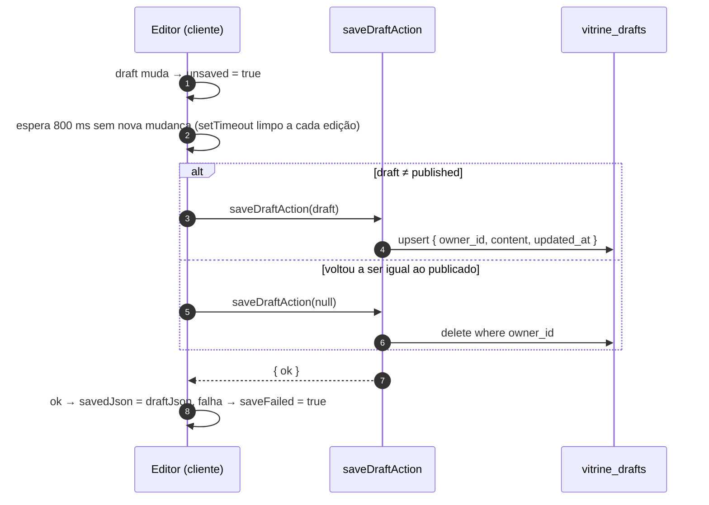
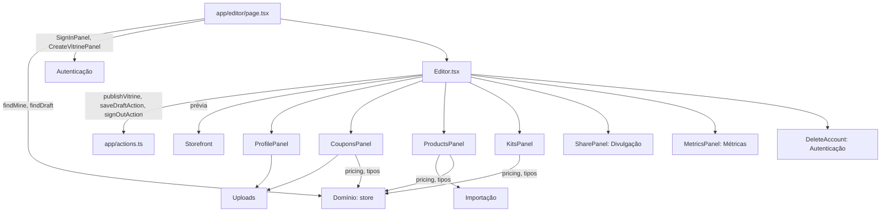

# Módulo: Editor (`/editor`)

## Visão geral (sem jargão)

O editor é o **bastidor da vitrine**. A tela tem duas metades:

- **À esquerda**, abas para arrumar a vitrine: **Perfil**, **Cupons**, **Produtos**, **Kits**, **Divulgar** e **Métricas**.
- **À direita**, uma **prévia ao vivo** de como a vitrine vai ficar, que pode ser vista em tamanho de computador ou de celular.

Tudo o que a creator muda é salvo sozinho, em segundos, como **rascunho** — dá para fechar o navegador e voltar depois. O público **não vê** o rascunho: a vitrine pública só muda quando ela clica em **Publicar**. No topo, um indicador mostra "Publicado" (tudo no ar) ou "Não publicado · rascunho salvo" (há mudanças guardadas, mas ainda não no ar).

É como editar um documento com "salvar automático" e um botão separado de "enviar".

## Responsabilidades

- Carregar a versão publicada e o rascunho (se houver) da vitrine de quem está logado.
- Editar perfil, cupons, produtos e kits, com reordenação por arrastar.
- Salvar o rascunho automaticamente e avisar ao sair com mudanças pendentes.
- Mostrar a prévia real (o mesmo componente da vitrine pública) em modo "prévia".
- Publicar (validação + gravação atômica + invalidação de cache).
- Hospedar os painéis de [divulgação](divulgacao.md), [métricas](metricas.md), [uploads](uploads.md), [importação](importacao.md) e a [exclusão de conta](autenticacao.md#4-excluir-conta).

## Estrutura de arquivos

| Arquivo | Papel |
|---|---|
| [`app/editor/page.tsx`](../../app/editor/page.tsx) | Server Component. `connection()`, decide entre login, criar vitrine ou editor; carrega publicado + rascunho; lê `?aba=` e `?erro=` |
| [`components/editor/Editor.tsx`](../../components/editor/Editor.tsx) | Casca do editor: estado do rascunho, autosave, publicar, abas, prévia |
| [`components/editor/panels.tsx`](../../components/editor/panels.tsx) | `ProfilePanel` (aba Perfil) e o tipo `Update` |
| [`components/editor/CouponsPanel.tsx`](../../components/editor/CouponsPanel.tsx) | Aba Cupons + `couponAlerts()` |
| [`components/editor/CouponDates.tsx`](../../components/editor/CouponDates.tsx) | Seletor de validade com atalhos e calendário acessível |
| [`components/editor/ProductsPanel.tsx`](../../components/editor/ProductsPanel.tsx) | Aba Produtos: importar por link (1 ou vários), lista reordenável, formulário em blocos (Foto, Produto, Preço, Links) |
| [`components/editor/KitsPanel.tsx`](../../components/editor/KitsPanel.tsx) | Aba Kits |
| [`components/editor/SharePanel.tsx`](../../components/editor/SharePanel.tsx) | Aba Divulgar → [divulgacao.md](divulgacao.md) |
| [`components/editor/MetricsPanel.tsx`](../../components/editor/MetricsPanel.tsx) | Aba Métricas → [metricas.md](metricas.md) |
| [`components/editor/DeleteAccount.tsx`](../../components/editor/DeleteAccount.tsx) | Excluir conta → [autenticacao.md](autenticacao.md) |
| [`components/editor/ImageField.tsx`](../../components/editor/ImageField.tsx), [`LogoPicker.tsx`](../../components/editor/LogoPicker.tsx), [`upload.ts`](../../components/editor/upload.ts) | Imagens → [uploads.md](uploads.md) |
| [`components/editor/ui.tsx`](../../components/editor/ui.tsx) | Kit de UI do editor: campos, `MoneyInput`, `PercentInput`, `Segmented`, `Switch`, `Row`, `useDragSort`, `reorder`, `Pill`, `Empty`… |
| [`app/actions.ts`](../../app/actions.ts) | `publishVitrine` (linha 114) e `saveDraftAction` (linha 140) |

## Entidades

O editor manipula um único objeto `VitrineContent` (ver [domínio](dominio.md#entidades)) e persiste em:

- `vitrine_drafts.content` (rascunho, sem validação) — via `saveDraftAction`;
- `vitrines` + `coupons` + `products` + `kits` (publicado, validado) — via `publishVitrine` → RPC `publish_vitrine`.

Detalhes das tabelas em [database.md](../database.md).

## Rotas e ações

| Rota / Action | Handler | Nome | O que faz |
|---|---|---|---|
| `GET /editor` | `app/editor/page.tsx:27` | `Page` / `EditorLoader` | Sem sessão → `SignInPanel`; sem vitrine → `CreateVitrinePanel`; senão `Editor` com `published`, `draft`, `today` (UTC), `email`, `initialTab` |
| `?aba=perfil\|cupons\|produtos\|kits\|divulgar\|metricas` | `components/editor/Editor.tsx:19-26` | `TABS` | Abre direto na aba (o editor atualiza a URL com `history.replaceState`) |
| `?erro=login` | `app/editor/page.tsx:17` | — | Mostra aviso de login não concluído |
| Server Action | `app/actions.ts:114` | `publishVitrine(content)` | Zod → RPC → apaga rascunho → `updateTag` (handle antigo, novo, home). Erros: "Cupom 2: Informe a marca" etc. (`ITEM_LABELS`, linha 110) |
| Server Action | `app/actions.ts:140` | `saveDraftAction(content \| null)` | `content` grava (`upsert`); `null` apaga (rascunho igual ao publicado) |

A página tem `robots: { index: false }` (`app/editor/page.tsx:8`).

## Fluxos principais

### Estado do editor

`Editor` (`components/editor/Editor.tsx:82-147`) guarda:

| Estado | Significado |
|---|---|
| `draft` | O que está na tela (começa no rascunho do servidor ou no publicado) |
| `published` | A última versão publicada que este navegador conhece |
| `savedJson` | O JSON que já está guardado no servidor (rascunho, ou o publicado se não há rascunho) |
| `dirty` | `draft ≠ published` → "Não publicado" e botão Publicar habilitado |
| `unsaved` | `draft ≠ savedJson` → "salvando…" e aviso ao sair |
| `saveFailed` | Último autosave falhou → "erro ao salvar rascunho" |

### Autosave

Enquanto `unsaved`, o navegador mostra o aviso padrão de "sair da página?" (`beforeunload`, `Editor.tsx:129-134`) e o botão **Sair** pede confirmação (`Editor.tsx:209-211`).

### Publicar

Ver o diagrama completo em [arquitetura](../architecture.md#fluxo-de-uma-mutação-publicar). No cliente (`Editor.tsx:135-147`): tira um *snapshot* do `draft`, chama `publishVitrine`; com sucesso, `published = snapshot` e `savedJson = snapshot` (o servidor apagou o rascunho). Se a creator continuar editando durante a publicação, o autosave salva as novas mudanças como um novo rascunho.

### Prévia

- A prévia é o próprio `Storefront` com `preview` (`Editor.tsx:301`): não registra métricas e não abre lojas.
- Links que não são âncoras (`#…`) são bloqueados por um `onClickCapture` (`Editor.tsx:292-300`).
- O seletor "Computador/Celular" só muda a largura máxima da caixa (1100 px / 400 px); a vitrine reage porque usa *container queries*.
- A barra de endereço falsa mostra `myvitri.com/{draft.handle}` (constante `HOST`, não a origem real).

### Abas

| Aba | Componente | Conteúdo |
|---|---|---|
| **Perfil** | `ProfilePanel` (`panels.tsx:11`) + `DeleteAccount` | Foto de perfil (upload, iniciais como fallback), nome (60), link (sanitizado: minúsculas, sem `@`, só `[a-z0-9_.]`, `panels.tsx:41`), foto de capa (upload), frase de destaque (90, com contador), texto de apoio (240) |
| **Cupons** | `CouponsPanel` | Lista reordenável com selo de situação; aviso de cupons vencendo; formulário (abaixo) |
| **Produtos** | `ProductsPanel` | Lista reordenável; formulário em blocos; importar por link |
| **Kits** | `KitsPanel` | Só aparece o botão de criar quando há produtos; formulário (abaixo) |
| **Divulgar** | `SharePanel` (recebe também `publishedHandle` e `publishedJson`, `Editor.tsx:271`) | Link com cópia em um toque, status de publicação, onde colar por rede, imagens prontas, UTM → [divulgacao.md](divulgacao.md) |
| **Métricas** | `MetricsPanel` | → [metricas.md](metricas.md) |

A aba inicial é a de `?aba=`; sem ela, **Perfil** se já há cupons, senão **Cupons** (`Editor.tsx:101`). O ícone da aba Cupons mostra um contador de `couponAlerts` (vencidos ou vencendo em até 7 dias).

#### Formulário de cupom (`CouponsPanel.tsx`)

| Campo | Comportamento |
|---|---|
| Marca | até 60 |
| Código | maiúsculas, sem espaços, até 40 |
| Desconto | `%` (1–100, `PercentInput`) ou `R$` (`MoneyInput`, mínimo 1 centavo). Trocar o tipo **reinicia o valor** para 10% ou R$ 20 (`CouponsPanel.tsx:119`) |
| Condição | até 120 |
| Vale até | `CouponDates`: "Sem validade", 7, 15 ou 30 dias, ou calendário (não deixa escolher antes de hoje/início) |
| Link da loja | dispara a busca automática de logo |
| Logo da marca | `LogoPicker` → [uploads.md](uploads.md) |
| Como usar | `
` recolhido; um passo por linha (até 400) |
| Excluir | também tira o cupom dos produtos vinculados (`CouponsPanel.tsx:44-51`) |

Situação na lista (`CouponsPanel.tsx:12-19`): "Entra em DD/MM" (agendado), "Vencido", "Vence em N dias" (≤ 7) ou só "até DD/MM".

#### Formulário de produto (`ProductsPanel.tsx`)

O formulário é dividido em quatro blocos com título pequeno (`Group`, `ProductsPanel.tsx:36-43`), na ordem em que a creator costuma conferir um produto importado: a foto, o que é, quanto custa e para onde leva.

| Bloco | Campo | Comportamento |
|---|---|---|
| **Foto** | Foto do produto | `ImageField` com `kind="product"`: enviar do aparelho (tocando ou arrastando), trocar, remover ou colar o link. A miniatura é um quadrado creme com a foto inteira (`object-contain` + `mix-blend-multiply`, como na vitrine). Dica: "Use a foto da loja ou envie uma sua." (com foto) ou "Sem foto, usamos uma ilustração." → [uploads.md](uploads.md) |
| | Ilustração | Só sem foto: grade de **ilustrações** (`ICONS`, `role="group"`) |
| **Produto** | Nome / Marca / Categoria | 80 / 60 / 30; categoria tem `datalist` com as categorias já usadas |
| **Preço** | Preço cheio + Cupom | Lado a lado (o cupom mais largo, colunas 5fr/7fr). `MoneyInput` aceita "189,90", "R$ 1.189,90". O `select` mostra "{código} · {desconto} · {marca}" |
| | "Na vitrine" | Com preço ou esgotado: mostra o preço final (e o cheio riscado se houver desconto) ou o selo **"Esgotado na loja"** |
| | Aviso de esgotado | Só leitura: "A loja estava sem estoque quando buscamos o produto…". **Não há switch**: `soldOut` só vem da importação por link |
| **Links** | Link do produto | URL |
| | Link de afiliado / Review em vídeo | Escondidos atrás de "+ Link de afiliado ou review em vídeo" até a creator pedir (estado `moreId`) ou até um deles estar preenchido |
| — | Remover | também tira o produto dos kits (`ProductsPanel.tsx:151-158`) |

Importação (detalhes em [importacao.md](importacao.md)):

- **Um link:** `importProductAction` → novo produto já aberto para revisão; se veio sem preço, avisa.
- **Vários links** (até 20, `BULK_MAX`): um por vez, em sequência, e adiciona tudo no fim com um resumo ("3 produtos adicionados. 1 precisa de nome ou preço à mão.").
- O cupom é **adivinhado** por domínio da loja ou nome da marca (`guessCoupon`, `ProductsPanel.tsx:25-34`).
- Preço, estoque (`soldOut`) e `priceCheckedAt` são preenchidos **uma única vez**, na importação (`fromImport`, `ProductsPanel.tsx:84-97`). Não há mais "Conferir na loja" nem a prop `today` no `ProductsPanel`.

#### Formulário de kit (`KitsPanel.tsx`)

Nome (60, vira título e botão de escolha), descrição (240), assinatura (80) e até **4 produtos** (checkbox; os outros ficam desabilitados ao atingir o limite). Mostra total e economia quando há desconto.

### Reordenar (`useDragSort`, `ui.tsx:162-213`)

Arrastar pela alça usa *pointer events* (funciona com mouse e toque; o *drag and drop* nativo não funciona no celular), com rolagem automática perto das bordas da coluna. Com a alça focada, as setas ↑/↓ movem o item. A ordem vira `position` na publicação.

## Integração com outros módulos

## Pegadinhas e dívidas técnicas

1. **Último que salva vence.** Duas abas ou dois aparelhos editando ao mesmo tempo sobrescrevem o rascunho um do outro, e `publishVitrine` não confere versão (`updatedAt` volta, mas não é usado para detectar conflito).
2. **Trocar o link (handle) quebra o link antigo** na hora da publicação: não há redirecionamento e o link antigo fica livre para outra pessoa. As métricas continuam (são por `vitrine_id`).
3. **Esgotado não tem volta pelo formulário.** `soldOut` só é definido na importação e o switch manual saiu: um produto importado como esgotado continua "Esgotado na loja" mesmo que volte ao estoque, até a creator removê-lo e importá-lo de novo (ver [importação](importacao.md#pegadinhas-e-dívidas-técnicas)).
4. **Cupons vencidos ficam na lista** (só somem da vitrine pública) e `couponAlerts` conta vencidos como "vencendo".
5. **Não dá mais para agendar cupom novo**: o banco e o domínio suportam `startsAt`, mas o `CouponDates` só mostra o início para cupons antigos já agendados, com a opção "Começar agora" (`CouponDates.tsx:187-230`).
6. **Falhas de rede nas Server Actions não são tratadas**: se `saveDraftAction` lançar (em vez de devolver `{ ok: false }`), o indicador fica preso em "salvando…" até a próxima edição; o mesmo vale para importações e uploads (ver [uploads](uploads.md#pegadinhas-e-dívidas-técnicas)).
7. **`today` do editor é UTC** (`app/editor/page.tsx:24`) — selos "vence hoje/amanhã" e o calendário mudam de dia às 21h de Brasília.
8. **`published` é só local**: se a vitrine for publicada em outra aba, este editor continua comparando com a versão antiga e pode mostrar "Não publicado" indevidamente até recarregar.
9. **Importação em lote é sequencial e pelo cliente** (uma Server Action por link). Com 20 links lentos (timeout de 8 s cada, mais Brave), pode levar minutos.
10. **Rascunho sem validação até 500 KB**: itens incompletos só são apontados no momento de publicar ("Produto 3: Informe o nome do produto").
