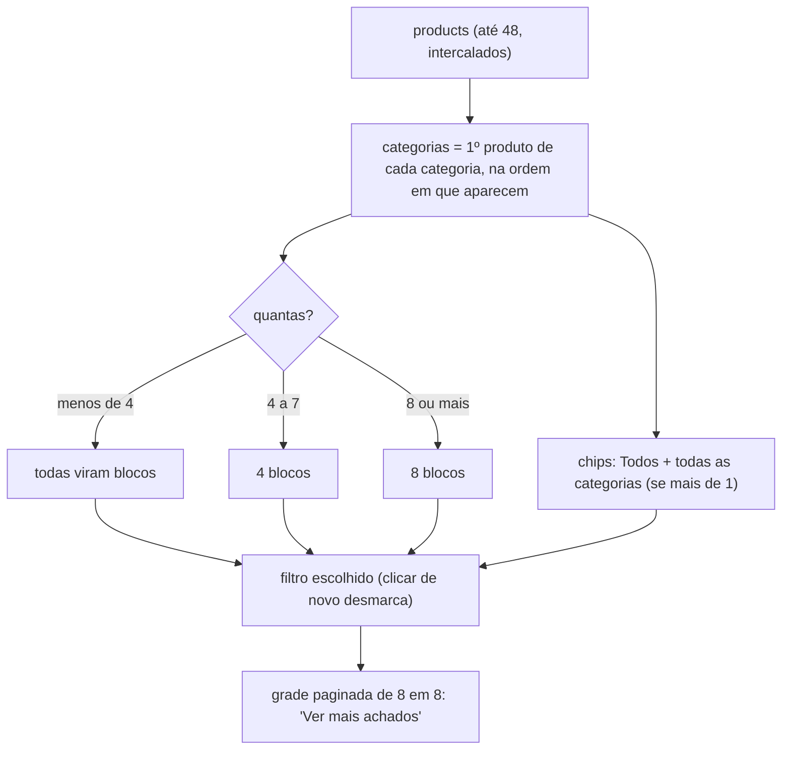
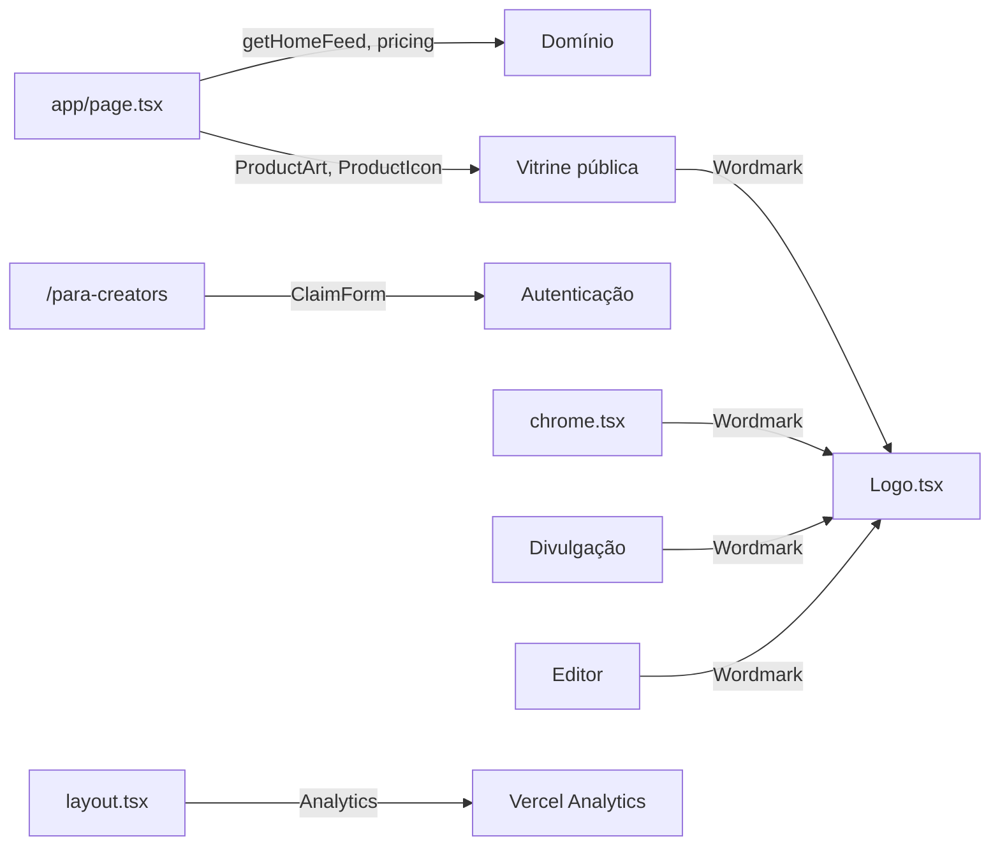

# Módulo: Home, landing de creators, páginas legais e marca

## Visão geral (sem jargão)

Este módulo reúne as **páginas "da casa"**, que não pertencem a nenhuma creator:

- **Home (`/`)** — a vitrine do shopping inteiro, voltada para **quem compra**: mostra creators, cupons que estão valendo, achados por categoria e as marcas mais indicadas. Tudo vem das vitrines publicadas mais recentes.
- **Para creators (`/para-creators`)** — a página de "venda" para quem **cria conteúdo**: explica o produto e tem o formulário "escolha seu link e entre com o Google".
- **Privacidade (`/privacidade`) e Termos (`/termos`)** — textos legais (LGPD), exigidos também pela verificação do login do Google.
- **Marca** — logotipo, ícone da aba, ícone do iPhone, nome e domínio públicos.

## Responsabilidades

- Descoberta: montar e exibir o feed da home a partir das vitrines publicadas.
- Aquisição: landing com o formulário de criação da vitrine.
- Conformidade: páginas de Privacidade e Termos.
- Identidade: layout raiz (fontes, metadata, analytics), tokens de estilo, logotipo e ícones.

## Estrutura de arquivos

| Arquivo | Papel |
|---|---|
| [`app/page.tsx`](../../app/page.tsx) | Home de descoberta (Server Component) |
| [`app/para-creators/page.tsx`](../../app/para-creators/page.tsx) | Landing para creators |
| [`app/privacidade/page.tsx`](../../app/privacidade/page.tsx) | Política de Privacidade (atualizada em "2 de novembro de 2026") |
| [`app/termos/page.tsx`](../../app/termos/page.tsx) | Termos de Uso (mesma data) |
| [`app/layout.tsx`](../../app/layout.tsx) | Layout raiz: `lang="pt-BR"`, fontes Inter e Barlow Condensed (`next/font/google`), metadata padrão, `<Analytics />` |
| [`app/globals.css`](../../app/globals.css) | Tailwind v4, tokens (`ink`, `paper`, `coral`, `mute`, `soft`, `line`, `sale`), utilitário `no-scrollbar` |
| [`app/icon.svg`](../../app/icon.svg) | Favicon (etiqueta coral com "v") |
| [`app/apple-icon.tsx`](../../app/apple-icon.tsx) | Ícone 180×180 para tela inicial do iOS, gerado com `ImageResponse` sobre fundo branco |
| [`components/home/chrome.tsx`](../../components/home/chrome.tsx) | `SiteHeader`, `SectionHead`, `SiteFooter`, classes `pad`, `pillDark`, `pillLight` |
| [`components/home/CategoryShop.tsx`](../../components/home/CategoryShop.tsx) | Bloco "Compre por categoria" (Client Component) |
| [`components/home/LegalPage.tsx`](../../components/home/LegalPage.tsx) | Moldura das páginas legais (`LegalPage`, `Section`) |
| [`components/brand/Logo.tsx`](../../components/brand/Logo.tsx) | `Wordmark` (logotipo SVG), `TagMark` (ícone), `WORDMARK_RATIO`, cores `INK`/`CORAL` |
| [`lib/brand.ts`](../../lib/brand.ts) | `BRAND = "MyVitri"`, `HOST = "myvitri.com"`, `CONTACT_EMAIL = "contato@myvitri.com"` |
| [`lib/vitrine/data.ts`](../../lib/vitrine/data.ts) | `getHomeFeed()` (ver [domínio](dominio.md#leitura-pública-cacheada-libvitrinedatats)) |

## Entidades

Só leitura de `vitrines`, `coupons` e `products` via `getHomeFeed()` → `listFeed()`. Kits não aparecem na home. Ver [database.md](../database.md).

## Rotas

| Rota | Handler | O que faz |
|---|---|---|
| `GET /` | `app/page.tsx:66` (`Home`) | Lê `getHomeFeed()`; se der erro, usa `EMPTY` e a home abre sem as seções de dados (`app/page.tsx:67-71`) |
| `GET /?code=…` | `proxy.ts:11-15` | Redireciona para `/auth/callback` (ver [autenticação](autenticacao.md)) |
| `GET /para-creators` | `app/para-creators/page.tsx:33` | Landing + `ClaimForm` (âncora `#criar`) |
| `GET /privacidade` | `app/privacidade/page.tsx:13` | Política de Privacidade |
| `GET /termos` | `app/termos/page.tsx:13` | Termos de Uso |
| `GET /icon.svg` | `app/icon.svg` | Favicon |
| `GET /apple-icon` | `app/apple-icon.tsx` | PNG 180×180 |

### Metadata

| Página | `title` | `description` |
|---|---|---|
| padrão (`layout.tsx:10-13`) | "MyVitri \| Sua vitrine de cupons"; template `"%s · MyVitri"` | "Junte todos os seus cupons e produtos favoritos em um link só. Feito para creators." |
| `/para-creators` | "Para creators" | "Monte sua vitrine com todos os seus cupons…" |
| `/privacidade` | "Política de Privacidade" | "Como o MyVitri coleta, usa e protege seus dados." |
| `/termos` | "Termos de Uso" | "As regras para usar o MyVitri." |

## Fluxos principais

### Seções da home (`app/page.tsx`)

| Seção | Aparece quando | Conteúdo | Para onde leva |
|---|---|---|---|
| Faixa | sempre | "Até {maior %}% OFF com os cupons de quem você segue." | `#cupons` ou, sem cupons, `/marinacosta` |
| `SiteHeader` | sempre | Logo; links Creators, Categorias, Para creators; botão "Minha vitrine" | `/editor` |
| Hero | sempre | "Indicado por gente. Não pelo algoritmo."; grade 2×2 com os 4 primeiros produtos do feed (ou ilustrações) e selo do cupom | "Explorar vitrines" (`#creators` ou `/marinacosta`), "Sou creator" (`/para-creators`) |
| Creators (`#creators`) | há creators | Até 8 `CreatorCard` (capa ou mosaico de 4 produtos, selo "Até X", avatar, nº de cupons) + card "Sua vitrine aqui" | `/{handle}` |
| Cupons ativos (`#cupons`) | há cupons | Até 8 cupons intercalados entre creators | `/{handle}#cupons` |
| Faixa preta | sempre | "O que é bom merece ser dividido" | `/para-creators` |
| Categoria (`#categorias`) | há produtos | `CategoryShop` (abaixo) | `/{handle}#produtos` |
| Marca (`#marcas`) | há marcas | Até 8 marcas com logo, "N creators indicam" e o melhor cupom | `/{handle}#cupons` da creator com o melhor cupom |
| `SiteFooter` | sempre | Links para compradores, creators (inclui "Vitrine de exemplo" `/marinacosta`), Privacidade, Termos | — |

### `CategoryShop`

Cada card mostra selo do cupom, nome, marca, preço final e riscado, e "Indicado por {creator}" (`CategoryShop.tsx:75-95`).

### Landing `/para-creators`

Faixa "Grátis para começar" (com link para a vitrine de exemplo) → cabeçalho → hero com ilustrações → título "Todos os seus cupons. Um link só." → **`ClaimForm`** → 3 recursos (cupons num link, preço com desconto, kits) → "Pronta em 2 minutos" (3 passos) → chamada final que rola até `#criar` → rodapé. O formulário e o login estão em [autenticacao.md](autenticacao.md#1-nova-creator-pela-landing).

### Páginas legais

`LegalPage` (`components/home/LegalPage.tsx:5-25`) dá título, data de atualização, introdução e rodapé; `Section` estiliza cada seção. Pontos de contato com o código:

| O texto promete | Onde está no código |
|---|---|
| Login Google só com `openid`, `email`, `profile` | `signInWithOAuth({ provider: "google" })` sem `scopes` extras (`app/actions.ts:28`) |
| Eventos sem IP nem identificador pessoal | `events` só tem `vitrine_id`, `kind`, `item_id`, `created_at` |
| Cookie temporário de até 10 min com o link escolhido | `vitri_claim`, `maxAge: 60 * 10` (`lib/vitrine/claim.ts:17`) |
| Registro na sessão do navegador para não contar visita duas vezes | `sessionStorage["vitri:visto:{handle}"]` (`Storefront.tsx:225`) |
| Exclusão pelo editor apaga conta, vitrine, itens, rascunho e métricas | `deleteAccountAction` + cascata |
| Brave Search sem dados pessoais | só URL/nome do produto vão para a Brave (`import-link.ts:231-251`) |
| UTM identifica a vitrine, nunca o visitante | `withUtm` (`links.ts:7-19`) |

### Marca

- `Wordmark` desenha "myvitri" em traço redondo com os pingos dos "i" em coral (`Logo.tsx:19-33`); é SVG puro para funcionar também dentro de `ImageResponse` (imagens de divulgação).
- `TagMark` é a etiqueta de preço coral com o "v" (favicon e ícone do app). O furo da etiqueta é recorte real (`fillRule="evenodd"`).
- `HOST` é usado em textos ("myvitri.com/seunome"), **não** para montar links reais — esses usam a origem da requisição.

## Integração com outros módulos

## Pegadinhas e dívidas técnicas

1. **Dependência da vitrine demo `/marinacosta`**: é o destino de "Ver uma vitrine", "Explorar vitrines" (sem creators) e do rodapé. Em banco novo ela não existe, porque o seed está quebrado (ver [database.md](../database.md#pegadinhas-e-dívidas-de-modelagem)).
2. **A home só olha as 24 vitrines publicadas mais recentemente** (`listFeed(…, 24)`). Não há ranking nem paginação; vitrines antigas e boas somem da home quando outras publicam.
3. **Marcas agrupadas só pelo nome em minúsculas** (`data.ts:83`): "Nike" e "Nike Brasil" viram marcas diferentes; o mesmo vale para categorias, que diferenciam maiúsculas ("Praia" ≠ "praia").
4. **Cache de horas** (`cacheLife("hours")`): cupom que vence ou começa pode demorar até ~1 h para sumir/aparecer na home.
5. **Privacidade x Vercel Analytics:** a política diz que não há ferramentas de rastreamento de terceiros, mas `<Analytics />` está no layout raiz (PR #6, posterior às páginas legais). Alinhar o texto.
6. **Datas das páginas legais são texto fixo** ("2 de novembro de 2026"); precisam ser atualizadas à mão a cada mudança.
7. **`public/` tem 5 SVGs do template** (`file.svg`, `globe.svg`, `next.svg`, `vercel.svg`, `window.svg`) que nada usa.
8. **`HOST` fixo**: em desenvolvimento e em previews, os textos continuam dizendo `myvitri.com/…`.
