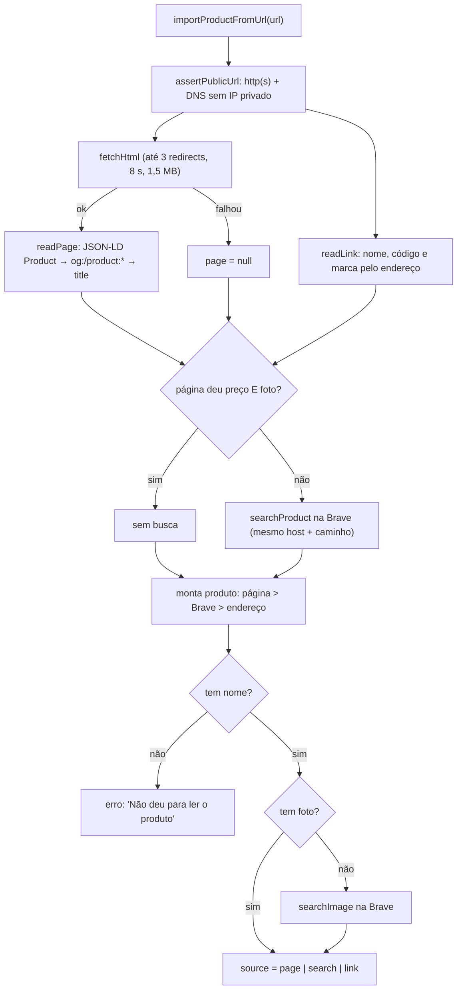
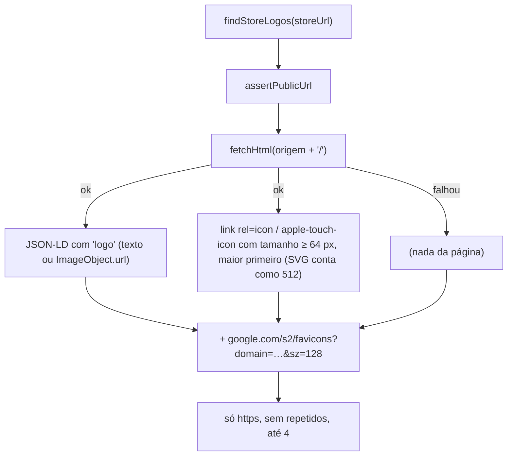
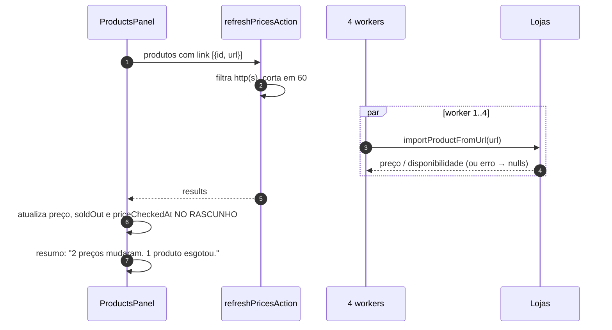
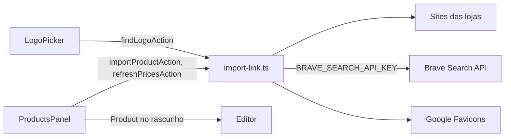

# Módulo: Importação por link (`lib/vitrine/import-link.ts`)

## Visão geral (sem jargão)

Cadastrar produto à mão é chato. Por isso a creator pode só **colar o link** de um produto (por exemplo, a página do tênis no site da Nike) e o MyVitri **lê a página** e preenche nome, marca, foto, preço e se está esgotado.

Funciona como um assistente que abre o link, procura a "etiqueta" que as lojas deixam para o Google (dados estruturados) e copia o que encontrar. Se a loja **bloquear robôs**, o assistente tenta duas saídas: perguntar ao buscador **Brave** o que ele sabe sobre aquela página e, em último caso, deduzir o nome pelo próprio endereço (`…/bola-de-futebol-society-094751.html` → "Bola de futebol society").

O mesmo assistente:

- **reconfere preço e estoque** de todos os produtos com link ("Conferir na loja");
- **procura o logo da marca** no site da loja quando a creator preenche o link da loja num cupom.

Tudo isso roda **no servidor** e com proteção para que ninguém use o recurso para acessar a rede interna (SSRF).

## Responsabilidades

- Baixar páginas públicas com segurança (sem IPs privados, com limite de tamanho, tempo e redirecionamentos).
- Extrair produto de JSON-LD, Open Graph, `<title>` e do próprio endereço.
- Fallback opcional via Brave Search API.
- Achar logos candidatos de uma loja.
- Reconferir preços em lote.

## Estrutura de arquivos

| Arquivo | Papel |
|---|---|
| [`lib/vitrine/import-link.ts`](../../lib/vitrine/import-link.ts) | Toda a lógica (`server-only`) |
| [`app/actions.ts`](../../app/actions.ts) | `importProductAction` (155), `findLogoAction` (166), `refreshPricesAction` (206) |
| [`components/editor/ProductsPanel.tsx`](../../components/editor/ProductsPanel.tsx) | UI de importar (1 ou vários) e "Conferir na loja" |
| [`components/editor/LogoPicker.tsx`](../../components/editor/LogoPicker.tsx) | UI que dispara a busca de logos |

### Funções internas

| Função | Linha | O que faz |
|---|---|---|
| `isPrivateAddress(ip)` | 20 | IPv4: `0/8`, `10/8`, `127/8`, `≥224`, `100.64/10`, `169.254/16`, `172.16/12`, `192.168/16`. IPv6: `::1`, `::`, `fc…`, `fd…`, `fe80…` e IPv4 mapeado (`::ffff:`) |
| `assertPublicUrl(raw)` | 37 | Só `http:`/`https:`; resolve o DNS (`lookup all`) e recusa se **algum** IP for privado |
| `fetchPublic(raw, {accept, maxBytes})` | 46 | `redirect: "manual"`, até 3 redirecionamentos (cada um revalidado), timeout 8 s, user-agent `Mozilla/5.0 (compatible; VitriBot/1.0)`, lê no máximo `maxBytes` |
| `fetchHtml(raw)` | 79 | `fetchPublic` com `accept: text/html` e 1,5 MB |
| `decode` / `meta` | 84 / 94 | Entidades HTML; lê `<meta property|name=… content=…>` nas duas ordens de atributo |
| `findLd(html, test)` | 106 | Percorre todos os `<script type="application/ld+json">`, inclusive arrays e `@graph`, e devolve o 1º nó que passa no teste |
| `findProductLd` | 126 | Nó com `@type` `Product` |
| `toCents(v)` | 135 | número ou string ("189,90") → centavos; `null` se ≤ 0 |
| `readAvailability(v)` | 141 | `OutOfStock`, `SoldOut`, `Discontinued`, `oos`, `unavailable` → `false`; `InStock`, `LimitedAvailability`, `PreOrder`, `OnlineOnly`, `available` → `true` |
| `readPage({html, url})` | 149 | Nome, marca, foto, preço, disponibilidade a partir de JSON-LD → OG/`product:*` → `<title>` |
| `readLink(url)` | 173 | Deduz nome (maior segmento do caminho), código numérico (≥ 4 dígitos) e marca (1º pedaço do domínio) |
| `brave(path, params)` | 207 | Chamada à Brave Search API; sem chave ou com erro → `null` (timeout 6 s) |
| `searchProduct(link, query)` | 231 | Busca web; só aceita resultado com `product` e **mesmo host e caminho** do link colado |
| `searchImage(query, host)` | 246 | Busca de imagens (`safesearch=strict`), preferindo o domínio da loja |
| `importProductFromUrl(raw)` | 253 | Orquestra tudo (fluxo abaixo) |
| `findStoreLogos(raw)` | 281 | Logos candidatos da loja (fluxo abaixo) |

## Entidades

Não persiste nada. Devolve `ImportedProduct` (`import-link.ts:5-15`):

| Campo | Tipo | Observação |
|---|---|---|
| `name` | string | até 80 |
| `brand` | string | até 60 |
| `imageUrl` | string | URL absoluta (externa) |
| `price` | number \| null | centavos |
| `available` | boolean \| null | `false` = esgotado; `null` = a página não diz |
| `url` | string | URL final, depois dos redirecionamentos |
| `source` | `"page"` \| `"search"` \| `"link"` | De onde vieram os dados |

O editor converte isso em `Product` (`fromImport`, `ProductsPanel.tsx:82-95`): `price ?? 0`, `soldOut = available === false`, `priceCheckedAt = agora` se veio preço, e tenta adivinhar o cupom.

## Rotas / ações

| Action | Linha | Login? | Entrada | Saída | Erro mostrado |
|---|---|---|---|---|---|
| `importProductAction(url)` | `app/actions.ts:155` | sim | URL | `{ ok, product }` | "Não conseguimos ler esse link. Preencha os dados à mão." |
| `findLogoAction(url)` | `app/actions.ts:166` | sim | URL da loja | `{ ok, logos: string[] }` (até 4) | "Não conseguimos abrir o site da loja. Confira o link." |
| `refreshPricesAction(items)` | `app/actions.ts:206` | sim | `{ id, url }[]` | `{ ok, results: { id, price, available }[] }` | Por item: `null`s quando falha |

`refreshPricesAction` filtra URLs `http(s)`, corta em **60** e processa com **4 workers** concorrentes dentro da mesma requisição.

## Fluxos principais

### Importar um produto

Prioridade de cada campo (`import-link.ts:261-268`):

| Campo | 1º | 2º | 3º |
|---|---|---|---|
| nome | página | Brave (web) | endereço |
| marca | página (JSON-LD `brand` ou `og:site_name`) | endereço (domínio) | — |
| foto | página | Brave (web) | Brave (imagens) |
| preço | página (JSON-LD `offers.price`/`lowPrice`, `product:price:amount`, `og:price:amount`) | Brave (web) | `null` |
| disponível | página | — | `null` |
| url | URL final da página | URL colada | — |

### Achar logos da loja

No editor, a busca é automática 700 ms depois de a creator parar de digitar o link da loja, **só se o cupom ainda não tiver logo**; a creator escolhe um dos círculos (nada é escolhido sozinho).

### Conferir preços

## Integração com outros módulos

## Pegadinhas e dívidas técnicas

1. **SSRF com janela de DNS rebinding:** `assertPublicUrl` resolve o DNS e depois o `fetch` resolve **de novo**. Um domínio malicioso pode responder IP público na checagem e privado na conexão. Mitigação típica: conectar no IP já validado (agente HTTP com `lookup` fixo).
2. **Lista de IPs privados incompleta:** faltam, por exemplo, `198.18.0.0/15`, `192.0.0.0/24`, `::` mapeados de outras formas e prefixos IPv6 como `64:ff9b::/96`. Baixo risco em ambiente serverless, mas vale revisar.
3. **Qualquer usuário logado pode usar o servidor como "robô"**: até 60 URLs por chamada de `refreshPricesAction`, sem limite de chamadas. Não há rate limit.
4. **HTML cortado em 1,5 MB:** páginas grandes com o JSON-LD no fim não são lidas por completo (`complete` é calculado mas não usado, `import-link.ts:63-74`).
5. **Decodificação sempre UTF-8** (`new TextDecoder()`); lojas em ISO-8859-1 geram acentos errados no nome.
6. **Preço lido pode ser o promocional** ou o de outra variação (`offers[0]`), e o "Conferir na loja" sobrescreve o preço cheio do produto com ele.
7. **Fotos e logos são *hotlink*:** o app guarda a URL da loja/Brave/Google, não a imagem. Podem quebrar ou ser bloqueadas por *hotlink protection*.
8. **Sem a chave da Brave**, lojas que bloqueiam robôs só rendem o nome deduzido do endereço — o editor mostra "precisa de nome ou preço à mão".
9. **`readLink` chuta a marca pelo domínio** (`nike.com.br` → "Nike", mas `loja.exemplo.com` → "Loja").
