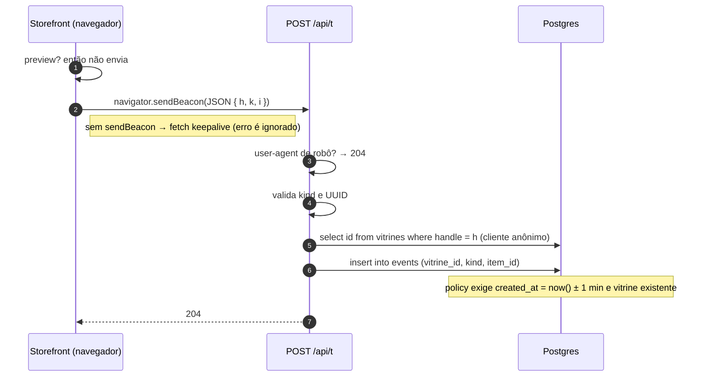
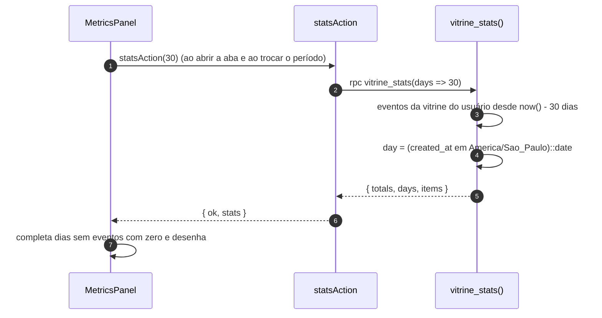
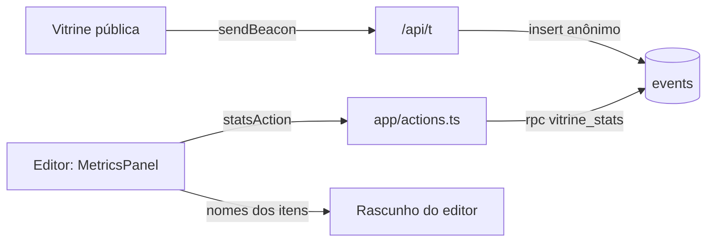

# Módulo: Métricas

## Visão geral (sem jargão)

A creator quer saber **se a vitrine está funcionando**: quantas pessoas abriram, quantas copiaram cupom, quais produtos chamam mais atenção. Para isso, a vitrine pública anota num **caderno anônimo** cada visita e cada clique importante — sem guardar nome, e-mail ou IP de ninguém, só "alguém clicou em comprar o produto X às 14h".

No editor, a aba **Métricas** transforma esse caderno em números e gráficos para os últimos 7, 30 ou 90 dias: visitas, cliques para a loja, cupons copiados, gráfico por dia, "funil" da visita até a loja e os itens mais clicados.

## Responsabilidades

- Registrar eventos da vitrine pública sem atrapalhar a compra (nunca falha visivelmente).
- Filtrar robôs óbvios e não contar a prévia do editor.
- Agregar os eventos por dia e por item (no banco) e exibir no editor.

## Estrutura de arquivos

| Arquivo | Papel |
|---|---|
| [`components/storefront/Storefront.tsx`](../../components/storefront/Storefront.tsx) | `track()` (linhas 48-57), `send()` (218-220), visita única por aba (222-233), eventos nos botões |
| [`app/api/t/route.ts`](../../app/api/t/route.ts) | `POST /api/t`: valida e grava em `events` |
| [`supabase/migrations/20261102000700_creator_tools.sql`](../../supabase/migrations/20261102000700_creator_tools.sql) | Tabela `events`, policies e função `vitrine_stats()` |
| [`app/actions.ts`](../../app/actions.ts) | Tipo `Stats` (204-208) e `statsAction(days)` (210-219) |
| [`components/editor/MetricsPanel.tsx`](../../components/editor/MetricsPanel.tsx) | Aba Métricas: blocos, gráfico diário, barras, tops |

## Entidades

Tabela `public.events` (`id`, `vitrine_id`, `kind`, `item_id`, `created_at`) — detalhes, índice e policies em [database.md](../database.md#publicevents).

| `kind` | Quando | `item_id` |
|---|---|---|
| `view` | Abrir a vitrine (1x por aba do navegador) | — |
| `buy` | Foto ou botão de compra do produto | produto |
| `copy` | Botão do cupom ("Copiar e ir para a loja"/"Copiar código") | cupom |
| `kit` | Botão de compra de um item do kit (o mesmo clique também grava `buy` do produto) | kit |
| `video` | "Ver meu review" | produto |

## Rotas / endpoints

| Rota / Action | Handler | O que faz |
|---|---|---|
| `POST /api/t` | `app/api/t/route.ts:11` | Corpo `{ h: handle, k: kind, i?: uuid }`. Ignora user-agents de robô (`bot\|crawl\|spider\|preview\|facebookexternalhit\|whatsapp\|slurp\|headless`), `kind` desconhecido e `i` que não é UUID (vira `null`). Busca o `id` da vitrine pelo handle e insere em `events`. **Sempre responde 204**, mesmo com erro. |
| `statsAction(days)` | `app/actions.ts:210` | Chama `rpc("vitrine_stats", { days })` com a sessão do usuário |
| RPC `vitrine_stats(days)` | migração `000700`, linhas 36-55 | Agrega os últimos `days` (1–90) da vitrine de `auth.uid()` |

## Fluxos principais

### Registrar um evento

### Ler as métricas

### O que a aba mostra (`MetricsPanel.tsx`)

| Bloco | Fórmula | Linhas |
|---|---|---|
| **Visitas** | `totals.view` | 200, 224 |
| **Cliques para a loja** | `buy + copy` (e "% de quem visitou") | 201, 225 |
| **Cupons copiados** | `copy + buy` ("nos cupons e nos produtos") | 202, 226 |
| **Kits e reviews** | `kit + video` | 227 |
| **Visitas e cliques por dia** | Linha azul = `views`; laranja = `clicks` (= todo evento que não é `view`). Eixo com teto "redondo" (`niceMax`: 4, 10, 20, 50…). Dica ao passar o mouse e tabela recolhível | 80-187 |
| **Da visita à loja** | Barras: visitas → cliques para a loja → cupons copiados, com % | 238-247 |
| **Onde clicam** | Barras: produtos (`buy`), cupons (`copy`), kits (`kit`), reviews (`video`) | 249-259 |
| **Mais clicados** | Top 5 de `buy`, `copy` e `kit` (este só se houver kits). Nomes vêm do **rascunho atual**; item apagado vira "Item removido" | 204-214, 261-275 |

Cores (`SERIES`, linha 16): visitas `#2A78D6`, cliques `#EB6834`.

## Integração com outros módulos

## Pegadinhas e dívidas técnicas

1. **"Cliques para a loja" e "Cupons copiados" são o mesmo número** (`buy + copy` e `copy + buy`, `MetricsPanel.tsx:201-202`). No funil, a 2ª e a 3ª barras são sempre iguais. Além disso, "Cupons copiados" conta compras de produtos **sem** cupom.
2. **Definições de "clique" diferentes:** no gráfico diário, `clicks` inclui `kit` e `video`; nos blocos, "Cliques para a loja" não inclui.
3. **Fuso:** os dias vêm em `America/Sao_Paulo`, mas o eixo do gráfico é montado a partir de `today` em UTC. Entre 21h e meia-noite (Brasília) o último ponto ("hoje") fica vazio e os eventos de hoje aparecem como "ontem".
4. **Janela móvel x dias de calendário:** o SQL pega `now() - N dias` (janela de 24h × N), enquanto o gráfico mostra N dias de calendário — o primeiro dia aparece parcial.
5. **Contagem de visitas é aproximada:** 1 por aba (`sessionStorage`); nova aba ou novo dispositivo conta de novo; não há deduplicação por pessoa.
6. **Inflar métricas é fácil:** o filtro de robôs é só por user-agent e a policy de `events` permite insert anônimo **direto na API do Supabase**, sem passar por `/api/t`. Não há rate limit.
7. **`/api/t` faz duas idas ao banco por evento** (busca o id pelo handle, depois insere) e engole erros (só `console.error("track", …)`).
8. **`events` cresce para sempre** e as estatísticas são calculadas na hora a cada abertura da aba (há índice por `vitrine_id, created_at desc`, mas não há agregação prévia).
9. **Cliques que não geram evento:** o nome da marca no cupom é link direto para a loja, sem `track`.
10. **Compra de item do kit conta duas vezes:** o botão grava `buy` (produto) e `kit` (kit); no gráfico diário, que soma os dois em `clicks`, um clique vira 2.
