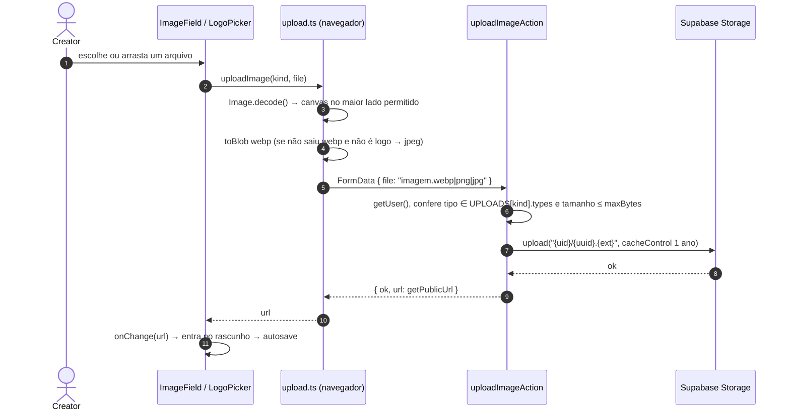
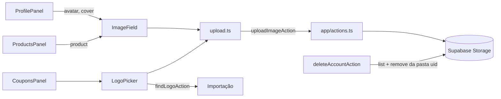

# Módulo: Uploads de imagem

## Visão geral (sem jargão)

A creator pode enviar **quatro tipos de imagem** do próprio celular ou computador:

- **foto de perfil** (o círculo ao lado do nome);
- **foto de capa** (a imagem grande no topo da vitrine);
- **foto do produto** (no lugar da foto puxada da loja, ou quando a importação não achou foto);
- **logo da marca** de cada cupom.

Antes de enviar, o **próprio navegador encolhe a foto** (como quando o WhatsApp comprime uma imagem) e converte para um formato leve. Isso deixa o envio rápido e a vitrine leve. As imagens ficam guardadas no **Supabase Storage**, cada pessoa na sua pasta, e qualquer um pode vê-las pelo link (são públicas, como fotos de um site).

Também dá para **colar o link** de uma imagem que já está na internet em vez de enviar, e, no caso do logo, **escolher um logo encontrado no site da loja**.

## Responsabilidades

- Reduzir e converter a imagem no navegador.
- Validar tipo e tamanho no servidor e gravar no bucket certo, na pasta do usuário.
- Devolver a URL pública para entrar no rascunho.
- Oferecer as alternativas (colar link, arrastar, logos sugeridos).

## Estrutura de arquivos

| Arquivo | Papel |
|---|---|
| [`components/editor/upload.ts`](../../components/editor/upload.ts) | `shrinkImage` (canvas), `uploadImage` (reduz + chama a action), `IMAGE_ACCEPT`, `MAX_SIDE` |
| [`components/editor/ImageField.tsx`](../../components/editor/ImageField.tsx) | Campo de capa (`kind="cover"`), de perfil (`kind="avatar"`) e do produto (`kind="product"`, usado no bloco Foto do `ProductsPanel`): enviar, arrastar, trocar, remover, colar link |
| [`components/editor/LogoPicker.tsx`](../../components/editor/LogoPicker.tsx) | Logo do cupom: opções achadas no site, enviar, colar link, remover |
| [`app/actions.ts`](../../app/actions.ts) | `UPLOADS` (linhas 177-182), `ImageKind` (183) e `uploadImageAction` (linhas 186-202) |
| [`supabase/migrations/20261103000000_brand_logos.sql`](../../supabase/migrations/20261103000000_brand_logos.sql) | Bucket `brand-logos` + policies |
| [`supabase/migrations/20261103000100_vitrine_photos.sql`](../../supabase/migrations/20261103000100_vitrine_photos.sql) | Bucket `vitrine-photos` + policies |

## Entidades

Arquivos em `storage.objects`, caminho `{uid}/{uuid}.{ext}`. A URL pública vai para `vitrines.avatar_url`, `vitrines.look.bannerUrl`, `products.image_url` ou `coupons.logo_url` (depois da publicação). Ver [database.md](../database.md#storage-arquivos).

| `kind` | Bucket | Maior lado | Formatos gerados | Limite na action | Limite no bucket |
|---|---|---|---|---|---|
| `logo` | `brand-logos` | 512 px | WebP (q 0,9) ou PNG (mantém transparência) | 1 MiB | 1 MiB, `image/webp`/`image/png` |
| `cover` | `vitrine-photos` | 1600 px | WebP (q 0,85) ou JPEG (q 0,85, fundo branco) | 2 MiB | 2 MiB, `image/webp`/`image/jpeg` |
| `avatar` | `vitrine-photos` | 512 px | WebP (q 0,85) ou JPEG (q 0,85, fundo branco) | 2 MiB | 2 MiB, `image/webp`/`image/jpeg` |
| `product` | `vitrine-photos` | 1000 px | WebP (q 0,85) ou JPEG (q 0,85, fundo branco) | 2 MiB | 2 MiB, `image/webp`/`image/jpeg` |

O maior lado de cada tipo está em `MAX_SIDE` (`upload.ts:4`): a capa ocupa a largura da vitrine, logo e perfil aparecem pequenos e o produto fica no meio. Foto de produto não ganhou bucket nem migração própria: reaproveita `vitrine-photos`.

O seletor de arquivo aceita `image/png, image/jpeg, image/webp, image/svg+xml, image/gif` (`upload.ts:44`) — SVG e GIF são rasterizados no canvas (GIF perde a animação; SVG sem `width`/`height` é desenhado no tamanho máximo).

## Rotas / ações

| Action | Linha | Entrada | Saída | Erros |
|---|---|---|---|---|
| `uploadImageAction(kind, form)` | `app/actions.ts:186` | `kind` + `FormData` com `file` | `{ ok: true, url }` | Sem sessão; tipo/tamanho inválido ("Use uma imagem PNG, JPG, SVG ou WebP."); falha no Storage ("Não deu para enviar a imagem. Tente de novo.") |

## Fluxo principal

A imagem fica pública na URL do bucket **assim que é enviada** (o caminho tem um UUID, então não é "adivinhável"); na vitrine ela só aparece depois de **Publicar**.

### Comportamentos de UI

| Componente | Comportamento | Linhas |
|---|---|---|
| `ImageField` capa | Área tracejada 3:1 para tocar ou arrastar; com imagem, botões "Trocar" e "Remover" sobre a foto | `ImageField.tsx:95-127` |
| `ImageField` perfil | Círculo com foto ou iniciais; "Enviar foto"/"Trocar foto" e "Remover" | `ImageField.tsx:128-155` |
| `ImageField` produto | Mesma linha do perfil, mas com quadrado creme de 80 px e cantos arredondados; a foto aparece inteira (`object-contain`) com `mix-blend-multiply`, como no card da vitrine; sem foto, ícone de upload | `ImageField.tsx:130-137` |
| Colar link | "Prefere colar o link da imagem?" abre um campo de URL (rótulo "Link da foto de capa/de perfil/do produto") | `ImageField.tsx:63`, `:168-171` |
| Imagem quebrada | `onError` marca e mostra "Essa imagem não abriu…" | `ImageField.tsx:89-91`, `:162-166` |
| `LogoPicker` | Círculos com o logo atual e os achados no site; "+" abre enviar/colar; × remove; busca automática 700 ms após digitar o link da loja (só sem logo) | `LogoPicker.tsx:43-47`, `:62-121` |

## Integração com outros módulos

## Pegadinhas e dívidas técnicas

1. **Limite de 1 MB das Server Actions.** O Next 16 recusa corpos acima de 1 MB por padrão e `next.config.ts` não aumenta `serverActions.bodySizeLimit`. Fotos de capa/perfil/produto entre ~1 MB e 2 MB (mais comuns quando o navegador cai no JPEG) nunca chegam ao código da action, apesar de `UPLOADS` e o bucket aceitarem 2 MiB. Ajustar `experimental.serverActions.bodySizeLimit` (com folga para o *multipart*) ou reduzir o alvo.
2. **Erro lançado deixa o campo travado:** `ImageField.send` e `LogoPicker.upload` fazem `setUploading(true)` → `await` → `setUploading(false)` sem `try/finally`. Se a action lançar (413 do item acima, rede, deploy novo), o botão fica em "Enviando…".
3. **Arquivos órfãos:** trocar ou remover uma imagem (inclusive remover um produto com foto enviada) não apaga o arquivo anterior. Só a exclusão de conta limpa a pasta (até 1000 arquivos por bucket).
4. **Tipo confiado ao cliente:** a action e o bucket conferem o `Content-Type` declarado, não o conteúdo do arquivo. Um usuário logado consegue guardar bytes arbitrários (até o limite) rotulados como imagem na própria pasta pública.
5. **Mensagem de erro cita SVG** ("Use uma imagem PNG, JPG, SVG ou WebP.") mas o servidor só aceita WebP/PNG/JPEG — o SVG funciona só porque o navegador converte antes.
6. **Logos escolhidos do site da loja e links colados não são copiados para o bucket**: continuam como URL externa (*hotlink*).
7. **Sem `next/image`**: as imagens são servidas no tamanho enviado, sem variações responsivas.
