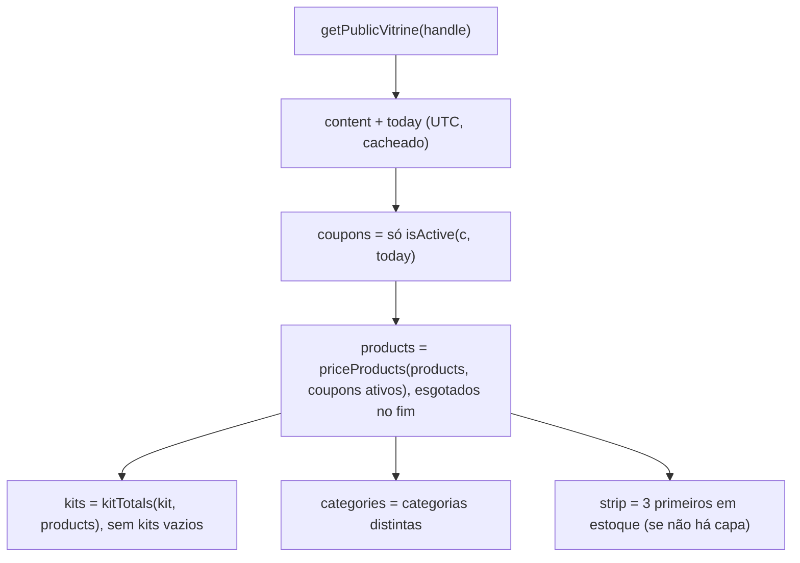
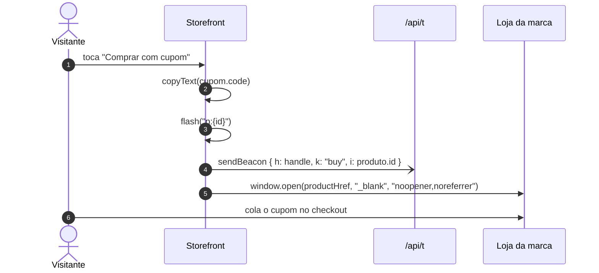
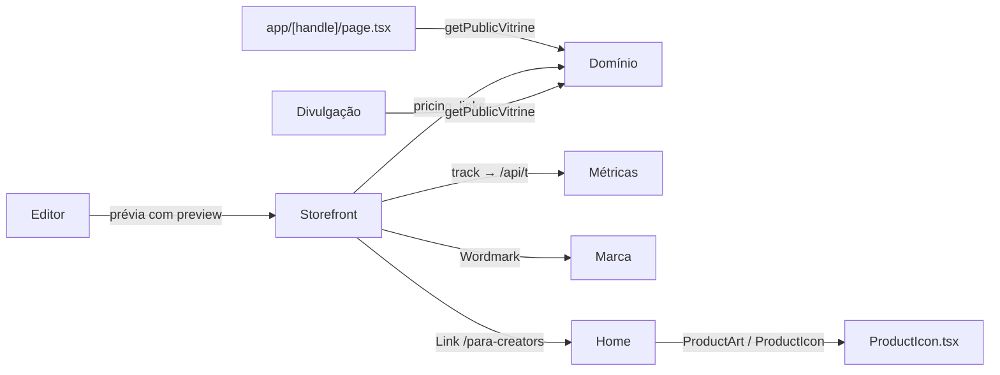

# Módulo: Vitrine pública (`/{handle}`)

## Visão geral (sem jargão)

É a página que o seguidor abre ao tocar no link da bio, por exemplo `myvitri.com/marinacosta`. Ela funciona como a **vitrine de uma loja de rua**, só que de uma pessoa:

- no topo, uma faixa com o maior desconto ("Até 15% OFF com os cupons de Marina");
- a foto de capa (ou, se não houver, as fotos dos primeiros produtos) e uma frase de destaque;
- os **cupons** num carrossel, cada um com o botão "Copiar e ir para a loja";
- os **produtos** numa grade, já com o preço calculado com o cupom e o preço cheio riscado;
- os **kits** (combos), com o total e quanto a pessoa economiza;
- um convite para outras creators criarem a própria vitrine.

O visual é **fixo** (branco, cinza claro, títulos em caixa alta) — a creator só escolhe o conteúdo e a capa. Cupons vencidos ou ainda não iniciados **somem sozinhos**.

## Responsabilidades

- Resolver o `handle` da URL para uma vitrine publicada (ou 404).
- Renderizar a vitrine com preços calculados apenas com cupons **ativos hoje**.
- Copiar códigos de cupom, abrir a loja com UTM/afiliado e registrar eventos anônimos.
- Gerar `<title>`/`description` da página (a imagem de prévia fica no módulo [divulgação](divulgacao.md)).
- Servir como **prévia** dentro do editor (modo `preview`).

## Estrutura de arquivos

| Arquivo | Papel |
|---|---|
| [`app/[handle]/page.tsx`](../../app/%5Bhandle%5D/page.tsx) | `generateMetadata`, `<Suspense>` e `VitrinePage` (busca e `notFound()`) |
| [`components/storefront/Storefront.tsx`](../../components/storefront/Storefront.tsx) | A vitrine inteira (Client Component): seções, carrossel, busca, filtros, kits, métricas |
| [`components/storefront/ProductIcon.tsx`](../../components/storefront/ProductIcon.tsx) | `ProductIcon` (8 ilustrações SVG), `ProductArt` (foto ou ilustração), `ICON_LABELS` |
| [`lib/vitrine/data.ts`](../../lib/vitrine/data.ts) | `getPublicVitrine(handle)` com `"use cache"` |
| [`lib/vitrine/pricing.ts`](../../lib/vitrine/pricing.ts), [`lib/vitrine/links.ts`](../../lib/vitrine/links.ts) | Preço com cupom, selos, validade, UTM |

## Entidades

Lê `vitrines`, `coupons`, `products` e `kits` (somente leitura, pela policy pública). Grava em `events` indiretamente via `/api/t`. Ver [database.md](../database.md).

## Rotas

| Rota | Handler | Nome | O que faz |
|---|---|---|---|
| `GET /{handle}` | `app/[handle]/page.tsx:25` | `Page` → `VitrinePage` | `decodeURIComponent(handle).toLowerCase()` → `getPublicVitrine` → `Storefront` ou `notFound()` |
| metadata | `app/[handle]/page.tsx:7` | `generateMetadata` | `title: "Vitrine de {name}"` (o layout acrescenta " · MyVitri"), `description: sub` ou texto padrão; sem vitrine: "Vitrine não encontrada" |
| `GET /{handle}/opengraph-image` | `app/[handle]/opengraph-image.tsx` | — | Ver [divulgacao.md](divulgacao.md) |
| `GET /{handle}/story` | `app/[handle]/story/route.ts` | — | Ver [divulgacao.md](divulgacao.md) |
| `POST /api/t` | `app/api/t/route.ts` | — | Chamado pela vitrine; ver [metricas.md](metricas.md) |

## Estrutura da página

| Seção | Aparece quando | Conteúdo | `Storefront.tsx` |
|---|---|---|---|
| Faixa de desconto | há cupom ativo | "Até {maior %}% OFF com os cupons de {primeiro nome}" (ou "Cupons de desconto de…" só com cupons fixos) + "Ver cupons" | 245-252 |
| Cabeçalho | sempre | Avatar (ou iniciais), nome, `@handle`, navegação para as seções que existem (escondida em contêiner estreito) | 254-271 |
| Capa | sempre | `look.bannerUrl` em 21:9 (4:3 no estreito); sem capa, até 3 fotos dos primeiros produtos **em estoque** | 273-287 |
| Destaque | sempre | `headline` sem `*` (marcação antiga) ou "A vitrine de {primeiro nome}"; `sub`; botões "Ver produtos"/"Ver cupons" | 288-305 |
| Cupons (`#cupons`) | há cupom ativo | Carrossel com setas (somem quando tudo cabe); card com logo, marca (link para a loja com UTM), validade, desconto, condição, "Como usar" (lista), código e botão | 308-365 |
| Produtos (`#produtos`) | há produto | Contagem; **busca** se houver mais de 8; **chips de categoria** se houver mais de 1; grade 2 ou 3 colunas; esgotados no fim | 367-438 |
| Kits (`#kits`) | há kit com ao menos 1 produto encontrado | Abas se houver mais de 1 (com troca automática); mosaico de fotos; título, descrição e assinatura; lista de itens com preço e botão de compra de cada item; total e economia. Layout em `grid-template-areas` (detalhes abaixo) | 485-613 |
| Chamada para creators | sempre | "Você também cria conteúdo?" → `/para-creators` | 549-557 |
| Rodapé | sempre | "Feito com MyVitri" + aviso de que preços podem mudar | 559-565 |

## Fluxos principais

### Montagem dos dados

Consequência importante: se o cupom vinculado a um produto **venceu**, o produto aparece com preço cheio e sem selo — o vínculo continua no banco.

### Interações do visitante

| Ação | O que acontece | Evento (`/api/t`) |
|---|---|---|
| Abrir a página | Registra 1 visita por aba (`sessionStorage["vitri:visto:{handle}"]`) | `view` |
| Cupom → "Copiar e ir para a loja" / "Copiar código" | Copia o código, mostra "Copiado!" por 2,5 s e abre `storeUrl` + UTM em nova aba (se houver) | `copy` (id do cupom) |
| Nome da marca no cupom | Link comum para `storeUrl` + UTM | — |
| Foto ou botão do produto ("Comprar com cupom"/"Ver na loja") | Copia o código do cupom (se houver), mostra "Cupom copiado!" e abre `productHref` (afiliado como veio, ou link + UTM) | `buy` (id do produto) |
| "Ver meu review" | Abre `videoUrl` | `video` (id do produto) |
| Botão de compra de um item do kit (`kitBuy`) | Igual ao botão do produto: copia o cupom do item (se houver) e abre `productHref` | `buy` (id do produto) **e** `kit` (id do kit) |
| Busca | Filtra por nome + marca + categoria, sem acento e sem diferenciar maiúsculas (`fold`) | — |

### Layout dos kits

Cada kit é uma grade com três áreas — **fotos** (mosaico `KIT_GRID`), **cabeçalho** (título, descrição, assinatura) e **corpo** (lista de itens e total) — organizadas com `grid-template-areas` conforme a largura do contêiner (`Storefront.tsx:541` no contêiner do kit, `:543` fotos, `:557` cabeçalho, `:569` corpo):

| Largura do contêiner | Arranjo | Miniatura de cada item na lista |
|---|---|---|
| Abaixo de `@3xl` (48rem) | Uma coluna: fotos, cabeçalho, lista | Aparece |
| De `@3xl` até `@min-[88rem]` | Cabeçalho em cima, na largura toda (`'head head'`); embaixo, fotos e lista lado a lado (`'photos body'`, colunas `1.1fr 1fr`) | **Some** (`@3xl:hidden`): repetiria a foto vizinha e espremeria o nome |
| A partir de `@min-[88rem]` | Fotos à esquerda ocupando as duas linhas; cabeçalho e lista à direita (`'photos head' 'photos body'`) | Volta (`@min-[88rem]:flex`) |

Ao lado das fotos, a lista estica até o fim delas (`self-stretch`) e o total desce (`mt-auto`) para alinhar com a última foto. O motivo de o título só ir para o lado em tela bem larga (comentário em `Storefront.tsx:554-556`): numa coluna estreita os nomes quebram e a lista passa muito do fim das fotos. Todos os kits ficam na mesma célula da grade externa, então a área tem a altura do maior e a página não pula na troca de kit.

### Modo prévia (`preview`)

Dentro do editor, `Storefront` recebe `preview` e: não registra visita nem cliques (`send` não chama `track`) e não abre lojas (`openStore` não é chamado). O editor ainda bloqueia cliques em links (ver [editor](editor.md#prévia)).

### Layout responsivo

O componente raiz tem `@container` (`Storefront.tsx:244`) e as variações usam *container queries* (`@3xl:`, `@max-2xl:`, `@max-md:`). Assim a mesma vitrine se adapta tanto à janela do visitante quanto à caixa de prévia do editor.

## Integração com outros módulos

## Pegadinhas e dívidas técnicas

1. **Metadados e página tratam o handle de forma diferente:** `generateMetadata` usa o `handle` cru (`page.tsx:8-9`), enquanto a página faz `decodeURIComponent(...).toLowerCase()` (`page.tsx:20`). Em `/MarinaCosta` a vitrine abre, mas o título é "Vitrine não encontrada".
2. **`window.open` sem checagem de protocolo** em `openStore` (`Storefront.tsx:43-45`). Hoje as URLs só entram validadas pelo Zod na publicação, mas a RLS permite escrita direta pela dona da vitrine (ver [domínio](dominio.md#pegadinhas-e-dívidas-técnicas)). Os `<a href>` são protegidos pelo React contra `javascript:`, o `window.open` não.
3. **Imagens externas sem fallback:** fotos de produto e logos são *hotlink* das lojas; se a loja bloquear ou mudar a URL, aparece imagem quebrada (não há `onError` na vitrine, ao contrário do editor).
4. **Produto com cupom e sem link**: o botão copia o código, não abre nada e mesmo assim conta como `buy`.
5. **Um clique no item do kit gera dois eventos** (`buy` e `kit`), o que conta em dobro no gráfico diário de cliques (ver [métricas](metricas.md#pegadinhas-e-dívidas-técnicas)).
6. **Validade dos cupons depende do cache e do UTC** (ver [arquitetura](../architecture.md#datas-e-fuso-horário)).
7. **Sem página 404 própria, sem `sitemap`/`robots`** e sem `canonical`: `/MarinaCosta` e `/marinacosta` são URLs distintas para buscadores.
8. **`show` é ignorado**: cada seção aparece só pelo conteúdo, apesar da coluna existir.
9. **Fallback do Suspense é uma tela branca** (`page.tsx:27`), sem esqueleto.
