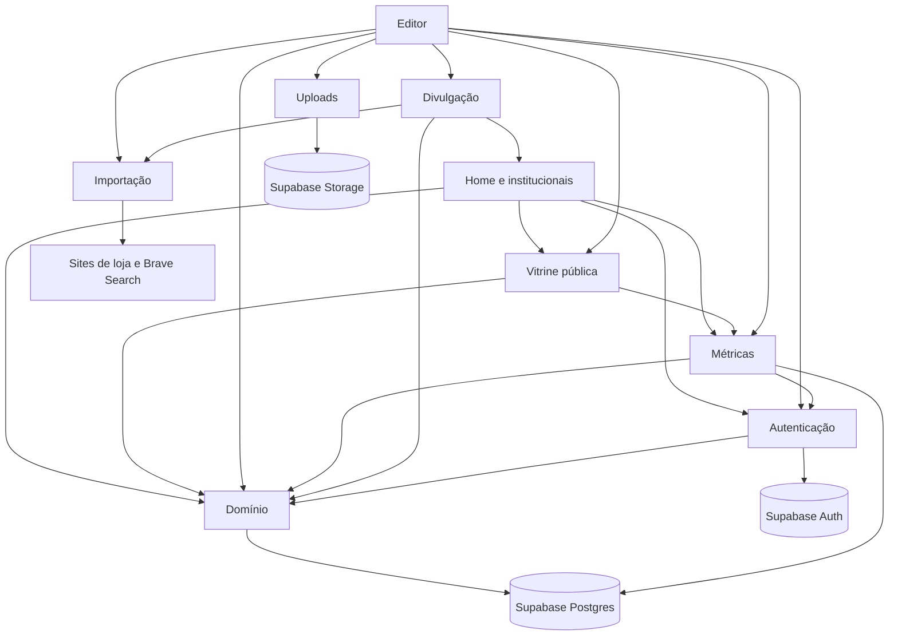
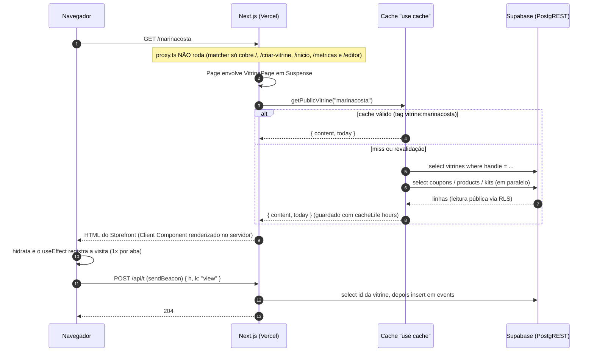
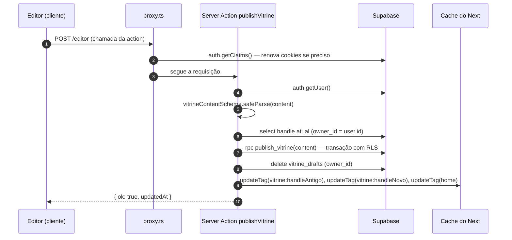
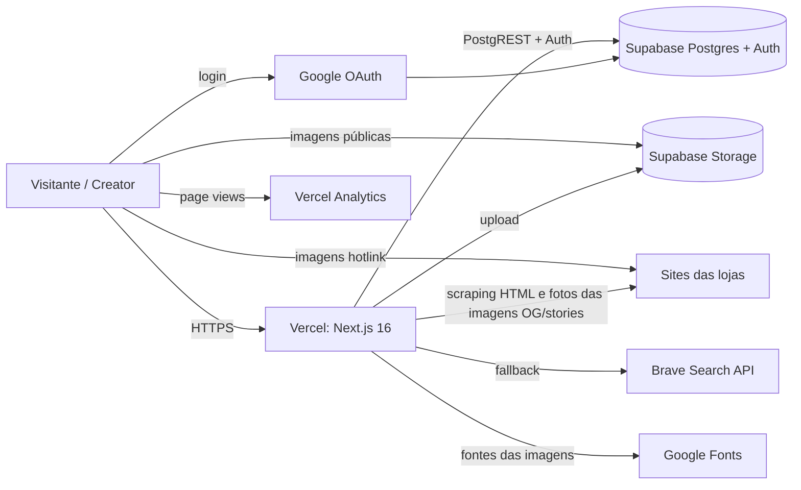

# Arquitetura

## Visão geral (sem jargão)

O **MyVitri** é um site onde **creators** (influenciadoras, criadores de conteúdo) montam uma **vitrine pública** com os **cupons de desconto** das marcas que divulgam, os **produtos** que indicam e **kits** (combos de produtos). A vitrine tem um endereço curto, tipo `myvitri.com/marinacosta`, feito para ir na bio do Instagram/TikTok.

Pense num **shopping**:

- A **landing** (`/`) é a fachada do shopping: mostra as vitrines de creators, os cupons ativos, as categorias e as marcas para quem compra, e convida quem divulga a criar a própria vitrine (botões **Criar vitrine** e **Criar conta**). Quem já entrou com a conta é levado direto para a **home logada** (`/inicio`), que mostra a busca de creators, marcas e produtos, os atalhos da própria vitrine (editar, ver, copiar o link) ou o convite para criar uma, e, logo abaixo, **abas** para explorar o catálogo inteiro: **Para você** (o bloco da própria vitrine e dois carrosséis, os **creators do dia**, vitrines com mais cliques hoje, e os **últimos kits** publicados), **Vitrines**, **Produtos**, **Kits** e **Marcas**, cada uma com filtros e ordem.
- Cada **vitrine** (`/{handle}`) é uma loja. O visitante vê os produtos com o preço já calculado com o cupom, copia o código e é levado para a loja oficial da marca. O MyVitri **não vende nada**: só aponta para a loja certa com o cupom certo.
- O **editor** (`/editor`) é o "estoque" da loja, onde a creator arruma tudo. Ela edita um **rascunho** (salvo sozinho a cada mudança) e, quando gosta do resultado, clica em **Publicar**.
- A creator ainda tem uma página de **métricas** (`/metricas`: quantas visitas e cliques a vitrine teve, o que mais funciona e o que precisa de atenção) e **ferramentas de divulgação** (link com cópia em um toque, passo a passo de onde colar, imagem para stories e prévia do link com a foto dela e dos produtos, UTM nos links).

O fluxo de uso é:

```mermaid
graph LR
    A["Creator abre /criar-vitrine (ou o fim da landing)"] --> B["Escolhe nome e link"]
    B --> C["Entra com Google"]
    C --> D["Editor: cadastra cupons, produtos, kits"]
    D --> E["Publica"]
    E --> F["Coloca myvitri.com/handle na bio"]
    F --> G["Seguidor abre a vitrine"]
    G --> H["Copia o cupom e vai à loja da marca"]
    H --> I["Evento anônimo vira métrica em /metricas"]
```

## Visão técnica

### Stack

| Camada | Tecnologia | Versão (package.json) | Observação |
|---|---|---|---|
| Framework | Next.js (App Router) | `16.4.4` | Com `cacheComponents`, `partialPrefetching` e `proxy.ts` (o antigo *middleware*). Leia `node_modules/next/dist/docs/` antes de mexer — APIs mudaram (ver `AGENTS.md`). |
| UI | React | `19.3.0` | Server Components + Client Components; `useActionState`, `useTransition` |
| Estilo | Tailwind CSS v4 | `^4` | Carregado pelo loader `@tailwindcss/turbopack` (`next.config.ts:14-21`), **sem** `postcss.config` |
| Validação | Zod | `^4.6.7` | Schemas em `lib/vitrine/types.ts` |
| Banco/Auth/Arquivos | Supabase (`@supabase/supabase-js`, `@supabase/ssr`) | `^2.118.0` / `^0.12.7` | Postgres + RLS, Auth com Google, Storage |
| Imagens (servidor) | `sharp` | `^0.35.5` | Reduz e compõe as fotos de perfil e de produto das imagens OG/stories (`lib/vitrine/share-image.tsx`). Dependência direta desde que o QR code (`qrcode`) saiu |
| Analytics | `@vercel/analytics` | `^2.0.1` | `<Analytics />` em `app/layout.tsx:20` |
| Linguagem | TypeScript strict | `^5` | Alias `@/*` → raiz (`tsconfig.json`) |

Não há testes automatizados, CI, Dockerfile nem filas/jobs no repositório.

### Estrutura de pastas

| Caminho | Papel |
|---|---|
| `app/` | Rotas do App Router (páginas, route handlers, imagens OG), `actions.ts` (todas as Server Actions), `layout.tsx`, `globals.css` |
| `components/auth/` | Formulários de login/criação de vitrine e `LoginButton` (modal de login) |
| `components/editor/` | Editor (painéis, campos, upload) — tudo Client Component |
| `components/metrics/` | Página de métricas: `MetricsView` (Server Component), `DailyChart` (gráfico, Client Component) e `stats.ts` (tipos da RPC, períodos, "hoje" em Brasília) |
| `components/storefront/` | A vitrine pública (`Storefront.tsx`) e as ilustrações de produto |
| `components/home/` | Peças da landing, da home logada e das páginas legais (cabeçalho/rodapé, `LookHero`, `Marquee`, `CopyLinkButton`, `HomeView` (conteúdo de `/inicio`), `CreatorCard`, `CreatorCover` e `Avatar`, `KitCard` e `KitMosaic`, `HomeSearch`) |
| `components/home/catalog/` | Base das abas do `/inicio`: `params.ts` (estado na URL) e `ui.tsx` (abas, chips, ordenação, moldura, "Ver mais", estado vazio) |
| `components/home/tabs/` | Uma aba por arquivo (`VitrinesTab`, `ProdutosTab`, `KitsTab`, `MarcasTab`) e, nas subpastas `vitrines/`, `produtos/`, `kits/` e `marcas/`, os cards e o painel de comparação de marca |
| `components/brand/` | Logotipo e ícone (SVG puro) |
| `lib/brand.ts` | Nome, domínio e e-mail de contato |
| `lib/supabase/` | Clientes Supabase do servidor e tipos gerados |
| `lib/vitrine/` | Domínio: tipos/schemas, preços, links/UTM, persistência, cache de leitura, importação por link, imagens de divulgação, cookie de "claim" |
| `lib/vitrine/catalog/` | Leitura (com `"use cache"`) e consulta dos catálogos das abas do `/inicio`: `vitrines.ts`, `products.ts`, `kits.ts`, `brands.ts` |
| `proxy.ts` | Proxy do Next (renova sessão, corrige retorno do OAuth, leva quem tem sessão de `/` para `/inicio`, leva o antigo `/editor?aba=metricas` para `/metricas`) |
| `supabase/` | Migrações SQL e seed |
| `public/` | `hero/`: imagens do `LookHero` em WebP (`retrato.webp` 2400×1792 e `blazer`, `bolsa`, `brincos`, `calca` 2048×2048, WebP qualidade 92 na resolução original, geradas por IA; o `next/image` gera e serve versões redimensionadas com `quality={90}`), mais os SVGs padrão do `create-next-app`, **não usados** |
| `.claude/launch.json` | Configuração de preview (`npm run dev`, porta 3000) para o Claude Code |

### Mapa dos módulos

O projeto não é dividido em "apps" como um monólito Django; os módulos abaixo são **fatias funcionais**.

| Módulo | Responsabilidade | Principais arquivos |
|---|---|---|
| Domínio | Tipos, schemas, preço com cupom, UTM, leitura/gravação no Supabase, cache de leitura pública. `store.ts` e `data.ts` exportam os conversores e helpers que os catálogos reaproveitam (`toCoupon`, `toProduct`, `toKit`, `rank`, `interleave`, `todayISO`, `live`, `groupBrands` e os tipos `Db`, `Fields`, `By`) | `lib/vitrine/{types,pricing,links,store,data}.ts` |
| Catálogo da home | Abas Vitrines, Produtos, Kits e Marcas de `/inicio`: leitura em cache, agrupamento, filtros e ordem lidos da URL | `lib/vitrine/catalog/*`, `components/home/catalog/*`, `components/home/tabs/*` |
| Autenticação | Login com Google, sessão, criação da vitrine, sair, excluir conta | `proxy.ts`, `app/auth/callback/route.ts`, `lib/supabase/server.ts`, `lib/vitrine/claim.ts`, `components/auth/forms.tsx` |
| Editor | Rascunho com autosave, painéis, prévia, publicação | `app/editor/page.tsx`, `components/editor/*` |
| Vitrine pública | Página `/{handle}` | `app/[handle]/page.tsx`, `components/storefront/*` |
| Landing, home logada e páginas institucionais | Landing para os dois públicos (`/`), home de quem entrou (`/inicio`), página de criação de vitrine, privacidade, termos, marca | `app/page.tsx`, `app/inicio/page.tsx`, `app/criar-vitrine/`, `app/privacidade/`, `app/termos/`, `components/home/*`, `components/brand/*` |
| Importação por link | Ler nome/foto/preço/estoque de páginas de loja; achar logos | `lib/vitrine/import-link.ts` |
| Uploads de imagem | Reduzir no navegador e enviar ao Storage | `components/editor/{upload.ts,ImageField.tsx,LogoPicker.tsx}` |
| Métricas | Registrar eventos anônimos (`/api/t`) e mostrá-los na página `/metricas` | `app/api/t/route.ts`, `app/metricas/page.tsx`, `components/metrics/*` |
| Divulgação | Imagem OG e de stories (com fotos), link, status de publicação, onde colar, UTM | `app/[handle]/opengraph-image.tsx`, `app/[handle]/story/route.ts`, `lib/vitrine/share-image.tsx`, `components/editor/SharePanel.tsx` |

### Dependências entre módulos

Leitura das setas: "usa". Exemplos concretos: o editor e a home logada têm links para `/metricas` (o bloco "Sua vitrine" tem **Ver métricas**; o topo do editor, **Métricas**); a página de métricas lê a vitrine de quem entrou (`findMine`) e reaproveita `CopyLinkButton` e o cabeçalho/rodapé da home; a home usa `ProductArt` da vitrine pública (`components/storefront/ProductIcon.tsx`) e o `SignupForm` da autenticação (em `/criar-vitrine`); o editor renderiza o próprio `Storefront` como prévia; a divulgação usa o `Wordmark` da marca (`components/brand/Logo.tsx`) e o `fetchPublic` da importação para baixar as fotos das imagens.

### Rotas

| Rota | Arquivo | Tipo | Renderização |
|---|---|---|---|
| `/` | `app/page.tsx` | Página | Landing: cabeçalho (`SiteHeader` com `action`: Vitrines, Categorias, Marcas, Cupons, **Entrar** (`LoginButton`, abre o login num modal) e **Criar conta** → `/criar-vitrine`), hero com altura mínima da primeira tela (`min-h-[calc(100svh-81px)]`, descontando o header) e `LookHero` (`components/home/LookHero.tsx`: foto editorial `public/hero/retrato.webp` via `next/image` com `priority` e `sizes` que consideram a foto deitada recortada num quadro em pé (aparece ~1,7× mais larga que o quadro), com quatro cards de produto sobrepostos — blazer, bolsa, brincos e pantalona — no estilo da vitrine (com animação no hover: o card sobe, cresce levemente, ganha sombra maior e passa para a frente, a foto do produto aproxima e o código do cupom destaca; desligada com `prefers-reduced-motion`): "Cupom -X%", nome, preço com desconto, preço cheio riscado e código; é ilustração estática com marcas e cupons fictícios na constante `LOOK`, sem links nem dados do banco; no celular aparecem só 2 cards) e botões **Criar vitrine** (`/criar-vitrine`) e **Explorar vitrines** (`#vitrines`, ou `#cupons` se não houver vitrines), `#vitrines` (grade de creators + card "Sua vitrine aqui"), bloco "Cada vitrine é uma pessoa", `#cupons`, `#categorias`, `#marcas`, o bloco de venda `CreatorPitch` (`#para-quem-divulga`, `components/home/CreatorPitch.tsx`: "Seu público pergunta. A vitrine responde.", "Feita para quem tem cupom de muita marca" (3 cards), "E ainda" (6 itens), "Pronta em 2 minutos", "Perguntas frequentes" (`FAQ`, 7 itens) e CTA "Seu link na bio, pronto hoje" → `/criar-vitrine`) e rodapé ("Para quem compra" e "Para quem divulga", esta com **Entrar** que também abre o modal). Renderiza dois JSON-LD: `siteJsonLd` e `appJsonLd(FAQ)` (WebApplication + FAQPage). Dados via `getHomeFeed()` (`"use cache"`, tag `home`); não lê cookies, então continua estática (quem tem sessão é redirecionado pelo proxy) |
| `/inicio` | `app/inicio/page.tsx` | Página | Home logada, sempre por requisição (`connection()` dentro de `<Suspense>`), `noindex` e `Disallow` no `robots.ts`. A página cuida da sessão (`findMine()`, `SignInPanel` sem sessão) e lê a aba da URL (`flatParams`, `tabOf`, de `components/home/catalog/params.ts`); todo o conteúdo de quem entrou está em `HomeView({ name, tab, params, forYou })` (`components/home/HomeView.tsx`). Só na aba **Para você** a página carrega os dados dos carrosséis (`loadCreators`, `getRecentKits`) e os passa em `forYou`; nas outras abas `forYou` é `null` e cada aba busca os próprios dados. Sem sessão: `SignInPanel`, o login em página cheia (`?erro=login` mostra o aviso); é para onde o callback volta, mas nenhum link do site leva a `/inicio` como forma de entrar (o **Entrar** abre o modal). Abre com a saudação (kicker "Sua home", "Olá, nome" em serifa grande e uma linha de apoio) e a busca `HomeSearch` bem separada logo abaixo; depois vêm as abas (`TabNav`, presa no topo ao rolar) e o conteúdo da aba atual, veja [Abas do `/inicio`](#abas-do-inicio). Cabeçalho sem links de navegação (com sessão o proxy redireciona `/` para `/inicio`, então âncoras da landing voltariam para a home), só o botão **Sair** (`signOutAction`). A busca (`components/home/HomeSearch.tsx`, Client Component) procura enquanto digita via `GET /api/busca`, com debounce de 250 ms e mínimo de 2 letras, Esc limpa o campo; botão "Limpar" no lugar do ✕ nativo do campo; os resultados abrem abaixo do campo em 1 a 3 colunas, conforme quantos grupos vieram (creators → `/{handle}`, marcas com o melhor cupom → `/{handle}#cupons`, produtos com o preço com cupom → `/{handle}#produtos`) |
| `/metricas` | `app/metricas/page.tsx` | Página | Métricas da vitrine de quem entrou, sempre por requisição (`connection()` dentro de `<Suspense>`), `noindex`, `Disallow` no `robots.ts` e no `matcher` do proxy. Sem sessão: `SignInPanel`. Com sessão e sem vitrine: `NoVitrine` (convite para criar). Com vitrine: `?periodo=7\|30\|90` (`parsePeriod`, padrão 30), `vitrine_stats(days)` e `topCreatorsToday(db, 50)` em paralelo, e `MetricsView`; veja [Página de métricas](#página-de-métricas) |
| `/criar-vitrine` | `app/criar-vitrine/page.tsx` | Página | Só a tela de criar conta, sem cabeçalho de navegação nem rodapé (apenas a marca, que volta para `/`). `SignupForm` (`components/auth/forms.tsx`): título "Crie sua vitrine", nome + link (hook `useClaim`, campos em `ClaimFields`), botão "Criar com Google" (`claimAction`), aceite dos termos e "Já tem conta? Entrar" (`LoginButton`, abre o modal; o parágrafo fica fora do `<form>` do cadastro). No desktop a metade direita (fundo areia) mostra `VitrinePreview`, prévia ao vivo com iniciais, nome e `myvitri.com/handle` conforme a pessoa digita, com cupons de exemplo; no celular só o formulário. FAQ e JSON-LD da aplicação ficam na landing |
| `/privacidade`, `/termos` | `app/privacidade/page.tsx`, `app/termos/page.tsx` | Páginas | Estáticas |
| `/editor` | `app/editor/page.tsx` | Página | Sempre por requisição (`connection()`); `?aba=` (`perfil`, `cupons`, `produtos`, `kits`, `divulgar`) e `?erro=login`. O antigo `?aba=metricas` não chega à página: o proxy redireciona para `/metricas` |
| `/{handle}` | `app/[handle]/page.tsx` | Página | `<Suspense>` + `getPublicVitrine()` (`"use cache"`, tag `vitrine:{handle}`). O cabeçalho do `Storefront` tem, à esquerda da foto da creator, o link de voltar `Link href="/"` (`aria-label` "Voltar para o início"): só a seta no celular, seta + "Início" em contêiner largo (`@2xl`). O destino é `/` de propósito: o proxy leva quem tem sessão para `/inicio`, e quem não tem fica na landing. Na prévia do editor (`preview`) é só um `` com a mesma aparência, para o clique não tirar a pessoa do editor. O logo no rodapé continua levando à home |
| `/{handle}/opengraph-image` | `app/[handle]/opengraph-image.tsx` | Imagem (convenção de metadata) | PNG 1200×630 |
| `/{handle}/story` | `app/[handle]/story/route.ts` | Route Handler `GET` | PNG 1080×1920 (perfil, produtos com foto, cupons) |
| `/api/t` | `app/api/t/route.ts` | Route Handler `POST` | Grava evento, sempre 204 |
| `/api/busca?q=` | `app/api/busca/route.ts` | Route Handler `GET` | Busca da home logada. Pública, sem sessão. Normaliza o termo (`trim`, minúsculas, até 60 caracteres), chama `searchHome()` e responde JSON `{ creators, brands, products }`; erro do banco vira `500` com `{ "error": "busca" }` (detalhe só no log). Depende da RPC `search_catalog` |
| `/auth/callback` | `app/auth/callback/route.ts` | Route Handler `GET` | Troca `code` por sessão. Destino padrão: `/inicio` (erros: `/inicio?erro=login`). Só vai para `/editor` quando o login veio do claim (`/criar-vitrine`) e a vitrine foi criada nesta chamada |
| `/icon.svg`, `/apple-icon` | `app/icon.svg`, `app/apple-icon.tsx` | Ícones (convenção de metadata) | Estáticos |

O topo do editor tem o link **Métricas** (`/metricas`), que pede confirmação se o rascunho ainda não terminou de salvar (a navegação é no cliente).

### Abas do `/inicio`

O que muda entre as abas está na URL (`/inicio?aba=produtos&cat=tenis&ordem=desconto&limite=48`), não em estado do cliente: o voltar do navegador funciona, o link pode ser compartilhado e cada troca é uma página montada de novo no servidor. As peças comuns ficam em `components/home/catalog/`:

| Peça | Arquivo | O que faz |
|---|---|---|
| `TABS`, `tabOf` | `params.ts` | As cinco abas e o parâmetro `?aba=para-voce\|vitrines\|produtos\|kits\|marcas`; a padrão (**Para você**) não aparece na URL |
| `flatParams` | `params.ts` | Achata a query em um valor por chave, só os não vazios (cada valor cortado em 80 caracteres) |
| `hrefWith(params, changes)` | `params.ts` | Monta o endereço com os parâmetros mudados (`null` tira a chave). Mudar filtro ou ordem zera `limite`; o link de aba (`TabNav`) parte de parâmetros vazios, então trocar de aba limpa os filtros |
| `PAGE`, `limitOf` | `params.ts` | 24 itens por "página"; `?limite=` cresce de 24 em 24, no máximo 10 páginas (240) |
| `TabNav` | `ui.tsx` | Abas presas no topo (`sticky top-0`) |
| `FilterChips`, `ToggleChip`, `SortLinks` | `ui.tsx` | Filtro de valor único (clicar no ativo tira o filtro; some com menos de 2 opções), filtro liga/desliga (`?param=1`) e ordenação em links (a primeira opção é a padrão e não vai para a URL) |
| `CatalogFrame`, `catalogGrid`, `CatalogEmpty`, `LoadMore`, `countLabel` | `ui.tsx` | Moldura (título, filtros, ordem, contador), grade de 2 a 4 colunas, estado vazio com "Limpar filtros", botão "Ver mais" e contador com plural |

Tudo em `ui.tsx` é `<Link scroll={false}>` renderizado no servidor, para a pessoa continuar onde estava.

| Aba (`?aba=`) | Componente | Dados | Filtros | Ordem (a primeira é a padrão) |
|---|---|---|---|---|
| **Para você** (`para-voce`) | `ForYouTab` em `HomeView.tsx` | `findMine()`, `getTopCreators()` (ou `getHomeFeed()` enquanto ninguém clicou), `getRecentKits()` | — | — |
| **Vitrines** (`vitrines`) | `tabs/VitrinesTab.tsx`, card `tabs/vitrines/VitrineCard.tsx` | `getVitrinesCatalog()` e `getTrendingHandles()` (`lib/vitrine/catalog/vitrines.ts`) | `cat`, `marca`, `kits=1` (com kits), `vencendo=1` (cupom vencendo) | `alta` (em alta hoje), `recentes`, `desconto`, `cupons` |
| **Produtos** (`produtos`) | `tabs/ProdutosTab.tsx`, card `tabs/produtos/ProductCard.tsx` | `queryProducts()` sobre `getProductCatalog()` (`catalog/products.ts`) | `cat`, `marca`, `preco` (`ate-100`, `100-300`, `300-mais`), `cupom=1`, `video=1` | `destaque`, `desconto`, `menor`, `maior` |
| **Kits** (`kits`) | `tabs/KitsTab.tsx`, card `tabs/kits/KitCatalogCard.tsx` (usa `KitMosaic` de `KitCard.tsx`) | `getKitCatalog()` e `queryKits()` (`catalog/kits.ts`) | `preco` (`ate-200`, `200-500`, `500-mais`), `cat`, `creator` (handle) | `recentes`, `economia`, `menor` |
| **Marcas** (`marcas`) | `tabs/MarcasTab.tsx`, `tabs/marcas/{BrandCard,BrandDetail}.tsx`, regras em `tabs/marcas/query.ts` | `getCatalogBrands()` (`catalog/brands.ts`) | `cat`, `vencendo=1`, `letra` (só com mais de 24 marcas), e `marca=<chave>` que abre o painel | `desconto`, `creators`, `vencendo`, `az` |

Como cada aba funciona:

- **Vitrines:** só entram vitrines com cupom ativo ou produto à venda. O card mostra capa (`CreatorCover`), `@handle` e categoria principal, as 3 primeiras marcas e `+N`, a contagem de produtos, cupons e kits (kit só conta se tiver produto à venda), o maior desconto ("Até X%"), um alerta "Cupom vence em N dias" quando algum cupom ativo vence em até 7 dias e o selo **Nova** para vitrines criadas há até 14 dias. As opções de categoria e marca são as 12 mais frequentes entre as vitrines (o filtro ativo continua na lista). Na ordem `alta`, a posição vem de `topCreatorsToday(db, 50)`, via `getTrendingHandles()`; quem não aparece no ranking fica depois, por `updated_at`. A leitura são quatro varreduras das tabelas inteiras (`vitrines`, `coupons`, `products`, `kits`), em páginas de 1000 linhas (até 20 páginas por tabela).
- **Produtos:** só produtos à venda (`sold_out = false`) com o preço já com o cupom ativo (`live` + `priceProducts`). A ordem "em destaque" intercala as vitrines (`interleave`), para uma creator não tomar o começo da grade. Produtos iguais entre vitrines (nome + marca sem acento, caixa e espaços repetidos) viram um só card, que fica com o de menor preço final (no empate, o que tem review em vídeo) e diz "Indicado por Fulana e mais N"; o card leva a `/{handle}#produtos`. As faixas de preço usam o preço final; produto sem preço vai para o fim nas ordens por preço e fica fora do filtro de preço. As opções de filtro vêm do catálogo inteiro (marcas: as 12 mais frequentes mais a escolhida) e os filtros rodam fora do cache. A leitura é paginada de 1000 em 1000, até 10 mil linhas por tabela.
- **Kits:** kits com algum produto à venda, com total, total com cupom e economia (`kitTotals`); o produto de outra vitrine nunca entra no kit. Ordem padrão pela `kits.published_at` mais recente. O card leva a `/{handle}#kits`. A leitura pega até 500 kits e busca produtos e cupons só pelos IDs usados (em lotes de 100 no `in(...)`).
- **Marcas:** marcas com ao menos um cupom ativo, agrupadas pelo nome sem espaços nas pontas e em minúsculas (chave `?marca=`). O card mostra o melhor cupom somando todas as vitrines (`Até X%` se houver mais de um), os rostos de quem oferece e a validade. Clicar abre o painel `BrandDetail` com todos os cupons ativos da marca, do melhor para o pior, logo abaixo da linha do card (posicionado pela propriedade CSS `order`, nos três tamanhos de grade; se a marca aberta está fora da lista, o painel vai para o topo). **O painel não expõe o código nem o link da loja** (`getCatalogBrands` os zera): "Pegar cupom" leva a `/{handle}#cupons`, onde a visita e a cópia contam para a creator. A categoria de uma marca vem dos produtos ligados a cupons dela ou com o mesmo nome de marca. Abrir ou fechar uma marca mantém o `limite`. A leitura usa até 2000 cupons e 5000 produtos.

Todas as leituras são `"use cache"` com a tag `home`; veja a tabela de [Renderização e cache](#renderização-e-cache).

### Página de métricas

`/metricas` mostra à creator o desempenho da vitrine **publicada** (a prévia do editor não conta), no visual da home. A página (`app/metricas/page.tsx`) só cuida da sessão e da leitura; `MetricsView` (`components/metrics/MetricsView.tsx`) recebe tudo pronto.

| Bloco | O que mostra | De onde vem |
|---|---|---|
| Período | Abas `7 dias`, `30 dias` (padrão) e `90 dias` (`?periodo=`) | `parsePeriod` (`components/metrics/stats.ts`) |
| Resumo | **Visitas** (`view`), **Cliques para a loja** (`buy` + `copy`, com a % de quem visitou), **Cupons copiados** (cópias de cupom + cliques em produto que tem cupom, porque o clique também copia o código) e **Kits e reviews** (`kit` + `video`). Cada número tem a variação contra os mesmos dias anteriores (↑ / ↓ com %, "= igual" ou "novo" quando antes era zero) | `totals` e `items` da RPC `vitrine_stats`; variação de `previous` |
| Dia a dia | Visitas e cliques por dia, duas linhas num eixo só, dias sem evento completados com zero | `days` da RPC; `DailyChart` (Client Component, SVG) |
| Funil e "Onde clicam" | Visitaram, clicaram para a loja, copiaram um cupom; e a divisão dos cliques entre produtos, cupons, kits e reviews em vídeo | `totals` |
| Rankings | Top 5 de produtos mais clicados, cupons mais copiados e kits mais usados, com foto/logo; item que saiu da vitrine aparece como "Item removido" | `items` cruzados com a vitrine publicada (`priceProducts`) |
| Sua posição hoje | Posição entre as 50 vitrines mais clicadas do dia e se aparece em "Creators do dia" (as 12 primeiras); some se o ranking não responder | `topCreatorsToday(db, 50)` (RPC `top_creators_today`) |
| Avisos | Cupons vencendo em até 7 dias, vencidos e agendados, e produtos esgotados, com link para o editor (`/editor?aba=cupons` ou `produtos`) | vitrine publicada (`couponStatus`, `daysLeft`) |

Estados: sem visitas nem cliques no período, o resumo aparece e o resto dá lugar a um convite para colocar o link na bio; se a RPC falhar, a página abre com um aviso no lugar dos números (`stats = null`). "Hoje" e o agrupamento por dia seguem `America/Sao_Paulo` (`todaySP()`). A variação depende do campo `previous` que a versão atual de `vitrine_stats` devolve (migração `20261105000000_metrics_previous.sql`, veja [database.md](database.md#funções-rpc)); sem a migração aplicada, `previous` não vem e a página funciona normalmente, só sem as variações.

### Server Actions (`app/actions.ts`)

Todas as mutações passam por Server Actions num único arquivo. Toda action que mexe em dados chama `getUser()` e devolve erro amigável sem sessão. As métricas não são uma action: a página `/metricas` chama a RPC `vitrine_stats` direto no servidor (`app/metricas/page.tsx:13`).

| Action | Linha | Precisa de login? | O que faz |
|---|---|---|---|
| `claimAction` | 47 | não | Landing: valida link/nome, guarda cookie e manda para o Google (ou cria direto se já logado) |
| `signInAction` | 64 | não | Inicia login Google a partir do editor |
| `createVitrineAction` | 69 | sim | Cria a vitrine para quem logou sem uma |
| `signOutAction` | 76 | — | Encerra a sessão e volta para `/` (botão **Sair** do editor e de `/inicio`) |
| `deleteAccountAction` | 86 | sim | Apaga arquivos, chama `delete_my_account()` e invalida caches |
| `publishVitrine` | 114 | sim | Valida com Zod, chama `publish_vitrine()`, apaga rascunho, invalida caches |
| `saveDraftAction` | 140 | sim | Autosave: grava ou apaga o rascunho |
| `importProductAction` | 155 | sim | Importa produto por link |
| `findLogoAction` | 166 | sim | Procura logos no site da loja |
| `uploadImageAction` | 186 | sim | Envia imagem (logo, capa, perfil ou produto) ao Storage |

> Server Actions são endpoints HTTP públicos (POST para a URL da página). A checagem de sessão dentro de cada uma é obrigatória; a RLS do banco é a segunda barreira.

### Fluxo de uma requisição: abrir uma vitrine

### Fluxo de uma mutação: publicar

### Renderização e cache

O `next.config.ts` liga quatro opções que mudam o comportamento padrão:

| Opção | Linha | Efeito no projeto |
|---|---|---|
| `cacheComponents: true` | `next.config.ts:8` | Ativa o modelo de *Cache Components*: dados só são cacheados quando marcados com `"use cache"`; o que depende da requisição precisa estar dentro de `<Suspense>`. Por isso `app/[handle]/page.tsx`, `app/editor/page.tsx`, `app/inicio/page.tsx` e `app/metricas/page.tsx` envolvem o conteúdo em `<Suspense>`. |
| `partialPrefetching: true` | `next.config.ts:13` | Um `<Link>` pré-carrega só a "casca" (App Shell) da rota de destino, reaproveitada por todos os links para ela. |
| `images.qualities: [75, 90]` | `next.config.ts:10` | No Next 16, `next/image` só aceita `quality` listada em `qualities`. 75 é o padrão; 90 é usada apenas nas imagens do `LookHero`. |
| `experimental.agentFeedback: true` | `next.config.ts:5-7` | Faz o `next dev` escrever/restaurar o bloco do `AGENTS.md` (instruções para agentes de IA). Não afeta produção. |

**Dados cacheados** (`lib/vitrine/data.ts`):

| Função | Tag | `cacheLife` | Invalidado por |
|---|---|---|---|
| `getPublicVitrine(handle)` | `vitrine:{handle}` (`vitrineTag`) | `hours` | `publishVitrine` (handle antigo e novo), `createAndOpen`, `deleteAccountAction` (via `updateTag`); `/auth/callback` (via `revalidateTag(tag, { expire: 0 })`, já que `updateTag` só funciona em Server Actions) |
| `getHomeFeed()` | `home` (`HOME_TAG`) | `hours` | `publishVitrine`, `deleteAccountAction` |
| `getTopCreators()` | `home` | `minutes` | `publishVitrine`, `deleteAccountAction`; o ranking muda a cada clique, então também expira sozinho em minutos |
| `getRecentKits()` | `home` | `hours` | `publishVitrine`, `deleteAccountAction` |
| `searchHome(q)` | `home` | `minutes` | `publishVitrine`, `deleteAccountAction`; o termo é argumento da função, então cada termo normalizado tem a própria entrada de cache |
| `getVitrinesCatalog()` (`lib/vitrine/catalog/vitrines.ts`) | `home` | `hours` | `publishVitrine`, `deleteAccountAction`; horas porque cupom vencido e o selo "Nova" mudam com o dia |
| `getTrendingHandles()` (`catalog/vitrines.ts`) | `home` | `minutes` | idem; o ranking do dia muda a cada clique |
| `getProductCatalog()` (`catalog/products.ts`) | `home` | `hours` | idem; guarda o catálogo inteiro e os filtros de `queryProducts` rodam fora do cache |
| `getKitCatalog()` (`catalog/kits.ts`) | `home` | `hours` | idem; `queryKits` filtra e ordena fora do cache |
| `getCatalogBrands()` (`catalog/brands.ts`) | `home` | `hours` | idem |

Os filtros, a ordem e o "Ver mais" das abas (`?cat=`, `?ordem=`, `?limite=` …) **não** entram na chave do cache: cada função de catálogo guarda uma entrada só e a aba filtra em memória a cada requisição.

`summarizeVitrine(v)` (`lib/vitrine/data.ts:126`) **não** é cacheada: resume a própria vitrine de quem entrou (lida com a sessão por `findMine()`) no formato `HomeCreator`, mesmo sem nada ativo, e alimenta o bloco "Sua vitrine" de `/inicio`. Ela, `getHomeFeed` e os catálogos compartilham o helper `live(v, today)` (exportado de `data.ts`: cupons ativos, melhor primeiro, e produtos à venda com o preço com cupom).

O perfil `hours` do Next 16 é: *stale* 5 min, revalidação 1 h, expiração 1 dia; o `minutes` é *stale* 5 min, revalidação 1 min, expiração 1 h. Isso também define **a precisão da validade dos cupons**: um cupom que vence hoje pode continuar aparecendo até a próxima revalidação, porque o `today` usado no filtro é calculado **dentro** da função cacheada (`lib/vitrine/data.ts:32`, `todayISO` em `lib/vitrine/data.ts:66`).

As leituras cacheadas usam `createPublicSupabase()` (`lib/supabase/server.ts:28`), um cliente **sem cookies** — obrigatório, porque o resultado do cache é compartilhado entre todos os visitantes.

O **editor** chama `await connection()` (`app/editor/page.tsx:13`) para nunca ser pré-renderizado: depende da sessão e da data de hoje. `/inicio` (`HomeLoader` em `app/inicio/page.tsx`) e `/metricas` (`MetricsLoader` em `app/metricas/page.tsx`) fazem o mesmo, pelo mesmo motivo (dependem da sessão; `/metricas` também do dia de hoje).

### Proxy (o antigo middleware)

`proxy.ts` roda **antes** das rotas do `matcher` (`/`, `/criar-vitrine`, `/inicio`, `/metricas`, `/editor` e subrotas):

1. **Corrige o retorno do OAuth** (`proxy.ts:13-17`): se o Supabase devolver o usuário para `/?code=…` (acontece quando o `redirectTo` não está na lista de Redirect URLs), redireciona para `/auth/callback` com a mesma query.
2. **Antiga aba de métricas do editor** (`proxy.ts:18-21`): `/editor?aba=metricas` (links e favoritos antigos) recebe um redirect `307` para `/metricas`, antes de qualquer leitura de sessão.
3. **Renova a sessão** (`proxy.ts:23-34`): cria um cliente Supabase ligado aos cookies da requisição/resposta e chama `auth.getClaims()`. Se o token estiver para expirar, os cookies novos vão na resposta. Server Components não conseguem gravar cookies (o `setAll` de `lib/supabase/server.ts:17-21` engole o erro de propósito), então é o proxy que mantém a sessão viva.
4. **Leva quem já entrou para a home logada** (`proxy.ts:35-40`): se a requisição é para `/` e `getClaims()` devolve claims, responde com redirect para `/inicio`, copiando para o redirect os cookies de sessão recém-renovados. Assim a landing não precisa ler cookies e segue estática.

A vitrine pública (`/{handle}`), as imagens, `/api/t` e `/api/busca` não passam pelo proxy — não precisam de sessão.

### Autenticação e autorização (resumo)

- Login **só com Google**, via Supabase Auth (`signInWithOAuth`), fluxo com `code` trocado em `/auth/callback`.
- Todo **Entrar** do site é o `LoginButton` (`components/auth/forms.tsx`): botão client que abre um `<dialog>` nativo num modal (renderizado por `createPortal` no `<body>`, só no navegador; Esc ou clique fora fecham; animação de entrada desligada com `prefers-reduced-motion`) com "Entrar na sua vitrine", "Entrar com Google" (`signInAction`, via `SignInForm`), aceite dos termos e "Ainda não tem conta? Criar conta" (→ `/criar-vitrine`). Aparece no header da landing, no `SiteHeader` padrão (sem `action`), no rodapé e em `/criar-vitrine`. O `SignInPanel` (login em página cheia de `/inicio`) reaproveita o mesmo `SignInForm`. Após o Google, o callback leva a `/inicio`.
- Três clientes Supabase no servidor (`lib/supabase/server.ts`): `createSupabase()` (com cookies, para actions e páginas dinâmicas), `createPublicSupabase()` (anônimo, para cache) e `getUser()` (atalho que devolve cliente + usuário).
- **Autorização é do banco**: RLS + `owns_vitrine()`. O app nunca usa chave de serviço. Detalhes em [database.md](database.md#políticas-rls-estado-final).

### Integrações externas

| Serviço | Para quê | Onde | Obrigatório? |
|---|---|---|---|
| Supabase Postgres (PostgREST) | Dados | `lib/vitrine/store.ts`, `lib/vitrine/catalog/*`, `app/api/t/route.ts`, `app/api/busca/route.ts` (via `searchHome`), `app/metricas/page.tsx` (RPC `vitrine_stats`), `app/actions.ts` | sim |
| Supabase Auth + Google OAuth | Login | `app/actions.ts:24-31`, `app/auth/callback/route.ts` | sim |
| Supabase Storage | Fotos (capa, perfil, produto) e logos enviados | `app/actions.ts:177-202` | sim (para upload) |
| Sites das lojas (HTTP) | Importar produto, achar logo e baixar as fotos das imagens de divulgação | `lib/vitrine/import-link.ts`, `lib/vitrine/share-image.tsx:33-56` | não (degrada para preenchimento manual; a imagem sai sem a foto) |
| Brave Search API | Fallback quando a loja bloqueia robôs | `lib/vitrine/import-link.ts:207-251` | não (`BRAVE_SEARCH_API_KEY`) |
| Google Favicons (`google.com/s2/favicons`) | Último recurso de logo | `lib/vitrine/import-link.ts:308` | não |
| Google Fonts (CSS API, em tempo de execução) | Fontes TTF das imagens OG/stories | `lib/vitrine/share-image.tsx:58-84` | não (cai na fonte padrão) |
| Google Fonts (via `next/font`, no build) | Inter e Barlow Condensed do site | `app/layout.tsx:6-8` | sim (no build) |
| Vercel Web Analytics | Page views | `app/layout.tsx:20` | não |

Imagens de produto e logos achados no site da loja são **hotlink** (URL externa exibida direto no ``); só o que a creator envia vai para o Storage. A exceção são as imagens OG/stories: ali o **servidor** baixa as fotos (perfil e produtos) a cada geração, com `fetchPublic` (proteção contra SSRF, 4 s por requisição) e `sharp`.

### Tarefas assíncronas, filas e "signals"

**Não há** filas, cron jobs, workers, webhooks nem triggers de banco. O que parece assíncrono é:

| Comportamento | Como funciona | Onde |
|---|---|---|
| Autosave do rascunho | Debounce de 800 ms no navegador → `saveDraftAction` | `components/editor/Editor.tsx:124-132` |
| Registro de métricas | `navigator.sendBeacon` (fallback `fetch keepalive`) → `/api/t` | `components/storefront/Storefront.tsx:65-76` |
| Busca automática de logo | Debounce de 700 ms no navegador | `components/editor/LogoPicker.tsx:43-47` |
| Cupom vencer/começar | Não há job: a data é comparada na leitura (`couponStatus`), limitada pela revalidação do cache | `lib/vitrine/pricing.ts:26-30` |
| Atualização da home | Revalidação do cache (`hours`; `minutes` para o ranking e a busca) ou `updateTag(home)` ao publicar | `lib/vitrine/data.ts:19`, `lib/vitrine/data.ts:104-120` |
| Busca da home logada | Debounce de 250 ms no navegador → `GET /api/busca` (a requisição anterior é abortada ao continuar digitando) | `components/home/HomeSearch.tsx:12-13` |

### Configuração por ambiente

Não há arquivos de configuração por ambiente; tudo vem de variáveis de ambiente (veja `.env.example`).

| Variável | Obrigatória | Lida em | Para quê |
|---|---|---|---|
| `NEXT_PUBLIC_SUPABASE_URL` | sim | `lib/supabase/server.ts:7`, `proxy.ts:24` | URL do projeto Supabase |
| `NEXT_PUBLIC_SUPABASE_PUBLISHABLE_KEY` | sim | `lib/supabase/server.ts:8`, `proxy.ts:24` | Chave publicável (`sb_publishable_…`) |
| `BRAVE_SEARCH_API_KEY` | não | `lib/vitrine/import-link.ts:208` | Fallback da importação por link |
| `TRACK_SALT` | não em dev (recomendada em produção) | ainda não lida no código | Reservada para o hash diário anônimo de visitante em `events.visitor`; `/api/t` ainda não preenche esse campo |
| `NODE_ENV` | automática | `lib/vitrine/claim.ts:16` | Cookie `vitri_claim` com `secure` só em produção |

| Aspecto | Desenvolvimento | Produção |
|---|---|---|
| Servidor | `npm run dev` (Turbopack) | `npm run build && npm start`, ou Vercel |
| Cookie de claim | sem `secure` | `secure` |
| `redirectTo` do OAuth | montado a partir do header `origin`/`host` da requisição (`app/actions.ts:26`) | idem — cada domínio precisa estar nas Redirect URLs do Supabase |
| Domínio exibido nos textos | sempre `myvitri.com` (constante `HOST`, `lib/brand.ts:3`) | idem |
| Links reais (Divulgar) | `window.location.origin` (`components/editor/SharePanel.tsx:10`) | idem |
| `AGENTS.md` | reescrito pelo `next dev` | — |

### Infraestrutura de produção

O repositório não descreve a infraestrutura explicitamente. Os indícios apontam para **Vercel + Supabase**: o pacote `@vercel/analytics`, o PR #6 vindo de uma branch com prefixo `vercel/` (`vercel/vercel-web-analytics-integrati…`, típico das integrações da Vercel), `.vercel` no `.gitignore` e o README padrão de deploy na Vercel.

- **Deploy do app:** presumivelmente pela integração Git da Vercel (push na `main` / PRs com preview). Não há `vercel.json`.
- **Deploy do banco:** manual, com `supabase db push`.
- **Segredos:** só no painel da Vercel e no Supabase. `.env*` está no `.gitignore` (exceto `.env.example`). Nenhum segredo versionado foi encontrado.

### Estilo e design

- Tokens de cor e fontes em `app/globals.css:3-15` (`ink`, `paper`, `coral`, `mute`, `soft`, `line`, `sale`; `font-condensed` = Barlow Condensed).
- Fonte em `input`, `select`, `textarea` e `button`: `app/globals.css:46-60` define `font-family: inherit` para esses elementos fora das camadas do Tailwind, então ela vence as classes `font-display`/`font-sans` aplicadas direto neles. Por isso a classe de fonte vai no elemento pai (ex.: o `div` em volta do campo da busca em `components/home/HomeSearch.tsx`) ou num `span` dentro do botão.
- A vitrine usa **container queries** (`@container`, `@3xl:`, `@max-2xl:` em `components/storefront/Storefront.tsx`) em vez de *media queries*. É isso que faz a prévia do editor alternar entre "Computador" e "Celular" só mudando a largura da caixa (`components/editor/Editor.tsx:297`).
- A raiz de `HomeView` (e de `MetricsView`) usa `overflow-x-clip`, não `overflow-hidden`: `hidden` faz da div a área de rolagem e a barra de abas (`position: sticky`) deixa de ficar presa no topo. Por isso também o espaço antes das abas é um irmão (`
`) e não um padding de um contêiner: o `sticky` só prende dentro do próprio pai.
- O visual da vitrine é **fixo**; a creator só escolhe a capa. Temas/cores antigos ficaram no banco como legado.

### Datas e fuso horário

- Datas de cupom são strings `AAAA-MM-DD` comparadas como texto (`lib/vitrine/pricing.ts:26-30`).
- "Hoje" é calculado em **UTC** no servidor: `new Date().toISOString().slice(0, 10)` em `lib/vitrine/data.ts:32`, no helper `todayISO` (`lib/vitrine/data.ts:66`, usado por `getHomeFeed`, `getTopCreators`, `getRecentKits` e `searchHome`) e em `app/editor/page.tsx:24`; os catálogos de `lib/vitrine/catalog/` também usam `todayISO`. O ranking `top_creators_today` usa o dia de `America/Sao_Paulo` no banco.
- As métricas agrupam por dia em **`America/Sao_Paulo`** (`supabase/migrations/20261102000700_creator_tools.sql:39`), e a página `/metricas` calcula o "hoje" no mesmo fuso com `todaySP()` (`components/metrics/stats.ts`), para o gráfico bater com os dias da RPC.

### Convenções de código

- Comentários, mensagens e nomes de domínio em **português**; identificadores em inglês/português misto (`vitrine`, `handle`, `coupon`).
- `import "server-only"` em todo módulo que só pode rodar no servidor (`lib/supabase/server.ts`, `lib/vitrine/store.ts`, `data.ts`, `claim.ts`, `import-link.ts`, `share-image.tsx`, `catalog/*`).
- **Dinheiro em centavos** (`int`); formatação com `formatBRL` (`lib/vitrine/pricing.ts:5`).
- Erros para o usuário são **strings prontas em PT-BR** devolvidas pelas actions (`{ ok: false, error }`), nunca exceções.
- Nada de `next/image`: imagens são `` com `eslint-disable` explicando que a URL é arbitrária.

