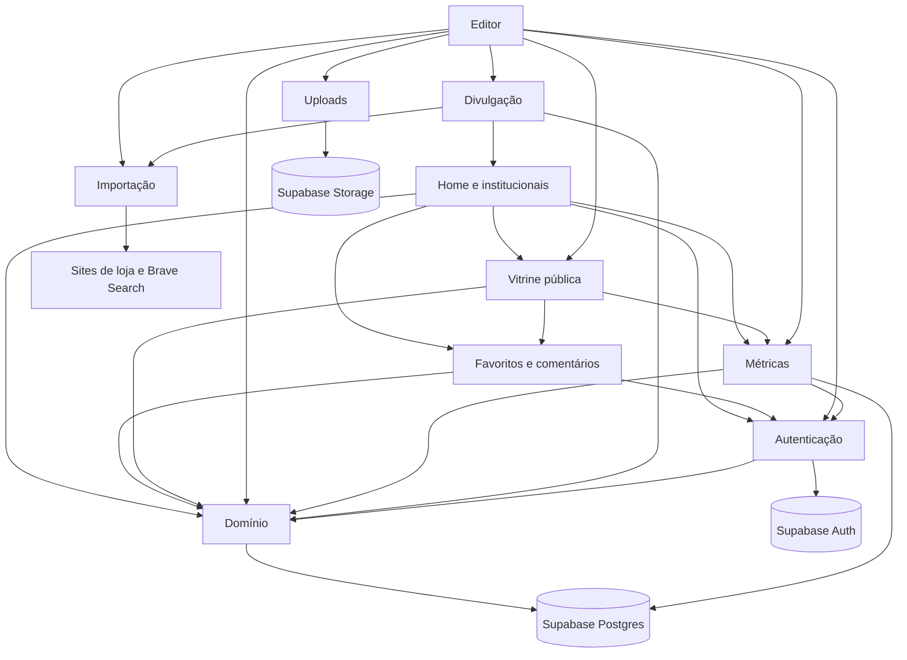
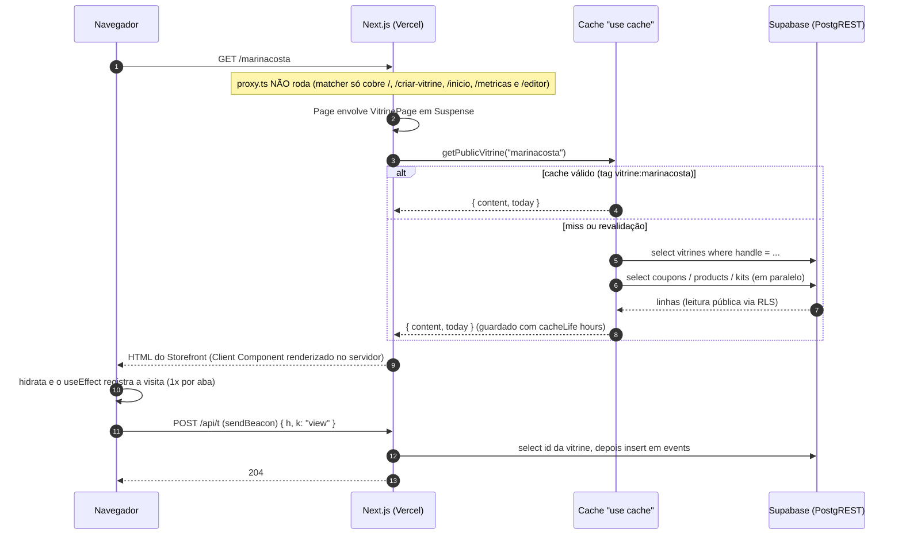
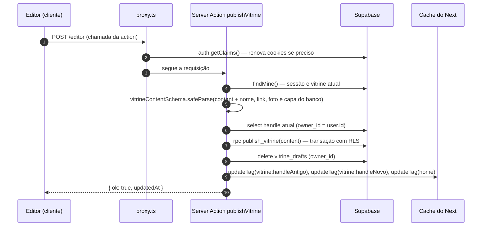
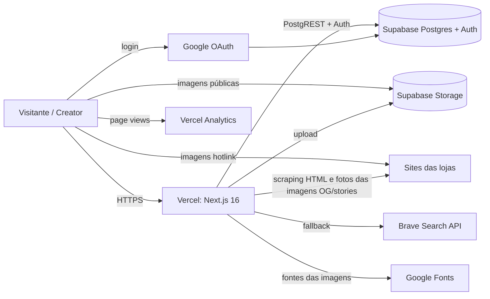

# Arquitetura

## Visão geral (sem jargão)

O **MyVitri** é um site onde **creators** (influenciadoras, criadores de conteúdo) montam uma **vitrine pública** com os **cupons de desconto** das marcas que divulgam, os **produtos** que indicam e **kits** (combos de produtos). A vitrine tem um endereço curto, tipo `myvitri.com/marinacosta`, feito para ir na bio do Instagram/TikTok.

Pense num **shopping**:

- A **landing** (`/`) é a fachada do shopping: mostra as vitrines de creators, os cupons ativos, as categorias e as marcas para quem compra, e convida quem divulga a criar a própria vitrine (botões **Criar vitrine** e **Criar conta**). Quem já entrou com a conta é levado direto para a **home** (`/inicio`), que só abre com login: quem não entrou e tenta abri-la volta para a landing. Ela mostra a busca de vitrines, marcas e produtos, os atalhos da própria vitrine (editar, ver, copiar o link) ou o convite para criar uma, e, logo abaixo, **abas** para explorar o catálogo inteiro: **Para você** (o bloco da própria vitrine e dois carrosséis, as **vitrines do dia**, vitrines com mais cliques hoje, e os **últimos kits** publicados), **Vitrines**, **Produtos**, **Kits** e **Marcas**, cada uma com filtros e ordem.
- Cada **vitrine** (`/{handle}`) é uma loja. O visitante copia os cupons das marcas (seção Cupons) e vê os produtos como foto e nome: tocar num produto abre em nova aba o link que a creator colou (`productHref`, sem UTM). Produto não tem preço nem cupom próprio. O MyVitri **não vende nada**: só aponta para a loja certa.
- O **editor** (`/editor`) é o "estoque" da loja, onde a creator arruma tudo. Ela edita um **rascunho** (salvo sozinho a cada mudança) e, quando gosta do resultado, clica em **Publicar**.
- A creator ainda tem uma página de **métricas** (`/metricas`: quantas visitas e cliques a vitrine teve, o que mais funciona e o que precisa de atenção) e **ferramentas de divulgação** (link com cópia em um toque, passo a passo de onde colar, imagem para stories e prévia do link com a foto dela e dos produtos, UTM nos links de loja dos cupons).

O fluxo de uso é:

```mermaid
graph LR
    A["Creator abre /criar-vitrine (ou o fim da landing)"] --> B["Escolhe nome e link"]
    B --> C["Entra com e-mail e senha ou Google"]
    C --> D["Editor: cadastra cupons, produtos, kits"]
    D --> E["Publica"]
    E --> F["Coloca myvitri.com/handle na bio"]
    F --> G["Seguidor abre a vitrine"]
    G --> H["Copia o cupom da marca ou abre o produto na loja"]
    H --> I["Evento anônimo vira métrica em /metricas"]
```

## Visão técnica

### Stack

| Camada | Tecnologia | Versão (package.json) | Observação |
|---|---|---|---|
| Framework | Next.js (App Router) | `16.4.4` | Com `cacheComponents`, `partialPrefetching` e `proxy.ts` (o antigo *middleware*). Leia `node_modules/next/dist/docs/` antes de mexer — APIs mudaram (ver `AGENTS.md`). |
| UI | React | `19.3.0` | Server Components + Client Components; `useActionState`, `useTransition` |
| Estilo | Tailwind CSS v4 | `^4` | Carregado pelo loader `@tailwindcss/turbopack` (`next.config.ts:14-21`), **sem** `postcss.config` |
| Validação | Zod | `^4.6.7` | Schemas em `lib/vitrine/types.ts` |
| Banco/Auth/Arquivos | Supabase (`@supabase/supabase-js`, `@supabase/ssr`) | `^2.118.0` / `^0.12.7` | Postgres + RLS, Auth (e-mail e senha e Google), Storage |
| Imagens (servidor) | `sharp` | `^0.35.5` | Reduz e compõe as fotos de perfil e de produto das imagens OG/stories (`lib/vitrine/share-image.tsx`). Dependência direta desde que o QR code (`qrcode`) saiu |
| Analytics | `@vercel/analytics` | `^2.0.1` | `<Analytics />` em `app/layout.tsx:20` |
| Linguagem | TypeScript strict | `^5` | Alias `@/*` → raiz (`tsconfig.json`) |

Não há testes automatizados, CI, Dockerfile nem filas/jobs no repositório.

### Estrutura de pastas

| Caminho | Papel |
|---|---|
| `app/` | Rotas do App Router (páginas, route handlers, imagens OG), `actions.ts` (todas as Server Actions), `layout.tsx`, `globals.css` |
| `components/auth/` | Telas de acesso (`AuthShell`, `SignInScreen`, `NewPasswordScreen`), `AuthPhoto` (Server Component, painel direito único de `/entrar`, `/criar-vitrine` e `/nova-senha`, só em md+: só a foto da arara `create_account/capa.webp`, sem logotipo sobre ela; decorativo, `aria-hidden`), `SignupForm` (criação de vitrine) e `LoginButton` (leva a `/entrar`) |
| `components/editor/` | Editor (painéis, campos, upload) — tudo Client Component |
| `components/metrics/` | Página de métricas: `MetricsView` (Server Component), `DailyChart` (gráfico, Client Component) e `stats.ts` (tipos da RPC, períodos, "hoje" em Brasília) |
| `components/storefront/` | A vitrine pública (`Storefront.tsx`), o coração `FavoriteButton`, a seção `Comments` e as ilustrações de produto |
| `components/home/` | Peças da landing, da home logada e das páginas legais (cabeçalho/rodapé e `SectionHead`, o cabeçalho de seção centrado: rótulo, `title` (string) e texto curto), `LookHero` (`LookHero.tsx`, a foto do hero), `Marquee` (a cópia da lista fica `aria-hidden` e com `tabindex="-1"` em `a, button`, mas sem `inert`, para que o clique funcione na parte dela que aparece na borda), `CopyLinkButton` (e `VitrineLinkBar`, a barra com o endereço da vitrine e o botão Copiar, ambos sobre o hook interno `useCopyLink`), `HomeView` (conteúdo de `/inicio`), `AccountMenu` (menu de conta e modal de configurações de `/inicio` e do editor, com prop opcional `onLeave`, que roda em Sair e nos links de Termos e Privacidade e pode cancelar com `preventDefault`, com o `ProfileBlock`: nome, link e foto de perfil, salvos por `updateProfileAction`), `CoverPicker` (enviar, trocar e remover a capa, por `updateCoverAction`), `CreatorCard` (card da home logada, com `favorited` obrigatório), `CreatorCover` (capa, usada na home e na aba Vitrines), `CoverLetter` (a capa de quem não enviou foto: a primeira letra do nome, também usada em `CreatorMosaic` e `Storefront`) e `Avatar`, `CreatorMosaic` (mosaico de vitrines da landing), `KitCard` e `KitMosaic`, `HomeSearch`) |
| `components/home/catalog/` | Base das abas do `/inicio`: `params.ts` (estado na URL) e `FilterMenu.tsx` (menu de filtro/ordenação, Client Component) e `ui.tsx` (abas, menus de filtro, ordenação, moldura, "Ver mais", estado vazio) |
| `components/home/tabs/` | Uma aba por arquivo (`FavoritasTab`, `VitrinesTab`, `ProdutosTab`, `KitsTab`, `MarcasTab`) e, nas subpastas `vitrines/`, `produtos/`, `kits/` e `marcas/`, os cards e o painel de comparação de marca |
| `components/brand/` | Logotipo e ícone (SVG puro) e `BackLink`, o voltar único do app (veja [O voltar do app](#o-voltar-do-app)) |
| `lib/brand.ts` | Nome, domínio e e-mail de contato |
| `lib/supabase/` | Clientes Supabase do servidor e tipos gerados |
| `lib/vitrine/` | Domínio: tipos/schemas, `account.ts` (`accountOf`, monta o `Account` do menu da conta), cupom e dinheiro (`pricing.ts`), links (UTM da loja dos cupons, link do produto), persistência, cache de leitura, importação por link, imagens de divulgação, cookie de "claim", tipos de favoritos e comentários e o helper `reachServer` (`social.ts`) |
| `lib/auth/` | `return-to.ts`: cookie `vitri_return` com a página para onde voltar depois do login (`safePath`, `saveReturn(path, maxAge)`, `takeReturn`); `password.ts`: `PASSWORD_MIN = 8`, o tamanho mínimo da senha; `account.ts`: `DELETE_WORD = "excluir"`, a palavra de confirmação de quem exclui a conta sem ter vitrine |
| `lib/vitrine/catalog/` | Leitura (com `"use cache"`) e consulta dos catálogos das abas do `/inicio`: `vitrines.ts`, `products.ts`, `kits.ts`, `brands.ts` |
| `proxy.ts` | Proxy do Next (renova sessão, corrige retorno do OAuth, leva quem tem sessão de `/` e `/entrar` para `/inicio` e quem não tem de `/inicio` para `/`, leva o antigo `/editor?aba=metricas` para `/metricas`) |
| `supabase/` | Migrações SQL e seed |
| `public/` | `hero/`: `retrato.webp` (2400×1792, WebP qualidade 92 na resolução original, gerada por IA) é usada só por `LookHero` (hero da landing); o `next/image` gera e serve versões redimensionadas com `quality={90}`. `create_account/capa.webp` (2752×1536, WebP qualidade 92) é usada por `AuthPhoto`. Sem uso no código, mas ainda no repositório: `hero/blazer.webp`, `hero/calca.webp`, `hero/carteira.webp` e `create_account/{serum,perfume,oculos,tenis,vela}.webp`. `bolsa.webp` e `brincos.webp` não são referenciadas por nenhum código, **não usadas**, assim como os SVGs padrão do `create-next-app` |
| `.claude/launch.json` | Configuração de preview (`npm run dev`, porta 3000) para o Claude Code |

### Mapa dos módulos

O projeto não é dividido em "apps" como um monólito Django; os módulos abaixo são **fatias funcionais**.

| Módulo | Responsabilidade | Principais arquivos |
|---|---|---|
| Domínio | Tipos, schemas, regras de cupom e dinheiro (`couponOff`, `couponStatus`, `parseBRL`), UTM do link de loja dos cupons (`withUtm`) e destino do clique no produto (`productHref`: `affiliateUrl || url`, sem UTM), leitura/gravação no Supabase, cache de leitura pública. `store.ts` e `data.ts` exportam os conversores e helpers que os catálogos reaproveitam (`toCoupon`, `toProduct`, `toKit`, `rank`, `interleave`, `todayISO`, `live`, `groupBrands` e os tipos `Db`, `Fields`, `By`) | `lib/vitrine/{types,pricing,links,store,data}.ts` |
| Catálogo da home | Abas Favoritas, Vitrines, Produtos, Kits e Marcas de `/inicio`: leitura em cache, agrupamento, filtros e ordem lidos da URL | `lib/vitrine/catalog/*`, `components/home/catalog/*`, `components/home/tabs/*` |
| Autenticação | Login com e-mail e senha ou Google, foto de perfil do Google (`googlePhoto`, usada também por `starterContent` na vitrine nova), recuperação de senha, sessão, criação da vitrine, sair, excluir conta | `proxy.ts`, `app/auth/callback/route.ts`, `lib/supabase/server.ts`, `lib/vitrine/claim.ts`, `lib/auth/return-to.ts`, `lib/auth/password.ts`, `components/auth/forms.tsx` |
| Editor | Rascunho com autosave, painéis, prévia, publicação | `app/editor/page.tsx`, `components/editor/*` |
| Vitrine pública | Página `/{handle}` | `app/[handle]/page.tsx`, `components/storefront/*` |
| Favoritos e comentários | Coração de favoritar (vitrine e cards), aba Favoritas, comentários da vitrine, "quem está vendo" (`GET /api/eu`). Tipos, limite e `reachServer` em `social.ts` (sem dependências, o cliente também importa; `reachServer` transforma a rejeição de uma Server Action sem resposta em `{ ok: false, error }`, para a falha não trocar a página pela tela de erro do Next, e só as ações de favoritar e comentar o usam); leitura/gravação em `store.ts`; cache dos comentários em `data.ts` | `lib/vitrine/social.ts`, `app/api/eu/route.ts`, `components/storefront/{FavoriteButton,Comments}.tsx`, `components/home/tabs/FavoritasTab.tsx` |
| Landing, home logada e páginas institucionais | Landing para os dois públicos (`/`), home de quem entrou (`/inicio`, redireciona quem não tem sessão para a landing), página de criação de vitrine, privacidade, termos, marca | `app/page.tsx`, `app/inicio/page.tsx`, `app/criar-vitrine/`, `app/privacidade/`, `app/termos/`, `components/home/*`, `components/brand/*` |
| Importação por link | Ler nome/foto/estoque de páginas de loja (sem preço), sem trocar o link colado pelo endereço final dos redirecionamentos; achar logos | `lib/vitrine/import-link.ts` |
| Uploads de imagem | Reduzir no navegador e enviar ao Storage | `components/editor/{upload.ts,ImageField.tsx,LogoPicker.tsx}` e `components/home/CoverPicker.tsx` (`ImageField` é só a foto do produto e exporta `FilePick` e `UploadIcon`, reaproveitados pela capa e pela foto de perfil) |
| Métricas | Registrar eventos anônimos (`/api/t`) e mostrá-los na página `/metricas` | `app/api/t/route.ts`, `app/metricas/page.tsx`, `components/metrics/*` |
| Divulgação | Imagem OG e de stories (com fotos), link, status de publicação, onde colar, UTM (só nos links de loja dos cupons) | `app/[handle]/opengraph-image.tsx`, `app/[handle]/story/route.ts`, `lib/vitrine/share-image.tsx`, `components/editor/SharePanel.tsx` |

### Dependências entre módulos

Leitura das setas: "usa". Exemplos concretos: só a home logada tem link para `/metricas` (o bloco "Sua vitrine" da aba Para você tem **Ver métricas →**, ao lado dos números; o editor não tem atalho para as métricas; os botões de baixo são **Editar vitrine** e **Ver minha vitrine ↗**, e o endereço fica na `VitrineLinkBar`, que também abre a vitrine em nova aba); a página de métricas lê a vitrine de quem entrou (`findMine`) e reaproveita `CopyLinkButton` e o cabeçalho/rodapé da home (ambas usam `<SiteFooter signedIn />`, só a linha final, sem as colunas "Para quem compra" e "Para quem divulga", que ficam no rodapé completo da landing e das páginas legais); a home usa `ProductArt` da vitrine pública (`components/storefront/ProductIcon.tsx`) e o `SignupForm` da autenticação (em `/criar-vitrine`); o editor renderiza o próprio `Storefront` como prévia; a vitrine pública e a aba Favoritas usam o `FavoriteButton`, e ambos e `Comments` abrem o `LoginButton` da autenticação para quem não entrou; a divulgação usa o `Wordmark` da marca (`components/brand/Logo.tsx`) e o `fetchPublic` da importação para baixar as fotos das imagens.

### Rotas

| Rota | Arquivo | Tipo | Renderização |
|---|---|---|---|
| `/` | `app/page.tsx` | Página | Landing: cabeçalho (`SiteHeader` com `action`: Vitrines, Cupons, Categorias, Marcas (a ordem das seções; com mais de 2 links, só aparecem do `lg` em diante), **Entrar** (`LoginButton`, leva a `/entrar?next=<página atual>`) e **Criar conta** → `/criar-vitrine`), hero sem altura mínima de tela, só texto e foto: do `lg` em diante a foto `public/hero/retrato.webp` (`LookHero`, `components/home/LookHero.tsx`, via `next/image` com `preload` no lugar do `priority`, obsoleto no Next 16, e `quality={90}`) ocupa o hero de ponta a ponta (largura até 2560px) com altura `clamp(480px, calc(100svh - 81px), max(860px, 56vw))` (o teto acompanha a largura para a foto não cortar mais em tela larga), o título, uma frase por linha, sobre a parede da foto (a fonte é limitada para não encostar na pessoa e, acima de 1440px, diminui com a largura até 56px em 2560px) e um clareado à esquerda para contraste; abaixo do `lg` o texto vem antes da foto, que tem zoom; botões **Criar vitrine** (`/criar-vitrine`) e **Explorar vitrines** (âncora para `#vitrines`, só aparece se houver vitrines). Todo o conteúdo (`SiteHeader`, `SiteFooter` e as seções) fica em `max-w-[1440px]`; só a foto do hero vai até `max-w-[2560px]`. Seções, nesta ordem: `#vitrines`, `#cupons`, `#categorias`, `#marcas`, todas com a constante `section` de `app/page.tsx` e um `SectionHead` centrado. `#vitrines` tem o título "Vitrines" (rótulo "Explore as"), `CreatorMosaic` (`components/home/CreatorMosaic.tsx`): mosaico em 4 colunas (2 no celular) com uma vitrine em destaque de 2×2, escolhida de preferência entre as que têm foto de capa e, entre essas, a com mais produtos, e as demais em cards altos 4:5 colados, com "Vitrine de" e o nome sobre a foto (sem capa, a primeira letra do nome, `CoverLetter`), sem @handle nem contagens. O card "Sua vitrine aqui" (com "Monte a sua em 2 minutos: {HOST}/seunome") vem por último e estica para fechar a linha. `#cupons` rola de lado no celular e vira grade de 4 colunas a partir do `md`; `#marcas` tem grade de 2 colunas (4 a partir do `md`); `#categorias` renderiza `CategoryShop`. O bloco de venda `CreatorPitch` (`#para-quem-divulga`, `components/home/CreatorPitch.tsx`: abertura centrada, sem botão, "Seu público pergunta. A vitrine responde.", "Feita para quem tem cupom de muita marca" (título em cima e 3 cards em `aspect-[4/3]`), "E ainda" (6 itens), "Pronta em 2 minutos", "Perguntas frequentes" (`FAQ`, 7 itens, em duas colunas) e CTA "Seu link na bio, pronto hoje" → `/criar-vitrine`) e rodapé ("Para quem compra" e "Para quem divulga", esta com **Entrar** que também leva a `/entrar`). Renderiza dois JSON-LD: `siteJsonLd` e `appJsonLd(FAQ)` (WebApplication + FAQPage). Dados via `getHomeFeed()` (`"use cache"`, tag `home`); não lê cookies, então continua estática (quem tem sessão é redirecionado pelo proxy) |
| `/inicio` | `app/inicio/page.tsx` | Página | Home de quem entrou: sem sessão não abre. O proxy responde `307` para `/` (descartando a query) e, se a sessão cair entre o proxy e a leitura, a página faz `redirect("/")`. Sempre por requisição (`connection()` dentro de `<Suspense>`), `noindex` e `Disallow` no `robots.ts`. A página cuida da sessão (`findMine()`) e lê a aba da URL (`flatParams`, `tabOf`, de `components/home/catalog/params.ts`); todo o conteúdo está em `HomeView({ name, account, tab, params, forYou, favorites })` (`components/home/HomeView.tsx`, `name` sempre `string`). Só na aba **Para você** a página carrega os dados dos carrosséis (`loadCreators`, `getRecentKits`) e os passa em `forYou`; nas outras abas `forYou` é `null` e cada aba busca os próprios dados. Só nas abas **Para você**, **Vitrines** e **Favoritas** a página lê também `listFavoriteHandles` (`favorites`, da última favoritada para a primeira; erro vira lista vazia) para pintar o coração (em **Para você**, `ForYouTab` repassa `favorited` ao `CreatorCard` do carrossel de vitrines (do dia ou novas); a landing, por ser estática, não usa o `CreatorCard` e não tem coração). Abre com a saudação (kicker "Sua home" e "Olá, nome", em serifa grande, sozinho, sem texto de apoio ao lado) e, logo abaixo, a busca `HomeSearch` em largura total, uma barra com fundo creme (borda escura no foco) cujo rótulo "Buscar vitrines, marcas e produtos" é só para leitor de tela (`sr-only`), e uma dica pequena abaixo do campo ("Busque por uma pessoa, uma marca ou um produto.", ligada a ele por `aria-describedby`); depois vêm as abas (`TabNav`, presa no topo ao rolar) e o conteúdo da aba atual, veja [Abas do `/inicio`](#abas-do-inicio). Na aba **Para você**, quem tem vitrine vê primeiro o bloco "Sua vitrine" (`YourVitrine`): a capa à esquerda, dentro do `CoverPicker` (props `hasCover`, `name` e `children`, a foto; sobe a imagem com `uploadImage("cover")`, grava com `updateCoverAction` e faz `router.refresh()`; salva na hora, sem publicar). Sem capa, só a dona vê um convite no lugar dela: o quadrado inteiro envia a foto (clique ou arraste), com a primeira letra do nome apagada ao fundo (`CoverLetter`) e o botão **Enviar capa**. Com capa, **Trocar capa** e **Remover** são links discretos abaixo da foto, não por cima dela, e arrastar uma imagem sobre a foto também a troca; **Remover** pede confirmação na mesma linha ("Remover a capa?", com **Sim, remover** e **Cancelar**) antes de gravar. Ao lado da capa ficam nome, endereço, números e atalhos. A capa é opcional: para o público, sem ela aparece a primeira letra do nome (`CoverLetter`). Cabeçalho sem links de navegação (o proxy redireciona `/` para `/inicio`, então âncoras da landing voltariam para a home), só o menu de conta `AccountMenu` (`components/home/AccountMenu.tsx`, Client Component): o botão mostra a foto de quem entrou (`account.avatarUrl`, montado em `app/inicio/page.tsx`: primeiro a foto da vitrine e, sem ela, a do Google, lida por `googlePhoto(user)` de `lib/vitrine/claim.ts`: `user_metadata.avatar_url`, só se começar com `https://`, a mesma regra dos comentários, e vazia para quem entra só com e-mail e senha; `referrerPolicy="no-referrer"`), com as iniciais como reserva quando não há foto ou ela não carrega (`onError` e checagem na montagem, `img.complete && naturalWidth === 0`, porque a imagem pode falhar antes da hidratação), e abre um menu com a mesma foto ao lado de nome e e-mail, **Configurações** e **Sair** (`signOutAction`); fecha com Esc, clique fora ou quando o foco sai. **Configurações** abre um `<dialog>` nativo (fecha com Esc, pelo X ou clicando no fundo) com: perfil (`ProfileBlock`, só para quem tem vitrine: foto, que começa com a da vitrine ou, sem ela, a do Google (`account.googlePhoto`), com enviar, trocar e **Remover**, que volta para a foto do Google e some quando a foto já é a do Google; nome e link, e um botão **Salvar** que chama `updateProfileAction`; o botão só habilita com alteração, mudar o link avisa que o antigo para de funcionar e, passado o envio, a página faz `router.refresh()`), conta (e-mail e como entra, Google, e-mail e senha ou os dois, lido de `user.app_metadata.providers`), senha (botão que dispara `requestPasswordResetAction`, o mesmo fluxo do **Esqueci minha senha**, que leva a `/nova-senha`; para quem só usa Google serve para criar senha), sua vitrine (só para quem ainda não tem vitrine: convite **Criar minha vitrine**, para `/criar-vitrine`; quem tem vitrine não vê esse bloco, e os atalhos para editor e métricas ficam no bloco "Sua vitrine" da aba Para você), excluir conta (`DeleteAccount`, que só existe aqui: o editor não tem mais esse botão) e links para Termos e Privacidade. A página monta o objeto `Account` com `accountOf(user, vitrine)` (`lib/vitrine/account.ts`, o mesmo usado por `app/editor/page.tsx`) (`name`, `email`, `avatarUrl`, `googlePhoto`, `providers`, `vitrine {handle,name,avatarUrl} | null`) e o passa em `HomeView` na prop `account`. A busca (`components/home/HomeSearch.tsx`, Client Component) procura enquanto digita via `GET /api/busca`, com debounce de 250 ms e mínimo de 2 letras, Esc limpa o campo; botão "Limpar" no lugar do ✕ nativo do campo; os resultados abrem abaixo do campo em 1 a 3 colunas, conforme quantos grupos vieram (vitrines → `/{handle}`, marcas com o melhor cupom → `/{handle}#cupons`, produtos com quem indica → `/{handle}#produtos`) |
| `/metricas` | `app/metricas/page.tsx` | Página | Métricas da vitrine de quem entrou, sempre por requisição (`connection()` dentro de `<Suspense>`), `noindex`, `Disallow` no `robots.ts` e no `matcher` do proxy. Sem sessão: `redirect("/entrar?next=/metricas")`. Com sessão e sem vitrine: `NoVitrine` (convite para criar). Com vitrine: `?periodo=7\|30\|90` (`parsePeriod`, padrão 30), `vitrine_stats(days)` e `topCreatorsToday(db, 50)` em paralelo, e `MetricsView`; veja [Página de métricas](#página-de-métricas). O cabeçalho usa `SiteHeader back="/inicio"` (sem botão à direita); `NoVitrine` não tem botão "Início", e o botão "Editar vitrine" mostra só "Editar" no celular |
| `/criar-vitrine` | `app/criar-vitrine/page.tsx` | Página | Só a tela de criar conta, sem cabeçalho de navegação nem rodapé (apenas a marca, que volta para `/`, e uma seta de voltar ao lado dela, também para `/`). `SignupForm` (`components/auth/forms.tsx`) dentro do `AuthShell` (duas colunas): título "Crie sua vitrine", nome + link (hook `useClaim`, campos em `ClaimFields`), e-mail e senha (mínimo `PASSWORD_MIN`), botão "Criar conta" (`via=email`) e, depois do divisor "ou", "Criar com Google". Os dois botões enviam o mesmo formulário para `claimAction`, que distingue pelo campo `via`; e-mail e senha não têm `required` para o Google poder seguir sem eles (a ação confere). Depois vêm o aceite dos termos e "Já tem conta? Entrar" (link para `/entrar`, fora do `<form>`). Com a confirmação de e-mail ligada, o envio com e-mail mostra o aviso (`notice`) de que o link de confirmação foi enviado. No desktop a metade direita mostra `AuthPhoto` (só a foto da arara); no celular só o formulário. FAQ e JSON-LD da aplicação ficam na landing |
| `/entrar` | `app/entrar/page.tsx` | Página | Tela de entrar, `noindex`, no `AuthShell` de duas colunas (`SignInScreen`, com `AuthPhoto`: no `md` em diante o painel direito mostra a foto `public/create_account/capa.webp` (`next/image` com `fill`, `preload`, `quality={90}`, `object-cover`, `alt=""` por ser decorativa); sem o painel no celular, o `sizes` termina em `1px` e o navegador baixa a menor versão, 640w; vale também para o passo "Esqueci minha senha"): e-mail e senha (`signInWithPasswordAction`), "Esqueci minha senha" (troca o miolo por `ForgotPassword`, que usa `requestPasswordResetAction`), divisor "ou" e "Entrar com Google" (`signInAction`), aceite dos termos e "Ainda não tem conta? Criar conta" (→ `/criar-vitrine`). No topo, seta de voltar (área de toque de 44px) ao lado do logo: leva à página de `next`, ou a `/` quando `next` exige sessão (`/inicio`, `/editor`, `/metricas`, `/nova-senha`, função `backFrom`), para não voltar à própria tela; no passo "Esqueci minha senha" ela volta ao formulário de entrar (não há link "Voltar para entrar"). Lê `?next=` (filtrado por `safePath`, padrão `/inicio`) e `?erro=login` (mostra "O login não foi concluído. Tente de novo."). Está no `matcher` do proxy: quem já tem sessão vai para `/inicio` |
| `/nova-senha` | `app/nova-senha/page.tsx` | Página | Define a senha nova para quem chegou pelo link do e-mail (`NewPasswordScreen`, `updatePasswordAction`), `noindex`. Por requisição (`connection()` dentro de `<Suspense>`): sem sessão, `redirect("/entrar")`. Está no `matcher` do proxy (renova a sessão) |
| `/privacidade`, `/termos` | `app/privacidade/page.tsx`, `app/termos/page.tsx` | Páginas | Estáticas. Trazem a data de atualização (5 de novembro de 2026) e cobrem quem favorita ou comenta: comentários públicos com nome e foto do Google (seção 4 "Comentários" dos termos, que renumerou as seguintes, e parágrafo próprio na privacidade), exclusão da conta apaga favoritas e comentários |
| `/editor` | `app/editor/page.tsx` | Página | Sempre por requisição (`connection()`); `?aba=` (`perfil`, `cupons`, `produtos`, `kits`, `divulgar`). A aba Perfil tem só os Textos (frase de destaque e texto de apoio); nome, link e foto ficam nas Configurações da home, a capa no bloco "Sua vitrine" e "Excluir minha conta" só nas Configurações. Sem sessão: `redirect("/entrar?next=/editor")`. Com `cacheComponents` o Next mantém a rota anterior viva (`<Activity>`) ao navegar e o `Editor` só lê as props em `useState` ao montar. Por isso não há `key` que o remonte (o menu da conta dentro do editor não pode ser remontado ao salvar o perfil nas Configurações): o próprio `Editor` compara `pickProfile(published)` entre renderizações e, quando nome, link, foto ou capa mudam, copia os quatro para `draft`, `published` e `savedJson` (`components/editor/Editor.tsx:112-121`), preservando a aba aberta e as edições em andamento. A página passa `account={accountOf(user, vitrine)}` (`app/editor/page.tsx:24`). O antigo `?aba=metricas` não chega à página: o proxy redireciona para `/metricas` |
| `/{handle}` | `app/[handle]/page.tsx` | Página | `<Suspense>` + `getPublicVitrine()` (`"use cache"`, tag `vitrine:{handle}`) e `getComments()` (`"use cache"`, tag `comentarios:{handle}`), lidos em paralelo; erro nos comentários vira lista vazia e não derruba a página. A página continua igual para todos e em cache: o que é por pessoa vem de `GET /api/eu`, buscado no navegador por `useViewer` (`null` enquanto carrega). O cabeçalho do `Storefront` tem só o `BackLink` à esquerda (`href="/"`, rótulo "Início", sem `divider`), o menu de seções: só a seta no celular, seta + "Início" em contêiner largo (`labelClass="@max-2xl:hidden"`, container query). O destino é `/` de propósito: o proxy leva quem tem sessão para `/inicio`, e quem não tem fica na landing. Na prévia do editor (`preview`) o `BackLink` fica sem `href`, só com a aparência, para o clique não tirar a pessoa do editor. A foto da creator (80px, anel branco), o nome e o @handle ficam centralizados no topo da página, logo acima do título: a foto fica sobre a borda inferior da capa (`-mt-10`). O topo é sempre uma capa: a foto enviada ou, sem ela, a primeira letra do nome (`CoverLetter`, de `components/home/CreatorCard.tsx`). O topo da vitrine não tem faixa de anúncio; a seção de cupons e o botão "Ver cupons" do topo continuam O logo no rodapé continua levando à home. O `FavoriteButton` (variante `profile`: coração + "Favoritar"/"Favorita" em qualquer largura) fica no bloco do perfil, embaixo do nome e do @handle; visitante vê o mesmo coração, que abre o `LoginButton`. Antes de `useViewer` responder o botão aparece igual, com `aria-busy`, e o toque é ignorado (sem `disabled`, que o `button:disabled` global deixaria a 40% de opacidade a cada toque). Depois do último bloco vem a seção `#comentarios` (`Comments`, item "Comentários" no nav): título com o total, campo de comentar igual para todos (1 a 500 caracteres): o visitante escreve antes de entrar e o botão vira "Entrar e publicar"; o campo cresce com o texto (`field-sizing-content`), mostra "Comentando como {nome}", avisa "Restam N" nos últimos 100 caracteres e aceita Ctrl/Cmd+Enter. A lista mostra 10 por vez ("Ver mais (N)"; o servidor entrega até 100), com selos "Você" e "Da vitrine" (`byOwner`), data relativa e, sem comentários, uma linha simples de texto. A seção é uma coluna única (`max-w-[760px]`), alinhada à esquerda com os outros títulos da vitrine. Quem escreveu e a dona da vitrine veem "Excluir" na linha do nome (com confirmação "Excluir mesmo"). Com comentários, o topo da vitrine tem o link "N comentários" para `#comentarios`. Nenhum dos dois (coração e comentários) aparece na prévia do editor (`preview`) |
| `/api/eu?h=` | `app/api/eu/route.ts` | Route Handler `GET` | "Quem está vendo" a vitrine `h` (normalizado: `trim`, minúsculas, até 30 caracteres). Responde o tipo `Viewer` de `lib/vitrine/social.ts` com `Cache-Control: private, no-store`: sem sessão `{ user: null }`; com sessão `{ user: { id, name, avatarUrl }, favorited, owner }` (nome e foto do `user_metadata` do Google; `loadViewerState` lê se a vitrine é favorita e se a pessoa é a dona). Se a leitura falhar, devolve a pessoa identificada com `favorited: false` e `owner: false`. Usa `getUser()`, e este handler pode gravar cookies, então é ele que renova a sessão de quem abre direto uma vitrine (`/{handle}` não passa pelo proxy). Chamada por `useViewer` em `Storefront.tsx` |
| `/{handle}/opengraph-image` | `app/[handle]/opengraph-image.tsx` | Imagem (convenção de metadata) | PNG 1200×630 |
| `/{handle}/story` | `app/[handle]/story/route.ts` | Route Handler `GET` | PNG 1080×1920 (perfil, produtos com foto, cupons) |
| `/api/t` | `app/api/t/route.ts` | Route Handler `POST` | Grava evento, sempre 204 |
| `/api/busca?q=` | `app/api/busca/route.ts` | Route Handler `GET` | Busca da home logada. Pública na API (não exige sessão), mas a interface só a usa em `/inicio`, que exige login. Normaliza o termo (`trim`, minúsculas, até 60 caracteres), chama `searchHome()` e responde JSON `{ creators, brands, products }`; erro do banco vira `500` com `{ "error": "busca" }` (detalhe só no log). Depende da RPC `search_catalog` |
| `/auth/callback` | `app/auth/callback/route.ts` | Route Handler `GET` | Troca `code` por sessão. Destino padrão: a página guardada no cookie `vitri_return` (`takeReturn()`, lido e apagado; veja [Autenticação](#autenticação-e-autorização-resumo)) ou, sem ele, `/inicio`. Também é a volta dos links por e-mail (confirmar conta e senha nova, que guardam `/nova-senha` em `vitri_return` por 1 hora). Erro do Google (`error` sem `code`) ou falha na troca do código redireciona para `/entrar?erro=login`, que mostra o aviso (sem sessão, `/inicio` levaria à landing, que é estática). O link precisa ser aberto no mesmo navegador em que foi pedido (PKCE): se a confirmação da conta for aberta em outro, o e-mail fica confirmado mas a troca falha, e a pessoa entra com a senha. Sem `code` e sem `error` vai para `/inicio`. Só vai para `/editor` quando o login (Google ou link de confirmação) veio do claim (`/criar-vitrine`) e a vitrine foi criada nesta chamada |
| `/icon.svg`, `/apple-icon` | `app/icon.svg`, `app/apple-icon.tsx` | Ícones (convenção de metadata) | Estáticos |

O topo do editor tem o `BackLink` "Início" (leva a `/inicio`) e a marca (leva a `/`). Os dois e o menu da conta passam por `confirmLeave` (`components/editor/Editor.tsx:162`), que pede confirmação se o rascunho ainda não terminou de salvar (a navegação é no cliente).

À direita do topo ficam o estado de publicação e o `AccountMenu` (o mesmo da home, com foto ou iniciais, **Configurações** e **Sair**, recebendo `account` e `onLeave={confirmLeave}`). Com alterações não publicadas, o grupo mostra "Alterações não publicadas" (ou "Erro ao salvar o rascunho" se o autosave falhou) e o botão **Publicar**. Sem alterações, mostra "Publicado" com um ícone de confirmação e o link **Ver vitrine**, que abre `/{handle}` em outra aba. No celular o grupo ocupa uma linha própria.

### O voltar do app

`BackLink` (`components/brand/BackLink.tsx`) é o voltar de todas as telas: seta e rótulo em caixa alta ("Início" ou "Voltar"), só a seta no celular, área de toque de 44px com margem negativa (a peça ocupa só o que aparece). Fica sempre no canto esquerdo do cabeçalho.

| Uso | Comportamento |
|---|---|
| com `href` | `Link` |
| só com `onClick` | `<button>` (passo anterior da mesma tela) |
| sem os dois | só a aparência (prévia do editor) |

`labelClass` define onde o rótulo some (padrão `max-md:hidden`; a vitrine usa `@max-2xl:hidden`) e `divider` desenha um fio à direita (usado em `SiteHeader`, `AuthShell` e no editor, não no `Storefront`). Onde aparece: `Storefront`, `AuthShell` (`/entrar`, `/criar-vitrine`, `/nova-senha`), `SiteHeader` (prop `back`, usada em `/metricas`, `/termos` e `/privacidade`; `action={null}` deixa o cabeçalho sem botão à direita, o padrão continua sendo **Entrar**) e o cabeçalho do editor.

### Abas do `/inicio`

O que muda entre as abas está na URL (`/inicio?aba=produtos&cat=tenis&ordem=desconto&limite=48`), não em estado do cliente (a exceção é o abrir e fechar dos menus de filtro e ordenação): o voltar do navegador funciona, o link pode ser compartilhado e cada troca é uma página montada de novo no servidor. As peças comuns ficam em `components/home/catalog/`:

| Peça | Arquivo | O que faz |
|---|---|---|
| `TABS`, `tabOf` | `params.ts` | As seis abas e o parâmetro `?aba=para-voce\|favoritas\|vitrines\|produtos\|kits\|marcas` (nesta ordem); a padrão (**Para você**) não aparece na URL |
| `flatParams` | `params.ts` | Achata a query em um valor por chave, só os não vazios (cada valor cortado em 80 caracteres) |
| `hrefWith(params, changes)` | `params.ts` | Monta o endereço com os parâmetros mudados (`null` tira a chave) e sempre remove `erro`. Mudar filtro ou ordem zera `limite`; o link de aba (`TabNav`) parte de parâmetros vazios, então trocar de aba limpa os filtros |
| `PAGE`, `limitOf` | `params.ts` | 24 itens por "página"; `?limite=` cresce de 24 em 24, no máximo 10 páginas (240) |
| `TabNav` | `ui.tsx` | Abas presas no topo (`sticky top-0`) |
| `FilterMenu`, `FilterChips`, `ToggleChip`, `SortMenu` | `FilterMenu.tsx` (Client Component), `ui.tsx` | `FilterMenu`: botão que abre uma lista, suspensa no computador e de baixo para cima no celular (com fundo escurecido, título e "Fechar"); só o abrir e fechar fica no cliente, as opções são links do servidor; fecha ao escolher, ao clicar fora, com Esc (o foco volta ao botão) e quando o foco sai dele. `FilterChips`: filtro de valor único em forma de menu; com filtro escolhido o botão fica preenchido, mostra o valor e ganha um × que tira o filtro num clique (clicar na opção escolhida também tira); some com menos de 2 opções. `ToggleChip`: filtro liga/desliga (`?param=1`), na mesma linha e com a mesma altura dos menus, sempre depois deles, em Vitrines (só "Cupom vencendo"), Produtos e Marcas. `SortMenu`: ordenação num menu ("Ordenar por" + a opção atual, no celular só a opção atual); a primeira opção é a padrão e não vai para a URL. Opção ou chip ativo usa `aria-current="true"` |
| `CatalogFrame`, `catalogGrid`, `CatalogEmpty`, `LoadMore`, `countLabel` | `ui.tsx` | Moldura (título menor, com o texto de apoio ao lado no desktop (`lg`), e uma barra única com borda: filtros à esquerda, que no celular rolam de lado, e à direita o "Limpar filtros" (prop opcional `clearHref`, só com filtro ligado), o contador e a ordenação), grade de 2 a 4 colunas, estado vazio com "Limpar filtros" (e a prop opcional `action`, um botão extra), botão "Ver mais" (`LoadMore`) e contador com plural |

Tudo em `ui.tsx` é `<Link scroll={false}>` renderizado no servidor, para a pessoa continuar onde estava.

| Aba (`?aba=`) | Componente | Dados | Filtros | Ordem (a primeira é a padrão) |
|---|---|---|---|---|
| **Para você** (`para-voce`) | `ForYouTab` em `HomeView.tsx` | `findMine()`, `getTopCreators()` (ou `getHomeFeed()` enquanto ninguém clicou), `getRecentKits()` | — | — |
| **Favoritas** (`favoritas`) | `tabs/FavoritasTab.tsx` (reusa `VitrineCard`) | `favorites` (de `listFavoriteHandles`) cruzado com `getVitrinesCatalog()` | — | a das favoritas: da última favoritada para a primeira |
| **Vitrines** (`vitrines`) | `tabs/VitrinesTab.tsx`, card `tabs/vitrines/VitrineCard.tsx` | `getVitrinesCatalog()` e `getTrendingHandles()` (`lib/vitrine/catalog/vitrines.ts`) | `cat`, `marca`, `vencendo=1` (cupom vencendo) | `alta` (em alta hoje), `recentes`, `desconto`, `cupons` |
| **Produtos** (`produtos`) | `tabs/ProdutosTab.tsx`, card `tabs/produtos/ProductCard.tsx` | `queryProducts()` sobre `getProductCatalog()` (`catalog/products.ts`) | `cat`, `marca`, `video=1` | sem ordenação (sempre "em destaque"; `preco`, `cupom` e `ordem` são ignorados) |
| **Kits** (`kits`) | `tabs/KitsTab.tsx`, card `tabs/kits/KitCatalogCard.tsx` (usa `KitMosaic` de `KitCard.tsx`) | `getKitCatalog()` e `queryKits()` (`catalog/kits.ts`) | `cat`, `creator` (handle) | sem ordenação (do mais recente ao mais antigo) |
| **Marcas** (`marcas`) | `tabs/MarcasTab.tsx`, `tabs/marcas/{BrandCard,BrandDetail}.tsx`, regras em `tabs/marcas/query.ts` | `getCatalogBrands()` (`catalog/brands.ts`) | `cat`, `vencendo=1`, `letra` (só com mais de 24 marcas), e `marca=<chave>` que abre o painel | `desconto`, `creators`, `vencendo`, `az` |

Como cada aba funciona:

- **Favoritas:** privada e por pessoa, por isso a página carrega `favorites` na própria requisição. Cruza os handles com o catálogo de vitrines em cache, então só aparecem as favoritas que ainda têm cupom ativo ou produto à venda (o contador conta só essas). Sem filtros nem ordenação; usa `LoadMore`. Sem favoritas: "Nenhuma vitrine favorita ainda"; com favoritas mas nenhuma ativa: "Suas favoritas estão sem novidade agora"; ambos com o botão "Explorar vitrines" (`?aba=vitrines`).
- **Vitrines:** só entram vitrines com cupom ativo ou produto à venda. O card recebe `favorited`: o `FavoriteButton` (variante `card`) fica por cima da capa, à direita, **fora** do `<Link>` (botão dentro de link não é HTML válido). O card mostra a capa (`CreatorCover`: a foto de capa ou, sem ela, a primeira letra do nome, `CoverLetter`; a legenda traz só o nome, nunca a foto de perfil) sem selo sobre ela. Abaixo da capa, sem divisórias e nesta ordem: `@handle` numa linha; as 3 primeiras marcas e `+N` em destaque, numa linha só cortada com reticências; os números como texto ("14 produtos · 1 cupom · 2 kits"), omitindo o que está zerado (kit só conta se tiver produto à venda), com o ponto separador só no computador e cada número quebrando inteiro no celular; e, por último, o alerta "Cupom vence em N dias" quando algum cupom ativo vence em até 7 dias. As opções de categoria e marca são as 12 mais frequentes entre as vitrines (o filtro ativo continua na lista). Na ordem `alta`, a posição vem de `topCreatorsToday(db, 50)`, via `getTrendingHandles()`; quem não aparece no ranking fica depois, por `updated_at`. A leitura são quatro varreduras das tabelas inteiras (`vitrines`, `coupons`, `products`, `kits`), em páginas de 1000 linhas (até 20 páginas por tabela).
- **Produtos:** só produtos à venda (`sold_out = false`) de vitrines com conteúdo ativo (`live`); o catálogo não lê cupons. A ordem "em destaque" intercala as vitrines (`interleave`), para uma creator não tomar o começo da grade. Produtos iguais entre vitrines (nome + marca sem acento, caixa e espaços repetidos) viram um só card, que fica com o primeiro visto (ou o primeiro com review em vídeo) e diz "Indicado por Fulana e mais N"; o card mostra foto, nome centrado e "Indicado por" e leva a `/{handle}#produtos`. Não há filtro de preço nem ordenação. As opções de filtro vêm do catálogo inteiro (marcas: as 12 mais frequentes mais a escolhida) e os filtros rodam fora do cache. A leitura é paginada de 1000 em 1000, até 10 mil linhas por tabela.
- **Kits:** kits com algum produto à venda, sem preço (`HomeKit` não tem `total`, `final` nem `save`); o produto de outra vitrine nunca entra no kit. Ordem padrão pela `kits.published_at` mais recente. O card (`KitCatalogCard`) segue o de produto: mosaico, nome, descrição de até 2 linhas, e "Montado por <nome da vitrine>" sublinhado, no estilo do "Indicado por" do `ProductCard`; não mostra foto de quem montou nem preço. O card leva a `/{handle}#kits`. A leitura (consulta `kits` com `vitrines(handle, name)`; `CatalogKit` = `HomeKit` + `publishedAt` e `cats`) pega até 500 kits e busca só os produtos pelos IDs usados (não lê cupons) (em lotes de 100 no `in(...)`).
- **Marcas:** marcas com ao menos um cupom ativo, agrupadas pelo nome sem espaços nas pontas e em minúsculas (chave `?marca=`). O card mostra o melhor cupom somando todas as vitrines (`Até X%` se houver mais de um), os rostos de quem oferece (sem a validade, que os cartões públicos não mostram; a data só alimenta o vencimento automático e os filtros "Vencendo esta semana" e a ordem "Vencendo antes"). Clicar abre o painel `BrandDetail` com todos os cupons ativos da marca, do melhor para o pior, logo abaixo da linha do card (posicionado pela propriedade CSS `order`, nos três tamanhos de grade; se a marca aberta está fora da lista, o painel vai para o topo). **O painel não expõe o código nem o link da loja** (`getCatalogBrands` os zera): "Pegar cupom" leva a `/{handle}#cupons`, onde a visita e a cópia contam para a creator. A categoria de uma marca vem dos produtos ligados a cupons dela ou com o mesmo nome de marca. Abrir ou fechar uma marca mantém o `limite`. A leitura usa até 2000 cupons e 5000 produtos.

Todas as leituras são `"use cache"` com a tag `home`; veja a tabela de [Renderização e cache](#renderização-e-cache).

### Página de métricas

`/metricas` mostra à creator o desempenho da vitrine **publicada** (a prévia do editor não conta), no visual da home. A página (`app/metricas/page.tsx`) só cuida da sessão e da leitura; `MetricsView` (`components/metrics/MetricsView.tsx`) recebe tudo pronto.

| Bloco | O que mostra | De onde vem |
|---|---|---|
| Período | Abas `7 dias`, `30 dias` (padrão) e `90 dias` (`?periodo=`) | `parsePeriod` (`components/metrics/stats.ts`) |
| Resumo | **Visitas** (`view`), **Cliques para a loja** (`buy` + `copy`, com a % de quem visitou), **Cupons copiados** (só o total de `copy`) e **Kits e reviews** (`kit` + `video`). Cada número tem a variação contra os mesmos dias anteriores (↑ / ↓ com %, "= igual" ou "novo" quando antes era zero) | `totals` e `items` da RPC `vitrine_stats`; variação de `previous` (a de "Cupons copiados" compara com `previous.copy`) |
| Dia a dia | Visitas e cliques por dia, duas linhas num eixo só, dias sem evento completados com zero | `days` da RPC; `DailyChart` (Client Component, SVG) |
| Funil e "Onde clicam" | Visitaram, clicaram para a loja, copiaram um cupom; e a divisão dos cliques entre produtos, cupons, kits e reviews em vídeo | `totals` |
| Rankings | Top 5 de produtos mais clicados (com a marca no lugar do preço), cupons mais copiados e kits mais usados, com foto/logo; item que saiu da vitrine aparece como "Item removido" | `items` cruzados com a vitrine publicada |
| Sua posição hoje | Posição entre as 50 vitrines mais clicadas do dia e se aparece em "Vitrines do dia" (as 12 primeiras); some se o ranking não responder | `topCreatorsToday(db, 50)` (RPC `top_creators_today`) |
| Avisos | Cupons vencendo em até 7 dias, vencidos e agendados, e produtos esgotados, com link para o editor (`/editor?aba=cupons` ou `produtos`) | vitrine publicada (`couponStatus`, `daysLeft`) |

Estados: sem visitas nem cliques no período, o resumo aparece e o resto dá lugar a um convite para colocar o link na bio; se a RPC falhar, a página abre com um aviso no lugar dos números (`stats = null`). "Hoje" e o agrupamento por dia seguem `America/Sao_Paulo` (`todaySP()`). A variação depende do campo `previous` que a versão atual de `vitrine_stats` devolve (migração `20261105000000_metrics_previous.sql`, veja [database.md](database.md#funções-rpc)); sem a migração aplicada, `previous` não vem e a página funciona normalmente, só sem as variações.

### Server Actions (`app/actions.ts`)

Todas as mutações passam por Server Actions num único arquivo. Toda action que mexe em dados chama `getUser()` e devolve erro amigável sem sessão. As métricas não são uma action: a página `/metricas` chama a RPC `vitrine_stats` direto no servidor (`app/metricas/page.tsx:13`). As três actions de favoritos e comentários devolvem `SocialResult` (`{ ok: true }` ou `{ ok: false, error }`).

| Action | Linha | Precisa de login? | O que faz |
|---|---|---|---|
| `claimAction` | 175 | não | Criar vitrine (`/criar-vitrine`): valida link/nome e, conforme o campo `via`, cria a conta com e-mail e senha (`signUpWithEmail`: `signUp` com `emailRedirectTo` em `/auth/callback`, e, como a confirmação de e-mail está ligada, guarda o cookie do claim e devolve `notice`) ou guarda o cookie e manda para o Google. Logado, cria direto |
| `signInAction` | 193 | não | Inicia o login Google a partir de `/entrar`. Lê o campo `next` do formulário ou, se vazio, o `Referer` do mesmo host (`refererPath`, sem o `erro`), guarda em `vitri_return` (`saveReturn`) e redireciona ao Google |
| `signInWithPasswordAction` | 94 | não | Entra com e-mail e senha (`signInWithPassword`) e vai para `next` (`safePath`, padrão `/inicio`). A mensagem de erro não revela se o e-mail existe ("E-mail ou senha incorretos…"); e-mail não confirmado e limites de envio têm texto próprio |
| `requestPasswordResetAction` | 113 | não | Guarda `/nova-senha` em `vitri_return` por 1 hora (`saveReturn(path, maxAge)`) e envia o link (`resetPasswordForEmail`, `redirectTo` em `/auth/callback`). A resposta é a mesma com ou sem conta, para não revelar quais e-mails existem. Serve também a quem só usava o Google |
| `updatePasswordAction` | 127 | sim | Troca a senha (`updateUser`) de quem chegou por `/nova-senha`; confere `PASSWORD_MIN` e vai para `/inicio`. Sem sessão: "Este link expirou…" |
| `createVitrineAction` | 201 | sim | Cria a vitrine para quem logou sem uma |
| `signOutAction` | 208 | — | Encerra a sessão e volta para `/` (item **Sair** do menu de conta `AccountMenu`, em `/inicio` e no editor) |
| `deleteAccountAction` | 218 | sim | Confere a confirmação digitada: o link da vitrine para quem tem uma, ou a palavra `excluir` (`DELETE_WORD`, `lib/auth/account.ts`) para quem não tem. Lê antes as vitrines em que a pessoa comentou (`listCommentedHandles`), apaga arquivos, chama `delete_my_account()` e invalida caches (vitrine, `comentarios:{handle}` de cada vitrine comentada e `home`) |
| `setFavoriteAction(handle, on)` | 248 | sim | Liga/desliga o favorito (`setFavorite`: upsert ou delete em `favorites`). Vitrine inexistente: "Esta vitrine não existe mais." Não invalida cache nem chama `refresh()`: a lista é por pessoa e não é cacheada. Quem atualiza a página do catálogo é o `FavoriteButton` (`router.refresh()`, só na variante `card` sem `stay`); a vitrine pública não precisa, porque `useViewer` lê de novo ao montar |
| `addCommentAction(handle, body)` | 260 | sim | Valida (`trim`, não vazio, até `COMMENT_MAX` = 500), grava com `addComment` (autor, nome, foto e data são preenchidos pelo trigger `comments_stamp`; erro `VT429` vira `CommentRateLimitError` e a mensagem "Muitos comentários em pouco tempo...") e chama `updateTag(commentsTag(handle))` |
| `deleteCommentAction(id)` | 278 | sim | Apaga o comentário (quem pode é decidido pela RLS: autor ou dona) e invalida `comentarios:{handle}` da vitrine dele |
| `publishVitrine` | 296 | sim | Lê a vitrine de quem está logado (`findMine()`), junta ao conteúdo recebido o nome, o link, a foto e a capa **do banco** (`pickProfile`), ignorando o que o editor traz (não preenche a foto com a do Google), valida com Zod, chama `publish_vitrine()`, apaga rascunho, invalida caches |
| `updateProfileAction(profile)` | 346 | sim | Configurações: grava nome, link e foto de perfil direto em `vitrines` (`saveProfile` → `updateProfile`), na hora, sem passar pela publicação. A cada gravação de perfil ou de capa, `saveProfile` grava `avatarUrl || googlePhoto(user)` em `avatar_url`, porque a página pública não tem acesso aos dados do login: sem foto própria vale a do Google e, sem nenhuma das duas, o campo fica vazio e a vitrine mostra as iniciais. Valida com `vitrineProfileSchema` (a capa vem do banco), link já usado vira "{HOST}/{link} já está em uso" (`HandleTakenError`) e invalida `vitrine:{handle}` (do link antigo e, se mudou, do novo) e `home` |
| `updateCoverAction(bannerUrl)` | 351 | sim | Home: grava a capa (`look.bannerUrl`) pelo mesmo `saveProfile`; vazia remove a capa e a vitrine passa a mostrar a primeira letra do nome. Mesmas invalidações |
| `saveDraftAction` | 356 | sim | Autosave: grava ou apaga o rascunho (que não tem nome, link, foto nem capa: esses valem os do banco) |
| `importProductAction` | 371 | sim | Importa produto por link (`importProductFromUrl`). O retorno (`ImportedProduct`) traz só `name`, `brand`, `imageUrl`, `available` e `source`, sem `url`: o editor guarda no produto o link exatamente como foi colado. Sem nome confiável, devolve erro e o editor cria o produto só com o link, para preencher à mão. Veja [Importação de produto por link](#importação-de-produto-por-link) |
| `findLogoAction` | 382 | sim | Procura logos no site da loja |
| `uploadImageAction` | 402 | sim | Envia imagem (logo, capa, perfil ou produto) ao Storage. Quem chama: `LogoPicker`, `ImageField` (produto), `CoverPicker` (capa) e o `ProfileBlock` das Configurações (perfil) |

> Server Actions são endpoints HTTP públicos (POST para a URL da página). A checagem de sessão dentro de cada uma é obrigatória; a RLS do banco é a segunda barreira.

### Fluxo de uma requisição: abrir uma vitrine

### Fluxo de uma mutação: publicar

### Renderização e cache

O `next.config.ts` liga quatro opções que mudam o comportamento padrão:

| Opção | Linha | Efeito no projeto |
|---|---|---|
| `cacheComponents: true` | `next.config.ts:8` | Ativa o modelo de *Cache Components*: dados só são cacheados quando marcados com `"use cache"`; o que depende da requisição precisa estar dentro de `<Suspense>`. Por isso `app/[handle]/page.tsx`, `app/editor/page.tsx`, `app/inicio/page.tsx` e `app/metricas/page.tsx` envolvem o conteúdo em `<Suspense>`. |
| `partialPrefetching: true` | `next.config.ts:13` | Um `<Link>` pré-carrega só a "casca" (App Shell) da rota de destino, reaproveitada por todos os links para ela. |
| `images.qualities: [75, 90]` | `next.config.ts:10` | No Next 16, `next/image` só aceita `quality` listada em `qualities`. 75 é o padrão; 90 é usada apenas na foto do `LookHero`. |
| `experimental.agentFeedback: true` | `next.config.ts:5-7` | Faz o `next dev` escrever/restaurar o bloco do `AGENTS.md` (instruções para agentes de IA). Não afeta produção. |

**Dados cacheados** (`lib/vitrine/data.ts`):

| Função | Tag | `cacheLife` | Invalidado por |
|---|---|---|---|
| `getPublicVitrine(handle)` | `vitrine:{handle}` (`vitrineTag`) | `hours` | `publishVitrine` e `updateProfileAction` (handle antigo e novo), `updateCoverAction`, `createAndOpen`, `deleteAccountAction` (via `updateTag`); `/auth/callback` (via `revalidateTag(tag, { expire: 0 })`, já que `updateTag` só funciona em Server Actions) |
| `getComments(handle)` | `comentarios:{handle}` (`commentsTag`) | `minutes` | `addCommentAction`, `deleteCommentAction` e `deleteAccountAction` (via `updateTag`, quem comenta vê na hora); para os demais, expira em minutos. Guarda os 100 mais recentes (`COMMENTS_SHOWN`) e o total exato, com a data já formatada no servidor (`dateLabel`, `pt-BR`, `America/Sao_Paulo`). Cache separado do de `getPublicVitrine`, que dura horas e só muda ao publicar |
| `getHomeFeed()` | `home` (`HOME_TAG`) | `hours` | `publishVitrine`, `updateProfileAction`, `updateCoverAction`, `deleteAccountAction` |
| `getTopCreators()` | `home` | `minutes` | `publishVitrine`, `updateProfileAction`, `updateCoverAction`, `deleteAccountAction`; o ranking muda a cada clique, então também expira sozinho em minutos |
| `getRecentKits()` | `home` | `hours` | `publishVitrine`, `updateProfileAction`, `updateCoverAction`, `deleteAccountAction` |
| `searchHome(q)` | `home` | `minutes` | `publishVitrine`, `updateProfileAction`, `updateCoverAction`, `deleteAccountAction`; o termo é argumento da função, então cada termo normalizado tem a própria entrada de cache |
| `getVitrinesCatalog()` (`lib/vitrine/catalog/vitrines.ts`) | `home` | `hours` | `publishVitrine`, `updateProfileAction`, `updateCoverAction`, `deleteAccountAction`; horas porque cupom vencido e o alerta "Cupom vence em N dias" mudam com o dia |
| `getTrendingHandles()` (`catalog/vitrines.ts`) | `home` | `minutes` | idem; o ranking do dia muda a cada clique |
| `getProductCatalog()` (`catalog/products.ts`) | `home` | `hours` | idem; guarda o catálogo inteiro e os filtros de `queryProducts` rodam fora do cache |
| `getKitCatalog()` (`catalog/kits.ts`) | `home` | `hours` | idem; `queryKits` filtra e ordena fora do cache |
| `getCatalogBrands()` (`catalog/brands.ts`) | `home` | `hours` | idem |

O que é **por pessoa** (favoritos e `GET /api/eu`) não é cacheado: a lista de favoritas é lida na própria requisição de `/inicio`, e a rota `/api/eu` responde `private, no-store`.

Os filtros, a ordem e o "Ver mais" das abas (`?cat=`, `?ordem=`, `?limite=` …) **não** entram na chave do cache: cada função de catálogo guarda uma entrada só e a aba filtra em memória a cada requisição.

`summarizeVitrine(v)` (`lib/vitrine/data.ts:156`) **não** é cacheada: resume a própria vitrine de quem entrou (lida com a sessão por `findMine()`) no formato `HomeCreator`, mesmo sem nada ativo, e alimenta o bloco "Sua vitrine" de `/inicio`. Ela, `getHomeFeed` e os catálogos compartilham o helper `live(v, today)` (exportado de `data.ts`: cupons ativos, melhor primeiro, e produtos à venda).

O perfil `hours` do Next 16 é: *stale* 5 min, revalidação 1 h, expiração 1 dia; o `minutes` é *stale* 5 min, revalidação 1 min, expiração 1 h. Isso também define **a precisão da validade dos cupons**: um cupom que vence hoje pode continuar aparecendo até a próxima revalidação, porque o `today` usado no filtro é calculado **dentro** da função cacheada (`lib/vitrine/data.ts:34`, `todayISO` em `lib/vitrine/data.ts:98`).

As leituras cacheadas usam `createPublicSupabase()` (`lib/supabase/server.ts:28`), um cliente **sem cookies** — obrigatório, porque o resultado do cache é compartilhado entre todos os visitantes.

O **editor** chama `await connection()` (`app/editor/page.tsx:15`) para nunca ser pré-renderizado: depende da sessão e da data de hoje. `/inicio` (`HomeLoader` em `app/inicio/page.tsx`) e `/metricas` (`MetricsLoader` em `app/metricas/page.tsx`) fazem o mesmo, pelo mesmo motivo (dependem da sessão; `/metricas` também do dia de hoje).

### Proxy (o antigo middleware)

`proxy.ts` roda **antes** das rotas do `matcher` (`/`, `/criar-vitrine`, `/inicio`, `/metricas`, `/editor` e subrotas):

1. **Corrige o retorno do OAuth** (`proxy.ts:13-18`): se o Supabase devolver o usuário para `/?code=…` (acontece quando o `redirectTo` não está na lista de Redirect URLs), redireciona para `/auth/callback` com a mesma query.
2. **Antiga aba de métricas do editor** (`proxy.ts:19-22`): `/editor?aba=metricas` (links e favoritos antigos) recebe um redirect `307` para `/metricas`, antes de qualquer leitura de sessão.
3. **Renova a sessão** (`proxy.ts:24-37`): cria um cliente Supabase ligado aos cookies da requisição/resposta e chama `auth.getClaims()` (só valida o JWT, sem ir ao Supabase), exceto em `/`, `/inicio` e `/entrar` (item 4). Se o token estiver para expirar, os cookies novos vão na resposta. Server Components não conseguem gravar cookies (o `setAll` de `lib/supabase/server.ts:17-21` engole o erro de propósito), então é o proxy que mantém a sessão viva.
4. **Separa as duas portas de entrada** (`proxy.ts:39-48`): em `/`, `/inicio` e `/entrar` o proxy usa `auth.getUser()`, que confere a sessão no Supabase. `/` e `/entrar` com sessão respondem com redirect para `/inicio`; `/inicio` sem sessão responde `307` para `/`, descartando os parâmetros da URL. Os cookies de sessão recém-renovados são copiados para o redirect. Assim a landing não precisa ler cookies e segue estática. Usa-se `getUser()` e não `getClaims()` porque as duas rotas mandam uma para a outra: `getClaims()` aceitaria uma sessão já encerrada até o JWT expirar, e `/` e `/inicio` se redirecionariam sem fim.

A vitrine pública (`/{handle}`), as imagens, `/api/t`, `/api/busca` e `/api/eu` não passam pelo proxy — não precisam de sessão (`/api/eu` é a exceção parcial: lê a sessão, mas é o próprio handler que renova os cookies).

### Autenticação e autorização (resumo)

- Dois jeitos de entrar, ambos pelo Supabase Auth: **e-mail e senha** (`signUp` em `claimAction`, `signInWithPassword`, `resetPasswordForEmail` e `updateUser`, em `app/actions.ts`) e **Google** (`signInWithOAuth`). Os dois terminam num `code` trocado por sessão em `/auth/callback`, que também é a volta dos links por e-mail (confirmar conta e senha nova). A senha tem no mínimo `PASSWORD_MIN` (8) caracteres, conferido no formulário e de novo no servidor. As mensagens de erro de entrar e de pedir senha nova não revelam se o e-mail está cadastrado. O e-mail e a senha ficam com o Supabase Auth: o app não grava senha em tabela própria. Os links por e-mail usam PKCE, por isso precisam ser abertos no mesmo navegador em que foram pedidos.
- Todo **Entrar** do site é o `LoginButton` (`components/auth/forms.tsx`): botão client que não abre modal, apenas navega para `/entrar?next=<página atual>`. Aparece no header da landing, no `SiteHeader` padrão (sem `action`) e no rodapé; favoritar e comentar também o usam. `/editor` e `/metricas` sem sessão redirecionam para `/entrar?next=…`. `/entrar` (`SignInScreen`) e `/nova-senha` (`NewPasswordScreen`) usam o `AuthShell`, o mesmo layout de duas colunas de `/criar-vitrine`. O `AuthShell` recebe só `back`, `onBack` e `children` e sempre mostra o `AuthPhoto` à direita no desktop. Ele traz o `BackLink` no topo (em `/nova-senha`, leva a `/`).
- **Volta para a mesma página:** o `LoginButton` lê a página atual no clique (`herePath()`, não na renderização, porque a pessoa pode ter trocado de aba ou filtro; sem o `erro`) e a passa em `?next=`. `/entrar` filtra com `safePath` (só caminhos internos: começa com `/`, sem `//` nem `\`, até 500 caracteres; padrão `/inicio`) e a repassa como campo oculto `next` aos formulários. `signInWithPasswordAction` redireciona direto para ele; `signInAction` (Google) o guarda no cookie httpOnly `vitri_return` (`sameSite=lax`, `secure` em produção, `lib/auth/return-to.ts`; 10 min por padrão) e `/auth/callback` redireciona para ele em vez de `/inicio`. `saveReturn(path, maxAge)` aceita um tempo próprio: o pedido de senha nova guarda `/nova-senha` por 1 hora. Se `next` vier vazio (clique antes de hidratar), `signInAction` usa o `Referer` do mesmo host. O fluxo do claim de `/criar-vitrine` continua indo para `/editor`. Usa-se cookie, e não a URL de volta do Google, porque esta precisaria estar na lista de Redirect URLs do Supabase.
- **Favoritar e comentar** pedem login mas não vitrine: o `LoginButton` desses fluxos não tem textos próprios (só `className`, `children` e `onOpen`, chamado antes de navegar). O coração grava `vitri:favoritar` (o handle) no `sessionStorage` em `onOpen` e conclui o favorito na volta, já com sessão; se o visitante voltar sem entrar, o pedido guardado é apagado. O campo de comentário guarda o rascunho em `vitri:comentario:{handle}` e marca `vitri:comentar` para focar o campo na volta (nada é publicado sozinho). O autor de um comentário nunca vem do cliente: o trigger `comments_stamp` lê o JWT (veja [database.md](database.md#funções-rpc)).
- **Configuração do Supabase Auth feita no painel, fora das migrações** (quem monta outro ambiente precisa repetir; passo a passo no [README](../README.md#3-login-com-e-mail-e-com-google)): provedor Email ativado, "Confirm email" ligado e senha mínima de 8 caracteres (o mesmo valor de `PASSWORD_MIN`). Os links por e-mail só funcionam se o endereço de `/auth/callback` estiver nas Redirect URLs. O SMTP padrão do Supabase é limitado e serve só para testes: para uso real, configure SMTP próprio em Authentication > Emails. Se o limite de envio estourar, a ação devolve "Muitos e-mails enviados agora…" (`over_email_send_rate_limit`).
- Três clientes Supabase no servidor (`lib/supabase/server.ts`): `createSupabase()` (com cookies, para actions e páginas dinâmicas), `createPublicSupabase()` (anônimo, para cache) e `getUser()` (atalho que devolve cliente + usuário).
- **Autorização é do banco**: RLS + `owns_vitrine()`. O app nunca usa chave de serviço. Detalhes em [database.md](database.md#políticas-rls-estado-final).

### Integrações externas

| Serviço | Para quê | Onde | Obrigatório? |
|---|---|---|---|
| Supabase Postgres (PostgREST) | Dados | `lib/vitrine/store.ts`, `lib/vitrine/catalog/*`, `app/api/t/route.ts`, `app/api/eu/route.ts`, `app/api/busca/route.ts` (via `searchHome`), `app/metricas/page.tsx` (RPC `vitrine_stats`), `app/actions.ts` | sim |
| Supabase Auth (e-mail e senha, links por e-mail e Google OAuth) | Login, confirmação de conta e senha nova | `app/actions.ts:62-136,155-172`, `app/auth/callback/route.ts` | sim |
| Supabase Storage | Fotos (capa, perfil, produto) e logos enviados | `app/actions.ts:402-420` | sim (para upload) |
| Sites das lojas (HTTP) | Importar produto, achar logo e baixar as fotos das imagens de divulgação | `lib/vitrine/import-link.ts`, `lib/vitrine/share-image.tsx:33-49` | não (degrada para preenchimento manual; a imagem sai sem a foto) |
| Brave Search API | Fallback quando a loja bloqueia robôs | `lib/vitrine/import-link.ts:210-256` (`searchProduct` só quando a página não deu foto, `searchImage` quando ainda falta a foto) | não (`BRAVE_SEARCH_API_KEY`) |
| Google Favicons (`google.com/s2/favicons`) | Último recurso de logo | `lib/vitrine/import-link.ts:325` | não |
| Google Fonts (CSS API, em tempo de execução) | Fontes TTF das imagens OG/stories | `lib/vitrine/share-image.tsx:58-84` | não (cai na fonte padrão) |
| Google Fonts (via `next/font`, no build) | Inter e Barlow Condensed do site | `app/layout.tsx:6-8` | sim (no build) |
| Vercel Web Analytics | Page views | `app/layout.tsx:20` | não |

Imagens de produto e logos achados no site da loja são **hotlink** (URL externa exibida direto no ``); só o que a creator envia vai para o Storage. A exceção são as imagens OG/stories: ali o **servidor** baixa as fotos (perfil e produtos) a cada geração, com `fetchPublic` (proteção contra SSRF, 4 s por requisição) e `sharp`.

### Importação de produto por link

O editor (`components/editor/ProductsPanel.tsx`) cria produtos a partir de um link, um por vez: **+ Adicionar pelo link** (botão **Buscar**) ou **Adicionar manualmente**, sem importação em lote. Cada link passa por `importProductAction` → `importProductFromUrl` (`lib/vitrine/import-link.ts:260`).

- **Um único campo de link.** O produto mostra só "Link do produto", com `affiliateUrl || url`; editar grava `{ url: valor, affiliateUrl: "" }`. A importação guarda em `url` o link exatamente como foi colado, de afiliado ou da loja, e nunca o endereço final dos redirecionamentos (trocá-lo poderia perder a comissão). Por isso `ImportedProduct` não tem `url`: o endereço final serve só para a leitura.
- **Destino do clique.** `productHref(p)` (`lib/vitrine/links.ts:25`) devolve `p.affiliateUrl || p.url`, sem UTM. `withUtm` vale só para o link de loja dos cupons (`storeUrl`). `affiliateUrl` só tem valor em produtos antigos, de quando eram dois campos, e vale até o produto ser editado.

Ordem da leitura em `importProductFromUrl`:

1. `fetchPublic` baixa a página (proteção contra SSRF, até 3 redirecionamentos). Se a loja recusa (resposta que não é 2xx), lança `StoreRefused` com a URL onde os redirecionamentos pararam.
2. `readPage` lê JSON-LD de produto ou `og:title`/`og:image`; sem nenhum deles (telas de bloqueio como "Robot Check") devolve `null`. O `<title>` não é usado.
3. `readLink` tira do endereço nome, código e marca: só há nome com pelo menos 2 palavras, e `detailed` indica 3 ou mais. Vale o endereço final e, se ele não tiver nome, o colado.
4. Sem nome vindo da página nem do endereço, a importação falha ("Não deu para ler o produto"). O editor então cria o produto só com o link e pede nome e foto à mão.
5. Se a página não deu foto, `searchProduct` (Brave, só aceita o resultado do mesmo endereço) e, por fim, `searchImage(query, host, anyHost)`: aceita foto de outro site só quando o nome veio da página ou da busca, ou quando o endereço é `detailed`; senão, só da própria loja.

### Tarefas assíncronas, filas e "signals"

**Não há** filas, cron jobs, workers nem webhooks. Há **um trigger de banco**, `comments_stamp` (`before insert` em `comments`, função `stamp_comment()`), que roda de forma síncrona dentro do `insert` do comentário: sobrescreve autor, nome, foto e `created_at` a partir da sessão, faz `trim` do corpo e recusa o 6º comentário no mesmo minuto da mesma pessoa (erro `VT429`); veja [database.md](database.md#funções-rpc). O que parece assíncrono é:

| Comportamento | Como funciona | Onde |
|---|---|---|
| Autosave do rascunho | Debounce de 800 ms no navegador → `saveDraftAction` (só cupons, produtos, kits e textos: nome, link, foto e capa não têm rascunho) | `components/editor/Editor.tsx:128-136` |
| Registro de métricas | `navigator.sendBeacon` (fallback `fetch keepalive`) → `/api/t` | `components/storefront/Storefront.tsx:49-58` |
| Busca automática de logo | Debounce de 700 ms no navegador | `components/editor/LogoPicker.tsx:43-47` |
| Cupom vencer/começar | Não há job: a data é comparada na leitura (`couponStatus`), limitada pela revalidação do cache | `lib/vitrine/pricing.ts:15-19` |
| Atualização da home | Revalidação do cache (`hours`; `minutes` para o ranking e a busca) ou `updateTag(home)` ao publicar | `lib/vitrine/data.ts:21`, `lib/vitrine/data.ts:136-188` |
| Quem está vendo a vitrine | Depois de hidratar, `useViewer` faz `GET /api/eu?h=` (abortado ao desmontar); enquanto não responde, o coração aparece com o toque ignorado e o formulário de comentário é um espaço reservado | `components/storefront/Storefront.tsx` (`useViewer`) |
| Favoritar | Atualização otimista no `FavoriteButton` (`useTransition` + `setFavoriteAction`), desfeita se o servidor recusar ou não responder (a chamada passa por `reachServer`, de `lib/vitrine/social.ts`, e o erro aparece no aviso). Na variante `card` o botão tem área de toque de 44px com um círculo de 32px: desligado, translúcido escuro com `backdrop-blur`, e ligado, branco com coração preenchido (`CARD_LOOK`); na `profile`, ligado é fundo tinta com coração branco (`PROFILE_LOOK`). Animação `heart-pop`. Um conjunto em nível de módulo (`hearts`) e `announce(handle, on)` sincronizam todos os corações da mesma vitrine na página (o `Marquee` renderiza uma cópia da lista). Não há aviso de sucesso: favoritar e desfavoritar só mudam o coração, e desfazer é tocar nele de novo. Se o servidor recusar ou não responder, o coração volta atrás e aparece o `ErrorToast` (`role="alert"`, portal no `<body>`, some em 5 s, um por vez: uma nova tentativa fecha o anterior, inclusive o de outro card); o estado do componente é só `error`. Com `stay` (aba Favoritas) o card não some ao tirar o coração: fica esmaecido (`VitrineCard`, seletor `:has`) e sai da lista na próxima carga da aba | `components/storefront/FavoriteButton.tsx` |
| Comentar e apagar comentário | `addCommentAction` e `deleteCommentAction` são chamadas em `Comments.tsx` por `reachServer`. Se a requisição nem chegar (sem internet, servidor fora do ar, deploy novo), no envio o texto volta ao campo e o erro aparece abaixo dele | `components/storefront/Comments.tsx` |
| Busca da home logada | Debounce de 250 ms no navegador → `GET /api/busca` (a requisição anterior é abortada ao continuar digitando) | `components/home/HomeSearch.tsx:12-13` |

### Configuração por ambiente

Não há arquivos de configuração por ambiente; tudo vem de variáveis de ambiente (veja `.env.example`).

| Variável | Obrigatória | Lida em | Para quê |
|---|---|---|---|
| `NEXT_PUBLIC_SUPABASE_URL` | sim | `lib/supabase/server.ts:7`, `proxy.ts:24` | URL do projeto Supabase |
| `NEXT_PUBLIC_SUPABASE_PUBLISHABLE_KEY` | sim | `lib/supabase/server.ts:8`, `proxy.ts:24` | Chave publicável (`sb_publishable_…`) |
| `BRAVE_SEARCH_API_KEY` | não | `lib/vitrine/import-link.ts:212` | Fallback da importação por link |
| `TRACK_SALT` | não em dev (recomendada em produção) | ainda não lida no código | Reservada para o hash diário anônimo de visitante em `events.visitor`; `/api/t` ainda não preenche esse campo |
| `NODE_ENV` | automática | `lib/vitrine/claim.ts:16`, `lib/auth/return-to.ts` | Cookies `vitri_claim` e `vitri_return` com `secure` só em produção |

| Aspecto | Desenvolvimento | Produção |
|---|---|---|
| Servidor | `npm run dev` (Turbopack) | `npm run build && npm start`, ou Vercel |
| Cookies de claim e de retorno | sem `secure` | `secure` |
| `redirectTo` do OAuth e dos links por e-mail | montado a partir do header `origin`/`host` da requisição (`callbackUrl()`, `app/actions.ts:55`) | idem — cada domínio precisa estar nas Redirect URLs do Supabase |
| Domínio exibido nos textos | sempre `myvitri.com` (constante `HOST`, `lib/brand.ts:3`) | idem |
| Links reais (Divulgar) | `window.location.origin` (`components/editor/SharePanel.tsx:10`) | idem |
| `AGENTS.md` | reescrito pelo `next dev` | — |

### Infraestrutura de produção

O repositório não descreve a infraestrutura explicitamente. Os indícios apontam para **Vercel + Supabase**: o pacote `@vercel/analytics`, o PR #6 vindo de uma branch com prefixo `vercel/` (`vercel/vercel-web-analytics-integrati…`, típico das integrações da Vercel), `.vercel` no `.gitignore` e o README padrão de deploy na Vercel.

- **Deploy do app:** presumivelmente pela integração Git da Vercel (push na `main` / PRs com preview). Não há `vercel.json`.
- **Deploy do banco:** manual, com `supabase db push`.
- **Segredos:** só no painel da Vercel e no Supabase. `.env*` está no `.gitignore` (exceto `.env.example`). Nenhum segredo versionado foi encontrado.

### Estilo e design

- Tokens de cor e fontes em `app/globals.css:3-14` (`ink`, `paper`, `mute`, `cream`, `sand`, `gold`; `font-display` = Garamond, `font-sans` = Inter). Animações em `@theme`: `kit-progress`, `heart-pop` (coração) e `rise-in` (aviso e comentário novo), aplicadas com `motion-safe:`.
- Fonte em `input`, `select`, `textarea` e `button`: `app/globals.css:75-90` define `font-family: inherit` para esses elementos fora das camadas do Tailwind, então ela vence as classes `font-display`/`font-sans` aplicadas direto neles. Por isso a classe de fonte vai no elemento pai (ex.: o `div` em volta do campo da busca em `components/home/HomeSearch.tsx`) ou num `span` dentro do botão.
- A vitrine usa **container queries** (`@container`, `@3xl:`, `@max-2xl:` em `components/storefront/Storefront.tsx`) em vez de *media queries*. É isso que faz a prévia do editor alternar entre "Computador" e "Celular" só mudando a largura da caixa (`components/editor/Editor.tsx:288-289`).
- A raiz de `HomeView` (e de `MetricsView`) usa `overflow-x-clip`, não `overflow-hidden`: `hidden` faz da div a área de rolagem e a barra de abas (`position: sticky`) deixa de ficar presa no topo. Por isso também o espaço antes das abas é um irmão (`
`) e não um padding de um contêiner: o `sticky` só prende dentro do próprio pai.
- O visual da vitrine é **fixo**; a creator só escolhe a capa. Temas/cores antigos ficaram no banco como legado.

### Datas e fuso horário

- Datas de cupom são strings `AAAA-MM-DD` comparadas como texto (`lib/vitrine/pricing.ts:15-19`).
- "Hoje" é calculado em **UTC** no servidor: `new Date().toISOString().slice(0, 10)` em `lib/vitrine/data.ts:34`, no helper `todayISO` (`lib/vitrine/data.ts:98`, usado por `getHomeFeed`, `getTopCreators`, `getRecentKits` e `searchHome`) e em `app/editor/page.tsx:24`; os catálogos de `lib/vitrine/catalog/` também usam `todayISO`. O ranking `top_creators_today` usa o dia de `America/Sao_Paulo` no banco.
- As métricas agrupam por dia em **`America/Sao_Paulo`** (`supabase/migrations/20261102000700_creator_tools.sql:39`), e a página `/metricas` calcula o "hoje" no mesmo fuso com `todaySP()` (`components/metrics/stats.ts`), para o gráfico bater com os dias da RPC.

### Convenções de código

- Comentários, mensagens e nomes de domínio em **português**; identificadores em inglês/português misto (`vitrine`, `handle`, `coupon`).
- `import "server-only"` em todo módulo que só pode rodar no servidor (`lib/supabase/server.ts`, `lib/vitrine/store.ts`, `data.ts`, `claim.ts`, `import-link.ts`, `lib/auth/return-to.ts`, `share-image.tsx`, `catalog/*`).
- **Dinheiro em centavos** (`int`); formatação com `formatBRL` (`lib/vitrine/pricing.ts:5`).
- Erros para o usuário são **strings prontas em PT-BR** devolvidas pelas actions (`{ ok: false, error }`), nunca exceções.
- Nada de `next/image`: imagens são `` com `eslint-disable` explicando que a URL é arbitrária.

