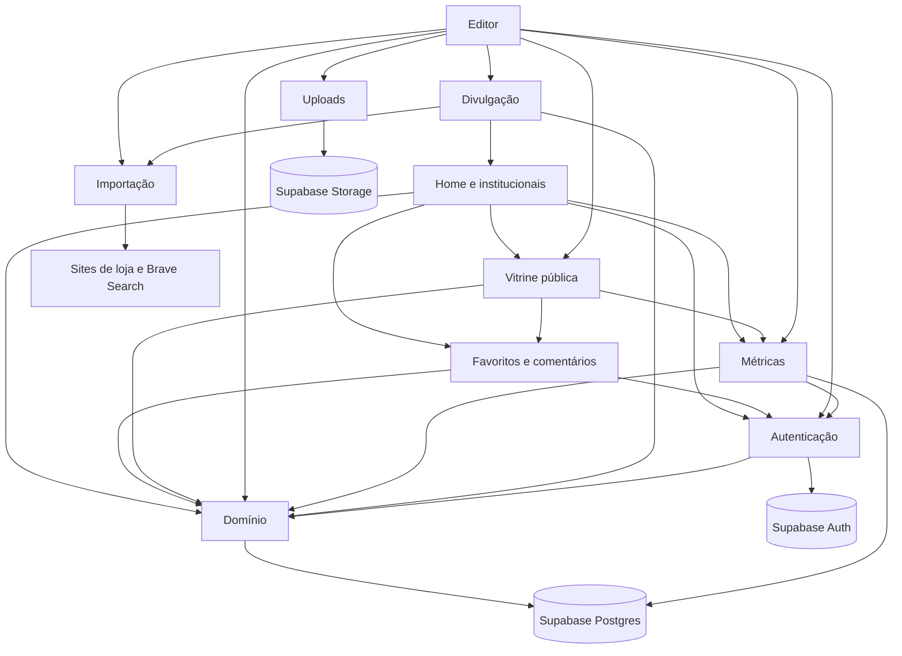
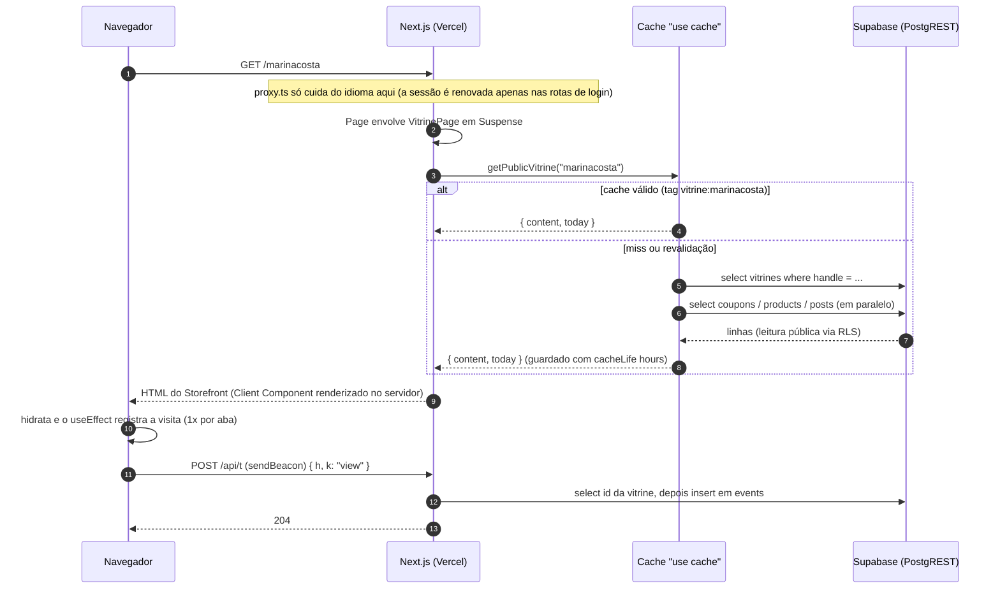
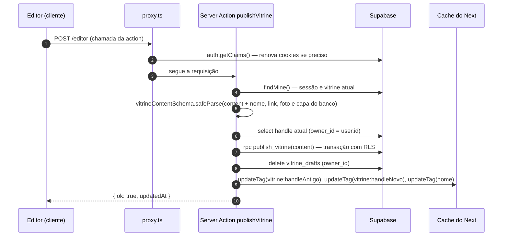
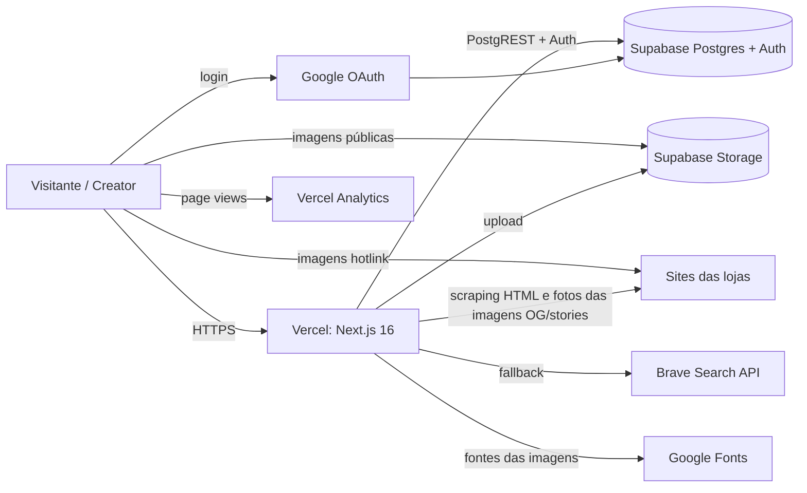
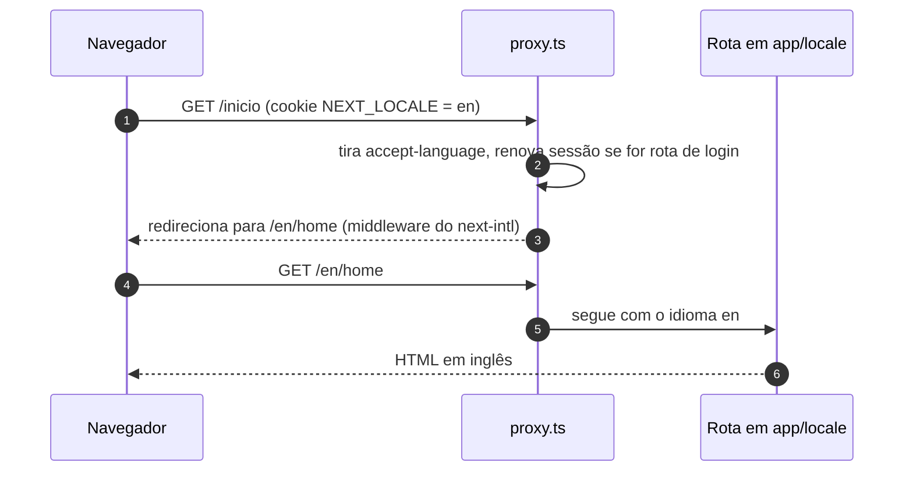

# Arquitetura

## Visão geral (sem jargão)

O **MyVitri** é um site onde **creators** (influenciadoras, criadores de conteúdo) montam uma **vitrine pública** com os **cupons de desconto** das marcas que divulgam, os **produtos** que indicam e **outfits** (`posts` no código e no banco: a foto dela usando um conjunto, com a lista das peças, cada uma levando ao produto). A vitrine tem um endereço curto, tipo `myvitri.com/@marinacosta`, feito para ir na bio do Instagram/TikTok.

Pense num **shopping**:

- A **landing** (`/`) é a fachada do shopping: mostra as vitrines de creators, os cupons ativos, as categorias e as marcas para quem compra, e convida quem divulga a criar a própria vitrine (botões **Criar vitrine** e **Criar conta**). Quem já entrou com a conta é levado direto para a **home** (`/inicio`), que só abre com login: quem não entrou e tenta abri-la volta para a landing. Ela mostra a busca de vitrines, marcas e produtos, os atalhos da própria vitrine (editar, ver, copiar o link) ou o convite para criar uma, e, logo abaixo, **abas** para explorar o catálogo inteiro: **Para você** (o bloco da própria vitrine e dois carrosséis, as **vitrines do dia**, vitrines com mais cliques hoje, e os **últimos outfits** publicados), **Vitrines**, **Produtos**, **Outfits** e **Marcas**, cada uma com filtros e ordem.
- Cada **vitrine** (`/@{handle}`) é uma loja. O visitante copia os cupons das marcas (seção Cupons) e vê os produtos como foto e nome: tocar num produto abre em nova aba o link que a creator colou (`productHref`, sem UTM). Produto não tem preço nem cupom próprio. O MyVitri **não vende nada**: só aponta para a loja certa.
- O **editor** (`/editor`) é o "estoque" da loja, onde a creator arruma tudo. Ela edita um **rascunho** (salvo sozinho a cada mudança) e, quando gosta do resultado, clica em **Publicar**.
- A creator ainda tem uma página de **métricas** (`/metricas`: quantas visitas e cliques a vitrine teve, o que mais funciona e o que precisa de atenção) e **ferramentas de divulgação** (link com cópia em um toque, passo a passo de onde colar, imagem para stories e prévia do link com a foto dela e dos produtos, UTM nos links de loja dos cupons).

O site inteiro existe em **português** (sem prefixo na URL, o idioma padrão) e em **inglês** (prefixo `/en` e nomes de página traduzidos: `myvitri.com/en/home`). Neste documento as rotas aparecem pelo caminho em português (o nome da pasta em `app/[locale]`), com a URL em inglês ao lado; a seção [Internacionalização (i18n)](#internacionalização-i18n) explica como o idioma é escolhido. O conteúdo que as creators escrevem (nomes, textos, cupons) não é traduzido.

O fluxo de uso é:

```mermaid
graph LR
    A["Creator abre /criar-vitrine (ou o fim da landing)"] --> B["Escolhe nome e link"]
    B --> C["Entra com e-mail e senha ou Google"]
    C --> D["Editor: cadastra cupons, produtos, outfits"]
    D --> E["Publica"]
    E --> F["Coloca myvitri.com/@handle na bio"]
    F --> G["Seguidor abre a vitrine"]
    G --> H["Copia o cupom da marca ou abre o produto na loja"]
    H --> I["Evento anônimo vira métrica em /metricas"]
```

## Visão técnica

### Stack

| Camada | Tecnologia | Versão (package.json) | Observação |
|---|---|---|---|
| Framework | Next.js (App Router) | `16.4.4` | Com `cacheComponents`, `partialPrefetching` e `proxy.ts` (o antigo *middleware*). Leia `node_modules/next/dist/docs/` antes de mexer — APIs mudaram (ver `AGENTS.md`). |
| UI | React | `19.3.0` | Server Components + Client Components; `useActionState`, `useTransition` |
| Estilo | Tailwind CSS v4 | `^4` | Carregado pelo loader `@tailwindcss/turbopack` (`next.config.ts:25-32`), **sem** `postcss.config` |
| Validação | Zod | `^4.6.7` | Schemas em `lib/vitrine/types.ts` |
| Banco/Auth/Arquivos | Supabase (`@supabase/supabase-js`, `@supabase/ssr`) | `^2.118.0` / `^0.12.7` | Postgres + RLS, Auth (e-mail e senha e Google), Storage |
| Imagens (servidor) | `sharp` | `^0.35.5` | Reduz e compõe as fotos de perfil e de produto das imagens OG/stories (`lib/vitrine/share-image.tsx`). Dependência direta desde que o QR code (`qrcode`) saiu |
| Textos e idioma | `next-intl` | `^4.14.9` | Site em português e inglês: rotas em `app/[locale]/`, mensagens em `messages/{pt-BR,en}.json`, configuração em `lib/i18n/` e plugin em `next.config.ts` (veja [Internacionalização (i18n)](#internacionalização-i18n)) |
| Analytics | `@vercel/analytics` | `^2.0.1` | `<Analytics />` em `app/[locale]/layout.tsx:38` |
| Métricas de desempenho | `@vercel/speed-insights` | `^2.1.0` | `<SpeedInsights />` em `app/[locale]/layout.tsx:40`, ao lado do `<Analytics />` (LCP, INP, CLS medidos nos aparelhos dos visitantes; precisa ser ativado no painel da Vercel) |
| Linguagem | TypeScript strict | `^5` | Alias `@/*` → raiz (`tsconfig.json`) |

Não há testes automatizados, CI, Dockerfile nem filas/jobs no repositório.

### Estrutura de pastas

| Caminho | Papel |
|---|---|
| `app/[locale]/` | Todas as páginas e imagens (OG, stories, `apple-icon`), por idioma. O `layout.tsx` daqui é o layout raiz (`<html lang>`, fontes, `NextIntlClientProvider`, Analytics) e exporta `generateStaticParams` com os idiomas. `[...rest]/page.tsx` chama `notFound()` para URLs sem rota (e exporta `generateMetadata` com o título do 404, porque no navegador o Next resolve o metadata da rota). Também ficam aqui `not-found.tsx` (404 traduzido, usado pela vitrine inexistente de `[handle]` e pelo catch-all) e `error.tsx` (error boundary das páginas); veja [Páginas de erro e 404](#páginas-de-erro-e-404) |
| `app/` (fora de `[locale]`) | O que não depende do idioma: `actions.ts` (todas as Server Actions), `api/*`, `auth/callback`, `llms.txt`, `robots.ts`, `sitemap.ts`, `globals.css`, `global-not-found.tsx` (o 404 de URLs que não passam pelo idioma, como arquivos inexistentes, ligado por `experimental.globalNotFound`) e `global-error.tsx` (falha no layout raiz) |
| `components/auth/` | Telas de acesso (`AuthShell`, `SignInScreen`, `NewPasswordScreen`), `AuthSkeleton` (tela de espera de `/entrar` e `/nova-senha`), `AuthPhoto` (Server Component, painel direito único de `/entrar`, `/criar-vitrine` e `/nova-senha`, só em md+: só a foto da arara `create_account/capa.webp`, sem logotipo sobre ela; decorativo, `aria-hidden`), `SignupForm` (criação de vitrine) e `LoginButton` (leva a `/entrar`) |
| `components/editor/` | Editor (painéis, campos, upload) — tudo Client Component — e `EditorSkeleton` (tela de espera de `/editor`) |
| `components/metrics/` | Página de métricas: `MetricsView` (Server Component), `DailyChart` (gráfico, Client Component) `stats.ts` (tipos da RPC, períodos, "hoje" em Brasília) e `MetricsSkeleton` (tela de espera) |
| `components/storefront/` | A vitrine pública (`Storefront.tsx`), o coração `FavoriteButton`, a seção `Comments`, as ilustrações de produto e `StorefrontSkeleton` (tela de espera da vitrine) |
| `components/home/` | Peças da landing, da home logada e das páginas legais (cabeçalho/rodapé e `SectionHead`, o cabeçalho de seção centrado: rótulo, `title` (string) e texto curto), `ScrollHeader` (Client Component usado só em `app/[locale]/page.tsx`, em volta do `SiteHeader`: fixa o header no topo e, quando a rolagem passa da altura do header aberto, liga `data-compact` e o header encolhe e ganha fundo de vidro; ver a rota `/`), `LookHero` (`LookHero.tsx`, a foto do hero), `Marquee` (a cópia da lista fica `aria-hidden` e com `tabindex="-1"` em `a, button`, mas sem `inert`, para que o clique funcione na parte dela que aparece na borda), `CopyLinkButton` (e `VitrineLinkBar`, a barra com o endereço da vitrine e o botão Copiar, ambos sobre o hook interno `useCopyLink`), `HomeView` (conteúdo de `/inicio`), `HomeSkeleton` (tela de espera de `/inicio`), `AccountMenu` (menu de conta e modal de configurações de `/inicio` e do editor, com prop opcional `onLeave`, que roda em Sair e nos links de Termos e Privacidade e pode cancelar com `preventDefault`, com o `ProfileBlock`: nome, link e foto de perfil, salvos por `updateProfileAction`), `CoverPicker` (enviar, trocar e remover a capa, por `updateCoverAction`), `CreatorCard` (card da home logada, com `favorited` obrigatório), `CreatorCover` (capa, usada na home e na aba Vitrines), `CoverLetter` (a capa de quem não enviou foto: a primeira letra do nome, também usada em `CreatorMosaic` e `Storefront`) e `Avatar`, `CreatorMosaic` (mosaico de vitrines da landing), `PostCard` (card de outfit: foto 4:5, quantas peças e a vitrine, sem legenda, com link para `/@{handle}#outfits`), `HomeSearch`) |
| `components/home/catalog/` | Base das abas do `/inicio`: `params.ts` (estado na URL) e `FilterMenu.tsx` (menu de filtro/ordenação, Client Component) e `ui.tsx` (abas, menus de filtro, ordenação, moldura, "Ver mais", estado vazio) e `NavPending.tsx` (Client Component: indicador de navegação, ver [Abas do `/inicio`](#abas-do-inicio)) |
| `components/home/tabs/` | Uma aba por arquivo (`FavoritasTab`, `VitrinesTab`, `ProdutosTab`, `PostsTab`, `MarcasTab`) e, nas subpastas `vitrines/`, `produtos/` e `marcas/`, os cards e o painel de comparação de marca |
| `components/brand/` | Logotipo e ícone (SVG puro), `BackLink`, o voltar único do app (veja [O voltar do app](#o-voltar-do-app)) `LocaleSwitcher` (troca de idioma no rodapé, usado por `SiteFooter`) `ErrorScreen` (tela compartilhada das páginas de erro e 404) e `Skeleton.tsx` (`Bone` e `LoadingScreen`, base das telas de espera; veja [Telas de espera](#telas-de-espera)) |
| `components/legal/` | Textos jurídicos longos, um componente por idioma: `TermsPt`, `TermsEn`, `PrivacyPt`, `PrivacyEn` (recebem a data de atualização) |
| `lib/i18n/` | `routing.ts` (idiomas, prefixo, cookie, `pathnames` com o nome de cada página por idioma, `parsePath`, `internalPath` e `localizePath`), `navigation.ts` (`Link`, `redirect`, `useRouter`, `usePathname`, `getPathname` com idioma, os tipos `Href` e `RedirectHref` e os auxiliares `hrefOf` e `vitrineHref`), `request.ts` (idioma de cada renderização, fuso `TIME_ZONE` e carga das mensagens) e `next-intl.d.ts` (tipa as chaves a partir do pt-BR) |
| `lib/fonts.ts` | Fontes do site (Inter e EB Garamond via `next/font`); exporta `fontVariables`, usado pelo layout de `[locale]`, `global-error.tsx` e `global-not-found.tsx` |
| `messages/` | `pt-BR.json` e `en.json`, o catálogo de textos (mesmas chaves nos dois, cerca de 720, em namespaces como `common`, `seo`, `landing`, `auth`, `errors`, `fallback`, `storefront`, `editor`, `legal`) |
| `lib/brand.ts` | Nome, domínio e e-mail de contato |
| `lib/supabase/` | Clientes Supabase do servidor e tipos gerados |
| `lib/vitrine/` | Domínio: tipos/schemas, `account.ts` (`accountOf`, monta o `Account` do menu da conta), cupom e dinheiro (`pricing.ts`), links (UTM da loja dos cupons, link do produto), persistência, redes sociais da creator (`socials.ts`: `socialUrl`, `pickSocials`, `socialLinks`), cache de leitura, importação por link, imagens de divulgação, cookie de "claim", tipos de favoritos e comentários e o helper `reachServer` (`social.ts`) |
| `lib/auth/` | `return-to.ts`: cookie `vitri_return` com a página para onde voltar depois do login (`safePath`, `saveReturn(path, maxAge)`, `takeReturn`); `password.ts`: `PASSWORD_MIN = 8`, o tamanho mínimo da senha; `account.ts`: `DELETE_WORDS`, a palavra de confirmação por idioma (`excluir` em pt-BR, `delete` em en) de quem exclui a conta sem ter vitrine |
| `lib/vitrine/catalog/` | Leitura (com `"use cache"`) e consulta dos catálogos das abas do `/inicio`: `vitrines.ts`, `products.ts`, `posts.ts`, `brands.ts` |
| `proxy.ts` | Proxy do Next (idioma pelo middleware do `next-intl`, renova sessão, corrige retorno do OAuth, leva quem tem sessão de `/` e `/entrar` para `/inicio` e quem não tem de `/inicio` para `/`, tudo respeitando o prefixo do idioma e o nome da página traduzido) |
| `lib/seo.tsx` | Metadados e JSON-LD por idioma (`pageMeta`, `localizedPath`, `languageAlternates`, `siteJsonLd`, `appJsonLd`, `vitrineJsonLd`, `listNames`) |
| `supabase/` | Migrações SQL e seed |
| `public/` | `icon.svg` é o ícone do site (declarado em `metadata.icons` no layout). `hero/`: `retrato.webp` (2400×1792, WebP qualidade 92 na resolução original, gerada por IA) é usada só por `LookHero` (hero da landing); o `next/image` gera e serve versões redimensionadas com `quality={90}`. `create_account/capa.webp` (2752×1536, WebP qualidade 92) é usada por `AuthPhoto`. `CreatorPitch` usa `create_account/tenis.webp` (card de produto) e, no card de outfits, `hero/retrato.webp` recortada na mulher mais `hero/{blazer,calca,bolsa}.webp` (as peças que ela usa), na seção "Feita para quem tem cupom de muita marca". Sem uso no código, mas ainda no repositório: `hero/{brincos,carteira}.webp` e `create_account/{oculos,perfume,serum,vela}.webp`, além dos SVGs padrão do `create-next-app` |
| `.claude/launch.json` | Configuração de preview (`npm run dev`, porta 3000) para o Claude Code |

### Mapa dos módulos

O projeto não é dividido em "apps" como um monólito Django; os módulos abaixo são **fatias funcionais**.

| Módulo | Responsabilidade | Principais arquivos |
|---|---|---|
| Domínio | Tipos, schemas, regras de cupom e dinheiro (`couponOff`, `couponStatus`, `parseBRL`), UTM do link de loja dos cupons (`withUtm`) e destino do clique no produto (`productHref`: `affiliateUrl || url`, sem UTM), leitura/gravação no Supabase, cache de leitura pública. `store.ts` e `data.ts` exportam os conversores e helpers que os catálogos reaproveitam (`toCoupon`, `toProduct`, `toPost`, `isMissingTable`, `rank`, `interleave`, `todayISO`, `live`, `groupBrands` e os tipos `Db`, `Fields`, `By`) | `lib/vitrine/{types,pricing,links,store,data}.ts` |
| Catálogo da home | Abas Favoritas, Vitrines, Produtos, Outfits e Marcas de `/inicio`: leitura em cache, agrupamento, filtros e ordem lidos da URL | `lib/vitrine/catalog/*`, `components/home/catalog/*`, `components/home/tabs/*` |
| Autenticação | Login com e-mail e senha ou Google, foto de perfil do Google (`googlePhoto`, usada também por `starterContent` na vitrine nova), recuperação de senha, sessão, criação da vitrine, sair, excluir conta | `proxy.ts`, `app/auth/callback/route.ts`, `lib/supabase/server.ts`, `lib/vitrine/claim.ts`, `lib/auth/return-to.ts`, `lib/auth/password.ts`, `components/auth/forms.tsx` |
| Editor | Rascunho com autosave, painéis (o Perfil traz o bloco "Redes sociais", `SocialsFields` em `components/editor/panels.tsx`: um campo por rede, que aceita `@usuario`, `usuario`, link sem `https://` ou link completo do domínio daquela rede, com aviso em vermelho quando o texto não é um perfil dela; fica no rascunho e vai na publicação junto com a frase e o texto de apoio; cupons, produtos e posts: `PostsPanel` sobe a foto vertical com `uploadImage("post")`, escolhe de 1 a 8 peças entre os produtos da vitrine; cada linha se chama "Outfit N" e não há campo de legenda; apagar um produto o tira dos posts). Na interface "Posts" se chama **Outfits**, mas código, tipos e banco seguem como `posts`, prévia, publicação | `app/[locale]/editor/page.tsx`, `components/editor/*` |
| Vitrine pública | Página `/@{handle}`. Logo abaixo da capa, alinhado à direita dela (a partir de @2xl; no celular, centralizado embaixo do @ da creator), `SocialLinks` mostra uma linha discreta de ícones em traço (15 px, cinza, escurecem no hover), um por rede válida (Instagram, TikTok, YouTube, X), cada um abrindo o perfil em nova aba (`rel="me noopener noreferrer"`, `aria-label` "{nome} no {rede}", mensagem `storefront.socialLink`); sem rede válida, nada aparece. Não há evento de métrica para esses cliques | `app/[locale]/[handle]/page.tsx`, `components/storefront/*` |
| Favoritos e comentários | Coração de favoritar com o número de favoritos da vitrine (`getFavoriteCount`) (vitrine e cards), aba Favoritas, comentários da vitrine e respostas, "quem está vendo" (`GET /api/eu`). Tipos, limite e `reachServer` em `social.ts` (sem dependências, o cliente também importa; `reachServer` transforma a rejeição de uma Server Action sem resposta em `{ ok: false, error }`, para a falha não trocar a página pela tela de erro do Next, e só as ações de favoritar e comentar o usam); leitura/gravação em `store.ts`; cache dos comentários em `data.ts` | `lib/vitrine/social.ts`, `app/api/eu/route.ts`, `components/storefront/{FavoriteButton,Comments}.tsx`, `components/home/tabs/FavoritasTab.tsx` |
| Internacionalização | Idiomas, rotas com prefixo, mensagens, troca de idioma, SEO por idioma | `lib/i18n/*`, `messages/*`, `proxy.ts`, `lib/seo.tsx`, `components/brand/LocaleSwitcher.tsx`, `components/legal/*` |
| Landing, home logada e páginas institucionais | Landing para os dois públicos (`/`), home de quem entrou (`/inicio`, redireciona quem não tem sessão para a landing), página de criação de vitrine, privacidade, termos, marca | `app/[locale]/page.tsx`, `app/[locale]/inicio/page.tsx`, `app/[locale]/criar-vitrine/`, `app/[locale]/privacidade/`, `app/[locale]/termos/`, `components/home/*`, `components/brand/*` |
| Importação por link | Ler nome/foto/estoque de páginas de loja (sem preço), sem trocar o link colado pelo endereço final dos redirecionamentos; achar logos | `lib/vitrine/import-link.ts` |
| Uploads de imagem | Reduzir no navegador (lado maior: logo 512, capa 1600, perfil 512, produto 1000, post 1440; `ImageKind` inclui `"post"`, bucket `vitrine-photos`, 2 MiB) e enviar ao Storage | `components/editor/{upload.ts,ImageField.tsx,LogoPicker.tsx}` e `components/home/CoverPicker.tsx` (`ImageField` é só a foto do produto e exporta `FilePick` e `UploadIcon`, reaproveitados pela capa e pela foto de perfil) |
| Métricas | Registrar eventos anônimos (`/api/t`) e mostrá-los na página `/metricas` | `app/api/t/route.ts`, `app/[locale]/metricas/page.tsx`, `components/metrics/*` |
| Divulgação | Imagem OG e de stories (com fotos), link, status de publicação, onde colar, UTM (só nos links de loja dos cupons) | `app/[locale]/[handle]/opengraph-image.tsx`, `app/[locale]/[handle]/story/route.ts`, `lib/vitrine/share-image.tsx`, `components/editor/SharePanel.tsx` |

### Dependências entre módulos

Leitura das setas: "usa". Exemplos concretos: só a home logada tem link para `/metricas` (o bloco "Sua vitrine" da aba Para você tem **Ver métricas →**, ao lado dos números; o editor não tem atalho para as métricas; os botões de baixo são **Editar vitrine** e **Ver minha vitrine ↗**, e o endereço fica na `VitrineLinkBar`, que também abre a vitrine em nova aba); a página de métricas lê a vitrine de quem entrou (`findMine`) e reaproveita `CopyLinkButton` e o cabeçalho/rodapé da home (ambas usam `<SiteFooter signedIn />`, só a linha final, sem as colunas "Para quem compra" e "Para quem divulga", que ficam no rodapé completo da landing e das páginas legais); a home usa `ProductArt` da vitrine pública (`components/storefront/ProductIcon.tsx`) e o `SignupForm` da autenticação (em `/criar-vitrine`); o editor renderiza o próprio `Storefront` como prévia; a vitrine pública e a aba Favoritas usam o `FavoriteButton`, e ambos e `Comments` abrem o `LoginButton` da autenticação para quem não entrou; a divulgação usa o `Wordmark` da marca (`components/brand/Logo.tsx`) e o `fetchPublic` da importação para baixar as fotos das imagens.

### Rotas

Todas as páginas e imagens ficam em `app/[locale]/`, e a URL de cada uma existe nos dois idiomas, com o nome traduzido (`pathnames` em `lib/i18n/routing.ts`). A tabela mostra o caminho interno, o nome da pasta, em português; a coluna **URL** traz as duas versões. Route handlers de API, `/auth/callback`, `/llms.txt`, `/robots.txt` e `/sitemap.xml` não têm prefixo.

| Rota (caminho interno) | URL em pt-BR / en | Arquivo | Tipo | Renderização |
|---|---|---|---|---|
| `/` | `/` / `/en` | `app/[locale]/page.tsx` | Página | Landing: cabeçalho fixo no topo (`ScrollHeader`, `components/home/ScrollHeader.tsx`, envolvendo o `SiteHeader`). Ele reserva o espaço do header aberto com um bloco de 73px no celular e 81px do `md` em diante (a mesma altura que o hero desconta), para a página não pular, e um `IntersectionObserver` nesse bloco liga `data-compact` quando a rolagem passa dessa altura: o header encolhe (81px para 57px no desktop, 73px para 57px no celular) e o fundo vira vidro (`bg-white/80`, `backdrop-blur-[40px]`, `backdrop-saturate-[1.6]`) com uma linha fina de ponta a ponta; ao subir, volta ao estado aberto. Transição de 200ms, desligada com movimento reduzido. Os filhos reagem com `group-data-[compact]/header:` (no `SiteHeader`: padding menor e borda própria transparente; em **Criar conta**: `min-h-10`), classes que só têm efeito dentro do `ScrollHeader`, então as outras páginas com `SiteHeader` não mudam. Conteúdo do `SiteHeader` com `action`: Vitrines, Cupons, Categorias, Marcas (a ordem das seções; o `SiteHeader` recebe as âncoras da página, pares `["vitrines", rótulo]`, e o rodapé usa `{ pathname: "/", hash }` e `null` no "Entrar"; com mais de 2 links, só aparecem do `lg` em diante), **Entrar** (`LoginButton`, leva a `/entrar?next=<página atual>`) e **Criar conta** → `/criar-vitrine`), hero sem altura mínima de tela, só texto e foto: do `lg` em diante a foto `public/hero/retrato.webp` (`LookHero`, `components/home/LookHero.tsx`, via `next/image` com `preload` no lugar do `priority`, obsoleto no Next 16, e `quality={90}`) ocupa o hero de ponta a ponta (largura até 2560px) com altura `clamp(480px, calc(100svh - 81px), max(860px, 56vw))` (o teto acompanha a largura para a foto não cortar mais em tela larga), o título, uma frase por linha, sobre a parede da foto (a fonte é limitada para não encostar na pessoa e, acima de 1440px, diminui com a largura até 56px em 2560px) e um clareado à esquerda para contraste; abaixo do `lg` o texto vem antes da foto, que tem zoom; botões **Criar vitrine** (`/criar-vitrine`) e **Explorar vitrines** (âncora para `#vitrines`, só aparece se houver vitrines). Todo o conteúdo (`SiteHeader`, `SiteFooter` e as seções) fica em `max-w-[1440px]`; só a foto do hero vai até `max-w-[2560px]`. Seções, nesta ordem: `#vitrines`, `#cupons`, `#categorias`, `#marcas`, todas com a constante `section` de `app/[locale]/page.tsx` e um `SectionHead` centrado. `#vitrines` tem o título "Vitrines" (rótulo "Explore as"), `CreatorMosaic` (`components/home/CreatorMosaic.tsx`): mosaico em 4 colunas (2 no celular) com uma vitrine em destaque de 2×2, escolhida de preferência entre as que têm foto de capa e, entre essas, a com mais produtos, e as demais em cards altos 4:5 colados, com "Vitrine de" e o nome sobre a foto (sem capa, a primeira letra do nome, `CoverLetter`), sem @handle nem contagens. O card "Sua vitrine aqui" (com "Monte a sua em 2 minutos: {HOST}/@seunome") vem por último e estica para fechar a linha. `#cupons` rola de lado no celular e vira grade de 4 colunas a partir do `md`; `#marcas` tem grade de 2 colunas (4 a partir do `md`); `#categorias` renderiza `CategoryShop`. O bloco de venda `CreatorPitch` (`#para-quem-divulga`, `components/home/CreatorPitch.tsx`: abertura centrada, sem botão, "Seu público pergunta. A vitrine responde.", "Feita para quem tem cupom de muita marca" (título em cima e 3 cards em `aspect-[4/3]`; os de produto e de outfits mostram fotos com `next/image`: o produto, "Tênis de couro" com `public/create_account/tenis.webp`, e o terceiro, "Outfits que vendem o look" (`pitch.outfitsTitle`, `outfitsText`, `outfitsPieces.{blazer,calca,bolsa}`), um outfit em miniatura: a foto `public/hero/retrato.webp` recortada na mulher, com as peças que ela usa ao lado, `public/hero/{blazer,calca,bolsa}.webp`), "E ainda" (6 itens), "Pronta em 2 minutos", "Perguntas frequentes" (`FAQ`, 7 itens, em duas colunas) e CTA "Seu link na bio, pronto hoje" → `/criar-vitrine`) e rodapé ("Para quem compra" e "Para quem divulga", esta com **Entrar** que também leva a `/entrar`). Renderiza dois JSON-LD: `siteJsonLd` e `appJsonLd(FAQ)` (WebApplication + FAQPage). Dados via `getHomeFeed()` (`"use cache"`, tag `home`); não lê cookies, então continua estática (quem tem sessão é redirecionado pelo proxy) |
| `/inicio` | `/inicio` / `/en/home` | `app/[locale]/inicio/page.tsx` | Página | Home de quem entrou: sem sessão não abre. O proxy responde `307` para `/` (descartando a query) e, se a sessão cair entre o proxy e a leitura, a página faz `redirect("/")`. Sempre por requisição (`connection()` dentro de `<Suspense>`), `noindex` e `Disallow` no `robots.ts`. A página cuida da sessão (`findMine()`) e lê a aba da URL (`flatParams`, `tabOf`, de `components/home/catalog/params.ts`); todo o conteúdo está em `HomeView({ name, account, tab, params, forYou, favorites })` (`components/home/HomeView.tsx`, `name` sempre `string`). Só na aba **Para você** a página carrega os dados dos carrosséis (`loadCreators`, `getRecentPosts`) e os passa em `forYou`; nas outras abas `forYou` é `null` e cada aba busca os próprios dados. Só nas abas **Para você**, **Vitrines** e **Favoritas** a página lê também `listFavoriteHandles` (`favorites`, da última favoritada para a primeira; erro vira lista vazia) para pintar o coração (em **Para você**, `ForYouTab` repassa `favorited` ao `CreatorCard` do carrossel de vitrines (do dia ou novas); a landing, por ser estática, não usa o `CreatorCard` e não tem coração). Abre com a saudação (kicker "Sua home" e "Olá, nome", em serifa grande, sozinho, sem texto de apoio ao lado) e, logo abaixo, a busca `HomeSearch` em largura total, uma barra com fundo creme (borda escura no foco) cujo rótulo "Buscar vitrines, marcas e produtos" é só para leitor de tela (`sr-only`), e uma dica pequena abaixo do campo ("Busque por uma pessoa, uma marca ou um produto.", ligada a ele por `aria-describedby`); depois vêm as abas (`TabNav`, presa no topo ao rolar) e o conteúdo da aba atual, veja [Abas do `/inicio`](#abas-do-inicio). Na aba **Para você**, quem tem vitrine vê primeiro o bloco "Sua vitrine" (`YourVitrine`): a capa à esquerda, dentro do `CoverPicker` (props `hasCover`, `name` e `children`, a foto; sobe a imagem com `uploadImage("cover")`, grava com `updateCoverAction` e faz `router.refresh()`; salva na hora, sem publicar). Sem capa, só a dona vê um convite no lugar dela: o quadrado inteiro envia a foto (clique ou arraste), com a primeira letra do nome apagada ao fundo (`CoverLetter`) e o botão **Enviar capa**. Com capa, **Trocar capa** e **Remover** são links discretos abaixo da foto, não por cima dela, e arrastar uma imagem sobre a foto também a troca; **Remover** pede confirmação na mesma linha ("Remover a capa?", com **Sim, remover** e **Cancelar**) antes de gravar. Ao lado da capa ficam nome, endereço, números e atalhos. A capa é opcional: para o público, sem ela aparece a primeira letra do nome (`CoverLetter`). Cabeçalho sem links de navegação (o proxy redireciona `/` para `/inicio`, então âncoras da landing voltariam para a home), só o menu de conta `AccountMenu` (`components/home/AccountMenu.tsx`, Client Component): o botão mostra a foto de quem entrou (`account.avatarUrl`, montado em `app/[locale]/inicio/page.tsx`: primeiro a foto da vitrine e, sem ela, a do Google, lida por `googlePhoto(user)` de `lib/vitrine/claim.ts`: `user_metadata.avatar_url`, só se começar com `https://`, a mesma regra dos comentários, e vazia para quem entra só com e-mail e senha; `referrerPolicy="no-referrer"`), com as iniciais como reserva quando não há foto ou ela não carrega (`onError` e checagem na montagem, `img.complete && naturalWidth === 0`, porque a imagem pode falhar antes da hidratação), e abre um menu com a mesma foto ao lado de nome e e-mail, **Configurações** e **Sair** (`signOutAction`); fecha com Esc, clique fora ou quando o foco sai. **Configurações** abre um `<dialog>` nativo (fecha com Esc, pelo X ou clicando no fundo) com: perfil (`ProfileBlock`, só para quem tem vitrine: foto, que começa com a da vitrine ou, sem ela, a do Google (`account.googlePhoto`), com enviar, trocar e **Remover**, que volta para a foto do Google e some quando a foto já é a do Google; nome e link, e um botão **Salvar** que chama `updateProfileAction`; o botão só habilita com alteração, mudar o link avisa que o antigo para de funcionar e, passado o envio, a página faz `router.refresh()`), conta (e-mail e como entra, Google, e-mail e senha ou os dois, lido de `user.app_metadata.providers`), senha (botão que dispara `requestPasswordResetAction`, o mesmo fluxo do **Esqueci minha senha**, que leva a `/nova-senha`; para quem só usa Google serve para criar senha), sua vitrine (só para quem ainda não tem vitrine: convite **Criar minha vitrine**, para `/criar-vitrine`; quem tem vitrine não vê esse bloco, e os atalhos para editor e métricas ficam no bloco "Sua vitrine" da aba Para você), excluir conta (`DeleteAccount`, que só existe aqui: o editor não tem mais esse botão) e links para Termos e Privacidade. A página monta o objeto `Account` com `accountOf(user, vitrine)` (`lib/vitrine/account.ts`, o mesmo usado por `app/[locale]/editor/page.tsx`) (`name`, `email`, `avatarUrl`, `googlePhoto`, `providers`, `vitrine {handle,name,avatarUrl} | null`) e o passa em `HomeView` na prop `account`. A busca (`components/home/HomeSearch.tsx`, Client Component) procura enquanto digita via `GET /api/busca`, com debounce de 250 ms e mínimo de 2 letras, Esc limpa o campo; botão "Limpar" no lugar do ✕ nativo do campo; os resultados abrem abaixo do campo em 1 a 3 colunas, conforme quantos grupos vieram (vitrines → `/@{handle}`, marcas com o melhor cupom → `/@{handle}#cupons`, produtos com quem indica → `/@{handle}#produtos`) |
| `/metricas` | `/metricas` / `/en/metrics` | `app/[locale]/metricas/page.tsx` | Página | Métricas da vitrine de quem entrou, sempre por requisição (`connection()` dentro de `<Suspense>`), `noindex`, `Disallow` no `robots.ts` e no `matcher` do proxy. Sem sessão: `redirect("/entrar?next=/metricas")`. Com sessão e sem vitrine: `NoVitrine` (convite para criar). Com vitrine: `?period=7\|30\|90` (`parsePeriod`, padrão 30), `vitrine_stats(days)` e `topCreatorsToday(db, 50)` em paralelo, e `MetricsView`; veja [Página de métricas](#página-de-métricas). O cabeçalho usa `SiteHeader back="/inicio"` (sem botão à direita); `NoVitrine` não tem botão "Início", e o botão "Editar vitrine" mostra só "Editar" no celular |
| `/criar-vitrine` | `/criar-vitrine` / `/en/create-storefront` | `app/[locale]/criar-vitrine/page.tsx` | Página | Só a tela de criar conta, sem cabeçalho de navegação nem rodapé (apenas a marca, que volta para `/`, e uma seta de voltar ao lado dela, também para `/`). `SignupForm` (`components/auth/forms.tsx`) dentro do `AuthShell` (duas colunas): título "Crie sua vitrine", nome + link (hook `useClaim`, campos em `ClaimFields`), e-mail e senha (mínimo `PASSWORD_MIN`), botão "Criar conta" (`via=email`) e, depois do divisor "ou", "Criar com Google". Os dois botões enviam o mesmo formulário para `claimAction`, que distingue pelo campo `via`; e-mail e senha não têm `required` para o Google poder seguir sem eles (a ação confere). Depois vêm o aceite dos termos e "Já tem conta? Entrar" (link para `/entrar`, fora do `<form>`). Com a confirmação de e-mail ligada, o envio com e-mail mostra o aviso (`notice`) de que o link de confirmação foi enviado. No desktop a metade direita mostra `AuthPhoto` (só a foto da arara); no celular só o formulário. FAQ e JSON-LD da aplicação ficam na landing |
| `/entrar` | `/entrar` / `/en/sign-in` | `app/[locale]/entrar/page.tsx` | Página | Tela de entrar, `noindex`, no `AuthShell` de duas colunas (`SignInScreen`, com `AuthPhoto`: no `md` em diante o painel direito mostra a foto `public/create_account/capa.webp` (`next/image` com `fill`, `preload`, `quality={90}`, `object-cover`, `alt=""` por ser decorativa); sem o painel no celular, o `sizes` termina em `1px` e o navegador baixa a menor versão, 640w; vale também para o passo "Esqueci minha senha"): e-mail e senha (`signInWithPasswordAction`), "Esqueci minha senha" (troca o miolo por `ForgotPassword`, que usa `requestPasswordResetAction`), divisor "ou" e "Entrar com Google" (`signInAction`), aceite dos termos e "Ainda não tem conta? Criar conta" (→ `/criar-vitrine`). No topo, seta de voltar (área de toque de 44px) ao lado do logo: leva à página de `next`, ou a `/` quando `next` exige sessão (`/inicio`, `/editor`, `/metricas`, `/nova-senha`, função `backFrom`), para não voltar à própria tela; no passo "Esqueci minha senha" ela volta ao formulário de entrar (não há link "Voltar para entrar"). Lê `?next=` (filtrado por `safePath`, padrão `/inicio`; sempre o caminho interno, em português) e `?error=login` (mostra "O login não foi concluído. Tente de novo."). Está no `matcher` do proxy: quem já tem sessão vai para `/inicio` |
| `/nova-senha` | `/nova-senha` / `/en/new-password` | `app/[locale]/nova-senha/page.tsx` | Página | Define a senha nova para quem chegou pelo link do e-mail (`NewPasswordScreen`, `updatePasswordAction`), `noindex`. Por requisição (`connection()` dentro de `<Suspense>`): sem sessão, `redirect("/entrar")`. Está no `matcher` do proxy (renova a sessão) |
| `/privacidade`, `/termos` | `/privacidade`, `/termos` / `/en/privacy`, `/en/terms` | `app/[locale]/privacidade/page.tsx`, `app/[locale]/termos/page.tsx` | Páginas | Estáticas em cada idioma. A página escolhe o componente pelo idioma (`components/legal/{Terms,Privacy}{Pt,En}.tsx`); a versão em inglês traz o aviso de que o texto em português é o que prevalece. A política (nos dois idiomas) tem um item sobre o cookie de idioma `NEXT_LOCALE`. Trazem a data de atualização (5 de novembro de 2026) e cobrem quem favorita ou comenta: comentários públicos com nome e foto do Google (seção 4 "Comentários" dos termos, que renumerou as seguintes, e parágrafo próprio na privacidade), exclusão da conta apaga favoritas e comentários |
| `/editor` | `/editor` / `/en/editor` | `app/[locale]/editor/page.tsx` | Página | Sempre por requisição (`connection()`); `?tab=` (`profile`, `coupons`, `products`, `outfits`, `share`; o id interno da aba de outfits continua `posts`, só o nome na URL é `outfits`). A aba Perfil tem só os Textos (frase de destaque e texto de apoio) e as Redes sociais; nome, link e foto ficam nas Configurações da home, a capa no bloco "Sua vitrine" e "Excluir minha conta" só nas Configurações. Sem sessão: `redirect("/entrar?next=/editor")`. Com `cacheComponents` o Next mantém a rota anterior viva (`<Activity>`) ao navegar e o `Editor` só lê as props em `useState` ao montar. Por isso não há `key` que o remonte (o menu da conta dentro do editor não pode ser remontado ao salvar o perfil nas Configurações): o próprio `Editor` compara `pickProfile(published)` entre renderizações e, quando nome, link, foto ou capa mudam, copia os quatro para `draft`, `published` e `savedJson` (`components/editor/Editor.tsx:116-125`), preservando a aba aberta e as edições em andamento. A página passa `account={accountOf(user, vitrine)}` (`app/[locale]/editor/page.tsx:29`) |
| `/@{handle}` | `/@{handle}` / `/en/@{handle}` | `app/[locale]/[handle]/page.tsx` | Página | `<Suspense>` + `getPublicVitrine()` (`"use cache"`, tag `vitrine:{handle}`) `getComments()` (`"use cache"`, tag `comentarios:{handle}`) e `getFavoriteCount()` (`"use cache"`, tag `favoritos:{handle}`), lidos em paralelo; erro nos comentários vira lista vazia e erro no número de favoritos vira `null` (o coração aparece sem número); ambos são logados e não derrubam a página. O número vai para o `Storefront` na prop `favorites`. A página continua igual para todos e em cache: o que é por pessoa vem de `GET /api/eu`, buscado no navegador por `useViewer` (`null` enquanto carrega). O cabeçalho do `Storefront` tem só o `BackLink` à esquerda (`href="/"`, rótulo "Início", sem `divider`), o menu de seções: só a seta no celular, seta + "Início" em contêiner largo (`labelClass="@max-2xl:hidden"`, container query). O destino é `/` de propósito: o proxy leva quem tem sessão para `/inicio`, e quem não tem fica na landing. Na prévia do editor (`preview`) o `BackLink` fica sem `href`, só com a aparência, para o clique não tirar a pessoa do editor. A foto da creator (80px, anel branco), o nome e o @handle ficam centralizados no topo da página, logo acima do título: a foto fica sobre a borda inferior da capa (`-mt-10`). O topo é sempre uma capa: a foto enviada ou, sem ela, a primeira letra do nome (`CoverLetter`, de `components/home/CreatorCard.tsx`). O topo da vitrine não tem faixa de anúncio; a seção de cupons e o botão "Ver cupons" do topo continuam O logo no rodapé continua levando à home. A seção `#outfits` (só aparece com outfit que tenha foto e ao menos uma peça existente, via `postItems`) é o `OutfitCarousel` (`components/storefront/Storefront.tsx`, `<OutfitCarousel outfits={posts} firstName link />`), que mostra **um outfit por vez na largura toda da seção**, sem o próximo cortado na borda (o `Carousel` genérico, sem a prop `slides`, é só o de cupons). Os `OutfitSlide` ficam empilhados na mesma célula de um grid (a altura é a do maior); o inativo fica transparente, `inert` e `aria-hidden`. Transição: crossfade de 700 ms; a foto do outfit que entra começa em `scale-[1.08]` e aproxima até 100% em 7 s; "N peças neste look" (`storefront.outfitPieces`) e cada peça sobem com fade em sequência (atraso de 250 ms + 90 ms por peça). Troca automática a cada `OUTFIT_MS` = 6000 ms, parada com o mouse em cima, com foco dentro do carrossel, pelo botão de pausa/play (`outfitsPause`/`outfitsPlay`, ao lado das setas) e com `prefers-reduced-motion: reduce` (sem troca automática, sem o botão de pausa e com as transições desligadas por `motion-reduce:`). As setas dão a volta (do último vai ao primeiro) e somem abaixo de @2xl; no celular, arrastar o dedo para o lado (> 40 px) troca o outfit. Embaixo, uma barra de progresso segmentada com um botão por outfit (`outfitGo`, "Ver o outfit {n} de {total}"): as anteriores ficam cheias e a atual enche no ritmo da troca com `animate-outfit-progress` (`app/globals.css`, `@theme` com `--animate-outfit-progress: outfit-progress 6s linear forwards`, `scaleX(0)` a `scaleX(1)`); parada, a atual fica cheia. A região tem `aria-roledescription` = `common.carousel` e `aria-live` "off" enquanto troca sozinho e "polite" quando parado. Layout do slide: fundo cream; a partir de @3xl, grid `minmax(0,1.15fr) minmax(0,1fr)` com a foto inteira em 4:5 à esquerda e, à direita, a lista de peças (miniatura 80px, marca, nome e seta, cada uma levando ao link do produto, `productHref`) e o contador "01 / 04"; no celular, foto na largura toda e peças embaixo. Não mostra legenda. O menu da vitrine lista Produtos, Outfits e Comentários. O `FavoriteButton` (variante `profile`: coração + "Favoritar"/"Favorita" em qualquer largura) fica no bloco do perfil, embaixo do nome e do @handle; com `count` maior que 0 mostra ao lado do texto, separado por um traço, "N pessoas favoritaram" (plural do `next-intl`, `storefront.favorite.count`), também no `aria-label`. O número de "outras pessoas" é fixado ao montar (`count - favorited`) e soma o coração atual, para não contar duas vezes quem favoritou quando a página volta da ação com o número novo; visitante vê o mesmo coração, que abre o `LoginButton`. Antes de `useViewer` responder o botão aparece igual, com `aria-busy`, e o toque é ignorado (sem `disabled`, que o `button:disabled` global deixaria a 40% de opacidade a cada toque). Depois do último bloco vem a seção `#comentarios` (`Comments`, item "Comentários" no nav): título com o total, campo de comentar igual para todos (1 a 500 caracteres): o visitante escreve antes de entrar e o botão vira "Entrar e publicar"; o campo cresce com o texto (`field-sizing-content`), mostra "Comentando como {nome}", avisa "Restam N" nos últimos 100 caracteres e aceita Ctrl/Cmd+Enter. A lista mostra 10 conversas por vez ("Ver mais (N)"; o servidor entrega até 100 comentários originais, com todas as respostas deles), com selos "Você" e "Da vitrine" (`byOwner`), data relativa e, sem comentários, uma linha simples de texto. A seção é uma coluna única (`max-w-[760px]`), alinhada à esquerda com os outros títulos da vitrine. Quem escreveu e a dona da vitrine veem "Excluir" na linha do nome (com confirmação "Excluir mesmo"; apagar o original apaga as respostas). Cada comentário e cada resposta tem "Responder": abre um campo inline sob ele (um aberto por vez, com foco ao abrir, Cancelar ou Esc fecham; visitante vê "Entrar para responder"). As respostas aparecem como árvore: no banco há um `parent_id` só (lista plana por conversa), e `replyTree()` (`components/storefront/Comments.tsx`) pendura cada resposta sob a resposta que ela responde (`replyToId`) ou, sem ela, sob o comentário original. O recuo vai até `MAX_DEPTH` = 3 níveis abaixo do original; respostas mais fundas ficam no último nível. Não há linha ligando as fotos: o componente `Branched` só recua, de modo que cada nível começa alinhado ao texto de quem é respondido (`ROOT_INDENT` = 54 px abaixo do comentário original, `REPLY_INDENT` = 44 px abaixo de uma resposta). O campo de responder abre embaixo de quem está sendo respondido (no último nível, embaixo de quem recebe a resposta). O "@Nome" dourado no começo da resposta (a partir de `replyToId`) só aparece quando ela não está logo embaixo da resposta que responde, ou seja, quando foi achatada pelo limite de níveis. Conversas com mais de 2 respostas (`REPLIES_OPEN`) começam fechadas ("Ver N respostas"/"Ocultar respostas"). Com comentários, o topo da vitrine tem o link "N comentários" para `#comentarios`. Nenhum dos dois (coração e comentários) aparece na prévia do editor (`preview`). No fim da vitrine, depois dos comentários, fica a seção de convite ("Gostou desta vitrine? Crie a sua.", botão para `/criar-vitrine`), só para quem não entrou: some na prévia do editor, para quem tem sessão e enquanto o `viewer` ainda é `null` (`!preview && viewer?.user === null`) |
| `/api/eu?h=` | sem prefixo, igual nos dois idiomas | `app/api/eu/route.ts` | Route Handler `GET` | "Quem está vendo" a vitrine `h` (normalizado: `trim`, minúsculas, até 30 caracteres). Responde o tipo `Viewer` de `lib/vitrine/social.ts` com `Cache-Control: private, no-store`: sem sessão `{ user: null }`; com sessão `{ user: { id, name, avatarUrl }, favorited, owner }` (nome e foto do `user_metadata` do Google; `loadViewerState` lê se a vitrine é favorita e se a pessoa é a dona). Se a leitura falhar, devolve a pessoa identificada com `favorited: false` e `owner: false`. Usa `getUser()`, e este handler pode gravar cookies, então é ele que renova a sessão de quem abre direto uma vitrine (`/@{handle}` não passa pelo proxy). Chamada por `useViewer` em `Storefront.tsx` |
| `/@{handle}/opengraph-image` | `/@{handle}/opengraph-image` / `/en/@{handle}/opengraph-image` | `app/[locale]/[handle]/opengraph-image.tsx` | Imagem (convenção de metadata) | PNG 1200×630, com os textos no idioma da URL (`shareImage(..., locale)`). O `alt` é só o nome do site. A landing tem a sua em `app/[locale]/opengraph-image.tsx` |
| `/@{handle}/story` | `/@{handle}/story` / `/en/@{handle}/story` | `app/[locale]/[handle]/story/route.ts` | Route Handler `GET` | PNG 1080×1920 (perfil, produtos com foto, cupons), com os textos no idioma da URL |
| `/api/t` | sem prefixo, igual nos dois idiomas | `app/api/t/route.ts` | Route Handler `POST` | Grava evento, sempre 204. Aceita `kind` `view`, `buy`, `copy`, `video` e `post` (`kit` não é mais aceito). O clique numa peça de um outfit dispara dois eventos: o `buy` do produto e o `post` com o id do post |
| `/api/busca?q=` | sem prefixo, igual nos dois idiomas | `app/api/busca/route.ts` | Route Handler `GET` | Busca da home logada. Pública na API (não exige sessão), mas a interface só a usa em `/inicio`, que exige login. Normaliza o termo (`trim`, minúsculas, até 60 caracteres), chama `searchHome()` e responde JSON `{ creators, brands, products }`; erro do banco vira `500` com `{ "error": "busca" }` (detalhe só no log). Depende da RPC `search_catalog` |
| `/api/*` (qualquer outro) | sem prefixo, igual nos dois idiomas | `app/api/[...rest]/route.ts` | Route Handler `GET`, `POST`, `PUT`, `PATCH`, `DELETE` | Caminho de `/api` que não existe: responde `404` com `{ "error": "not_found" }`. Como o proxy não passa por `/api`, sem esta rota o caminho cairia em `app/[locale]` com `api` como idioma |
| `/auth/callback` | sem prefixo, igual nos dois idiomas | `app/auth/callback/route.ts` | Route Handler `GET` | Troca `code` por sessão (fora de `[locale]`, sem prefixo). Destino padrão: a página guardada no cookie `vitri_return` (`takeReturn()`, lido e apagado; veja [Autenticação](#autenticação-e-autorização-resumo)) ou, sem ele, `/inicio`. Também é a volta dos links por e-mail (confirmar conta e senha nova, que guardam `/nova-senha` em `vitri_return` por 1 hora). Erro do Google (`error` sem `code`) ou falha na troca do código redireciona para `/entrar?error=login`, que mostra o aviso (sem sessão, `/inicio` levaria à landing, que é estática). O link precisa ser aberto no mesmo navegador em que foi pedido (PKCE): se a confirmação da conta for aberta em outro, o e-mail fica confirmado mas a troca falha, e a pessoa entra com a senha. Sem `code` e sem `error` vai para `/inicio`. Os redirecionamentos saem sem prefixo e o proxy leva ao idioma da última escolha (cookie `NEXT_LOCALE`), que o callback também lê para o texto inicial da vitrine nova (`vitrineDefaults`; sem cookie, português). Só vai para `/editor` quando o login (Google ou link de confirmação) veio do claim (`/criar-vitrine`) e a vitrine foi criada nesta chamada |
| `/icon.svg`, `/apple-icon` | `/icon.svg`, `/apple-icon` / `/en/apple-icon` | `public/icon.svg`, `app/[locale]/apple-icon.tsx` | Ícones | `icon.svg` é arquivo estático de `public/`, referenciado em `metadata.icons`; `apple-icon` é convenção de metadata |
| `/favicon.ico` | `/favicon.ico` | `next.config.ts:17-23` | Redirect permanente | Vai para `/icon.svg` (o pedido automático dos navegadores não tem arquivo nem passa pelo proxy). No mesmo `redirects`, `/para-creators` vai para `/criar-vitrine` (nome antigo da página de venda) |
| `/sitemap.xml` | sem prefixo, igual nos dois idiomas | `app/sitemap.ts` | Metadata route | Uma entrada por idioma de cada página (`/`, `/criar-vitrine`, vitrines publicadas, `/privacidade`, `/termos`), cada uma com `alternates.languages` apontando para as outras versões. Sem banco, sai só com as páginas fixas |
| `/robots.txt` | sem prefixo, igual nos dois idiomas | `app/robots.ts` | Metadata route | Libera o público e bloqueia `/editor`, `/inicio`, `/metricas` (e as versões `/en/...`), `/api/` e `/auth/` |
| `/llms.txt` | sem prefixo, igual nos dois idiomas | `app/llms.txt/route.ts` | Route Handler `GET` | Resumo do site em Markdown para assistentes de IA. Só em português (mensagens `seo.site` em `pt-BR`), com um link para a versão em inglês entre as páginas |
| qualquer outra URL | — | `app/[locale]/[...rest]/page.tsx`, `app/global-not-found.tsx` | 404 | Dentro de um idioma, `notFound()` renderiza `app/[locale]/not-found.tsx` no layout do idioma. Fora (arquivo inexistente), vale `global-not-found.tsx`, bilíngue; `/api/*` inexistente responde 404 em JSON. Veja [Páginas de erro e 404](#páginas-de-erro-e-404) |

O topo do editor tem o `BackLink` "Início" (leva a `/inicio`) e a marca (leva direto a `/inicio`, pela prop `home` do `SiteHeader`). Os dois e o menu da conta passam por `confirmLeave` (`components/editor/Editor.tsx:167`), que pede confirmação se o rascunho ainda não terminou de salvar (a navegação é no cliente).

À direita do topo ficam o estado de publicação e o `AccountMenu` (o mesmo da home, com foto ou iniciais, **Configurações** e **Sair**, recebendo `account` e `onLeave={confirmLeave}`). Com alterações não publicadas, o grupo mostra "Alterações não publicadas" (ou "Erro ao salvar o rascunho" se o autosave falhou) e o botão **Publicar**. Sem alterações, mostra "Publicado" com um ícone de confirmação e o link **Ver vitrine**, que abre `/@{handle}` em outra aba. No celular o grupo ocupa uma linha própria.

### Logo de quem entrou

`SiteHeader` (`components/home/chrome.tsx`) tem a prop `home`, o destino do logo (padrão `/`). `/inicio` (`HomeView`), `/metricas` (`MetricsView` e `NoVitrine`) e o editor passam `home="/inicio"`: com sessão, `/` só chegaria a `/inicio` por redirecionamento do proxy, depois de consultar o Supabase.

### Telas de espera

Cada página com dados por requisição usa um esqueleto como `fallback` do `<Suspense>`, no formato da própria página, em vez de um retângulo branco:

| Página | Esqueleto |
|---|---|
| `/inicio` | `components/home/HomeSkeleton.tsx` (usa `TabNav` sem `current`, nenhuma aba marcada) |
| `/metricas` | `components/metrics/MetricsSkeleton.tsx` |
| `/editor` | `components/editor/EditorSkeleton.tsx` |
| `/@handle` | `components/storefront/StorefrontSkeleton.tsx` |
| `/entrar`, `/nova-senha` | `components/auth/AuthSkeleton.tsx` |

`components/brand/Skeleton.tsx` traz `Bone` (bloco cinza com a classe `skeleton` e `motion-safe:animate-shimmer`: um reflexo claro atravessa o bloco da esquerda para a direita a cada 1,6s e, com "reduzir movimento", o bloco fica parado; `@utility skeleton` e `--animate-shimmer`/`@keyframes shimmer` ficam em `app/globals.css`) e `LoadingScreen` (`role="status"`, `aria-busy` e `aria-label` com a mensagem `common.loading`). Os esqueletos não leem nada por requisição, então entram no shell estático pré-renderizado (PPR) e aparecem na hora da navegação (o HTML de `inicio`, `metricas` e `editor` em `.next/server/app/pt-BR/` contém o esqueleto). `/entrar` e `/nova-senha` usam `components/auth/AuthSkeleton.tsx` (prop `screen`: `"signIn"` ou `"newPassword"`), no formato do `AuthShell`: seta, logotipo, título real, `Bone` no lugar dos campos e a mesma `AuthPhoto`.

Convenção: página nova com dados por requisição deve ter um esqueleto no formato dela como `fallback` do `Suspense`.

### O voltar do app

`BackLink` (`components/brand/BackLink.tsx`) é o voltar de todas as telas: seta e rótulo em caixa alta ("Início" ou "Voltar"), só a seta no celular, área de toque de 44px com margem negativa (a peça ocupa só o que aparece). Fica sempre no canto esquerdo do cabeçalho.

| Uso | Comportamento |
|---|---|
| com `href` | `Link` |
| só com `onClick` | `<button>` (passo anterior da mesma tela) |
| sem os dois | só a aparência (prévia do editor) |

`labelClass` define onde o rótulo some (padrão `max-md:hidden`; a vitrine usa `@max-2xl:hidden`) e `divider` desenha um fio à direita (usado em `SiteHeader`, `AuthShell` e no editor, não no `Storefront`). Onde aparece: `Storefront`, `AuthShell` (`/entrar`, `/criar-vitrine`, `/nova-senha`), `SiteHeader` (prop `back`, usada em `/metricas`, `/termos` e `/privacidade`; `action={null}` deixa o cabeçalho sem botão à direita, o padrão continua sendo **Entrar**) e o cabeçalho do editor.

### Páginas de erro e 404

Quando algo não existe ou quebra, a pessoa vê uma tela no visual do site (marca no topo, kicker dourado, título em serifa, texto e botões), sempre a mesma peça: `ErrorScreen` (`components/brand/ErrorScreen.tsx`). Ela não usa hooks nem o `Link` do next-intl, porque também serve às páginas que ficam fora do provedor de idioma; quem a chama passa os textos já prontos e o endereço do início. Mostra o número `404` grande ou, sem `code`, a etiqueta `TagMark`, e aceita uma `note` opcional.

| Arquivo | Quando aparece | Idioma e textos |
|---|---|---|
| `app/[locale]/not-found.tsx` | `notFound()` da vitrine inexistente em `[handle]` e URLs sem rota (catch-all `[...rest]`) | Dentro do layout do idioma; namespace `fallback` das mensagens. `generateMetadata` define o título "Página não encontrada"/"Page not found". Botões **Explorar vitrines** e **Criar minha vitrine** |
| `app/[locale]/[...rest]/page.tsx` | Catch-all | Exporta o mesmo `generateMetadata`: no navegador o Next resolve o metadata da rota, e sem ele o título voltaria ao padrão do site |
| `app/[locale]/error.tsx` | Erro inesperado numa página (error boundary, componente cliente) | Traduzido (`fallback.error`). O botão **Tentar de novo** chama `retry()` (API do Next 16.3+), e `error.digest` aparece como "Código do erro", para cruzar com o log do servidor. Usa `<title>` do React, porque `error.tsx` não aceita metadata |
| `app/global-error.tsx` | Falha no próprio layout raiz | Substitui o layout raiz e fica fora do `NextIntlClientProvider`: tem os textos pt-BR e en inline e escolhe o idioma pelo prefixo `/en` da URL (`usePathname`). Importa `globals.css` e as fontes |
| `app/global-not-found.tsx` | URLs que não passam pelo idioma | Bilíngue, sem idioma na URL, com o mesmo visual |

As fontes (Inter e EB Garamond, via `next/font`) vivem em `lib/fonts.ts`, que exporta `fontVariables`; o layout de `[locale]`, `global-error.tsx` e `global-not-found.tsx` aplicam essa string no `<html>`.

Comportamentos a conhecer:

- URLs fora do matcher do proxy (`/auth/...`, arquivos com extensão) chegam a `[locale]` com um idioma inválido. `/api/...` inexistente não chega lá: `app/api/[...rest]/route.ts` responde 404 em JSON. `/favicon.ico` (pedido automático dos navegadores) tem redirect permanente para `/icon.svg` em `next.config.ts`, pelo mesmo motivo. O `notFound()` vem então do próprio layout raiz (`lib/i18n/request.ts`) e o Next mostra o 404 padrão dele, não o `global-not-found.tsx`.
- O 404 de vitrine inexistente responde HTTP 200: o `notFound()` acontece depois de o streaming começar, dentro do `Suspense`. O Next injeta `noindex` na página.

### Abas do `/inicio`

O que muda entre as abas está na URL (`/inicio?tab=products&category=tenis&sort=discount&limit=48`, com parâmetros em inglês nos dois idiomas), não em estado do cliente (a exceção é o abrir e fechar dos menus de filtro e ordenação): o voltar do navegador funciona, o link pode ser compartilhado e cada troca é uma página montada de novo no servidor. As peças comuns ficam em `components/home/catalog/`.

Leituras em paralelo (`app/[locale]/inicio/page.tsx`): os carrosséis (em cache) começam antes da sessão; depois do `getUser()`, a vitrine, os favoritos e os carrosséis seguem juntos. A vitrine completa (`findMineContent`) só é lida na aba **Para você**; nas outras basta `findMineSummary` (handle, nome e foto, uma consulta). `findMine()` em `lib/vitrine/store.ts` usa as duas, e `accountOf` aceita `Pick<VitrineContent, "handle" | "name" | "avatarUrl">`.

Indicador de navegação: `NavPending` envolve as abas, o conteúdo e o rodapé em `HomeView`. Ao clicar em qualquer link do próprio `/inicio` que muda a URL (aba, filtro, ordem, "Ver mais", inclusive nos menus de filtro), mostra uma barra dourada no topo (animação `nav-progress` em `app/globals.css`) e esmaece o conteúdo (`group-aria-busy:opacity-50`) até a URL mudar.

Peças:

| Peça | Arquivo | O que faz |
|---|---|---|
| `TABS`, `tabOf` | `params.ts` | As seis abas e o parâmetro `?tab=for-you\|saved\|storefronts\|products\|outfits\|brands` (nesta ordem); a padrão (**Para você**) não aparece na URL |
| `flatParams` | `params.ts` | Achata a query em um valor por chave, só os não vazios (cada valor cortado em 80 caracteres) |
| `hrefWith(params, changes)` | `params.ts` | Devolve um objeto de destino `{ pathname: "/inicio", query }` (tipo `Href`) com os parâmetros mudados (`null` tira a chave) e sempre remove `error`. Mudar filtro ou ordem zera `limit`; o link de aba (`TabNav`) parte de parâmetros vazios, então trocar de aba limpa os filtros |
| `PAGE`, `limitOf` | `params.ts` | 24 itens por "página"; `?limit=` cresce de 24 em 24, no máximo 10 páginas (240) |
| `TabNav` | `ui.tsx` | Abas presas no topo (`sticky top-0`) |
| `FilterMenu`, `FilterChips`, `ToggleChip`, `SortMenu` | `FilterMenu.tsx` (Client Component), `ui.tsx` | `FilterMenu`: botão que abre uma lista, suspensa no computador e de baixo para cima no celular (com fundo escurecido, título e "Fechar"); só o abrir e fechar fica no cliente, as opções são links do servidor; fecha ao escolher, ao clicar fora, com Esc (o foco volta ao botão) e quando o foco sai dele. `FilterChips`: filtro de valor único em forma de menu; com filtro escolhido o botão fica preenchido, mostra o valor e ganha um × que tira o filtro num clique (clicar na opção escolhida também tira); some com menos de 2 opções. `ToggleChip`: filtro liga/desliga (`?param=1`), na mesma linha e com a mesma altura dos menus, sempre depois deles, em Vitrines (só "Cupom vencendo"), Produtos e Marcas. `SortMenu`: ordenação num menu ("Ordenar por" + a opção atual, no celular só a opção atual); a primeira opção é a padrão e não vai para a URL. Opção ou chip ativo usa `aria-current="true"` |
| `CatalogFrame`, `catalogGrid`, `CatalogEmpty`, `LoadMore`, `countLabel` | `ui.tsx` | Moldura (título menor, com o texto de apoio ao lado no desktop (`lg`), e uma barra única com borda: filtros à esquerda, que no celular rolam de lado, e à direita o "Limpar filtros" (prop opcional `clearHref`, só com filtro ligado), o contador e a ordenação), grade de 2 a 4 colunas, estado vazio com "Limpar filtros" (e a prop opcional `action`, um botão extra), botão "Ver mais" (`LoadMore`) e contador com plural |

Tudo em `ui.tsx` é `<Link scroll={false}>` renderizado no servidor, para a pessoa continuar onde estava.

| Aba (`?tab=`) | Componente | Dados | Filtros | Ordem (a primeira é a padrão) |
|---|---|---|---|---|
| **Para você** (`for-you`) | `ForYouTab` em `HomeView.tsx` | `findMineContent()` (as outras abas leem só `findMineSummary()`), `getTopCreators()` (ou `getHomeFeed()` enquanto ninguém clicou), `getRecentPosts()` | — | — |
| **Favoritas** (`saved`) | `tabs/FavoritasTab.tsx` (reusa `VitrineCard`) | `favorites` (de `listFavoriteHandles`) cruzado com `getVitrinesCatalog()` | — | a das favoritas: da última favoritada para a primeira |
| **Vitrines** (`storefronts`) | `tabs/VitrinesTab.tsx`, card `tabs/vitrines/VitrineCard.tsx` | `getVitrinesCatalog()` e `getTrendingHandles()` (`lib/vitrine/catalog/vitrines.ts`) | `category`, `brand`, `expiring=1` (cupom vencendo) | `trending` (em alta hoje), `recent`, `discount`, `coupons` |
| **Produtos** (`products`) | `tabs/ProdutosTab.tsx`, card `tabs/produtos/ProductCard.tsx` | `queryProducts()` sobre `getProductCatalog()` (`catalog/products.ts`) | `category`, `brand`, `video=1` | sem ordenação (sempre "em destaque"; `sort` é ignorado) |
| **Outfits** (`outfits`) | `tabs/PostsTab.tsx`, card `PostCard.tsx` | `getPostCatalog()` e `queryPosts()` (`catalog/posts.ts`) | `category`, `creator` (handle) | sem ordenação (do mais recente ao mais antigo) |
| **Marcas** (`brands`) | `tabs/MarcasTab.tsx`, `tabs/marcas/{BrandCard,BrandDetail}.tsx`, regras em `tabs/marcas/query.ts` | `getCatalogBrands()` (`catalog/brands.ts`) | `category`, `expiring=1`, `letter` (só com mais de 24 marcas; a letra de números e símbolos é `other`), e `brand=<chave>` que abre o painel | `discount`, `creators`, `expiring`, `az` |

Como cada aba funciona:

- **Favoritas:** privada e por pessoa, por isso a página carrega `favorites` na própria requisição. Cruza os handles com o catálogo de vitrines em cache, então só aparecem as favoritas que ainda têm cupom ativo ou produto à venda (o contador conta só essas). Sem filtros nem ordenação; usa `LoadMore`. Sem favoritas: "Nenhuma vitrine favorita ainda"; com favoritas mas nenhuma ativa: "Suas favoritas estão sem novidade agora"; ambos com o botão "Explorar vitrines" (`?tab=storefronts`).
- **Vitrines:** só entram vitrines com cupom ativo ou produto à venda. O card recebe `favorited`: o `FavoriteButton` (variante `card`) fica por cima da capa, à direita, **fora** do `<Link>` (botão dentro de link não é HTML válido). O card mostra a capa (`CreatorCover`: a foto de capa ou, sem ela, a primeira letra do nome, `CoverLetter`; a legenda traz só o nome, nunca a foto de perfil) sem selo sobre ela. Abaixo da capa, sem divisórias e nesta ordem: `@handle` numa linha; as 3 primeiras marcas e `+N` em destaque, numa linha só cortada com reticências; os números como texto ("14 produtos · 1 cupom · 2 posts"), omitindo o que está zerado (post só conta se tiver peça à venda), com o ponto separador só no computador e cada número quebrando inteiro no celular; e, por último, o alerta "Cupom vence em N dias" quando algum cupom ativo vence em até 7 dias. As opções de categoria e marca são as 12 mais frequentes entre as vitrines (o filtro ativo continua na lista). Na ordem `trending`, a posição vem de `topCreatorsToday(db, 50)`, via `getTrendingHandles()`; quem não aparece no ranking fica depois, por `updated_at`. A leitura são quatro varreduras das tabelas inteiras (`vitrines`, `coupons`, `products`, `posts`), em páginas de 1000 linhas (até 20 páginas por tabela).
- **Produtos:** só produtos à venda (`sold_out = false`) de vitrines com conteúdo ativo (`live`); o catálogo não lê cupons. A ordem "em destaque" intercala as vitrines (`interleave`), para uma creator não tomar o começo da grade. Produtos iguais entre vitrines (nome + marca sem acento, caixa e espaços repetidos) viram um só card, que fica com o primeiro visto (ou o primeiro com review em vídeo) e diz "Indicado por Fulana e mais N"; o card mostra foto, nome centrado e "Indicado por" e leva a `/@{handle}#produtos`. Não há filtro de preço nem ordenação. As opções de filtro vêm do catálogo inteiro (marcas: as 12 mais frequentes mais a escolhida) e os filtros rodam fora do cache. A leitura é paginada de 1000 em 1000, até 10 mil linhas por tabela.
- **Outfits** (`posts` no código): posts com alguma peça à venda, sem preço (`HomePost` não tem `total`, `final` nem `save`); o produto de outra vitrine nunca entra no post. Ordem padrão pela `posts.published_at` mais recente. O card (`PostCard`) mostra a foto em 4:5, quantas peças e "Por <nome da vitrine>" (sem legenda: não tem a prop `caption`); não mostra preço. O card leva a `/@{handle}#outfits`. A leitura (consulta `posts` com `vitrines(handle, name)`; `CatalogPost` = `HomePost` + `publishedAt` e `cats`) pega até 500 posts e busca só os produtos pelos IDs usados (não lê cupons), em lotes de 100 no `in(...)`. Sem a tabela `posts` (num banco sem a migração) a aba abre vazia (`isMissingTable`).
- **Marcas:** marcas com ao menos um cupom ativo, agrupadas pelo nome sem espaços nas pontas e em minúsculas (chave `?brand=`). O card mostra o melhor cupom somando todas as vitrines (`Até X%` se houver mais de um), os rostos de quem oferece (sem a validade, que os cartões públicos não mostram; a data só alimenta o vencimento automático e os filtros "Vencendo esta semana" e a ordem "Vencendo antes"). Clicar abre o painel `BrandDetail` com todos os cupons ativos da marca, do melhor para o pior, logo abaixo da linha do card (posicionado pela propriedade CSS `order`, nos três tamanhos de grade; se a marca aberta está fora da lista, o painel vai para o topo). **O painel não expõe o código nem o link da loja** (`getCatalogBrands` os zera): "Pegar cupom" leva a `/@{handle}#cupons`, onde a visita e a cópia contam para a creator. A categoria de uma marca vem dos produtos ligados a cupons dela ou com o mesmo nome de marca. Abrir ou fechar uma marca mantém o `limit`. A leitura usa até 2000 cupons e 5000 produtos.

Todas as leituras são `"use cache"` com a tag `home`; veja a tabela de [Renderização e cache](#renderização-e-cache).

### Página de métricas

`/metricas` mostra à creator o desempenho da vitrine **publicada** (a prévia do editor não conta), no visual da home. A página (`app/[locale]/metricas/page.tsx`) só cuida da sessão e da leitura; `MetricsView` (`components/metrics/MetricsView.tsx`) recebe tudo pronto.

| Bloco | O que mostra | De onde vem |
|---|---|---|
| Período | Abas `7 dias`, `30 dias` (padrão) e `90 dias` (`?period=`) | `parsePeriod` (`components/metrics/stats.ts`) |
| Resumo | **Visitas** (`view`), **Cliques para a loja** (`buy` + `copy`, com a % de quem visitou), **Cupons copiados** (só o total de `copy`) e **Outfits e reviews** (`post` + `video`; cada outfit aparece como "Outfit N"). Cada número tem a variação contra os mesmos dias anteriores (↑ / ↓ com %, "= igual" ou "novo" quando antes era zero) | `totals` e `items` da RPC `vitrine_stats`; variação de `previous` (a de "Cupons copiados" compara com `previous.copy`) |
| Dia a dia | Visitas e cliques por dia, duas linhas num eixo só, dias sem evento completados com zero | `days` da RPC; `DailyChart` (Client Component, SVG) |
| Funil e "Onde clicam" | Visitaram, clicaram para a loja, copiaram um cupom; e a divisão dos cliques entre produtos, cupons, posts e reviews em vídeo | `totals` |
| Rankings | Top 5 de produtos mais clicados (com a marca no lugar do preço), cupons mais copiados e outfits mais clicados, com foto/logo; item que saiu da vitrine aparece como "Item removido" | `items` cruzados com a vitrine publicada |
| Sua posição hoje | Posição entre as 50 vitrines mais clicadas do dia e se aparece em "Vitrines do dia" (as 12 primeiras); some se o ranking não responder | `topCreatorsToday(db, 50)` (RPC `top_creators_today`) |
| Avisos | Cupons vencendo em até 7 dias, vencidos e agendados, e produtos esgotados, com link para o editor (`/editor?tab=coupons` ou `products`) | vitrine publicada (`couponStatus`, `daysLeft`) |

Estados: sem visitas nem cliques no período, o resumo aparece e o resto dá lugar a um convite para colocar o link na bio; se a RPC falhar, a página abre com um aviso no lugar dos números (`stats = null`). "Hoje" e o agrupamento por dia seguem `America/Sao_Paulo` (`todaySP()`). A variação depende do campo `previous` que a versão atual de `vitrine_stats` devolve (migração `20261105000000_metrics_previous.sql`, veja [database.md](database.md#funções-rpc)); sem a migração aplicada, `previous` não vem e a página funciona normalmente, só sem as variações.

### Server Actions (`app/actions.ts`)

Todas as mutações passam por Server Actions num único arquivo. Toda action que mexe em dados chama `getUser()` e devolve erro amigável sem sessão. As métricas não são uma action: a página `/metricas` chama a RPC `vitrine_stats` direto no servidor (`app/[locale]/metricas/page.tsx:13`). As três actions de favoritos e comentários devolvem `SocialResult` (`{ ok: true }` ou `{ ok: false, error }`).

O texto dos erros sai no idioma da página que chamou a action: cada uma pega as mensagens do namespace `errors` (`getTranslations("errors")`). As mensagens dos schemas Zod de `lib/vitrine/types.ts` são **chaves** (`"brandRequired"` etc.), traduzidas em `errors.schema`; o erro padrão do Zod vira `errors.schema.invalid`. Os redirecionamentos internos usam `go(href)`, que chama o `redirect` do next-intl com o idioma atual, e os caminhos de volta (`next`, `Referer`, cookie `vitri_return`) são guardados no caminho interno, **sem** prefixo e sem tradução (`internalPath`); `hrefOf` os converte de volta em destino do `redirect`. Em Server Actions não existe o segmento `[locale]`, então o idioma vem do cabeçalho que o proxy grava (veja [Internacionalização (i18n)](#internacionalização-i18n)). O campo `socials` do `vitrineContentSchema` aceita as 4 redes (texto até 200) e valida cada uma com `socialUrl`; texto que não é perfil daquela rede dá o erro `socialInvalid` (`errors.schema.socialInvalid`).

| Action | Linha | Precisa de login? | O que faz |
|---|---|---|---|
| `claimAction` | 213 | não | Criar vitrine (`/criar-vitrine`): valida link/nome (o texto inicial da vitrine vem de `vitrineDefaults`, no idioma atual, por `emptyContent`/`starterContent`) e, conforme o campo `via`, cria a conta com e-mail e senha (`signUpWithEmail`: `signUp` com `emailRedirectTo` em `/auth/callback`, e, como a confirmação de e-mail está ligada, guarda o cookie do claim e devolve `notice`) ou guarda o cookie e manda para o Google. Logado, cria direto |
| `signInAction` | 231 | não | Inicia o login Google a partir de `/entrar`. Lê o campo `next` do formulário ou, se vazio, o `Referer` do mesmo host (`refererPath`, sem o `erro`), guarda em `vitri_return` (`saveReturn`) e redireciona ao Google |
| `signInWithPasswordAction` | 126 | não | Entra com e-mail e senha (`signInWithPassword`) e vai para `next` (`safePath`, padrão `/inicio`). A mensagem de erro não revela se o e-mail existe ("E-mail ou senha incorretos…"); e-mail não confirmado e limites de envio têm texto próprio |
| `requestPasswordResetAction` | 147 | não | Guarda `/nova-senha` em `vitri_return` por 1 hora (`saveReturn(path, maxAge)`) e envia o link (`resetPasswordForEmail`, `redirectTo` em `/auth/callback`). A resposta é a mesma com ou sem conta, para não revelar quais e-mails existem. Serve também a quem só usava o Google |
| `updatePasswordAction` | 162 | sim | Troca a senha (`updateUser`) de quem chegou por `/nova-senha`; confere `PASSWORD_MIN` e vai para `/inicio`. Sem sessão: "Este link expirou…" |
| `createVitrineAction` | 240 | sim | Cria a vitrine para quem logou sem uma |
| `signOutAction` | 247 | — | Encerra a sessão e volta para `/` (item **Sair** do menu de conta `AccountMenu`, em `/inicio` e no editor) |
| `deleteAccountAction` | 258 | sim | Confere a confirmação digitada: o link da vitrine para quem tem uma, ou a palavra de confirmação (`DELETE_WORDS`, `lib/auth/account.ts`: `excluir` ou `delete`; aceita qualquer uma) para quem não tem. Lê antes as vitrines em que a pessoa comentou (`listCommentedHandles`), apaga arquivos, chama `delete_my_account()` e invalida caches (vitrine, `comentarios:{handle}` de cada vitrine comentada e `home`) |
| `setFavoriteAction(handle, on)` | 291 | sim | Liga/desliga o favorito (`setFavorite`: upsert ou delete em `favorites`). Vitrine inexistente: "Esta vitrine não existe mais." Depois de gravar chama `updateTag(favoritesTag(handle))`, para o número de favoritos da vitrine (cache `favoritos:{handle}`) refletir o clique; a lista em si é por pessoa e não é cacheada. Não chama `refresh()`: o `updateTag` numa Server Action já faz o Next mandar o roteador do cliente recarregar a página atual (cabeçalho `x-action-revalidated`), então o `FavoriteButton` não precisa de `router.refresh()`; a vitrine pública também não, porque `useViewer` lê de novo ao montar |
| `addCommentAction(handle, body, parentId?)` | 306 | sim | Valida (`trim`, não vazio, até `COMMENT_MAX` = 500), grava com `addComment` (autor, nome, foto e data são preenchidos pelo trigger `comments_stamp`; erro `VT429` vira `CommentRateLimitError` e a mensagem "Muitos comentários em pouco tempo..."), chama `updateTag(commentsTag(handle))`. Com `parentId` é uma resposta: o trigger a pendura no comentário original (responder a uma resposta entra na mesma conversa e o trigger guarda a resposta respondida em `reply_to_id`; o "Responder" de uma resposta envia o id dela como `parentId`). Se o comentário respondido já foi apagado (`CommentGoneError`, de `VT404` ou da FK `23503`), a action também invalida `comentarios:{handle}` e devolve `errors.replyGone` |
| `deleteCommentAction(id)` | 330 | sim | Apaga o comentário (quem pode é decidido pela RLS: autor ou dona) e invalida `comentarios:{handle}` da vitrine dele |
| `publishVitrine` | 350 | sim | Lê a vitrine de quem está logado (`findMine()`), junta ao conteúdo recebido o nome, o link, a foto e a capa **do banco** (`pickProfile`), ignorando o que o editor traz (não preenche a foto com a do Google), valida com Zod, chama `publish_vitrine()`, apaga rascunho, invalida caches |
| `updateProfileAction(profile)` | 403 | sim | Configurações: grava nome, link e foto de perfil direto em `vitrines` (`saveProfile` → `updateProfile`), na hora, sem passar pela publicação. A cada gravação de perfil ou de capa, `saveProfile` grava `avatarUrl || googlePhoto(user)` em `avatar_url`, porque a página pública não tem acesso aos dados do login: sem foto própria vale a do Google e, sem nenhuma das duas, o campo fica vazio e a vitrine mostra as iniciais. Valida com `vitrineProfileSchema` (a capa vem do banco), link já usado vira "{HOST}/@{link} já está em uso" (`HandleTakenError`) e invalida `vitrine:{handle}` (do link antigo e, se mudou, do novo) e `home` |
| `updateCoverAction(bannerUrl)` | 408 | sim | Home: grava a capa (`look.bannerUrl`) pelo mesmo `saveProfile`; vazia remove a capa e a vitrine passa a mostrar a primeira letra do nome. Mesmas invalidações |
| `saveDraftAction` | 413 | sim | Autosave: grava ou apaga o rascunho (que não tem nome, link, foto nem capa: esses valem os do banco) |
| `importProductAction` | 428 | sim | Importa produto por link (`importProductFromUrl`). O retorno (`ImportedProduct`) traz só `name`, `brand`, `imageUrl`, `available` e `source`, sem `url`: o editor guarda no produto o link exatamente como foi colado. Sem nome confiável, devolve erro e o editor cria o produto só com o link, para preencher à mão. Veja [Importação de produto por link](#importação-de-produto-por-link) |
| `findLogoAction` | 440 | sim | Procura logos no site da loja |
| `uploadImageAction` | 462 | sim | Envia imagem (logo, capa, perfil ou produto) ao Storage. Quem chama: `LogoPicker`, `ImageField` (produto), `CoverPicker` (capa) e o `ProfileBlock` das Configurações (perfil) |

> Server Actions são endpoints HTTP públicos (POST para a URL da página). A checagem de sessão dentro de cada uma é obrigatória; a RLS do banco é a segunda barreira.

### Fluxo de uma requisição: abrir uma vitrine

### Fluxo de uma mutação: publicar

### Renderização e cache

O `next.config.ts` liga quatro opções que mudam o comportamento padrão:

| Opção | Linha | Efeito no projeto |
|---|---|---|
| `cacheComponents: true` | `next.config.ts:8` | Ativa o modelo de *Cache Components*: dados só são cacheados quando marcados com `"use cache"`; o que depende da requisição precisa estar dentro de `<Suspense>`. Por isso (e com os esqueletos de [Telas de espera](#telas-de-espera) como `fallback`) `app/[locale]/[handle]/page.tsx`, `app/[locale]/editor/page.tsx`, `app/[locale]/inicio/page.tsx` e `app/[locale]/metricas/page.tsx` envolvem o conteúdo em `<Suspense>`. |
| `partialPrefetching: true` | `next.config.ts:13` | Um `<Link>` pré-carrega só a "casca" (App Shell) da rota de destino, reaproveitada por todos os links para ela. |
| `images.qualities: [75, 90]` | `next.config.ts:10` | No Next 16, `next/image` só aceita `quality` listada em `qualities`. 75 é o padrão; 90 é usada apenas na foto do `LookHero`. |
| `experimental.agentFeedback: true` | `next.config.ts:5-7` | Faz o `next dev` escrever/restaurar o bloco do `AGENTS.md` (instruções para agentes de IA). Não afeta produção. |

**Dados cacheados** (`lib/vitrine/data.ts`):

| Função | Tag | `cacheLife` | Invalidado por |
|---|---|---|---|
| `getPublicVitrine(handle)` | `vitrine:{handle}` (`vitrineTag`) | `hours` | `publishVitrine` e `updateProfileAction` (handle antigo e novo), `updateCoverAction`, `createAndOpen`, `deleteAccountAction` (via `updateTag`); `/auth/callback` (via `revalidateTag(tag, { expire: 0 })`, já que `updateTag` só funciona em Server Actions) |
| `getComments(handle, locale)` | `comentarios:{handle}` (`commentsTag`) | `minutes` | `addCommentAction`, `deleteCommentAction` e `deleteAccountAction` (via `updateTag`, quem comenta vê na hora); para os demais, expira em minutos. Guarda os 100 comentários originais mais recentes (`COMMENTS_SHOWN`), cada um com suas respostas (`CommentThread`, da mais antiga para a mais nova), e o total exato (respostas incluídas), com a data já formatada no servidor (`dateLabel`, por `getFormatter({ locale })`, no idioma recebido como argumento, que entra na chave do cache, e em `America/Sao_Paulo`). Cache separado do de `getPublicVitrine`, que dura horas e só muda ao publicar |
| `getFavoriteCount(handle)` | `favoritos:{handle}` (`favoritesTag`) | `minutes` | `setFavoriteAction` (via `updateTag`, quem favorita vê na hora); para os demais, expira em minutos. Chama a RPC `favorite_count` (`favoriteCount`, em `store.ts`) e devolve só o número |
| `getHomeFeed()` | `home` (`HOME_TAG`) | `hours` | `publishVitrine`, `updateProfileAction`, `updateCoverAction`, `deleteAccountAction` |
| `getTopCreators()` | `home` | `minutes` | `publishVitrine`, `updateProfileAction`, `updateCoverAction`, `deleteAccountAction`; o ranking muda a cada clique, então também expira sozinho em minutos |
| `getRecentPosts()` | `home` | `hours` | `publishVitrine`, `updateProfileAction`, `updateCoverAction`, `deleteAccountAction` |
| `searchHome(q)` | `home` | `minutes` | `publishVitrine`, `updateProfileAction`, `updateCoverAction`, `deleteAccountAction`; o termo é argumento da função, então cada termo normalizado tem a própria entrada de cache |
| `getVitrinesCatalog()` (`lib/vitrine/catalog/vitrines.ts`) | `home` | `hours` | `publishVitrine`, `updateProfileAction`, `updateCoverAction`, `deleteAccountAction`; horas porque cupom vencido e o alerta "Cupom vence em N dias" mudam com o dia |
| `getTrendingHandles()` (`catalog/vitrines.ts`) | `home` | `minutes` | idem; o ranking do dia muda a cada clique |
| `getProductCatalog()` (`catalog/products.ts`) | `home` | `hours` | idem; guarda o catálogo inteiro e os filtros de `queryProducts` rodam fora do cache |
| `getPostCatalog()` (`catalog/posts.ts`) | `home` | `hours` | idem; `queryPosts` filtra e ordena fora do cache |
| `getCatalogBrands()` (`catalog/brands.ts`) | `home` | `hours` | idem |

O número de favoritos de cada vitrine é público e tem cache próprio (`favoritos:{handle}`). O que é **por pessoa** (a lista de favoritas e `GET /api/eu`) não é cacheado: a lista de favoritas é lida na própria requisição de `/inicio`, e a rota `/api/eu` responde `private, no-store`.

Os filtros, a ordem e o "Ver mais" das abas (`?category=`, `?sort=`, `?limit=` …) **não** entram na chave do cache: cada função de catálogo guarda uma entrada só e a aba filtra em memória a cada requisição.

`summarizeVitrine(v)` (`lib/vitrine/data.ts:156`) **não** é cacheada: resume a própria vitrine de quem entrou (lida com a sessão por `findMine()`) no formato `HomeCreator`, mesmo sem nada ativo, e alimenta o bloco "Sua vitrine" de `/inicio`. Ela, `getHomeFeed` e os catálogos compartilham o helper `live(v, today)` (exportado de `data.ts`: cupons ativos, melhor primeiro, e produtos à venda).

O perfil `hours` do Next 16 é: *stale* 5 min, revalidação 1 h, expiração 1 dia; o `minutes` é *stale* 5 min, revalidação 1 min, expiração 1 h. Isso também define **a precisão da validade dos cupons**: um cupom que vence hoje pode continuar aparecendo até a próxima revalidação, porque o `today` usado no filtro é calculado **dentro** da função cacheada (`lib/vitrine/data.ts:34`, `todayISO` em `lib/vitrine/data.ts:98`).

**Idioma e cache:** as funções com `"use cache"` que leem textos ou datas traduzidos (como `getComments`) recebem o `locale` como argumento e o passam explicitamente às APIs do next-intl (`getFormatter({ locale })`, `getTranslations({ locale, namespace })`), em vez de depender do idioma implícito da requisição: sem ele o next-intl pode cair em `requestLocale`, que lê `headers()`, proibido dentro de `"use cache"`. Como argumento, o idioma entra na chave do cache e cada idioma tem a própria entrada. As demais leituras (dados puros) não dependem do idioma e têm uma entrada só.

As leituras cacheadas usam `createPublicSupabase()` (`lib/supabase/server.ts:28`), um cliente **sem cookies** — obrigatório, porque o resultado do cache é compartilhado entre todos os visitantes.

O **editor** chama `await connection()` (`app/[locale]/editor/page.tsx:15`) para nunca ser pré-renderizado: depende da sessão e da data de hoje. `/inicio` (`HomeLoader` em `app/[locale]/inicio/page.tsx`) e `/metricas` (`MetricsLoader` em `app/[locale]/metricas/page.tsx`) fazem o mesmo, pelo mesmo motivo (dependem da sessão; `/metricas` também do dia de hoje).

### Proxy (o antigo middleware)

`proxy.ts` roda em quase todas as URLs: o `matcher` exclui só `api/`, `auth/`, `_next/`, `_vercel/` e arquivos com extensão conhecida (`svg`, `png`, `jpg`, `webp`, `ico`, `txt`, `xml`, `js`, `css`, `json` etc.). Handles podem ter ponto (`maria.silva`), por isso só extensões conhecidas ficam de fora. A ordem é:

1. **Tira o `accept-language`** da cópia da requisição que segue adiante: o idioma do navegador não decide nada. Só valem a URL (`/en/...`) e o cookie `NEXT_LOCALE` com a última escolha, porque o público é brasileiro e um navegador em inglês não deve tirar ninguém do português sem ter escolhido.
2. **Corrige o retorno do OAuth:** se o Supabase devolver o usuário para `/?code=…` (acontece quando o `redirectTo` não está na lista de Redirect URLs), redireciona para `/auth/callback` com a mesma query. Vale também em `/en/?code=…`.
3. **Renova a sessão só nas rotas de login:** `/`, `/criar-vitrine`, `/entrar`, `/nova-senha`, `/inicio`, `/metricas` e `/editor` (com ou sem prefixo de idioma; constante `SESSION_PATHS`). O proxy cria um cliente Supabase ligado aos cookies da requisição/resposta e chama `auth.getClaims()` (só valida o JWT, sem ir ao Supabase). Server Components não conseguem gravar cookies (o `setAll` de `lib/supabase/server.ts` engole o erro de propósito), então é o proxy que mantém a sessão viva. Os cookies renovados são guardados e copiados para a resposta final, inclusive para redirecionamentos.
4. **Separa as duas portas de entrada:** em `/`, `/inicio` e `/entrar` o proxy usa `auth.getUser()`, que confere a sessão no Supabase. `/` e `/entrar` com sessão respondem com redirect para `/inicio`; `/inicio` sem sessão responde para `/`, descartando os parâmetros da URL (no `/inicio` a checagem é `auth.getClaims()`, ver abaixo). O destino mantém o prefixo do idioma (`/en/home` ↔ `/en`). Assim a landing não precisa ler cookies e segue estática. Usa-se `getUser()` e não `getClaims()` porque as duas rotas mandam uma para a outra: `getClaims()` aceitaria uma sessão já encerrada até o JWT expirar, e `/` e `/inicio` se redirecionariam sem fim.

   O `/inicio` é a exceção: como cada aba, filtro e "Ver mais" passa pelo proxy, ele usa `auth.getClaims()` (JWT verificado localmente com a chave ES256 do JWKS, sem ida ao Supabase) e manda para `/` quem não tem JWT. Uma sessão já encerrada passa até o JWT expirar, mas a página confere com `getUser()` e redireciona para a landing, que também confere e fica nela: não há vaivém.
5. **Idioma (middleware do `next-intl`):** por fim a requisição passa por `createMiddleware(routing)`. Ele manda quem abre um link sem prefixo para o idioma do cookie `NEXT_LOCALE` (por exemplo `/inicio` vira `/en/home` para quem escolheu inglês, já com o nome traduzido; e, por comportamento padrão dele, leva um nome de página do outro idioma ao nome certo, como `/en/privacidade` para `/en/privacy`), grava o cookie na escolha e coloca o idioma num cabeçalho da requisição, que é de onde Server Actions e route handlers leem o idioma.

`/api/t`, `/api/busca`, `/api/eu` e `/auth/callback` não passam pelo proxy (`/api/eu` lê a sessão, mas é o próprio handler que renova os cookies). A vitrine pública (`/@{handle}`) e as imagens passam só pelo item do idioma: a sessão não é renovada ali.

### Autenticação e autorização (resumo)

- Dois jeitos de entrar, ambos pelo Supabase Auth: **e-mail e senha** (`signUp` em `claimAction`, `signInWithPassword`, `resetPasswordForEmail` e `updateUser`, em `app/actions.ts`) e **Google** (`signInWithOAuth`). Os dois terminam num `code` trocado por sessão em `/auth/callback`, que também é a volta dos links por e-mail (confirmar conta e senha nova). A senha tem no mínimo `PASSWORD_MIN` (8) caracteres, conferido no formulário e de novo no servidor. As mensagens de erro de entrar e de pedir senha nova não revelam se o e-mail está cadastrado. O e-mail e a senha ficam com o Supabase Auth: o app não grava senha em tabela própria. Os links por e-mail usam PKCE, por isso precisam ser abertos no mesmo navegador em que foram pedidos.
- Todo **Entrar** do site é o `LoginButton` (`components/auth/forms.tsx`): botão client que não abre modal, apenas navega para `/entrar?next=<página atual>`. Aparece no header da landing, no `SiteHeader` padrão (sem `action`) e no rodapé; favoritar e comentar também o usam. `/editor` e `/metricas` sem sessão redirecionam para `/entrar?next=…`. `/entrar` (`SignInScreen`) e `/nova-senha` (`NewPasswordScreen`) usam o `AuthShell`, o mesmo layout de duas colunas de `/criar-vitrine`. O `AuthShell` recebe só `back`, `onBack` e `children` e sempre mostra o `AuthPhoto` à direita no desktop. Ele traz o `BackLink` no topo (em `/nova-senha`, leva a `/`).
- **Volta para a mesma página:** o `LoginButton` lê a página atual no clique (`herePath()`, não na renderização, porque a pessoa pode ter trocado de aba ou filtro; sem o `erro`) e a passa em `?next=`. `/entrar` filtra com `safePath` (só caminhos internos: começa com `/`, sem `//` nem `\`, até 500 caracteres; padrão `/inicio`) e a repassa como campo oculto `next` aos formulários. `signInWithPasswordAction` redireciona direto para ele; `signInAction` (Google) o guarda no cookie httpOnly `vitri_return` (`sameSite=lax`, `secure` em produção, `lib/auth/return-to.ts`; 10 min por padrão) e `/auth/callback` redireciona para ele em vez de `/inicio`. `saveReturn(path, maxAge)` aceita um tempo próprio: o pedido de senha nova guarda `/nova-senha` por 1 hora. Se `next` vier vazio (clique antes de hidratar), `signInAction` usa o `Referer` do mesmo host. O fluxo do claim de `/criar-vitrine` continua indo para `/editor`. Usa-se cookie, e não a URL de volta do Google, porque esta precisaria estar na lista de Redirect URLs do Supabase.
- **Favoritar e comentar** pedem login mas não vitrine: o `LoginButton` desses fluxos não tem textos próprios (só `className`, `children` e `onOpen`, chamado antes de navegar). O coração grava `vitri:favoritar` (o handle) no `sessionStorage` em `onOpen` e conclui o favorito na volta, já com sessão; se o visitante voltar sem entrar, o pedido guardado é apagado. O campo de comentário guarda o rascunho em `vitri:comentario:{handle}` e marca `vitri:comentar` para focar o campo na volta (nada é publicado sozinho). O autor de um comentário nunca vem do cliente: o trigger `comments_stamp` lê o JWT (veja [database.md](database.md#funções-rpc)).
- **Configuração do Supabase Auth feita no painel, fora das migrações** (quem monta outro ambiente precisa repetir; passo a passo no [README](../README.md#3-login-com-e-mail-e-com-google)): provedor Email ativado, "Confirm email" ligado e senha mínima de 8 caracteres (o mesmo valor de `PASSWORD_MIN`). Os links por e-mail só funcionam se o endereço de `/auth/callback` estiver nas Redirect URLs. O SMTP padrão do Supabase é limitado e serve só para testes: para uso real, configure SMTP próprio em Authentication > Emails. Se o limite de envio estourar, a ação devolve "Muitos e-mails enviados agora…" (`over_email_send_rate_limit`).
- Três clientes Supabase no servidor (`lib/supabase/server.ts`): `createSupabase()` (com cookies, para actions e páginas dinâmicas), `createPublicSupabase()` (anônimo, para cache) e `getUser()` (atalho que devolve cliente + usuário).
- **Autorização é do banco**: RLS + `owns_vitrine()`. O app nunca usa chave de serviço. Detalhes em [database.md](database.md#políticas-rls-estado-final).

### Integrações externas

| Serviço | Para quê | Onde | Obrigatório? |
|---|---|---|---|
| Supabase Postgres (PostgREST) | Dados | `lib/vitrine/store.ts`, `lib/vitrine/catalog/*`, `app/api/t/route.ts`, `app/api/eu/route.ts`, `app/api/busca/route.ts` (via `searchHome`), `app/[locale]/metricas/page.tsx` (RPC `vitrine_stats`), `app/actions.ts` | sim |
| Supabase Auth (e-mail e senha, links por e-mail e Google OAuth) | Login, confirmação de conta e senha nova | `app/actions.ts`, `app/auth/callback/route.ts` | sim |
| Supabase Storage | Fotos (capa, perfil, produto, post) e logos enviados | `app/actions.ts` (`uploadImageAction`) | sim (para upload) |
| Sites das lojas (HTTP) | Importar produto, achar logo e baixar as fotos das imagens de divulgação | `lib/vitrine/import-link.ts`, `lib/vitrine/share-image.tsx:33-49` | não (degrada para preenchimento manual; a imagem sai sem a foto) |
| Brave Search API | Fallback quando a loja bloqueia robôs | `lib/vitrine/import-link.ts:210-256` (`searchProduct` só quando a página não deu foto, `searchImage` quando ainda falta a foto) | não (`BRAVE_SEARCH_API_KEY`) |
| Google Favicons (`google.com/s2/favicons`) | Último recurso de logo | `lib/vitrine/import-link.ts:325` | não |
| Google Fonts (CSS API, em tempo de execução) | Fontes TTF das imagens OG/stories | `lib/vitrine/share-image.tsx:58-84` | não (cai na fonte padrão) |
| Google Fonts (via `next/font`, no build) | Inter e EB Garamond do site | `lib/fonts.ts` | sim (no build) |
| Vercel Web Analytics | Page views | `app/[locale]/layout.tsx:38` | não |
| Vercel Speed Insights | Desempenho real (LCP, INP, CLS) | `app/[locale]/layout.tsx:40` | não |

Imagens de produto e logos achados no site da loja são **hotlink** (URL externa exibida direto no ``); só o que a creator envia vai para o Storage. A exceção são as imagens OG/stories: ali o **servidor** baixa as fotos (perfil e produtos) a cada geração, com `fetchPublic` (proteção contra SSRF, 4 s por requisição) e `sharp`.

### Importação de produto por link

O editor (`components/editor/ProductsPanel.tsx`) cria produtos a partir de um link, um por vez: **+ Adicionar pelo link** (botão **Buscar**) ou **Adicionar manualmente**, sem importação em lote. Cada link passa por `importProductAction` → `importProductFromUrl` (`lib/vitrine/import-link.ts:260`).

- **Um único campo de link.** O produto mostra só "Link do produto", com `affiliateUrl || url`; editar grava `{ url: valor, affiliateUrl: "" }`. A importação guarda em `url` o link exatamente como foi colado, de afiliado ou da loja, e nunca o endereço final dos redirecionamentos (trocá-lo poderia perder a comissão). Por isso `ImportedProduct` não tem `url`: o endereço final serve só para a leitura.
- **Destino do clique.** `productHref(p)` (`lib/vitrine/links.ts:25`) devolve `p.affiliateUrl || p.url`, sem UTM. `withUtm` vale só para o link de loja dos cupons (`storeUrl`). `affiliateUrl` só tem valor em produtos antigos, de quando eram dois campos, e vale até o produto ser editado.

Ordem da leitura em `importProductFromUrl`:

1. `fetchPublic` baixa a página (proteção contra SSRF, até 3 redirecionamentos). Se a loja recusa (resposta que não é 2xx), lança `StoreRefused` com a URL onde os redirecionamentos pararam.
2. `readPage` lê JSON-LD de produto ou `og:title`/`og:image`; sem nenhum deles (telas de bloqueio como "Robot Check") devolve `null`. O `<title>` não é usado.
3. `readLink` tira do endereço nome, código e marca: só há nome com pelo menos 2 palavras, e `detailed` indica 3 ou mais. Vale o endereço final e, se ele não tiver nome, o colado.
4. Sem nome vindo da página nem do endereço, a importação falha ("Não deu para ler o produto"). O editor então cria o produto só com o link e pede nome e foto à mão.
5. Se a página não deu foto, `searchProduct` (Brave, só aceita o resultado do mesmo endereço) e, por fim, `searchImage(query, host, anyHost)`: aceita foto de outro site só quando o nome veio da página ou da busca, ou quando o endereço é `detailed`; senão, só da própria loja.

### Tarefas assíncronas, filas e "signals"

**Não há** filas, cron jobs, workers nem webhooks. Há **um trigger de banco**, `comments_stamp` (`before insert` em `comments`, função `stamp_comment()`), que roda de forma síncrona dentro do `insert` do comentário: sobrescreve autor, nome, foto e `created_at` a partir da sessão, faz `trim` do corpo e recusa o 6º comentário no mesmo minuto da mesma pessoa (erro `VT429`) e, numa resposta (`parent_id`), sobe para o comentário original, copia a vitrine dele, guarda em `reply_to_id` a resposta respondida (quando `parent_id` era uma resposta) e falha com `VT404` se ele não existe; veja [database.md](database.md#funções-rpc). O que parece assíncrono é:

| Comportamento | Como funciona | Onde |
|---|---|---|
| Autosave do rascunho | Debounce de 800 ms no navegador → `saveDraftAction` (só cupons, produtos, posts (outfits) e textos: nome, link, foto e capa não têm rascunho) | `components/editor/Editor.tsx:130-139` |
| Registro de métricas | `navigator.sendBeacon` (fallback `fetch keepalive`) → `/api/t` | `components/storefront/Storefront.tsx:69-78` |
| Busca automática de logo | Debounce de 700 ms no navegador | `components/editor/LogoPicker.tsx:43-47` |
| Cupom vencer/começar | Não há job: a data é comparada na leitura (`couponStatus`), limitada pela revalidação do cache | `lib/vitrine/pricing.ts:15-19` |
| Atualização da home | Revalidação do cache (`hours`; `minutes` para o ranking e a busca) ou `updateTag(home)` ao publicar | `lib/vitrine/data.ts:21`, `lib/vitrine/data.ts:136-188` |
| Quem está vendo a vitrine | Depois de hidratar, `useViewer` faz `GET /api/eu?h=` (abortado ao desmontar); enquanto não responde, o coração aparece com o toque ignorado e o formulário de comentário é um espaço reservado | `components/storefront/Storefront.tsx` (`useViewer`) |
| Copiar cupom | `copyCoupon` tenta `copyNow`: cópia síncrona (textarea + `document.execCommand("copy")`, devolve se deu certo) que mantém o gesto do clique, então a loja abre na hora sem bloqueio de pop-up, e mostra "Copiado!". Se falha, tenta `copyLater` (`navigator.clipboard.writeText`), não abre a loja sozinho e mostra um botão-link "Ir para a loja" (estado `fallback` por cupom, `storefront.goToStore`); se a segunda tentativa também falha, o botão diz "Copie o código acima" (`storefront.copyManually`) e o código, numa caixa com `select-all`, fica selecionado. A métrica `copy` é enviada a cada clique. O banner da vitrine usa `fetchPriority="high"` (é o LCP) | `components/storefront/Storefront.tsx` |
| Favoritar | Atualização otimista no `FavoriteButton` (`useTransition` + `setFavoriteAction`), desfeita se o servidor recusar ou não responder (a chamada passa por `reachServer`, de `lib/vitrine/social.ts`, e o erro aparece no aviso). Na variante `card` o botão tem área de toque de 44px com um círculo de 32px: desligado, translúcido escuro com `backdrop-blur`, e ligado, branco com coração preenchido (`CARD_LOOK`); na `profile`, ligado é fundo tinta com coração branco (`PROFILE_LOOK`). Animação `heart-pop`. Um conjunto em nível de módulo (`hearts`) e `announce(handle, on)` sincronizam todos os corações da mesma vitrine na página (o `Marquee` renderiza uma cópia da lista). Não há aviso de sucesso: favoritar e desfavoritar só mudam o coração, e desfazer é tocar nele de novo. Se o servidor recusar ou não responder, o coração volta atrás e aparece o `ErrorToast` (`role="alert"`, portal no `<body>`, some em 5 s, um por vez: uma nova tentativa fecha o anterior, inclusive o de outro card); o estado do componente é só `error`. Na aba Favoritas o `VitrineCard` (prop `stay`, só dele) não some ao tirar o coração: fica esmaecido (`VitrineCard`, seletor `:has`) e sai da lista na próxima carga da aba | `components/storefront/FavoriteButton.tsx` |
| Comentar, responder e apagar comentário | `addCommentAction` (comentário ou resposta) e `deleteCommentAction` são chamadas em `Comments.tsx` por `reachServer`. Se a requisição nem chegar (sem internet, servidor fora do ar, deploy novo), no envio o texto volta ao campo e o erro aparece abaixo dele. A resposta é otimista (aparece na hora na conversa e some se o servidor recusar). O rascunho continua um por conversa em `sessionStorage` (chave `handle#id`), e a volta do login guarda também a resposta respondida (`handle#id>resposta`, prop `resume` do `Composer`) e reabre o campo da resposta | `components/storefront/Comments.tsx` |
| Busca da home logada | Debounce de 250 ms no navegador → `GET /api/busca` (a requisição anterior é abortada ao continuar digitando) | `components/home/HomeSearch.tsx:12-13` |

### Configuração por ambiente

Não há arquivos de configuração por ambiente; tudo vem de variáveis de ambiente (veja `.env.example`).

| Variável | Obrigatória | Lida em | Para quê |
|---|---|---|---|
| `NEXT_PUBLIC_SUPABASE_URL` | sim | `lib/supabase/server.ts:7`, `proxy.ts:24` | URL do projeto Supabase |
| `NEXT_PUBLIC_SUPABASE_PUBLISHABLE_KEY` | sim | `lib/supabase/server.ts:8`, `proxy.ts:24` | Chave publicável (`sb_publishable_…`) |
| `BRAVE_SEARCH_API_KEY` | não | `lib/vitrine/import-link.ts:212` | Fallback da importação por link |
| `TRACK_SALT` | não em dev (recomendada em produção) | ainda não lida no código | Reservada para o hash diário anônimo de visitante em `events.visitor`; `/api/t` ainda não preenche esse campo |
| `NODE_ENV` | automática | `lib/vitrine/claim.ts:16`, `lib/auth/return-to.ts` | Cookies `vitri_claim` e `vitri_return` com `secure` só em produção |

| Aspecto | Desenvolvimento | Produção |
|---|---|---|
| Servidor | `npm run dev` (Turbopack) | `npm run build && npm start`, ou Vercel |
| Cookies de claim e de retorno | sem `secure` | `secure` |
| Cookie de idioma `NEXT_LOCALE` | gravado pelo middleware do `next-intl` (1 ano) | idem |
| `redirectTo` do OAuth e dos links por e-mail | montado a partir do header `origin`/`host` da requisição (`callbackUrl()`, `app/actions.ts:85`) | idem — cada domínio precisa estar nas Redirect URLs do Supabase |
| Domínio exibido nos textos | sempre `myvitri.com` (constante `HOST`, `lib/brand.ts:3`) | idem |
| Links reais (Divulgar) | `window.location.origin` (`components/editor/SharePanel.tsx:10`) | idem |
| `AGENTS.md` | reescrito pelo `next dev` | — |

### Infraestrutura de produção

O repositório não descreve a infraestrutura explicitamente. Os indícios apontam para **Vercel + Supabase**: o pacote `@vercel/analytics`, o PR #6 vindo de uma branch com prefixo `vercel/` (`vercel/vercel-web-analytics-integrati…`, típico das integrações da Vercel), `.vercel` no `.gitignore` e o README padrão de deploy na Vercel.

- **Deploy do app:** presumivelmente pela integração Git da Vercel (push na `main` / PRs com preview).
- **Região das funções:** `vercel.json` fixa `"regions": ["pdx1"]` (Portland), ao lado do banco Supabase (AWS `us-west-2`), em vez do padrão `iad1` (Virginia), que fazia cada consulta atravessar os EUA (~70 ms de ida e volta). Se o Supabase mudar de região, `regions` deve acompanhar.
- **Deploy do banco:** manual, com `supabase db push`.
- **Segredos:** só no painel da Vercel e no Supabase. `.env*` está no `.gitignore` (exceto `.env.example`). Nenhum segredo versionado foi encontrado.

### Estilo e design

- Tokens de cor e fontes em `app/globals.css:3-14` (`ink`, `paper`, `mute`, `cream`, `sand`, `gold`; `font-display` = Garamond, `font-sans` = Inter). Animações em `@theme`: `heart-pop` (coração) e `rise-in` (aviso e comentário novo), aplicadas com `motion-safe:`.
- Fonte em `input`, `select`, `textarea` e `button`: `app/globals.css:75-90` define `font-family: inherit` para esses elementos fora das camadas do Tailwind, então ela vence as classes `font-display`/`font-sans` aplicadas direto neles. Por isso a classe de fonte vai no elemento pai (ex.: o `div` em volta do campo da busca em `components/home/HomeSearch.tsx`) ou num `span` dentro do botão.
- A vitrine usa **container queries** (`@container`, `@3xl:`, `@max-2xl:` em `components/storefront/Storefront.tsx`) em vez de *media queries*. É isso que faz a prévia do editor alternar entre "Computador" e "Celular" só mudando a largura da caixa (`components/editor/Editor.tsx:288-289`).
- A raiz de `HomeView` (e de `MetricsView`) usa `overflow-x-clip`, não `overflow-hidden`: `hidden` faz da div a área de rolagem e a barra de abas (`position: sticky`) deixa de ficar presa no topo. Por isso também o espaço antes das abas é um irmão (`
`) e não um padding de um contêiner: o `sticky` só prende dentro do próprio pai.
- O visual da vitrine é **fixo**; a creator só escolhe a capa. Temas/cores antigos ficaram no banco como legado.

### Datas e fuso horário

- A data exibida nos comentários vem de `getFormatter({ locale }).dateTime` (`lib/vitrine/data.ts`), com o idioma da página e o fuso fixo `America/Sao_Paulo` (`TIME_ZONE`, `lib/i18n/request.ts`): o fuso não muda com o idioma, porque as datas das vitrines são do Brasil.
- Os preços continuam em BRL nos dois idiomas. `ddmm(d, locale)`, `parseBRL(input, locale)` e `centsToInput(cents, locale)` (`lib/vitrine/pricing.ts`) respeitam o idioma. A frase de validade do cupom é a mensagem ICU `coupon.expiry`, alimentada por `expiryValues(c, today, locale)`; no catálogo de vitrines, `expiring` é a data (AAAA-MM-DD) do vencimento mais próximo e o catálogo devolve `today`, e o card monta o texto.
- Datas de cupom são strings `AAAA-MM-DD` comparadas como texto (`lib/vitrine/pricing.ts:15-19`).
- "Hoje" é calculado em **UTC** no servidor: `new Date().toISOString().slice(0, 10)` em `lib/vitrine/data.ts:34`, no helper `todayISO` (`lib/vitrine/data.ts:98`, usado por `getHomeFeed`, `getTopCreators`, `getRecentPosts` e `searchHome`) e em `app/[locale]/editor/page.tsx:29`; os catálogos de `lib/vitrine/catalog/` também usam `todayISO`. O ranking `top_creators_today` usa o dia de `America/Sao_Paulo` no banco.
- As métricas agrupam por dia em **`America/Sao_Paulo`** (`supabase/migrations/20261102000700_creator_tools.sql:39`), e a página `/metricas` calcula o "hoje" no mesmo fuso com `todaySP()` (`components/metrics/stats.ts`), para o gráfico bater com os dias da RPC.

### Internacionalização (i18n)

O site inteiro está em **português do Brasil** (idioma padrão) e **inglês**, com `next-intl`.

| Idioma | URL | Exemplo |
|---|---|---|
| `pt-BR` (padrão) | sem prefixo, nomes em português | `myvitri.com/inicio` |
| `en` | prefixo `/en`, nomes em inglês | `myvitri.com/en/home` |

**URLs por idioma.** O nome de cada página é declarado em `pathnames` (`lib/i18n/routing.ts`): a chave é o caminho interno, o nome da pasta em `app/[locale]` (sempre em português), e o valor, a URL de cada idioma. As vitrines (`/@{handle}`) e o `/editor` têm a mesma URL nos dois idiomas.

| Caminho interno | pt-BR | en |
|---|---|---|
| `/` | `/` | `/en` |
| `/inicio` | `/inicio` | `/en/home` |
| `/criar-vitrine` | `/criar-vitrine` | `/en/create-storefront` |
| `/entrar` | `/entrar` | `/en/sign-in` |
| `/nova-senha` | `/nova-senha` | `/en/new-password` |
| `/editor` | `/editor` | `/en/editor` |
| `/metricas` | `/metricas` | `/en/metrics` |
| `/termos` | `/termos` | `/en/terms` |
| `/privacidade` | `/privacidade` | `/en/privacy` |
| `/[handle]` | `/@{handle}` | `/en/@{handle}` |

Os parâmetros de URL são em inglês nos dois idiomas: `/inicio` usa `tab`, `category`, `brand`, `sort`, `limit`, `creator`, `video`, `expiring` e `letter`; `/editor` usa `tab` (`profile`, `coupons`, `products`, `outfits`, `share`); `/metricas` usa `period`; `/entrar` usa `next` e `error`. Os valores de `tab` e `sort` das abas do `/inicio` estão em [Abas do `/inicio`](#abas-do-inicio) e as chaves de mensagens `catalog.tabs` e `catalog.*.sorts` usam esses mesmos valores.

**Endereço das vitrines.** O link público leva `@` (`myvitri.com/@fulana`, em inglês `/en/@fulana`), para nenhuma página nova do site esbarrar no link de alguém. A pasta continua `app/[locale]/[handle]`: o segmento chega com o `@` e `handleFromSegment` (`lib/vitrine/links.ts`) o converte em handle (aceita também `%40`). Sem `@` (`/fulana`), a página, o `opengraph-image` e o `story` tratam como inexistente (vitrine não encontrada / 404). Os helpers de `lib/vitrine/links.ts` são `vitrinePath(handle)` (`/@handle`), `vitrineAddress(handle)` (`myvitri.com/@handle`) e `handleFromSegment(segment)`; `vitrineHref` (`lib/i18n/navigation.ts`) passa `@handle` no param. `RESERVED_HANDLES` (`lib/vitrine/types.ts`) só bloqueia nomes que passariam por conta oficial: `admin`, `myvitri`, `vitri`, `suporte`, `support`, `ajuda`, `help`, `contato` e `oficial`.

**Como o idioma é escolhido.** O que vale é a URL. O cookie `NEXT_LOCALE` (1 ano) só lembra a última escolha, para o proxy levar quem abre um link sem prefixo ao idioma certo. O idioma do navegador (`accept-language`) é ignorado de propósito. A pessoa troca de idioma pelo `LocaleSwitcher` (`components/brand/LocaleSwitcher.tsx`), no `SiteFooter`, que leva à mesma página no outro idioma. Configuração em `lib/i18n/routing.ts`: `locales: ["pt-BR", "en"]`, `defaultLocale: "pt-BR"`, `localePrefix: "as-needed"`.

**Como funciona por dentro**

- **Rotas:** todas as páginas estão em `app/[locale]/`, e `app/[locale]/layout.tsx` é o layout raiz (`<html lang>`, `NextIntlClientProvider`). `generateStaticParams` devolve os dois idiomas, porque com Cache Components cada root param precisa de um valor conhecido no build. `next.config.ts` liga `experimental.globalNotFound` e `app/global-not-found.tsx` cobre as URLs fora do idioma; `app/[locale]/[...rest]/page.tsx` dá 404 dentro do layout do idioma. O plugin `createNextIntlPlugin("./lib/i18n/request.ts")` aponta para essa configuração.
- **Idioma de cada renderização** (`lib/i18n/request.ts`): nas páginas, fora de `"use cache"`, vem do segmento `[locale]` por `next/root-params`, que entra na chave do cache. Em Server Actions e route handlers o `root-params` lança erro, e então o idioma cai para o cabeçalho que o proxy grava (`requestLocale`). Um `locale` passado explicitamente (por exemplo `getTranslations({ locale, namespace })`) tem prioridade; dentro de `"use cache"` ele é obrigatório (ver Idioma e cache). Idioma desconhecido dá `notFound()`. O fuso é fixo (`TIME_ZONE = "America/Sao_Paulo"`) e as mensagens vêm de `messages/${locale}.json`.
- **Navegação:** `lib/i18n/navigation.ts` exporta `Link`, `redirect`, `useRouter`, `usePathname` e `getPathname` do next-intl, que mantêm o prefixo do idioma atual e traduzem o caminho (`/inicio` vira `/en/home` em inglês). Os links são tipados pelo `pathnames`: o TypeScript acusa link para página que não está lá. Hrefs com parâmetros ou âncora usam objeto, como `{ pathname: "/inicio", query: { tab: "products" } }` (um texto com `?` não é reconhecido como página); links de vitrine usam `vitrineHref(handle, hash?)`, que monta `{ pathname: "/[handle]", params: { handle: "@" + handle } }`. O módulo exporta ainda os tipos `Href` (href do `Link`) e `RedirectHref`, e `hrefOf(path)`, que converte um caminho interno em texto (de um `?next=` ou de um cookie) no destino do `redirect`/`Link`. Todo o app usa esse módulo no lugar de `next/link` e de `useRouter` de `next/navigation` (exceção: `global-not-found.tsx` e `global-error.tsx`, que ficam fora do idioma).
- **Caminhos internos:** os caminhos de volta (`?next=`, `Referer`, cookie `vitri_return`) são guardados no caminho interno, sem prefixo e sem tradução, com `internalPath(path)` (`lib/i18n/routing.ts`: `/en/home?tab=x` vira `/inicio?tab=x`), e `Link` e `redirect` põem o idioma e o nome certos na hora de ir. Assim um link de volta vale em qualquer idioma. `lib/i18n/routing.ts` exporta também `parsePath(path)` (idioma, se tem prefixo e caminho interno, reconhecendo só o nome de página do próprio idioma) e `localizePath(path, locale)` (caminho interno para a URL no idioma, com prefixo). O `/auth/callback`, que fica fora de `[locale]`, redireciona sem prefixo e o proxy cuida do resto.
- **Mensagens:** `messages/pt-BR.json` e `messages/en.json`, com as mesmas chaves. Plural e variações usam ICU (`plural`, `select`). Namespaces: `common`, `seo`, `landing`, `chrome`, `mosaic`, `categoryShop`, `lookHero`, `pitch`, `auth`, `errors` (com `errors.schema`), `fallback`, `vitrineDefaults`, `storefront`, `comments`, `share`, `counts`, `home`, `catalog`, `search`, `linkBar`, `cover`, `account`, `coupon`, `metrics`, `editor` e `legal`. `lib/i18n/next-intl.d.ts` tipa as chaves a partir do pt-BR: chave inexistente não compila.
- **SEO** (`lib/seo.tsx`): `pageMeta` (assíncrona) devolve título, descrição, canônico por idioma, `alternates.languages` (`pt-BR`, `en` e `x-default`, que é o português) e `og:locale`. `localizedPath(path, locale)` (usa `localizePath`) e `languageAlternates(path, absolute?)` são reaproveitados pelo `sitemap.ts`: canônico, `hreflang` e sitemap saem com os nomes traduzidos (`/en/home`, `/en/create-storefront`). Os JSON-LD levam `inLanguage` do idioma e `listNames` usa `Intl.ListFormat`. As páginas usam `generateMetadata`.
- **Imagens de divulgação:** `shareImage(..., locale)` (`lib/vitrine/share-image.tsx`) traduz os textos das imagens OG e de stories; `opengraph-image` e `story` leem o `locale` dos params.
- **Textos que precisam do idioma fora de componentes:** `reachServer(action, offlineMessage)` (`lib/vitrine/social.ts`) e `uploadImage(kind, file, unreadableMessage)` (`components/editor/upload.ts`) recebem a mensagem pronta do componente.
- **Páginas legais:** o texto longo não fica em mensagens; há um componente por idioma em `components/legal/` e as páginas `termos` e `privacidade` escolhem pelo idioma.

**Adicionar ou mudar um texto**

1. Crie a chave nos **dois** arquivos de `messages/` (parâmetros no formato `{nome}`; plural com ICU `{n, plural, one {...} other {...}}`).
2. Em componente cliente ou compartilhado use `useTranslations("namespace")`; em código do servidor, `await getTranslations("namespace")`.
3. Nunca monte frase juntando pedaços: use uma mensagem com parâmetros.
4. Para navegar, importe `Link`, `redirect` e `useRouter` de `@/lib/i18n/navigation`.

**Adicionar uma página nova**

1. Crie a pasta em `app/[locale]/<nome-em-portugues>/`.
2. Declare o caminho em `pathnames` (`lib/i18n/routing.ts`) com o nome em cada idioma (ou uma string só, se for igual).
3. Se a página depende de login, acrescente o caminho interno em `SESSION_PATHS` (`proxy.ts`) e, se for o caso, em `robots.ts` (nas duas versões).

**Adicionar um idioma novo**

1. Acrescente o código em `locales` de `lib/i18n/routing.ts` (o prefixo, o cookie, `generateStaticParams`, o `LocaleSwitcher`, o sitemap e o `hreflang` seguem a lista).
2. Crie `messages/<codigo>.json` com todas as chaves do pt-BR e o rótulo do idioma em `common.locale`.
3. Ajuste o que é fixo por idioma: `DELETE_WORDS` (`lib/auth/account.ts`), `ogLocale` em `lib/seo.tsx`, os componentes `components/legal/*` (hoje as páginas legais distinguem só `en`, o resto cai no português), a data e o formato do preço em `lib/vitrine/pricing.ts` se necessário.

**Limitações**

- O conteúdo das creators (nome, textos, cupons, produtos) não é traduzido.
- Os e-mails do Supabase Auth (confirmação de conta e senha nova) continuam só em português; são configurados no painel do Supabase, fora do código.
- O `llms.txt` é só em português.

### Convenções de código

- Comentários, mensagens e nomes de domínio em **português**; identificadores em inglês/português misto (`vitrine`, `handle`, `coupon`).
- `import "server-only"` em todo módulo que só pode rodar no servidor (`lib/supabase/server.ts`, `lib/vitrine/store.ts`, `data.ts`, `claim.ts`, `import-link.ts`, `lib/auth/return-to.ts`, `share-image.tsx`, `catalog/*`).
- **Dinheiro em centavos** (`int`); formatação com `formatBRL` (`lib/vitrine/pricing.ts:5`).
- Erros para o usuário são **strings prontas, já traduzidas no idioma da página** (namespace `errors`), devolvidas pelas actions (`{ ok: false, error }`), nunca exceções.
- Todo texto visível vai para `messages/*.json`; links e redirecionamentos usam `@/lib/i18n/navigation` (nunca `next/link` nem `useRouter` de `next/navigation`).
- Nada de `next/image`: imagens são `` com `eslint-disable` explicando que a URL é arbitrária.

