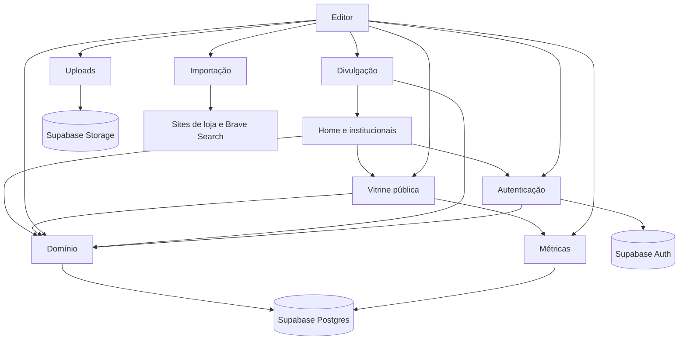
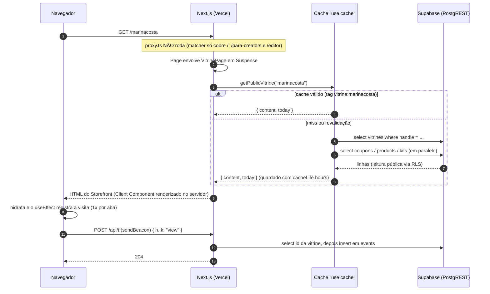
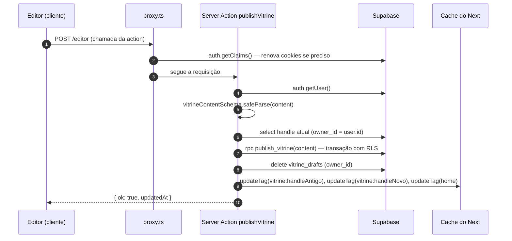
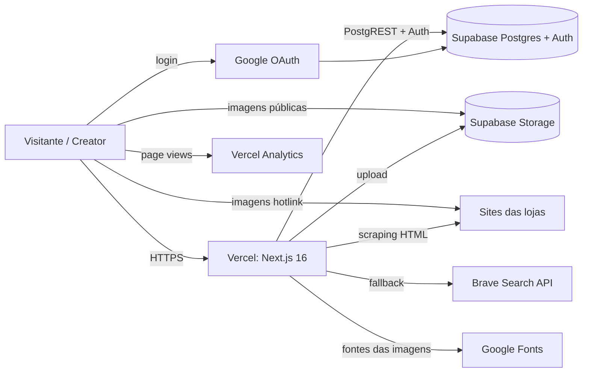

# Arquitetura

## Visão geral (sem jargão)

O **MyVitri** é um site onde **creators** (influenciadoras, criadores de conteúdo) montam uma **vitrine pública** com os **cupons de desconto** das marcas que divulgam, os **produtos** que indicam e **kits** (combos de produtos). A vitrine tem um endereço curto, tipo `myvitri.com/marinacosta`, feito para ir na bio do Instagram/TikTok.

Pense num **shopping**:

- A **home** (`/`) é o corredor principal: mostra vitrines, cupons ativos, achados por categoria e marcas.
- Cada **vitrine** (`/{handle}`) é uma loja. O visitante vê os produtos com o preço já calculado com o cupom, copia o código e é levado para a loja oficial da marca. O MyVitri **não vende nada**: só aponta para a loja certa com o cupom certo.
- O **editor** (`/editor`) é o "estoque" da loja, onde a creator arruma tudo. Ela edita um **rascunho** (salvo sozinho a cada mudança) e, quando gosta do resultado, clica em **Publicar**.
- A creator ainda tem **métricas** (quantas visitas e cliques a vitrine teve) e **ferramentas de divulgação** (QR code, imagem para stories, UTM nos links).

O fluxo de uso é:

```mermaid
graph LR
    A["Creator abre /para-creators"] --> B["Escolhe nome e link"]
    B --> C["Entra com Google"]
    C --> D["Editor: cadastra cupons, produtos, kits"]
    D --> E["Publica"]
    E --> F["Coloca myvitri.com/handle na bio"]
    F --> G["Seguidor abre a vitrine"]
    G --> H["Copia o cupom e vai à loja da marca"]
    H --> I["Evento anônimo vira métrica no editor"]
```

## Visão técnica

### Stack

| Camada | Tecnologia | Versão (package.json) | Observação |
|---|---|---|---|
| Framework | Next.js (App Router) | `16.4.4` | Com `cacheComponents`, `partialPrefetching` e `proxy.ts` (o antigo *middleware*). Leia `node_modules/next/dist/docs/` antes de mexer — APIs mudaram (ver `AGENTS.md`). |
| UI | React | `19.3.0` | Server Components + Client Components; `useActionState`, `useTransition` |
| Estilo | Tailwind CSS v4 | `^4` | Carregado pelo loader `@tailwindcss/turbopack` (`next.config.ts:10-17`), **sem** `postcss.config` |
| Validação | Zod | `^4.6.7` | Schemas em `lib/vitrine/types.ts` |
| Banco/Auth/Arquivos | Supabase (`@supabase/supabase-js`, `@supabase/ssr`) | `^2.118.0` / `^0.12.7` | Postgres + RLS, Auth com Google, Storage |
| QR code | `qrcode` | `^1.5.4` | No editor (SVG/PNG) e na imagem de stories |
| Analytics | `@vercel/analytics` | `^2.0.1` | `<Analytics />` em `app/layout.tsx:20` |
| Linguagem | TypeScript strict | `^5` | Alias `@/*` → raiz (`tsconfig.json`) |

Não há testes automatizados, CI, Dockerfile nem filas/jobs no repositório.

### Estrutura de pastas

| Caminho | Papel |
|---|---|
| `app/` | Rotas do App Router (páginas, route handlers, imagens OG), `actions.ts` (todas as Server Actions), `layout.tsx`, `globals.css` |
| `components/auth/` | Formulários de login/criação de vitrine |
| `components/editor/` | Editor (painéis, campos, upload) — tudo Client Component |
| `components/storefront/` | A vitrine pública (`Storefront.tsx`) e as ilustrações de produto |
| `components/home/` | Peças da home, landing e páginas legais |
| `components/brand/` | Logotipo e ícone (SVG puro) |
| `lib/brand.ts` | Nome, domínio e e-mail de contato |
| `lib/supabase/` | Clientes Supabase do servidor e tipos gerados |
| `lib/vitrine/` | Domínio: tipos/schemas, preços, links/UTM, persistência, cache de leitura, importação por link, imagens de divulgação, cookie de "claim" |
| `proxy.ts` | Proxy do Next (renova sessão, corrige retorno do OAuth) |
| `supabase/` | Migrações SQL e seed |
| `public/` | Só os SVGs padrão do `create-next-app`, **não usados** |
| `.claude/launch.json` | Configuração de preview (`npm run dev`, porta 3000) para o Claude Code |

### Mapa dos módulos

O projeto não é dividido em "apps" como um monólito Django; os módulos abaixo são **fatias funcionais**.

| Módulo | Responsabilidade | Principais arquivos |
|---|---|---|
| Domínio | Tipos, schemas, preço com cupom, UTM, leitura/gravação no Supabase, cache de leitura pública | `lib/vitrine/{types,pricing,links,store,data}.ts` |
| Autenticação | Login com Google, sessão, criação da vitrine, sair, excluir conta | `proxy.ts`, `app/auth/callback/route.ts`, `lib/supabase/server.ts`, `lib/vitrine/claim.ts`, `components/auth/forms.tsx` |
| Editor | Rascunho com autosave, painéis, prévia, publicação | `app/editor/page.tsx`, `components/editor/*` |
| Vitrine pública | Página `/{handle}` | `app/[handle]/page.tsx`, `components/storefront/*` |
| Home e páginas institucionais | Home de descoberta, landing de creators, privacidade, termos, marca | `app/page.tsx`, `app/para-creators/`, `app/privacidade/`, `app/termos/`, `components/home/*`, `components/brand/*` |
| Importação por link | Ler nome/foto/preço/estoque de páginas de loja; achar logos | `lib/vitrine/import-link.ts` |
| Uploads de imagem | Reduzir no navegador e enviar ao Storage | `components/editor/{upload.ts,ImageField.tsx,LogoPicker.tsx}` |
| Métricas | Registrar eventos anônimos e mostrar gráficos | `app/api/t/route.ts`, `components/editor/MetricsPanel.tsx` |
| Divulgação | Imagem OG, imagem de stories, QR, link, UTM | `app/[handle]/opengraph-image.tsx`, `app/[handle]/story/route.ts`, `lib/vitrine/share-image.tsx`, `components/editor/SharePanel.tsx` |

### Dependências entre módulos

Leitura das setas: "usa". Exemplos concretos: a home usa `ProductArt` da vitrine pública (`components/storefront/ProductIcon.tsx`) e o `ClaimForm` da autenticação; o editor renderiza o próprio `Storefront` como prévia; a divulgação usa o `Wordmark` da marca (`components/brand/Logo.tsx`).

### Rotas

| Rota | Arquivo | Tipo | Renderização |
|---|---|---|---|
| `/` | `app/page.tsx` | Página | Dados via `getHomeFeed()` (`"use cache"`, tag `home`) |
| `/para-creators` | `app/para-creators/page.tsx` | Página | Estática + formulário cliente |
| `/privacidade`, `/termos` | `app/privacidade/page.tsx`, `app/termos/page.tsx` | Páginas | Estáticas |
| `/editor` | `app/editor/page.tsx` | Página | Sempre por requisição (`connection()`); `?aba=` e `?erro=login` |
| `/{handle}` | `app/[handle]/page.tsx` | Página | `<Suspense>` + `getPublicVitrine()` (`"use cache"`, tag `vitrine:{handle}`) |
| `/{handle}/opengraph-image` | `app/[handle]/opengraph-image.tsx` | Imagem (convenção de metadata) | PNG 1200×630 |
| `/{handle}/story` | `app/[handle]/story/route.ts` | Route Handler `GET` | PNG 1080×1920 com QR |
| `/api/t` | `app/api/t/route.ts` | Route Handler `POST` | Grava evento, sempre 204 |
| `/auth/callback` | `app/auth/callback/route.ts` | Route Handler `GET` | Troca `code` por sessão, cria vitrine |
| `/icon.svg`, `/apple-icon` | `app/icon.svg`, `app/apple-icon.tsx` | Ícones (convenção de metadata) | Estáticos |

### Server Actions (`app/actions.ts`)

Todas as mutações passam por Server Actions num único arquivo. Toda action que mexe em dados chama `getUser()` e devolve erro amigável sem sessão.

| Action | Linha | Precisa de login? | O que faz |
|---|---|---|---|
| `claimAction` | 47 | não | Landing: valida link/nome, guarda cookie e manda para o Google (ou cria direto se já logado) |
| `signInAction` | 64 | não | Inicia login Google a partir do editor |
| `createVitrineAction` | 69 | sim | Cria a vitrine para quem logou sem uma |
| `signOutAction` | 76 | — | Encerra a sessão e volta para `/` |
| `deleteAccountAction` | 86 | sim | Apaga arquivos, chama `delete_my_account()` e invalida caches |
| `publishVitrine` | 114 | sim | Valida com Zod, chama `publish_vitrine()`, apaga rascunho, invalida caches |
| `saveDraftAction` | 140 | sim | Autosave: grava ou apaga o rascunho |
| `importProductAction` | 155 | sim | Importa produto por link |
| `findLogoAction` | 166 | sim | Procura logos no site da loja |
| `uploadImageAction` | 185 | sim | Envia imagem ao Storage |
| `refreshPricesAction` | 206 | sim | Reconfere preço/estoque de até 60 produtos |
| `statsAction` | 227 | sim | Chama `vitrine_stats()` |

> Server Actions são endpoints HTTP públicos (POST para a URL da página). A checagem de sessão dentro de cada uma é obrigatória; a RLS do banco é a segunda barreira.

### Fluxo de uma requisição: abrir uma vitrine

### Fluxo de uma mutação: publicar

### Renderização e cache

O `next.config.ts` liga três opções que mudam o comportamento padrão:

| Opção | Linha | Efeito no projeto |
|---|---|---|
| `cacheComponents: true` | `next.config.ts:8` | Ativa o modelo de *Cache Components*: dados só são cacheados quando marcados com `"use cache"`; o que depende da requisição precisa estar dentro de `<Suspense>`. Por isso `app/[handle]/page.tsx` e `app/editor/page.tsx` envolvem o conteúdo em `<Suspense>`. |
| `partialPrefetching: true` | `next.config.ts:9` | Um `<Link>` pré-carrega só a "casca" (App Shell) da rota de destino, reaproveitada por todos os links para ela. |
| `experimental.agentFeedback: true` | `next.config.ts:5-7` | Faz o `next dev` escrever/restaurar o bloco do `AGENTS.md` (instruções para agentes de IA). Não afeta produção. |

**Dados cacheados** (`lib/vitrine/data.ts`):

| Função | Tag | `cacheLife` | Invalidado por |
|---|---|---|---|
| `getPublicVitrine(handle)` | `vitrine:{handle}` (`vitrineTag`) | `hours` | `publishVitrine` (handle antigo e novo), `createAndOpen`, `deleteAccountAction` (via `updateTag`); `/auth/callback` (via `revalidateTag(tag, { expire: 0 })`, já que `updateTag` só funciona em Server Actions) |
| `getHomeFeed()` | `home` (`HOME_TAG`) | `hours` | `publishVitrine`, `deleteAccountAction` |

O perfil `hours` do Next 16 é: *stale* 5 min, revalidação 1 h, expiração 1 dia. Isso também define **a precisão da validade dos cupons**: um cupom que vence hoje pode continuar aparecendo até a próxima revalidação, porque o `today` usado no filtro é calculado **dentro** da função cacheada (`lib/vitrine/data.ts:23`).

As leituras cacheadas usam `createPublicSupabase()` (`lib/supabase/server.ts:28`), um cliente **sem cookies** — obrigatório, porque o resultado do cache é compartilhado entre todos os visitantes.

O **editor** chama `await connection()` (`app/editor/page.tsx:13`) para nunca ser pré-renderizado: depende da sessão e da data de hoje.

### Proxy (o antigo middleware)

`proxy.ts` roda **antes** das rotas do `matcher` (`/`, `/para-creators`, `/editor` e subrotas):

1. **Corrige o retorno do OAuth** (`proxy.ts:11-15`): se o Supabase devolver o usuário para `/?code=…` (acontece quando o `redirectTo` não está na lista de Redirect URLs), redireciona para `/auth/callback` com a mesma query.
2. **Renova a sessão** (`proxy.ts:17-29`): cria um cliente Supabase ligado aos cookies da requisição/resposta e chama `auth.getClaims()`. Se o token estiver para expirar, os cookies novos vão na resposta. Server Components não conseguem gravar cookies (o `setAll` de `lib/supabase/server.ts:17-21` engole o erro de propósito), então é o proxy que mantém a sessão viva.

A vitrine pública (`/{handle}`), as imagens e `/api/t` não passam pelo proxy — não precisam de sessão.

### Autenticação e autorização (resumo)

- Login **só com Google**, via Supabase Auth (`signInWithOAuth`), fluxo com `code` trocado em `/auth/callback`.
- Três clientes Supabase no servidor (`lib/supabase/server.ts`): `createSupabase()` (com cookies, para actions e páginas dinâmicas), `createPublicSupabase()` (anônimo, para cache) e `getUser()` (atalho que devolve cliente + usuário).
- **Autorização é do banco**: RLS + `owns_vitrine()`. O app nunca usa chave de serviço. Detalhes em [database.md](database.md#políticas-rls-estado-final).

### Integrações externas

| Serviço | Para quê | Onde | Obrigatório? |
|---|---|---|---|
| Supabase Postgres (PostgREST) | Dados | `lib/vitrine/store.ts`, `app/api/t/route.ts`, `app/actions.ts` | sim |
| Supabase Auth + Google OAuth | Login | `app/actions.ts:24-31`, `app/auth/callback/route.ts` | sim |
| Supabase Storage | Fotos e logos enviados | `app/actions.ts:185-201` | sim (para upload) |
| Sites das lojas (HTTP) | Importar produto, conferir preço, achar logo | `lib/vitrine/import-link.ts` | não (degrada para preenchimento manual) |
| Brave Search API | Fallback quando a loja bloqueia robôs | `lib/vitrine/import-link.ts:207-251` | não (`BRAVE_SEARCH_API_KEY`) |
| Google Favicons (`google.com/s2/favicons`) | Último recurso de logo | `lib/vitrine/import-link.ts:308` | não |
| Google Fonts (CSS API, em tempo de execução) | Fontes TTF das imagens OG/stories | `lib/vitrine/share-image.tsx:25-38` | não (cai na fonte padrão) |
| Google Fonts (via `next/font`, no build) | Inter e Barlow Condensed do site | `app/layout.tsx:6-8` | sim (no build) |
| Vercel Web Analytics | Page views | `app/layout.tsx:20` | não |

Imagens de produto e logos achados no site da loja são **hotlink** (URL externa exibida direto no ``); só o que a creator envia vai para o Storage.

### Tarefas assíncronas, filas e "signals"

**Não há** filas, cron jobs, workers, webhooks nem triggers de banco. O que parece assíncrono é:

| Comportamento | Como funciona | Onde |
|---|---|---|
| Autosave do rascunho | Debounce de 800 ms no navegador → `saveDraftAction` | `components/editor/Editor.tsx:118-127` |
| Registro de métricas | `navigator.sendBeacon` (fallback `fetch keepalive`) → `/api/t` | `components/storefront/Storefront.tsx:48-57` |
| Conferência de preços | 4 "workers" concorrentes **dentro da mesma requisição** da action | `app/actions.ts:206-219` |
| Busca automática de logo | Debounce de 700 ms no navegador | `components/editor/LogoPicker.tsx:43-47` |
| Cupom vencer/começar | Não há job: a data é comparada na leitura (`couponStatus`), limitada pela revalidação do cache | `lib/vitrine/pricing.ts:26-30` |
| Atualização da home | Revalidação do cache (`hours`) ou `updateTag(home)` ao publicar | `lib/vitrine/data.ts:51-55` |

### Configuração por ambiente

Não há arquivos de configuração por ambiente; tudo vem de variáveis de ambiente (veja `.env.example`).

| Variável | Obrigatória | Lida em | Para quê |
|---|---|---|---|
| `NEXT_PUBLIC_SUPABASE_URL` | sim | `lib/supabase/server.ts:7`, `proxy.ts:18` | URL do projeto Supabase |
| `NEXT_PUBLIC_SUPABASE_PUBLISHABLE_KEY` | sim | `lib/supabase/server.ts:8`, `proxy.ts:18` | Chave publicável (`sb_publishable_…`) |
| `BRAVE_SEARCH_API_KEY` | não | `lib/vitrine/import-link.ts:208` | Fallback da importação por link |
| `NODE_ENV` | automática | `lib/vitrine/claim.ts:16` | Cookie `vitri_claim` com `secure` só em produção |

| Aspecto | Desenvolvimento | Produção |
|---|---|---|
| Servidor | `npm run dev` (Turbopack) | `npm run build && npm start`, ou Vercel |
| Cookie de claim | sem `secure` | `secure` |
| `redirectTo` do OAuth | montado a partir do header `origin`/`host` da requisição (`app/actions.ts:26`) | idem — cada domínio precisa estar nas Redirect URLs do Supabase |
| Domínio exibido nos textos | sempre `myvitri.com` (constante `HOST`, `lib/brand.ts:3`) | idem |
| Links reais (Divulgar, QR) | `window.location.origin` (`components/editor/SharePanel.tsx:11`) | idem |
| `AGENTS.md` | reescrito pelo `next dev` | — |

### Infraestrutura de produção

O repositório não descreve a infraestrutura explicitamente. Os indícios apontam para **Vercel + Supabase**: o pacote `@vercel/analytics`, o PR #6 vindo de uma branch com prefixo `vercel/` (`vercel/vercel-web-analytics-integrati…`, típico das integrações da Vercel), `.vercel` no `.gitignore` e o README padrão de deploy na Vercel.

- **Deploy do app:** presumivelmente pela integração Git da Vercel (push na `main` / PRs com preview). Não há `vercel.json`.
- **Deploy do banco:** manual, com `supabase db push`.
- **Segredos:** só no painel da Vercel e no Supabase. `.env*` está no `.gitignore` (exceto `.env.example`). Nenhum segredo versionado foi encontrado.

### Estilo e design

- Tokens de cor e fontes em `app/globals.css:3-15` (`ink`, `paper`, `coral`, `mute`, `soft`, `line`, `sale`; `font-condensed` = Barlow Condensed).
- A vitrine usa **container queries** (`@container`, `@3xl:`, `@max-2xl:` em `components/storefront/Storefront.tsx`) em vez de *media queries*. É isso que faz a prévia do editor alternar entre "Computador" e "Celular" só mudando a largura da caixa (`components/editor/Editor.tsx:281`).
- O visual da vitrine é **fixo**; a creator só escolhe a capa. Temas/cores antigos ficaram no banco como legado.

### Datas e fuso horário

- Datas de cupom são strings `AAAA-MM-DD` comparadas como texto (`lib/vitrine/pricing.ts:26-30`).
- "Hoje" é calculado em **UTC** no servidor: `new Date().toISOString().slice(0, 10)` em `lib/vitrine/data.ts:23`, `lib/vitrine/data.ts:56` e `app/editor/page.tsx:24`.
- As métricas agrupam por dia em **`America/Sao_Paulo`** (`supabase/migrations/20261102000700_creator_tools.sql:39`).

### Convenções de código

- Comentários, mensagens e nomes de domínio em **português**; identificadores em inglês/português misto (`vitrine`, `handle`, `coupon`).
- `import "server-only"` em todo módulo que só pode rodar no servidor (`lib/supabase/server.ts`, `lib/vitrine/store.ts`, `data.ts`, `claim.ts`, `import-link.ts`, `share-image.tsx`).
- **Dinheiro em centavos** (`int`); formatação com `formatBRL` (`lib/vitrine/pricing.ts:5`).
- Erros para o usuário são **strings prontas em PT-BR** devolvidas pelas actions (`{ ok: false, error }`), nunca exceções.
- Nada de `next/image`: imagens são `` com `eslint-disable` explicando que a URL é arbitrária.

