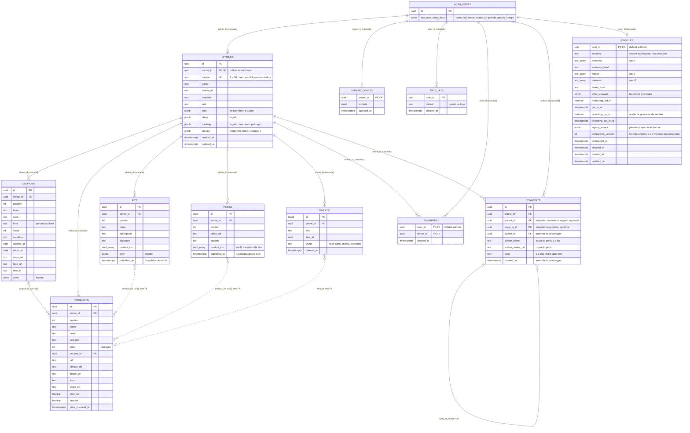
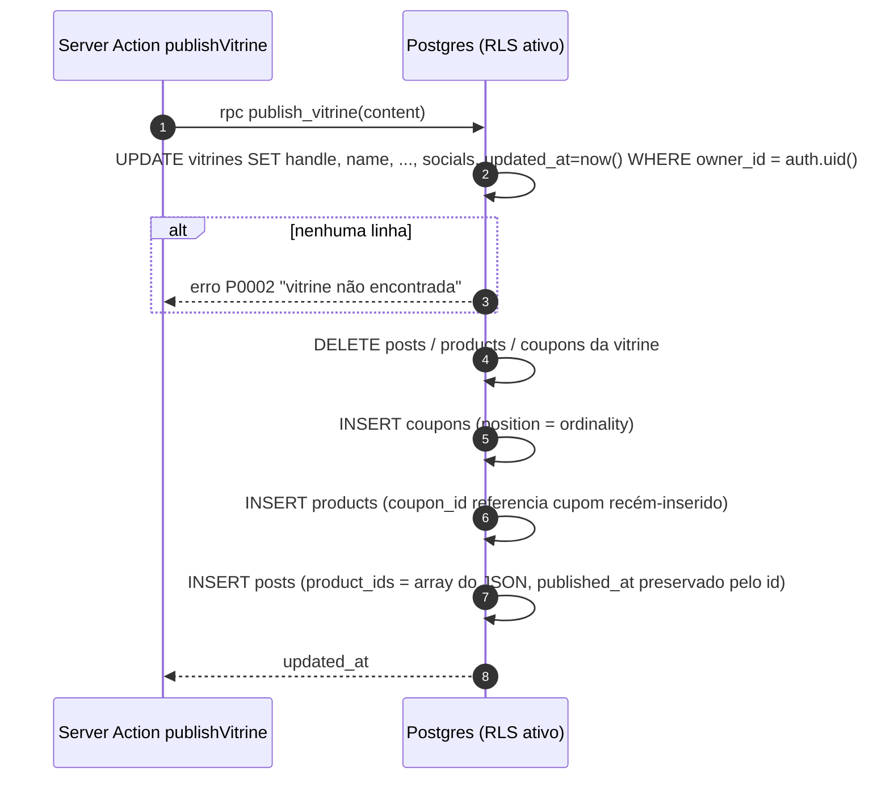
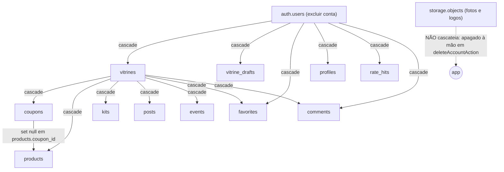

# Banco de dados

> Fonte da verdade: as migrações em [`supabase/migrations/`](../supabase/migrations) (aplicadas em ordem de nome) e os tipos gerados em [`lib/supabase/database.types.ts`](../lib/supabase/database.types.ts). Tudo o que está aqui foi conferido nesses arquivos.

## Visão geral (sem jargão)

Pense no banco como um **arquivo de pastas de uma loja de departamento**:

- Cada **creator** (influenciadora, criadora de conteúdo) tem **uma pasta**: a **vitrine**. Na capa da pasta está o nome dela, o endereço (`myvitri.com/marinacosta`), a foto, as frases de destaque e os links das redes sociais (Instagram, TikTok, YouTube, X).
- Dentro da pasta há três gavetas: **cupons** (os códigos de desconto de cada marca), **produtos** (o que ela indica: foto, nome e link) e **posts** (na interface chamados de **Outfits**: uma foto dela usando um conjunto e a lista das peças, que são produtos da vitrine). A antiga gaveta de **kits** não é mais usada pelo app: a tabela segue no banco, parada.
- Quem entra com e-mail e senha ou com o Google (mesmo sem ter vitrine) pode **seguir** vitrines (na interface "Seguir/Seguindo"; no código e no banco segue o nome antigo, favorito), numa lista privada (`favorites`), e **comentar** nelas (`comments`, com respostas em um nível): o comentário é público, e apaga quem escreveu ou a dona da vitrine.
- Ao lado da pasta oficial existe um **rascunho**: enquanto a creator edita, tudo vai para o rascunho. Só quando ela clica em **Publicar** o conteúdo do rascunho substitui o que está na pasta oficial.
- Existe ainda um **caderno de visitas** (`events`): toda vez que alguém abre a vitrine ou clica no produto ou em "copiar cupom", uma linha anônima é anotada ali. É daí que saem os gráficos de métricas.
- Cada conta tem ainda uma **ficha de boas-vindas** (`profiles`): as poucas perguntas que a pessoa responde logo depois de criar a conta (se divulga ou só procura cupons, em quais redes, o tamanho do público, como conheceu o MyVitri) e de onde ela veio (um "primeiro toque" de atribuição, sem IP). Quem pulou também ganha uma ficha, só marcada como pulada, para não ser perguntada de novo.
- Fora do app, num **escritório separado** (o schema `analytics`), ficam duas planilhas prontas que cruzam contas, fichas, vitrines e visitas para mostrar o funil de ativação. O app nunca lê esse escritório e a chave pública não abre a porta dele.
- As **fotos** enviadas (capa, perfil, fotos de post, logos de marca) não ficam no banco: ficam em "baldes" de arquivos (Supabase Storage), cada usuário na sua própria pasta.

Quem cuida da segurança é o próprio banco: regras chamadas **RLS** (Row Level Security) dizem "qualquer pessoa pode **ler** uma vitrine, mas só a dona pode **alterar**". O app nunca usa uma chave de administrador; ele sempre fala com o banco "como" a pessoa logada (ou como visitante anônimo).

## Visão técnica

- **SGBD:** PostgreSQL gerenciado pelo [Supabase](https://supabase.com) (PostgREST 14.18, segundo `database.types.ts:12`).
- **Schemas usados:** `public` (tabelas do app), `analytics` (views de análise, fora da API), `auth` (usuários, gerenciado pelo Supabase Auth), `storage` (buckets e objetos) e `extensions` (`unaccent` e `pg_trgm`, usadas na busca, e `pgcrypto`, para o HMAC de `track_event()`) e `vault` (o segredo `track_salt`, lido só por `track_event()`).
- **Acesso:** sempre via `@supabase/supabase-js` com a **chave publicável** (`NEXT_PUBLIC_SUPABASE_PUBLISHABLE_KEY`). Não existe `service_role` no código. Toda autorização é RLS + funções `security invoker`, com quatro exceções `security definer` (`delete_my_account`; `top_creators_today`, que só devolve a ordem do ranking; `take_rate_limit`, o contador de ritmo por conta; e `track_event`, que grava o evento da vitrine pública só com o visitante assinado). Há ainda triggers `security invoker`: `comments_stamp` (`stamp_comment()`), `vitrines_stamp` (`stamp_vitrine()`), `posts_stamp` (`stamp_post()`) e os de limite de itens (`enforce_item_limit()`); veja [Limites de segurança dos dados](#limites-de-segurança-dos-dados).
- **IDs dos itens** (`coupons.id`, `products.id`, `posts.id`) **não têm default**: são UUIDs gerados no navegador (`crypto.randomUUID()` em `components/editor/ui.tsx:14`) e enviados na publicação. Isso mantém o ID estável entre publicações, o que permite que as métricas (`events.item_id`) continuem apontando para o item certo.
- **Dinheiro em centavos** (`int`): `coupons.value` quando `kind = 'fixed'` e a coluna legado `products.price`.

## Diagrama ER



> Linhas tracejadas (`..`) são relações **lógicas**, sem chave estrangeira no banco.

## Histórico de migrações

| Ordem | Arquivo | O que faz |
|---|---|---|
| 1 | `20261102000000_vitrines.sql` | Cria `vitrines`, `coupons`, `products`, `kits`, índices, RLS, `owns_vitrine()` e a 1ª versão de `publish_vitrine()`. Kits tinham `tab` + `title`. |
| 2 | `20261102000100_split_owner_policies.sql` | Troca as policies `for all` do dono por policies separadas de `insert`/`update`/`delete` (o `for all` também cobria `select` e duplicava a policy pública). |
| — | *(000200 e 000300)* | **Não existem no repositório.** A numeração pula de `000100` para `000400`. |
| 3 | `20261102000400_vitrine_drafts.sql` | Cria `vitrine_drafts` (rascunho do editor) com RLS só do dono. |
| 4 | `20261102000500_kit_name.sql` | Kit passa a ter um nome só: renomeia `tab` → `name`, copia `title` para `name` quando existia, apaga `title`, migra rascunhos antigos e recria `publish_vitrine()`. |
| 5 | `20261102000600_kit_style.sql` | Adiciona `kits.style jsonb` e recria `publish_vitrine()`. |
| 6 | `20261102000700_creator_tools.sql` | Cupom ganha `logo_url`, `how_to`, `starts_at`; produto ganha `affiliate_url`, `video_url`, `sold_out`, `price_checked_at`; vitrine ganha `tracking`; cria `events` + policies e `vitrine_stats()`; recria `publish_vitrine()`. |
| 7 | `20261102000800_coupon_color.sql` | Adiciona `coupons.color jsonb` e recria `publish_vitrine()`. |
| 8 | `20261102000900_delete_account.sql` | Cria `delete_my_account()` (`security definer`). |
| 9 | `20261103000000_brand_logos.sql` | Cria o bucket `brand-logos` e as policies de `storage.objects`. |
| 10 | `20261103000100_vitrine_photos.sql` | Cria o bucket `vitrine-photos` e as policies. |
| 11 | `20261104000000_landing_home.sql` | Extensões `unaccent` e `pg_trgm` (schema `extensions`); função `fold()`; índices trigram de busca; `kits.published_at`; `events.visitor` e `events_day_idx`; recria `publish_vitrine()` (preserva `published_at`); cria `top_creators_today()` e `search_catalog()`. Está no repositório, mas precisa ser aplicada no Supabase: a busca (`/api/busca`) e as Vitrines do dia de `/inicio` dependem de `search_catalog()`, `top_creators_today()` e `kits.published_at`. Sem a migração, a busca responde 500 e os carrosséis não aparecem. |
| 12 | `20261105000000_metrics_previous.sql` | `create or replace` de `vitrine_stats(days)`: mantém `totals`, `days` e `items` e acrescenta `previous` (totais por `kind` dos `days` dias imediatamente anteriores à janela atual, mais `buy_coupon`). Alimenta a variação contra o período anterior de `/metricas`. Está no repositório e precisa ser aplicada no Supabase; sem ela a RPC continua devolvendo o formato antigo e a página funciona sem as variações. |
| 13 | `20261105010000_favorites.sql` | Cria `favorites` (PK `(user_id, vitrine_id)`), o índice `favorites_vitrine_idx` e RLS só do dono. |
| 14 | `20261105010100_comments.sql` | Cria `comments`, os índices `comments_vitrine_idx` e `comments_author_idx`, a função `stamp_comment()`, o trigger `comments_stamp` (`before insert`) e as policies. |
| 15 | `20261109000000_comment_replies.sql` | Adiciona `comments.parent_id` (FK para `comments(id)` **on delete cascade**), o índice parcial `comments_parent_idx` e recria `stamp_comment()` para tratar respostas (sobe para o original, copia a vitrine, erro `VT404`). RLS inalterada. |
| 16 | `20261109000100_favorite_count.sql` | Cria `favorite_count(target_handle text)` (`security definer`), que devolve quantas pessoas favoritaram a vitrine, e libera a execução só para `anon` e `authenticated`. `favorites` segue privada. |
| 17 | `20261109000200_profiles_onboarding.sql` | Cria `profiles` (respostas do onboarding e origem do cadastro) com RLS do dono (select, insert e update), preenche uma linha com `onboarding_version = 0` para cada conta já existente e cria o schema `analytics` (fora da API) com as views `analytics.account_activation` e `analytics.funnel_steps`. Aplicada no Supabase remoto (projeto `buhpwscgfutkrufhcyej`) em 09/11/2026: o preenchimento marcou as 4 contas existentes na época com versão 0. |
| 18 | `20261110000000_posts.sql` | Cria `posts` (índices `posts_vitrine_idx` e `posts_published_idx`, RLS: leitura pública e escrita do dono via `owns_vitrine()`); recria `events_kind_check` para aceitar também `'post'` (`'kit'` segue aceito pelos eventos antigos); recria `publish_vitrine()`: insere `posts` preservando `published_at` pelo `id` e **para de apagar e reinserir `kits`**, que ficam no banco, intactos e sem uso no app. Aplicada no Supabase do projeto `vitri` em 10/11/2026. Num banco sem ela, a função antiga apaga os kits ao publicar (o `content` não traz `kits`) e não grava posts; o app tolera a tabela ausente (`isMissingTable`, erros `PGRST205`/`42P01`, em `lib/vitrine/store.ts:75`): a vitrine, o catálogo, o carrossel e a contagem abrem normalmente, só sem posts. |
| 19 | `20261110020000_vitrine_socials.sql` | Adiciona `vitrines.socials jsonb not null default '{}'` (`CHECK` objeto e até 2000 bytes) e recria `publish_vitrine()` (versão **anterior**) gravando também `socials = coalesce(content->'socials', '{}')`; o resto da função é igual à de `20261110000000_posts.sql`. Aplicada no Supabase do projeto `vitri` em 10/11/2026. Num banco sem ela, o editor guarda as redes no rascunho (`vitrine_drafts.content`), mas publicar não as grava e a vitrine pública não mostra os ícones. |
| 20 | `20261110030000_comment_reply_to.sql` | Adiciona `comments.reply_to_id` (FK para `comments(id)` **on delete set null**), o índice parcial `comments_reply_to_idx` e recria `stamp_comment()` (versão **atual**): zera o `reply_to_id` vindo do cliente e, se o `parent_id` enviado é uma resposta, grava esse id em `reply_to_id` antes de subir `parent_id` para o original. RLS inalterada. Aplicada no Supabase do projeto `vitri` em 10/11/2026. |
| 21 | `20261110030100_onboarding_outro.sql` | Onboarding versão 2. Zera `heard_from = 'rede-social'` (a rede exata não foi informada), troca os `CHECK` `profiles_heard_from_check` (agora com as redes `instagram`, `tiktok`, `youtube`, `kwai`, `pinterest`, `whatsapp`, `telegram`, `blog`, no lugar de `rede-social`) e `profiles_audience_band_check` (ganha `outro`), adiciona `profiles.other_answers` (`jsonb`, texto livre das opções "Outro") e recria `analytics.account_activation` com `other_answers` no fim. Aplicada no Supabase remoto em 10/11/2026. Num banco sem ela, gravar `audience_band = 'outro'`, as novas opções de `heard_from` ou `other_answers` falha, e o onboarding não é salvo. |
| 22 | `20261110030200_session_recording_consent.sql` | Consentimento de gravação de sessão: adiciona `profiles.recording_opt_in` (`boolean`, default `false`) e `profiles.recording_opt_in_at` (`timestamptz`) e recria `analytics.account_activation` com `recording_opt_in` no fim. Aplicada no Supabase remoto em 10/11/2026. Num banco sem ela, gravar o onboarding falha e a leitura do consentimento vira "não consentiu". |
| 23 | `20261110040000_storage_quota.sql` | Cria `storage_upload_allowed()` e recria as policies de insert "dono envia logos" e "dono envia fotos" em `storage.objects` com a cota por pessoa (500 arquivos, 100 MiB, 40 envios em 10 minutos). Aplicada no Supabase do projeto `vitri` em 10/11/2026; num banco sem ela não há cota. |
| 24 | `20261113000000_product_favorite.sql` | Adiciona `products.favorite boolean not null default false` (produto favorito da creator, mostrado na seção "Favoritos" da vitrine) e recria `publish_vitrine()` (versão **atual**) gravando também `favorite = coalesce((p->>'favorite')::boolean, false)` em cada produto; o resto é igual à de `20261110020000_vitrine_socials.sql`. Aplicada no Supabase remoto em 13/11/2026. Não tem relação com a tabela `favorites` (quem segue cada vitrine). |
| 25 | `20261113000100_view_once_per_day.sql` | Cria o índice único parcial `events_view_once` em `events (vitrine_id, visitor) where kind = 'view' and visitor is not null`: uma visita por pessoa por dia. |
| 26 | `20261113010000_security_hardening.sql` | Endurecimento de segurança. Cria `is_http_url()` e `CHECK`s `NOT VALID` de link e de tamanho; triggers de limite de itens (`enforce_item_limit()`), `vitrines_stamp` e `posts_stamp`; remove as policies de insert e update de `kits`; cria `rate_hits` e `take_rate_limit()`. Aplicada no Supabase de produção em 14/11/2026 (registrada como versão `20261114001259`, nome `security_hardening`). Sem passo manual e sem dependência do app. O insert anônimo em `events` não muda nela (veja as duas migrações seguintes). Detalhes em [Limites de segurança dos dados](#limites-de-segurança-dos-dados). |
| 27 | `20261114000000_track_event.sql` | Passo 1 do fechamento do insert anônimo em `events` (aditiva). `create extension if not exists pgcrypto with schema extensions`; índice parcial `events_visitor_idx (visitor, created_at desc) where visitor is not null`; função `track_event()` (`security definer`, `anon` e `authenticated`). Aplicada no Supabase de produção em 14/11/2026 (registrada como versão `20261114002553`, nome `track_event`). Precisa do segredo `track_salt` no Vault (senão `track_event()` dá `VT500`). Não muda nada para o `/api/t` antigo. Veja [Como os eventos entram](#como-os-eventos-entram). |
| 28 | `20261114000100_events_lockdown.sql` | Passo 2. Remove a policy "visitante registra evento" de `events` e recria `top_creators_today()` contando só eventos com `visitor` não nulo. Aplicada no Supabase de produção em 14/11/2026 (registrada como versão `20261114003551`, nome `events_lockdown`), depois do deploy do app novo e com o segredo no Vault. Veja [Como os eventos entram](#como-os-eventos-entram). |
| — | `supabase/seed.sql` | Vitrine de demonstração `/marinacosta`. Insere em `kits` pelas colunas antigas `tab`/`title`. |

## Tabelas

### `public.vitrines`

Uma linha por creator. É a "capa" pública da vitrine. Criada em `20261102000000_vitrines.sql:4-16`; `tracking` vem de `20261102000700_creator_tools.sql:16`.

| Coluna | Tipo | Nulo? | Default | Restrições / observações |
|---|---|---|---|---|
| `id` | `uuid` | não | `gen_random_uuid()` | PK |
| `owner_id` | `uuid` | **sim** | — | `UNIQUE`, FK → `auth.users(id)` **on delete cascade**. Nulo só na vitrine demo do seed (ninguém consegue editá-la). O `UNIQUE` garante **uma vitrine por conta**. |
| `handle` | `text` | não | — | `UNIQUE`, `CHECK (handle ~ '^[a-z0-9_.]{3,30}$')`. É o caminho da URL (`/marinacosta`). |
| `name` | `text` | não | — | `CHECK char_length between 1 and 60` |
| `avatar_url` | `text` | não | `''` | `CHECK is_http_url(avatar_url)` (vazio ou `http(s)` até 2000 caracteres, `vitrines_avatar_url_check`). URL da foto de perfil (bucket `vitrine-photos`, Google ou link colado). A vitrine nova de quem entra pelo Google já nasce com a foto da conta (`starterContent`) e `saveProfile` regrava `avatarUrl \|\| googlePhoto(user)` a cada gravação de perfil, de foto ou de capa; vazio para quem usa só e-mail e senha (a vitrine mostra as iniciais). `publish_vitrine()` não preenche a foto |
| `headline` | `text` | não | `''` | `CHECK char_length <= 90` |
| `sub` | `text` | não | `''` | `CHECK char_length <= 240` |
| `look` | `jsonb` | não | `{"theme":"vibrante","accent":"#FF5A36","font":"moderna","radius":"arredondado","layout":"grade"}` | Hoje o app **só lê/grava `bannerUrl`** (foto de capa, opcional: vazia, a vitrine mostra a primeira letra do nome). As outras chaves são de um visual antigo e são descartadas por `pickLook` (`lib/vitrine/store.ts:27`). `CHECK` `vitrines_look_check`: precisa ser objeto, até 4000 bytes, com `look->>'bannerUrl'` vazio ou `http(s)`. |
| `show` | `jsonb` | não | `{"ticker":true,"products":true,"coupons":true,"kits":true,"cta":true}` | **Legado.** É gravada na publicação, mas nenhum componente lê (`lib/vitrine/types.ts:91`). `CHECK` `vitrines_show_check`: objeto de até 1000 bytes. |
| `tracking` | `jsonb` | não | `'{}'` | `CHECK pg_column_size(tracking) <= 2000`. **Legado:** o app não lê nem escreve mais esta coluna (a UTM saiu e o `tracking` saiu do `VitrineContent`). Sem migração, ela continua existindo e `publish_vitrine()` segue gravando `coalesce(content->'tracking', '{}')`, que agora resulta em `'{}'`. Valores antigos ficam como estão. |
| `socials` | `jsonb` | não | `'{}'` | `CHECK jsonb_typeof(socials) = 'object' and pg_column_size(socials) <= 2000` (`20261110020000_vitrine_socials.sql`). Guarda o que a creator digitou em `{ instagram, tiktok, youtube, x }` (`@usuario`, `usuario` ou link); o app transforma em link do perfil com `socialUrl` (`lib/vitrine/socials.ts`) e `loadContent` lê com `pickSocials` (`lib/vitrine/store.ts:96`). Gravada por `publish_vitrine()` |
| `created_at` | `timestamptz` | não | `now()` | Fixada pelo trigger `vitrines_stamp`: `now()` no insert e nunca muda depois. |
| `updated_at` | `timestamptz` | não | `now()` | O trigger `vitrines_stamp` nunca deixa a data ficar no futuro (usa `least(valor, now())`). Atualizado por `publish_vitrine()` e por `updateProfile` (nome, link, foto e capa). A home ordena por ele (`lib/vitrine/store.ts:121`). |

**Índices:** PK (`id`), únicos implícitos em `owner_id` e `handle`.

**Trigger `vitrines_stamp`** (`before insert or update`, função `stamp_vitrine()`): fixa `created_at`, limita `updated_at` a `now()` e recusa (`errcode 23514`, "link reservado") `handle` reservado na criação ou na troca de link: `admin`, `myvitri`, `vitri`, `suporte`, `support`, `ajuda`, `help`, `contato`, `oficial` (a mesma lista de `RESERVED_HANDLES` do app).

### `public.coupons`

Cupons de desconto de uma vitrine. `20261102000000_vitrines.sql:18-30` + colunas de `000700` e `000800`.

| Coluna | Tipo | Nulo? | Default | Restrições / observações |
|---|---|---|---|---|
| `id` | `uuid` | não | — | PK, **gerado no navegador** |
| `vitrine_id` | `uuid` | não | — | FK → `vitrines(id)` **on delete cascade** |
| `position` | `int` | não | — | Ordem (1..n) atribuída pela publicação (`with ordinality`) |
| `brand` | `text` | não | — | `CHECK char_length between 1 and 60` |
| `code` | `text` | não | — | `CHECK char_length between 1 and 40`. O Zod passa para maiúsculas. |
| `kind` | `text` | não | — | `CHECK kind in ('percent','fixed')` |
| `value` | `int` | não | — | `CHECK value > 0 and (kind = 'fixed' or value <= 100)`. `percent`: 1–100; `fixed`: centavos. |
| `condition` | `text` | não | `''` | Sem limite no banco; o Zod limita a 120 (`lib/vitrine/types.ts:30`). |
| `expires_at` | `date` | sim | — | Sem uso: a validade saiu do produto, nada lê nem filtra por ela e a interface não a preenche (cupons novos ficam `null`). A coluna segue no banco e no schema Zod (`expiresAt`). |
| `store_url` | `text` | não | `''` | Link da loja, exatamente como a creator colou (a vitrine abre-o sem acrescentar UTM). |
| `logo_url` | `text` | não | `''` | Logo da marca (bucket `brand-logos` ou URL externa). |
| `how_to` | `text` | não | `''` | `CHECK char_length <= 400`. Passos, um por linha. |
| `starts_at` | `date` | sim | — | Sem uso, como `expires_at`: não há mais cupom "agendado"; todo cupom publicado aparece. A coluna segue no banco e no schema Zod (`startsAt`). |
| `color` | `jsonb` | não | `'"auto"'` | `CHECK jsonb_typeof(color) in ('string','number') and pg_column_size(color) <= 40`. **Legado:** o schema Zod não tem `color`, então toda publicação grava `"auto"`. |

**Índices:** `coupons_vitrine_idx (vitrine_id, position)`.

### `public.products`

Produtos indicados. `20261102000000_vitrines.sql:32-46` + colunas de `000700`.

| Coluna | Tipo | Nulo? | Default | Restrições / observações |
|---|---|---|---|---|
| `id` | `uuid` | não | — | PK, gerado no navegador |
| `vitrine_id` | `uuid` | não | — | FK → `vitrines(id)` **on delete cascade** |
| `position` | `int` | não | — | Ordem |
| `name` | `text` | não | — | `CHECK char_length between 1 and 80` |
| `brand` | `text` | não | `''` | Zod: até 60 |
| `category` | `text` | não | `''` | Zod: até 30. Texto livre; vira filtro na vitrine e na home. |
| `price` | `int` | não | `0` | `CHECK price >= 0`. **Centavos.** **Legado:** ainda é gravada na publicação, mas nada a mostra (o produto não tem preço na vitrine); produto novo fica com 0. |
| `coupon_id` | `uuid` | sim | — | FK → `coupons(id)` **on delete set null**. **Legado:** produto não tem mais cupom próprio e produto novo fica com null. Só `lib/vitrine/catalog/brands.ts` ainda lê, para associar o produto a uma marca (com fallback para `brand`) |
| `url` | `text` | não | `''` | Link do produto, exatamente como a creator colou (de afiliado ou da loja). É para onde o clique leva, sem UTM |
| `image_url` | `text` | não | `''` | Foto: URL externa da loja (*hotlink*, vinda da importação ou colada) ou foto enviada pelo editor para o bucket `vitrine-photos` |
| `icon` | `text` | não | `'Bag'` | Ilustração mostrada (`ProductArt`) quando não há foto. O editor não tem seletor: produtos existentes mantêm o ícone que têm e os novos nascem com `Bag`. Zod restringe a `ICONS` (`lib/vitrine/types.ts:3`): `Bikini, Glasses, Jar, Bottle, Shoe, Hat, Nuts, Bag`. O banco não tem `CHECK`. |
| `affiliate_url` | `text` | não | `''` | **Legado:** o editor tem um único campo de link (grava em `url` e zera este). Só tem valor em produtos antigos, de quando eram dois campos, e vale até o produto ser editado: `productHref` devolve `affiliate_url || url`, sem UTM. Sem migração |
| `video_url` | `text` | não | `''` | Review em vídeo (Reels/TikTok/YouTube) |
| `sold_out` | `boolean` | não | `false` | Esgotado: fica no fim da lista, não é clicável (mostra "Esgotado"). Hoje só é definido pela importação por link (o editor não tem mais switch) |
| `favorite` | `boolean` | não | `false` | Favorito da creator (`20261113000000_product_favorite.sql`): aparece na seção "Favoritos de {nome}" da vitrine e ganha selo de coração na grade. Conteúdo antigo sem o campo entra como `false` |
| `price_checked_at` | `timestamptz` | sim | — | **Legado.** A importação por link não lê mais preço. Nada no app lê esse campo |

**Índices:** `products_vitrine_idx (vitrine_id, position)`, `products_coupon_idx (coupon_id)`.

### `public.kits`

**Sem uso no app** desde `20261110000000_posts.sql` (os posts, ou outfits na interface, os substituíram): a tabela e as linhas existentes continuam, mas nada lê nem grava, e `publish_vitrine()` não mexe mais nelas. Desde `20261113010000_security_hardening.sql` as policies de insert e update foram removidas (só `select` público e `delete` do dono restam). Combos de até 4 produtos. `20261102000000_vitrines.sql:48-58`, renomeado em `000500`, `style` em `000600`.

| Coluna | Tipo | Nulo? | Default | Restrições / observações |
|---|---|---|---|---|
| `id` | `uuid` | não | — | PK, gerado no navegador |
| `vitrine_id` | `uuid` | não | — | FK → `vitrines(id)` **on delete cascade** |
| `position` | `int` | não | — | Ordem |
| `name` | `text` | não | — | `kits_name_check: char_length between 1 and 60`. Era `tab` até a migração `000500`. |
| `description` | `text` | não | `''` | Zod: até 240 |
| `signature` | `text` | não | `''` | Zod: até 80 ("assinatura" da creator) |
| `product_ids` | `uuid[]` | não | `'{}'` | IDs de `products`. **Sem FK** (array). Zod: no máximo 4. |
| `style` | `jsonb` | não | `'{}'` | `CHECK pg_column_size(style) <= 2000`. **Legado:** sempre `{}` hoje. |
| `published_at` | `timestamptz` | não | `now()` | Primeira publicação do kit (`20261104000000_landing_home.sql`). Kits já existentes foram preenchidos com `vitrines.updated_at`. Até a migração dos posts, `publish_vitrine()` reinseria os kits preservando o valor pelo `id`. |

**Índices:** `kits_vitrine_idx (vitrine_id, position)`, `kits_published_idx (published_at desc)`.

### `public.posts`

Foto da creator usando um conjunto ("Outfit" na interface) e a lista ordenada das peças (produtos da vitrine). Substitui os kits. `20261110000000_posts.sql`.

| Coluna | Tipo | Nulo? | Default | Restrições / observações |
|---|---|---|---|---|
| `id` | `uuid` | não | — | PK, **sem default** (gerado no navegador) |
| `vitrine_id` | `uuid` | não | — | FK → `vitrines(id)` **on delete cascade** |
| `position` | `int` | não | — | Ordem |
| `photo_url` | `text` | não | — | `CHECK char_length between 1 and 2000` (`posts_photo_url_check`) e `CHECK is_http_url(photo_url)` (`posts_photo_url_http`, `NOT VALID`). Foto enviada ao bucket `vitrine-photos` |
| `caption` | `text` | não | `''` | `CHECK char_length <= 300`. Legenda do outfit: a creator preenche no `OutfitsEditor` e a vitrine pública a mostra; `""` quando não há |
| `product_ids` | `uuid[]` | não | `'{}'` | `CHECK cardinality <= 8`. IDs de `products`, na ordem da lista. **Sem FK** (array). Zod: de 1 a 8, sem repetição |
| `published_at` | `timestamptz` | não | `now()` | Primeira publicação do post. `publish_vitrine()` reinsere os posts, mas preserva o valor pelo `id`; post novo recebe `now()`. |

**Índices:** `posts_vitrine_idx (vitrine_id, position)`, `posts_published_idx (published_at desc)`.

### `public.vitrine_drafts`

Rascunho do editor, um por usuário. `20261102000400_vitrine_drafts.sql:3-7`. Fica numa tabela separada porque `vitrines` é de leitura pública e o rascunho é privado.

| Coluna | Tipo | Nulo? | Default | Restrições / observações |
|---|---|---|---|---|
| `owner_id` | `uuid` | não | — | PK, FK → `auth.users(id)` **on delete cascade** |
| `content` | `jsonb` | não | — | `CHECK pg_column_size(content) <= 500000` (~500 KB). É o `VitrineContent` inteiro, **sem validação Zod** (pode ter itens incompletos). |
| `updated_at` | `timestamptz` | não | `now()` | O app grava a hora do servidor Next (`lib/vitrine/store.ts:252`). |

### `public.events`

Eventos anônimos da vitrine pública (métricas). `20261102000700_creator_tools.sql:19-26`.

| Coluna | Tipo | Nulo? | Default | Restrições / observações |
|---|---|---|---|---|
| `id` | `bigint` | não | `generated always as identity` | PK |
| `vitrine_id` | `uuid` | não | — | FK → `vitrines(id)` **on delete cascade** |
| `kind` | `text` | não | — | `CHECK kind in ('view','buy','copy','kit','video','post')` (`'post'` desde `20261110000000_posts.sql`; `'kit'` só para eventos antigos) |
| `item_id` | `uuid` | sim | — | ID do cupom/produto/post clicado. **Sem FK** (o item pode ter sido apagado). |
| `created_at` | `timestamptz` | não | `now()` | A policy de insert exige `now() ± 1 minuto`. |
| `visitor` | `text` | sim | — | `CHECK visitor is null or visitor ~ '^[0-9a-f]{16}$'`: hash diário anônimo do visitante (sem IP guardado), preenchido por `/api/t` com HMAC de `TRACK_SALT` + dia + vitrine + IP + user-agent (muda todo dia e por vitrine), deduplica cliques em `top_creators_today()` e visitas pelo índice `events_view_once`. Eventos antigos, sem `visitor`, não contam mais em `top_creators_today()` desde `20261114000100`. |

**Índices:** `events_vitrine_idx (vitrine_id, created_at desc)`, `events_day_idx (created_at desc) where kind <> 'view'` (parcial, para o ranking do dia), `events_visitor_idx (visitor, created_at desc) where visitor is not null` (parcial, para o limite de ritmo de `track_event()`; `20261114000000`), `events_view_once (vitrine_id, visitor) where kind = 'view' and visitor is not null` (único: um `view` por visitante por dia; o segundo é rejeitado no insert, então `vitrine_stats`, `/inicio`, `/metricas`, o funil e o ranking seguem contando linhas).

Significado de `kind`:

| `kind` | Disparado por | `item_id` |
|---|---|---|
| `view` | Abrir a vitrine (1x por aba, via `sessionStorage`, só depois de `/api/eu` e nunca da dona; 1x por pessoa por dia, pelo índice `events_view_once`) | `null` |
| `buy` | Botão/foto de compra de um produto | id do produto |
| `copy` | Botão "Copiar" de um cupom | id do cupom |
| `post` | Clique numa peça de um post (dispara também o `buy` do produto) | id do post |
| `kit` | **Legado.** Era o botão de compra de um item do kit; o app não grava mais | id do kit |
| `video` | Link "Ver meu review" | id do produto |


### `public.favorites`

Vitrines que cada conta segue ("Seguindo" na interface; o nome favorito é só do código e do banco). Lista privada. `20261105010000_favorites.sql`. Quem favorita não precisa ter vitrine.

| Coluna | Tipo | Nulo? | Default | Restrições / observações |
|---|---|---|---|---|
| `user_id` | `uuid` | não | `auth.uid()` | Parte da PK, FK → `auth.users(id)` **on delete cascade** |
| `vitrine_id` | `uuid` | não | — | Parte da PK, FK → `vitrines(id)` **on delete cascade** |
| `created_at` | `timestamptz` | não | `now()` | `listFavoriteHandles` ordena por ela, da mais recente para a mais antiga |

**Índices:** PK `(user_id, vitrine_id)` (cobre "as favoritas de alguém"), `favorites_vitrine_idx (vitrine_id)` (serve à cascata ao apagar a vitrine). `setFavorite` liga com `upsert ... ignoreDuplicates` e desliga com `delete` (`lib/vitrine/store.ts`).

### `public.comments`

Comentários na vitrine pública. `20261105010100_comments.sql`. Sem edição: para corrigir, a pessoa apaga e escreve de novo.

| Coluna | Tipo | Nulo? | Default | Restrições / observações |
|---|---|---|---|---|
| `id` | `uuid` | não | `gen_random_uuid()` | PK |
| `vitrine_id` | `uuid` | não | — | FK → `vitrines(id)` **on delete cascade** |
| `author_id` | `uuid` | não | `auth.uid()` | FK → `auth.users(id)` **on delete cascade**. Sobrescrito pelo trigger |
| `author_name` | `text` | não | `''` | `CHECK char_length between 1 and 80`. Cópia do nome da conta (Google ou cadastro) na hora de comentar (`auth.users` não é legível pelo público). Sobrescrito pelo trigger |
| `author_avatar_url` | `text` | não | `''` | Cópia da foto do Google (vazia em conta de e-mail e senha); só `https://`, senão `''`. Sobrescrito pelo trigger |
| `body` | `text` | não | — | `CHECK char_length(btrim(body)) between 1 and 500`. O trigger faz o `trim` |
| `created_at` | `timestamptz` | não | `now()` | Sobrescrito pelo trigger |
| `parent_id` | `uuid` | sim | `null` | FK → `comments(id)` **on delete cascade** (`20261109000000_comment_replies.sql`). `null`: comentário original. Preenchido: resposta. É um nível só: o trigger troca o `parent_id` pelo do original quando se responde a uma resposta |
| `reply_to_id` | `uuid` | sim | `null` | FK `comments_reply_to_id_fkey` → `comments(id)` **on delete set null** (`20261110030000_comment_reply_to.sql`). Só preenchido quando a pessoa respondeu a uma resposta: guarda qual (o app monta a árvore de respostas com ele e mostra "@Nome" quando a resposta foi achatada pelo limite de níveis). Sempre zerado e recalculado pelo trigger. Se a resposta respondida é apagada, vira `null` |

**Índices:** `comments_vitrine_idx (vitrine_id, created_at desc)` (lista da vitrine), `comments_author_idx (author_id, created_at desc)` (limite por minuto e `listCommentedHandles`), `comments_parent_idx (parent_id, created_at) where parent_id is not null` (parcial, respostas de cada comentário), `comments_reply_to_idx (reply_to_id) where reply_to_id is not null` (parcial).

**Trigger `comments_stamp`** (`before insert`, `for each row`, função `stamp_comment()`; veja [Funções (RPC)](#funções-rpc)): como a chave publicável é pública e dá para chamar a API sem passar pelo app, nada que identifica o comentário vem do cliente. O trigger preenche autor, nome, foto e `created_at` a partir da sessão, faz o `trim` do corpo e limita a 5 comentários por minuto por pessoa. Numa resposta, também resolve o original (se `parent_id` já é uma resposta, usa o `parent_id` dela), copia a `vitrine_id` dele (a resposta nunca fica em outra vitrine) e levanta `VT404` se o comentário não existe. Se o `parent_id` enviado já era uma resposta, grava esse id em `reply_to_id` (o `reply_to_id` vindo do cliente é sempre descartado).

### `public.profiles`

Ficha de onboarding de cada conta, uma linha por usuário. `20261109000200_profiles_onboarding.sql`. Quem não tem linha ainda não passou pelo onboarding: `/inicio` e `/editor` mandam essa pessoa para `/boas-vindas` (`needsOnboarding`, `lib/onboarding/store.ts`). Quem pulou também tem linha (só `skipped_at` preenchido). Não confundir com `events`: `events` continua sendo só a métrica anônima das vitrines das creators; `profiles` é dado da conta e alimenta a análise de ativação.

| Coluna | Tipo | Nulo? | Default | Restrições / observações |
|---|---|---|---|---|
| `user_id` | `uuid` | não | `auth.uid()` | PK, FK → `auth.users(id)` **on delete cascade** |
| `persona` | `text` | sim | — | `CHECK persona in ('creator','shopper')`. Nulo se a pessoa pulou |
| `networks` | `text[]` | não | `'{}'` | `CHECK cardinality(networks) <= 9`. Redes que usa (valores em `NETWORKS`, `lib/onboarding/options.ts`) |
| `audience_band` | `text` | sim | — | `CHECK` em `menos-1k`, `1k-10k`, `10k-50k`, `50k-200k`, `200k-1m`, `acima-1m`, `outro` (o `outro` vem de `20261110030100_onboarding_outro.sql`) |
| `niches` | `text[]` | não | `'{}'` | `CHECK cardinality(niches) <= 3` |
| `interests` | `text[]` | não | `'{}'` | `CHECK cardinality(interests) <= 12` (resposta de quem escolheu `shopper`) |
| `heard_from` | `text` | sim | — | `CHECK` em `outra-creator`, `indicacao`, `google`, `anuncio`, `instagram`, `tiktok`, `youtube`, `kwai`, `pinterest`, `whatsapp`, `telegram`, `blog`, `outro` (`20261110030100_onboarding_outro.sql`; `rede-social` saiu e as linhas antigas viraram `null`) |
| `other_answers` | `jsonb` | não | `'{}'` | `CHECK jsonb_typeof = 'object' and pg_column_size <= 1000` (`20261110030100_onboarding_outro.sql`). Texto livre das opções "Outro" ("Outra", em redes): chave = nome da pergunta (`networks`, `audience`, `niches`, `heardFrom`, `interests`), valor com até 60 caracteres. Só entra a chave cuja opção está marcada (`otherAnswers`, `lib/onboarding/store.ts`); quem pulou grava `{}` |
| `marketing_opt_in` | `boolean` | não | `false` | Aceite de receber propostas de marcas |
| `opt_in_at` | `timestamptz` | sim | — | Quando aceitou (`saveOnboardingProfile` só preenche se `marketing_opt_in`) |
| `recording_opt_in` | `boolean` | não | `false` | Aceite de ter a navegação gravada (PostHog Session Replay) no programa de testes; checkbox opcional da última tela do onboarding (`20261110030200_session_recording_consent.sql`). Lido por `recordingConsent` (`lib/onboarding/store.ts`) para ligar a gravação no navegador. Só contas criadas depois dessa mudança veem o checkbox; as anteriores ficam `false` |
| `recording_opt_in_at` | `timestamptz` | sim | — | Quando aceitou (`saveOnboardingProfile` só preenche se `recording_opt_in`) |
| `signup_source` | `jsonb` | não | `'{}'` | `CHECK jsonb_typeof = 'object' and pg_column_size <= 2000`. Primeiro toque de atribuição, vindo do cookie `vitri_ref`: `source`, `medium`, `campaign` (utm), `ref` (handle de vitrine), `referrer_host` (só o domínio), `landing` e `first_seen_at`. Sem IP nem URL completa |
| `onboarding_version` | `int` | não | `1` | `CHECK >= 0`. `0` = conta anterior ao onboarding (não é perguntada, fora do funil); `1` = primeira versão das perguntas; `2` = versão atual (`ONBOARDING_VERSION`, `lib/onboarding/options.ts`): redes em "Como conheceu" e campo "Outro". O default do banco continua `1`, mas o app sempre grava a versão atual |
| `onboarded_at` | `timestamptz` | sim | — | Quando respondeu |
| `skipped_at` | `timestamptz` | sim | — | Quando pulou (nulo se respondeu) |
| `created_at` | `timestamptz` | não | `now()` | |
| `updated_at` | `timestamptz` | não | `now()` | Gravado pelo app a cada upsert |

**Tipos:** a entrada `profiles` de `lib/supabase/database.types.ts` foi escrita à mão a partir da migração (não veio do gerador).

**Índices:** só a PK. Os valores de `persona`, `audience_band` e `heard_from` são conferidos no banco; o texto de `other_answers` é limitado a 60 caracteres por pergunta pelo Zod (`onboardingSchema`) e a 1000 bytes pelo banco; as listas `networks`, `niches` e `interests` são conferidas pelo Zod (`onboardingSchema`), para trocar opções sem migração. A gravação é um `upsert` por `user_id` (`saveOnboardingProfile`), feito pela própria pessoa (RLS).

## Schema `analytics` (análise, fora da API)

Criado na mesma migração. É para consulta manual (SQL Editor ou um papel administrativo), não para o app: o schema não é exposto pelo PostgREST e `revoke all` o tira de `public`, `anon` e `authenticated`. As views rodam com o dono, enxergam todas as contas (inclusive `auth.users`) e por isso o schema não deve ser exposto no painel da API. O app não lê essas views.

| View | O que devolve |
|---|---|
| `analytics.account_activation` | Uma linha por conta (`auth.users`, com `left join` em `profiles`, `vitrines`, cupons, produtos e `events`): `user_id`, `signed_up_at`, `onboarding_version`, `persona`, `onboarded_at`, `skipped_at`, `audience_band`, `niches`, `networks`, `heard_from`, `marketing_opt_in`, a atribuição achatada (`utm_source`, `utm_medium`, `utm_campaign`, `ref`, `referrer_host`), `has_vitrine`, `items` (cupons mais produtos), `first_view_at` e `first_click_at` (primeiro evento `view` e primeiro de outro tipo na vitrine da conta) e, no fim, `other_answers` (texto livre das opções "Outro"; a coluna existe a partir da migração `20261110000000`) e `recording_opt_in` (a partir da migração `20261110030200`) |
| `analytics.funnel_steps` | Funil das contas com `onboarding_version` diferente de 0, em `ord`, `step`, `total`: 1 Conta criada, 2 Respondeu o onboarding, 3 Pulou o onboarding, 4 Criou a vitrine, 5 Adicionou cupom ou produto, 6 Recebeu a 1ª visita, 7 Teve o 1º clique |

O PostHog (eventos de navegador e de servidor) é a outra camada de análise e não grava nada no banco; veja [Analytics](architecture.md#analytics-duas-camadas).

### `public.rate_hits`

Contador de uso, por conta, das ações que acessam sites de fora (importar produto, achar logo). Só `take_rate_limit()` lê e grava. `20261113010000_security_hardening.sql`.

| Coluna | Tipo | Nulo? | Default | Restrições / observações |
|---|---|---|---|---|
| `user_id` | `uuid` | não | — | FK → `auth.users(id)` **on delete cascade** |
| `bucket` | `text` | não | — | `import` (importar produto pelo link) ou `logo` (procurar logo no site da loja) |
| `created_at` | `timestamptz` | não | `now()` | Hora do uso |

**Índices:** `rate_hits_idx (user_id, bucket, created_at desc)`. RLS ligado **sem policies** e sem grants para `anon` e `authenticated`: a tabela só é acessível pela função `security definer`.

### Limites de segurança dos dados

Além dos `CHECK`s de cada tabela, a migração `20261113010000_security_hardening.sql` fecha as brechas de quem chama a API do Supabase direto, sem passar pelo app. Os `CHECK`s foram criados `NOT VALID`: valem para inserts e updates novos, e linhas antigas não são revalidadas.

| Regra | Onde | Como |
|---|---|---|
| Link só vazio ou `http(s)`, até 2000 caracteres | `vitrines.avatar_url`, `vitrines.look->>'bannerUrl'`, `coupons.store_url`, `coupons.logo_url`, `products.url`, `products.image_url`, `products.affiliate_url`, `products.video_url`, `posts.photo_url` | `CHECK` com a função `is_http_url(text)` (`immutable`): `u is not null and char_length(u) <= 2000 and (u = '' or u ~* '^https?://')`. Nomes: `*_url_check`, exceto em `posts`, onde é `posts_photo_url_http` (`posts_photo_url_check` já era a checagem de tamanho de `20261110000000_posts.sql`) |
| Tamanho de texto | `coupons.condition` (até 120), `products.brand` (até 60), `products.category` (até 30) | `coupons_condition_len`, `products_brand_len`, `products_category_len` |
| Tamanho de JSON | `vitrines.look` (objeto, até 4000 bytes), `vitrines.show` (objeto, até 1000 bytes) | `vitrines_look_check`, `vitrines_show_check` |
| Itens por vitrine | até 100 cupons, 200 produtos e 30 posts | triggers `before insert` `coupons_limit`, `products_limit` e `posts_limit` (função `enforce_item_limit()`, `errcode 23514`, execute revogado de todos) |
| Datas e links reservados | `vitrines` e `posts` | `vitrines_stamp` (`stamp_vitrine()`: `created_at` fixo, `updated_at` nunca no futuro, links reservados recusados) e `posts_stamp` (`stamp_post()`: `published_at` nunca no futuro) |
| Ritmo por conta | importar produto e achar logo | RPC `take_rate_limit()` + `rate_hits`: 30 usos por 10 minutos em cada `bucket` |

No app, `safeUrl` (`lib/vitrine/links.ts`) repete a regra de link na leitura, e o schema da publicação já a aplicava; veja [Cabeçalhos de segurança](architecture.md#cabeçalhos-de-segurança) na arquitetura.

### Como os eventos entram

Os eventos de métrica (visitas e cliques) só entram pela função `track_event()`. Desde 14/11/2026 não existe mais policy de insert em `events`: quem chama o PostgREST direto com a chave publicável é recusado pela RLS (401, `42501`), então não dá para gravar eventos falsos fora do `/api/t`. O caminho é:

1. `/api/t` calcula o `visitor` (HMAC de `TRACK_SALT`) e a assinatura `sig` e chama `track_event()`.
2. A função confere a assinatura com o segredo `track_salt` do Vault, limita o ritmo por visitante (60 eventos em 10 minutos) e ignora a segunda visita do dia (índice `events_view_once`).
3. Só então grava em `events`, com `security definer`.

Duas migrações fecharam o insert anônimo, ambas **aplicadas** em produção:

| Migração | Aplicada em | Versão registrada | Efeito |
|---|---|---|---|
| `20261114000000_track_event.sql` | 14/11/2026 | `20261114002553` (`track_event`) | Cria `track_event()` (aditiva) |
| `20261114000100_events_lockdown.sql` | 14/11/2026 | `20261114003551` (`events_lockdown`) | Remove a policy "visitante registra evento" e faz `top_creators_today()` contar só eventos com `visitor` |

O índice único parcial `events_view_once` (`20261113000100_view_once_per_day.sql`) garante uma visita por pessoa por dia, e `track_event()` ignora a violação dele sem erro.

**Segredo no Vault.** O `track_event()` lê o segredo `track_salt` de `vault.decrypted_secrets`, e o valor precisa ser **idêntico** ao `TRACK_SALT` da Vercel. Se forem diferentes, a função recusa todo evento com `42501` ("visitante sem assinatura válida") e as métricas param: o `/api/t` só cai no insert direto quando a função não existe (`PGRST202`), não quando ela recusa (e, depois do lockdown, esse insert direto também seria recusado pela RLS). Para criar o segredo: `select vault.create_secret('<valor de TRACK_SALT>', 'track_salt');` (devolve só o id do registro, não o valor). Para trocar o valor: `select vault.update_secret((select id from vault.secrets where name = 'track_salt'), '<valor>');`. Se o `TRACK_SALT` da Vercel mudar, o do Vault tem de mudar junto.

## Storage (arquivos)

| Bucket | Público? | Limite | MIME aceitos | Quem usa | Migração |
|---|---|---|---|---|---|
| `brand-logos` | sim | 1 MiB (`1048576`) | `image/webp`, `image/png` | Logo de marca no cupom | `20261103000000_brand_logos.sql` |
| `vitrine-photos` | sim | 2 MiB (`2097152`) | `image/webp`, `image/jpeg` | Foto de capa, de perfil, do produto e do post | `20261103000100_vitrine_photos.sql` |

Caminho dos arquivos: `{auth.uid()}/{uuid}.{ext}` (`app/actions.ts:628`). As policies de `storage.objects` (insert, select, delete) só deixam o usuário mexer na pasta cujo primeiro segmento é o próprio `uid` (`storage.foldername(name)[1] = auth.uid()::text`). Leitura pública é pela URL do bucket público, sem policy.

**Cota por pessoa** (`20261110040000_storage_quota.sql`): as policies de insert ("dono envia logos" e "dono envia fotos") exigem também `storage_upload_allowed()`, que soma os dois buckets na pasta da pessoa e só devolve `true` com menos de 500 arquivos, menos de 100 MiB (soma de `metadata.size`) e menos de 40 envios nos últimos 10 minutos. A checagem roda antes do arquivo entrar, então o envio que passa do limite de tamanho é o último aceito. Vale também para quem chama a API do Storage direto, sem passar pelo app. Antes dessa migração não havia limite. Quando a policy recusa, o Storage responde `403` e `uploadImageAction` mostra `errors.uploadLimit`.

## Funções (RPC)

| Função | Linguagem / segurança | Quem pode executar | O que faz | Chamada em |
|---|---|---|---|---|
| `owns_vitrine(v uuid) → boolean` | SQL, `stable`, `security invoker`, `search_path = ''` | revogada de `public` e `anon` | `true` se a vitrine `v` pertence a `auth.uid()`. Usada nas policies. | Só nas policies |
| `publish_vitrine(content jsonb) → timestamptz` | plpgsql, `security invoker` | `authenticated` | Atualiza a vitrine do usuário, **apaga** todos os posts/produtos/cupons dela e **reinsere** a partir do JSON, numa transação (não toca em `kits`). Retorna `updated_at`. Versão atual: `20261113000000_product_favorite.sql` (grava também `products.favorite`; a anterior, `20261110020000_vitrine_socials.sql`, gravava `socials`; vem de `20261110000000_posts.sql` a preservação de `posts.published_at` por `id`; `content` sem `posts` não insere nenhum). | `lib/vitrine/store.ts:284` |
| `vitrine_stats(days int default 30) → jsonb` | SQL, `stable`, `security invoker` | `authenticated` | Agrega `events` da vitrine de quem chama nos últimos `days` (limitado a 1–90), por dia no fuso `America/Sao_Paulo` e por item. Também devolve `previous`: os totais da janela anterior de mesma duração. Versão atual: `20261105000000_metrics_previous.sql` (lê as duas janelas de uma vez, `now() - 2 * days`). | `loadStats` em `app/[locale]/metricas/page.tsx` e `loadWeek` (`vitrine_stats(7)`, os números do `ProfileHeader`) em `app/[locale]/inicio/page.tsx` |
| `stamp_comment() → trigger` | plpgsql, `security invoker`, `search_path = ''` | `execute` revogado de `public`, `anon` e `authenticated` (só o trigger a chama) | Função do trigger `comments_stamp`. Lê `auth.jwt() -> 'user_metadata'`: `author_id = auth.uid()`; `author_name` = `name`, senão `full_name`, senão `Visitante` (até 80 caracteres); `author_avatar_url` = `avatar_url` se começar com `https://`, senão vazio; `body` com `btrim`; `created_at = now()`. Se a pessoa já tem 5 ou mais comentários no último minuto, levanta `VT429` ("muitos comentários em pouco tempo"), que `addComment` transforma em `CommentRateLimitError`. Em resposta (`parent_id` não nulo), sobe para o comentário original (`coalesce(parent_id, id)`) e copia a `vitrine_id` dele e, quando o `parent_id` enviado era uma resposta, guarda esse id em `reply_to_id` (o valor vindo do cliente é zerado antes); se o comentário respondido não existe, levanta `VT404`, que `addComment` transforma em `CommentGoneError` (a FK `23503` também). | Trigger em `comments` (insert por `addComment`, `lib/vitrine/store.ts`) |
| `favorite_count(target_handle text) → integer` | SQL, `stable`, **`security definer`**, `search_path = ''` | `execute` revogado de `public`; liberado para `anon` e `authenticated` | Conta as linhas de `favorites` da vitrine com esse `handle` (join com `vitrines`). Como `favorites` é privada por RLS, a função só devolve o número, nunca quem favoritou. | `favoriteCount` em `lib/vitrine/store.ts`, via `getFavoriteCount` |
| `storage_upload_allowed() → boolean` | SQL, `stable`, `security invoker`, `search_path = ''` | `authenticated` (revogada de `public` e `anon`) | `true` se a pessoa está dentro da cota de upload: menos de 500 arquivos, menos de 100 MiB e menos de 40 envios nos últimos 10 minutos, somando `brand-logos` e `vitrine-photos` na pasta `auth.uid()`. É invoker de propósito: conta o que a pessoa enxerga pelas policies de select "dono lista logos"/"dono lista fotos" (que não chamam a função, então não há recursão). | Policies de insert de `storage.objects` |
| `is_http_url(u text) → boolean` | SQL, `immutable`, `parallel safe`, `search_path = ''` | padrão | `true` se `u` não é nulo, tem até 2000 caracteres e é vazio ou começa com `http://` ou `https://` (sem diferenciar maiúsculas). Base dos `CHECK`s de link. | `CHECK`s |
| `take_rate_limit(p_bucket text) → boolean` | plpgsql, **`security definer`**, `search_path = ''` | `authenticated` (revogada de `public` e `anon`) | Limite por conta (`auth.uid()`): `import` e `logo` valem 30 usos por 10 minutos cada; outro `p_bucket` dá erro `22023`. Apaga os registros vencidos da conta em `rate_hits`, devolve `false` sem conta ou com o limite estourado e, senão, registra o uso e devolve `true`. | `importProductAction`, `findLogoAction` (`withinRate`, `app/actions.ts`) |
| `stamp_vitrine() → trigger`, `stamp_post() → trigger`, `enforce_item_limit() → trigger` | plpgsql, `security invoker`, `search_path = ''` | `execute` revogado de `public`, `anon` e `authenticated` (só os triggers chamam) | Funções dos triggers de [Limites de segurança dos dados](#limites-de-segurança-dos-dados). | Triggers |
| `track_event(p_vitrine uuid, p_kind text, p_item uuid, p_visitor text, p_sig text) → void` | plpgsql, **`security definer`**, `search_path = ''` | `anon`, `authenticated` (revogada de `public`) | Grava um evento da vitrine pública. Lê o segredo `track_salt` de `vault.decrypted_secrets` (ausente: erro `VT500`); exige `p_visitor ~ '^[0-9a-f]{16}$'` e `p_sig` = hex(HMAC-SHA256(`p_visitor`, segredo)), senão erro `42501`. Ignora sem erro `p_kind` inválido, vitrine inexistente, visitante com 60 eventos ou mais nos últimos 10 minutos e a segunda visita do dia (`unique_violation` de `events_view_once`). Migração `20261114000000_track_event.sql`, aplicada em produção. O segredo do Vault precisa ser igual ao `TRACK_SALT` da Vercel (veja [Como os eventos entram](#como-os-eventos-entram)). | `app/api/t/route.ts` (`rpc("track_event")`) |
| `delete_my_account() → void` | plpgsql, **`security definer`** | `authenticated` | Apaga `auth.users` do próprio usuário; o resto sai em cascata. | `app/actions.ts:392` |
| `fold(t text) → text` | SQL, `immutable`, `parallel safe`, `search_path = ''` | padrão | Minúsculas e sem acento (`unaccent` com dicionário explícito, para poder entrar em índice). Base dos índices trigram e da busca. | Índices e `search_catalog()` |
| `top_creators_today(lim int default 12) → table(handle text)` | SQL, `stable`, **`security definer`** | `anon`, `authenticated` | Handles das vitrines (com ao menos um cupom ou produto) ordenados pelos cliques do dia no fuso `America/Sao_Paulo` (`buy`, `copy`, `kit`, `video`; a migração dos posts não alterou a função, então `post` não entra), deduplicando visitante + tipo + item; desempate por `vitrines.updated_at`. Desde `20261114000100` (aplicada em produção) conta só eventos com `visitor` não nulo. Devolve só a ordem, nunca contagens (a RLS de `events` segue só para o dono). `lim` limitado a 1–50. | `topCreatorsToday` (`lib/vitrine/store.ts:159`), via `getTopCreators()` (e `getDailyCreators()`, as Vitrines do dia de `/inicio`), `getTrendingHandles()` (ordem "Em alta hoje" da aba Vitrines) e `loadPosition` em `/metricas` (lim 50). |
| `search_catalog(q text, lim int default 5) → jsonb` | SQL, `stable`, `security invoker` | `anon`, `authenticated` | Busca sem acento (mínimo 2 caracteres) em creators (nome/handle), cupons (marca) e produtos (nome). Retorna `{ creators, coupons, products }`; ordena por igual, começa com, contém e depois por semelhança. Lê só o que a RLS já torna público. `lim` limitado a 1–20 (cupons e produtos: até 6x). Cada produto vem com o cupom ligado a ele (`coupon`, que o app ignora) e cada cupom/produto com `handle` e `creator` de quem indica. | `searchCatalog` (`lib/vitrine/store.ts:179`), via `searchHome()` e `GET /api/busca` |

### `publish_vitrine` passo a passo



A ordem dos `DELETE` (posts → products → coupons) e dos `INSERT` (coupons → products → posts) respeita a FK `products.coupon_id`. Como a função é `security invoker`, cada `DELETE`/`INSERT` passa pelas policies do dono. Um `handle` repetido estoura `23505` (unique violation), que o app traduz em "link já está em uso" (`lib/vitrine/store.ts:288`).

Formato do JSON esperado (`camelCase`, igual a `VitrineContent` em `lib/vitrine/types.ts:70-96`):

```json
{
  "handle": "marinacosta",
  "name": "Marina Costa",
  "avatarUrl": "",
  "headline": "...",
  "sub": "...",
  "look": { "bannerUrl": "" },
  "show": { "ticker": true, "products": true, "coupons": true, "kits": true, "cta": true },
  "socials": { "instagram": "", "tiktok": "", "youtube": "", "x": "" },
  "coupons": [{ "id": "uuid", "brand": "", "code": "", "kind": "percent", "value": 10, "condition": "", "expiresAt": null, "storeUrl": "", "logoUrl": "", "howTo": "", "startsAt": null }],
  "products": [{ "id": "uuid", "name": "", "brand": "", "category": "", "price": 0, "couponId": null, "url": "", "imageUrl": "", "icon": "Bag", "affiliateUrl": "", "videoUrl": "", "soldOut": false, "priceCheckedAt": null }],
  "posts": [{ "id": "uuid", "photoUrl": "", "caption": "", "productIds": [] }]
}
```

### `vitrine_stats` — formato de retorno

```json
{
  "totals": { "view": 120, "buy": 30, "copy": 12 },
  "days":   [{ "day": "2026-11-01", "views": 40, "clicks": 9 }],
  "items":  [{ "id": "uuid-do-item", "kind": "buy", "n": 7 }],
  "previous": { "view": 95, "buy": 22, "copy": 10, "buy_coupon": 8 }
}
```

`clicks` = todos os eventos que não são `view`. `previous` soma os eventos por `kind` dos `days` dias imediatamente anteriores à janela (só os `kind` que tiveram eventos aparecem) e inclui `buy_coupon`: cliques `buy` em produtos que têm cupom (`products.coupon_id` não nulo). O app **ignora** `buy_coupon`: a variação de "Cupons copiados" compara o `copy` atual com `previous.copy`. O campo é opcional no tipo `Stats` (`components/metrics/stats.ts`): sem a migração aplicada ele não vem.

## Políticas RLS (estado final)

| Tabela | Ação | Papéis | Regra |
|---|---|---|---|
| `vitrines` | select | `anon`, `authenticated` | `true` (pública) |
| `vitrines` | insert | `authenticated` | `owner_id = auth.uid()` |
| `vitrines` | update | `authenticated` | `owner_id = auth.uid()` (using e with check) |
| `vitrines` | delete | — | **Sem policy**: ninguém apaga direto; só pela cascata de `delete_my_account()` |
| `coupons` / `products` / `kits` / `posts` | select | `anon`, `authenticated` | `true` |
| `coupons` / `products` / `posts` | insert / update / delete | `authenticated` | `owns_vitrine(vitrine_id)` |
| `kits` | delete | `authenticated` | `owns_vitrine(vitrine_id)`. As policies de insert e update foram removidas em `20261113010000` (tabela legado) |
| `vitrine_drafts` | select / insert / update / delete | `authenticated` | `owner_id = auth.uid()` |
| `favorites` | select / insert / delete | `authenticated` | `user_id = auth.uid()` (insert: `with check`). Sem update |
| `comments` | select | `anon`, `authenticated` | `true` (pública) |
| `comments` | insert | `authenticated` | `author_id = auth.uid()` (o trigger já força esse valor) |
| `comments` | delete | `authenticated` | `author_id = auth.uid()` **ou** `owns_vitrine(vitrine_id)` (quem escreveu ou a dona da vitrine). Sem update. Apagar o original apaga as respostas em cascata |
| `profiles` | select / insert / update | `authenticated` | `user_id = (select auth.uid())` (insert: `with check`; update: `using` e `with check`). **Sem delete**: a linha sai pela cascata de `delete_my_account()` |
| `rate_hits` | — | nenhum | RLS ligado **sem policies** e sem grants; só `take_rate_limit()` (`security definer`) acessa |
| `analytics.*` | — | nenhum | Sem grants para `anon` e `authenticated`; o schema não é exposto pela API |
| `events` | insert | `anon`, `authenticated` | Policy "visitante registra evento": `created_at` entre `now() - 1 min` e `now() + 1 min` **e** a vitrine existe. Sem limite de ritmo. **Removida por `20261114000100_events_lockdown.sql`** (aplicada em 14/11/2026, versão `20261114003551`): hoje só `track_event()` (`security definer`) grava; o insert direto com a chave publicável é recusado (`42501`). Veja [Como os eventos entram](#como-os-eventos-entram) |
| `events` | select | `authenticated` | `owns_vitrine(vitrine_id)` (o ranking público passa por `top_creators_today()`, `security definer`, que só expõe a ordem) |
| `storage.objects` (`brand-logos`, `vitrine-photos`) | insert / select / delete | `authenticated` | primeira pasta do caminho = `auth.uid()`; o insert exige também `storage_upload_allowed()` (cota e ritmo) |

## Regras de exclusão (o que apaga o quê)



- `favorites` e `comments` caem por **duas** cascatas: ao apagar a conta de quem favoritou/comentou, e ao apagar a vitrine favoritada/comentada. Por isso `deleteAccountAction` lê antes (`listCommentedHandles`) as vitrines em que a pessoa comentou e invalida o cache `comentarios:{handle}` de cada uma depois da exclusão.
- Apagar um **cupom** no editor também limpa o `couponId` dos produtos no próprio rascunho (`remove` em `components/editor/Editor.tsx`); no banco, o `on delete set null` faria o mesmo.
- Apagar um **produto** no editor remove o ID dos posts no rascunho (`remove` em `components/editor/Editor.tsx`). No banco não há FK no array, então um post pode guardar IDs órfãos se alguém gravar direto; a vitrine ignora IDs que não encontra (`postItems`, `lib/vitrine/types.ts`).
- **Arquivos do Storage não somem com a conta**: `deleteAccountAction` lista e apaga até 1000 arquivos de cada bucket antes de chamar a RPC (`app/actions.ts:388`). Já a troca de foto de perfil ou de capa apaga a foto antiga de `vitrine-photos` na hora (`saveProfile`, `app/actions.ts:522`); fotos de produto e de outfit ficam órfãs até a exclusão da conta.

## Mapeamento banco ↔ app

O app trabalha em `camelCase` (`VitrineContent`), o banco em `snake_case`. A conversão está toda em [`lib/vitrine/store.ts`](../lib/vitrine/store.ts):

| Direção | Função | Arquivo |
|---|---|---|
| linha → `Coupon` | `toCoupon` | `lib/vitrine/store.ts:34` |
| linha → `Product` | `toProduct` | `lib/vitrine/store.ts:49` |
| linhas → `VitrineContent` | `loadContent` (`socials` com `pickSocials`; sem a coluna, tudo vazio) | `lib/vitrine/store.ts:77` |
| `VitrineContent` → banco | RPC `publish_vitrine` (o próprio SQL converte) | `lib/vitrine/store.ts:284` |
| nome, link, foto e capa → banco | `updateProfile`: `UPDATE` direto em `vitrines` (`handle`, `name`, `avatar_url`, `look`, `updated_at`), sem a RPC e sem o rascunho; vem de `updateProfileAction`, `updateAvatarAction` e `updateCoverAction`, validados por `vitrineProfileSchema` (`lib/vitrine/types.ts`) | `lib/vitrine/store.ts:277` |
| rascunho → `VitrineContent` | `findDraft` (completa campos novos como `posts`, descarta os `kits` de rascunhos antigos e remove legados e sempre usa nome, link, foto e capa da linha publicada em `vitrines`, nunca os do rascunho, via `pickProfile`) | `lib/vitrine/store.ts:229` |
| linha → `Post` | `toPost` | `lib/vitrine/store.ts:67` |
| respostas do onboarding → `profiles` | `saveOnboardingProfile`: `upsert` por `user_id` (`answers` nulo = pulou). Leitura de "já passou?" em `needsOnboarding` | `lib/onboarding/store.ts` |

`toCoupon`, `toProduct` e `toPost` são exportados e também usados pelos catálogos das abas de `/inicio` (`lib/vitrine/catalog/*`), que leem `vitrines`, `coupons`, `products` e `posts` com o cliente público (sem cookies), pela mesma RLS de leitura aberta.

