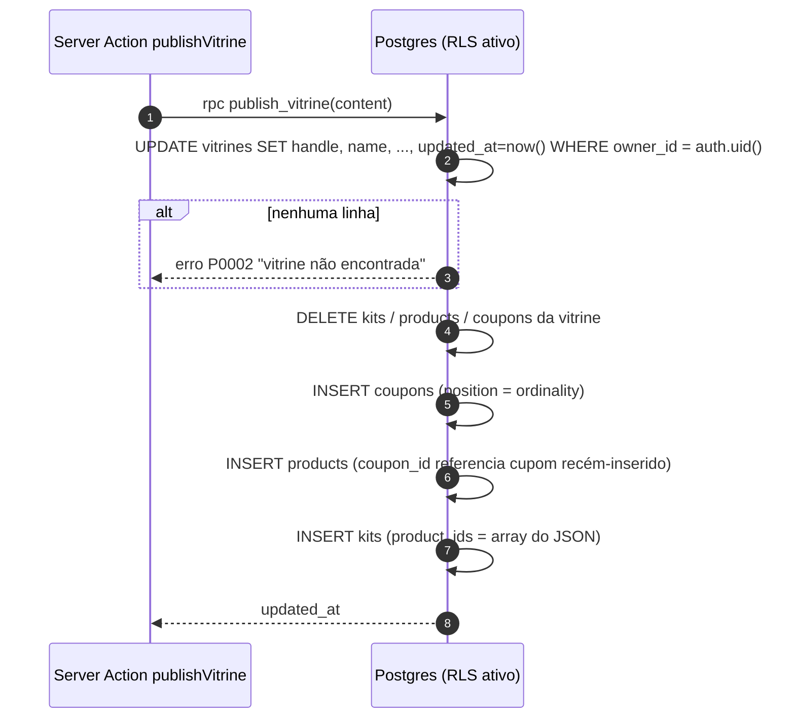
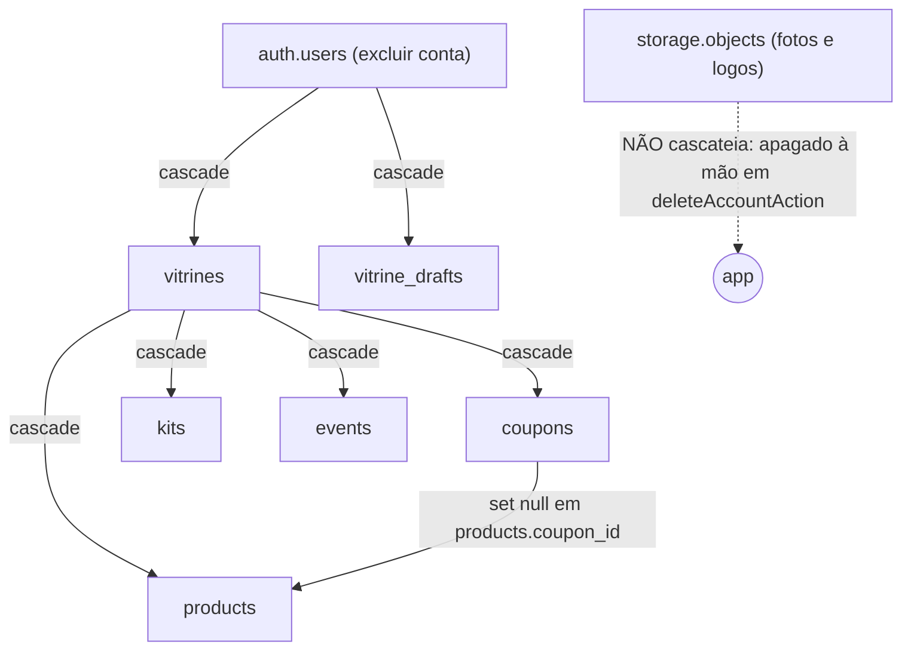

# Banco de dados

> Fonte da verdade: as migrações em [`supabase/migrations/`](../supabase/migrations) (aplicadas em ordem de nome) e os tipos gerados em [`lib/supabase/database.types.ts`](../lib/supabase/database.types.ts). Tudo o que está aqui foi conferido nesses arquivos.

## Visão geral (sem jargão)

Pense no banco como um **arquivo de pastas de uma loja de departamento**:

- Cada **creator** (influenciadora, criadora de conteúdo) tem **uma pasta**: a **vitrine**. Na capa da pasta está o nome dela, o endereço (`myvitri.com/marinacosta`), a foto e as frases de destaque.
- Dentro da pasta há três gavetas: **cupons** (os códigos de desconto de cada marca), **produtos** (o que ela indica, com preço) e **kits** (combinações de produtos, tipo "kit praia").
- Ao lado da pasta oficial existe um **rascunho**: enquanto a creator edita, tudo vai para o rascunho. Só quando ela clica em **Publicar** o conteúdo do rascunho substitui o que está na pasta oficial.
- Existe ainda um **caderno de visitas** (`events`): toda vez que alguém abre a vitrine ou clica em "comprar"/"copiar cupom", uma linha anônima é anotada ali. É daí que saem os gráficos de métricas.
- As **fotos** enviadas (capa, perfil, logos de marca) não ficam no banco: ficam em "baldes" de arquivos (Supabase Storage), cada usuário na sua própria pasta.

Quem cuida da segurança é o próprio banco: regras chamadas **RLS** (Row Level Security) dizem "qualquer pessoa pode **ler** uma vitrine, mas só a dona pode **alterar**". O app nunca usa uma chave de administrador; ele sempre fala com o banco "como" a pessoa logada (ou como visitante anônimo).

## Visão técnica

- **SGBD:** PostgreSQL gerenciado pelo [Supabase](https://supabase.com) (PostgREST 14.18, segundo `database.types.ts:12`).
- **Schemas usados:** `public` (tabelas do app), `auth` (usuários, gerenciado pelo Supabase Auth), `storage` (buckets e objetos) e `extensions` (`unaccent` e `pg_trgm`, usadas na busca).
- **Acesso:** sempre via `@supabase/supabase-js` com a **chave publicável** (`NEXT_PUBLIC_SUPABASE_PUBLISHABLE_KEY`). Não existe `service_role` no código. Toda autorização é RLS + funções `security invoker`, com duas exceções `security definer` (`delete_my_account` e `top_creators_today`, que só devolve a ordem do ranking).
- **IDs dos itens** (`coupons.id`, `products.id`, `kits.id`) **não têm default**: são UUIDs gerados no navegador (`crypto.randomUUID()` em `components/editor/ui.tsx:14`) e enviados na publicação. Isso mantém o ID estável entre publicações, o que permite que as métricas (`events.item_id`) continuem apontando para o item certo.
- **Dinheiro em centavos** (`int`): `products.price` e `coupons.value` quando `kind = 'fixed'`.

## Diagrama ER

```mermaid
erDiagram
    AUTH_USERS ||--o| VITRINES : "owner_id (cascade)"
    AUTH_USERS ||--o| VITRINE_DRAFTS : "owner_id (cascade)"
    VITRINES ||--o{ COUPONS : "vitrine_id (cascade)"
    VITRINES ||--o{ PRODUCTS : "vitrine_id (cascade)"
    VITRINES ||--o{ KITS : "vitrine_id (cascade)"
    VITRINES ||--o{ EVENTS : "vitrine_id (cascade)"
    COUPONS |o--o{ PRODUCTS : "coupon_id (set null)"
    KITS }o..o{ PRODUCTS : "product_ids uuid[] sem FK"
    EVENTS }o..o| PRODUCTS : "item_id sem FK"

    AUTH_USERS {
        uuid id PK
        jsonb raw_user_meta_data "name, avatar_url do Google"
    }
    VITRINES {
        uuid id PK
        uuid owner_id FK,UK "null na vitrine demo"
        text handle UK "3 a 30 chars: a-z 0-9 ponto underline"
        text name
        text avatar_url
        text headline
        text sub
        jsonb look "so bannerUrl e usado"
        jsonb show "legado"
        jsonb tracking "utm, campaign"
        timestamptz created_at
        timestamptz updated_at
    }
    COUPONS {
        uuid id PK
        uuid vitrine_id FK
        int position
        text brand
        text code
        text kind "percent ou fixed"
        int value
        text condition
        date expires_at
        date starts_at
        text store_url
        text logo_url
        text how_to
        jsonb color "legado"
    }
    PRODUCTS {
        uuid id PK
        uuid vitrine_id FK
        int position
        text name
        text brand
        text category
        int price "centavos"
        uuid coupon_id FK
        text url
        text affiliate_url
        text image_url
        text icon
        text video_url
        boolean sold_out
        timestamptz price_checked_at
    }
    KITS {
        uuid id PK
        uuid vitrine_id FK
        int position
        text name
        text description
        text signature
        uuid_array product_ids
        jsonb style "legado"
        timestamptz published_at "1a publicacao do kit"
    }
    VITRINE_DRAFTS {
        uuid owner_id PK,FK
        jsonb content
        timestamptz updated_at
    }
    EVENTS {
        bigint id PK
        uuid vitrine_id FK
        text kind
        uuid item_id
        text visitor "hash diario 16 hex, opcional"
        timestamptz created_at
    }
```



> Linhas tracejadas (`..`) são relações **lógicas**, sem chave estrangeira no banco.

## Histórico de migrações

| Ordem | Arquivo | O que faz |
|---|---|---|
| 1 | `20261102000000_vitrines.sql` | Cria `vitrines`, `coupons`, `products`, `kits`, índices, RLS, `owns_vitrine()` e a 1ª versão de `publish_vitrine()`. Kits tinham `tab` + `title`. |
| 2 | `20261102000100_split_owner_policies.sql` | Troca as policies `for all` do dono por policies separadas de `insert`/`update`/`delete` (o `for all` também cobria `select` e duplicava a policy pública). |
| — | *(000200 e 000300)* | **Não existem no repositório.** A numeração pula de `000100` para `000400`. |
| 3 | `20261102000400_vitrine_drafts.sql` | Cria `vitrine_drafts` (rascunho do editor) com RLS só do dono. |
| 4 | `20261102000500_kit_name.sql` | Kit passa a ter um nome só: renomeia `tab` → `name`, copia `title` para `name` quando existia, apaga `title`, migra rascunhos antigos e recria `publish_vitrine()`. |
| 5 | `20261102000600_kit_style.sql` | Adiciona `kits.style jsonb` e recria `publish_vitrine()`. |
| 6 | `20261102000700_creator_tools.sql` | Cupom ganha `logo_url`, `how_to`, `starts_at`; produto ganha `affiliate_url`, `video_url`, `sold_out`, `price_checked_at`; vitrine ganha `tracking`; cria `events` + policies e `vitrine_stats()`; recria `publish_vitrine()`. |
| 7 | `20261102000800_coupon_color.sql` | Adiciona `coupons.color jsonb` e recria `publish_vitrine()` (versão **atual**). |
| 8 | `20261102000900_delete_account.sql` | Cria `delete_my_account()` (`security definer`). |
| 9 | `20261103000000_brand_logos.sql` | Cria o bucket `brand-logos` e as policies de `storage.objects`. |
| 10 | `20261103000100_vitrine_photos.sql` | Cria o bucket `vitrine-photos` e as policies. |
| 11 | `20261104000000_landing_home.sql` | Extensões `unaccent` e `pg_trgm` (schema `extensions`); função `fold()`; índices trigram de busca; `kits.published_at`; `events.visitor` e `events_day_idx`; recria `publish_vitrine()` (preserva `published_at`, versão **atual**); cria `top_creators_today()` e `search_catalog()`. Está no repositório, mas precisa ser aplicada no Supabase: a busca (`/api/busca`) e os carrosséis de `/inicio` (creators do dia e últimos kits) dependem de `search_catalog()`, `top_creators_today()` e `kits.published_at`. Sem a migração, a busca responde 500 e os carrosséis não aparecem. |
| 12 | `20261105000000_metrics_previous.sql` | `create or replace` de `vitrine_stats(days)`: mantém `totals`, `days` e `items` e acrescenta `previous` (totais por `kind` dos `days` dias imediatamente anteriores à janela atual, mais `buy_coupon`). Alimenta a variação contra o período anterior de `/metricas`. Está no repositório e precisa ser aplicada no Supabase; sem ela a RPC continua devolvendo o formato antigo e a página funciona sem as variações. |
| — | `supabase/seed.sql` | Vitrine de demonstração `/marinacosta`. Insere em `kits` pelas colunas antigas `tab`/`title`. |

## Tabelas

### `public.vitrines`

Uma linha por creator. É a "capa" pública da vitrine. Criada em `20261102000000_vitrines.sql:4-16`; `tracking` vem de `20261102000700_creator_tools.sql:16`.

| Coluna | Tipo | Nulo? | Default | Restrições / observações |
|---|---|---|---|---|
| `id` | `uuid` | não | `gen_random_uuid()` | PK |
| `owner_id` | `uuid` | **sim** | — | `UNIQUE`, FK → `auth.users(id)` **on delete cascade**. Nulo só na vitrine demo do seed (ninguém consegue editá-la). O `UNIQUE` garante **uma vitrine por conta**. |
| `handle` | `text` | não | — | `UNIQUE`, `CHECK (handle ~ '^[a-z0-9_.]{3,30}$')`. É o caminho da URL (`/marinacosta`). |
| `name` | `text` | não | — | `CHECK char_length between 1 and 60` |
| `avatar_url` | `text` | não | `''` | URL da foto de perfil (bucket `vitrine-photos`, Google ou link colado) |
| `headline` | `text` | não | `''` | `CHECK char_length <= 90` |
| `sub` | `text` | não | `''` | `CHECK char_length <= 240` |
| `look` | `jsonb` | não | `{"theme":"vibrante","accent":"#FF5A36","font":"moderna","radius":"arredondado","layout":"grade"}` | Hoje o app **só lê/grava `bannerUrl`** (foto de capa). As outras chaves são de um visual antigo e são descartadas por `pickLook` (`lib/vitrine/store.ts:25`). |
| `show` | `jsonb` | não | `{"ticker":true,"products":true,"coupons":true,"kits":true,"cta":true}` | **Legado.** É gravada na publicação, mas nenhum componente lê (`lib/vitrine/types.ts:89`). |
| `tracking` | `jsonb` | não | `'{}'` | `CHECK pg_column_size(tracking) <= 2000`. Formato `{ utm: boolean, campaign: string }`; o app completa com `TRACKING = { utm: true, campaign: "" }` (`lib/vitrine/types.ts:101`). |
| `created_at` | `timestamptz` | não | `now()` | |
| `updated_at` | `timestamptz` | não | `now()` | Atualizado por `publish_vitrine()`. A home ordena por ele (`lib/vitrine/store.ts:112`). |

**Índices:** PK (`id`), únicos implícitos em `owner_id` e `handle`.

### `public.coupons`

Cupons de desconto de uma vitrine. `20261102000000_vitrines.sql:18-30` + colunas de `000700` e `000800`.

| Coluna | Tipo | Nulo? | Default | Restrições / observações |
|---|---|---|---|---|
| `id` | `uuid` | não | — | PK, **gerado no navegador** |
| `vitrine_id` | `uuid` | não | — | FK → `vitrines(id)` **on delete cascade** |
| `position` | `int` | não | — | Ordem (1..n) atribuída pela publicação (`with ordinality`) |
| `brand` | `text` | não | — | `CHECK char_length between 1 and 60` |
| `code` | `text` | não | — | `CHECK char_length between 1 and 40`. O Zod passa para maiúsculas. |
| `kind` | `text` | não | — | `CHECK kind in ('percent','fixed')` |
| `value` | `int` | não | — | `CHECK value > 0 and (kind = 'fixed' or value <= 100)`. `percent`: 1–100; `fixed`: centavos. |
| `condition` | `text` | não | `''` | Sem limite no banco; o Zod limita a 120 (`lib/vitrine/types.ts:30`). |
| `expires_at` | `date` | sim | — | `null` = sem validade. Vencido some da vitrine pública. |
| `store_url` | `text` | não | `''` | Link da loja (recebe UTM na vitrine). |
| `logo_url` | `text` | não | `''` | Logo da marca (bucket `brand-logos` ou URL externa). |
| `how_to` | `text` | não | `''` | `CHECK char_length <= 400`. Passos, um por linha. |
| `starts_at` | `date` | sim | — | Antes dessa data o cupom fica "agendado" e escondido. O editor atual não deixa criar agendamentos novos. |
| `color` | `jsonb` | não | `'"auto"'` | `CHECK jsonb_typeof(color) in ('string','number') and pg_column_size(color) <= 40`. **Legado:** o schema Zod não tem `color`, então toda publicação grava `"auto"`. |

**Índices:** `coupons_vitrine_idx (vitrine_id, position)`.

### `public.products`

Produtos indicados. `20261102000000_vitrines.sql:32-46` + colunas de `000700`.

| Coluna | Tipo | Nulo? | Default | Restrições / observações |
|---|---|---|---|---|
| `id` | `uuid` | não | — | PK, gerado no navegador |
| `vitrine_id` | `uuid` | não | — | FK → `vitrines(id)` **on delete cascade** |
| `position` | `int` | não | — | Ordem |
| `name` | `text` | não | — | `CHECK char_length between 1 and 80` |
| `brand` | `text` | não | `''` | Zod: até 60 |
| `category` | `text` | não | `''` | Zod: até 30. Texto livre; vira filtro na vitrine e na home. |
| `price` | `int` | não | `0` | `CHECK price >= 0`. **Centavos.** Preço cheio (sem cupom). |
| `coupon_id` | `uuid` | sim | — | FK → `coupons(id)` **on delete set null** |
| `url` | `text` | não | `''` | Link da loja (recebe UTM) |
| `image_url` | `text` | não | `''` | Foto: URL externa da loja (*hotlink*, vinda da importação ou colada) ou foto enviada pelo editor para o bucket `vitrine-photos` |
| `icon` | `text` | não | `'Bag'` | Ilustração quando não há foto. Zod restringe a `ICONS` (`lib/vitrine/types.ts:3`): `Bikini, Glasses, Jar, Bottle, Shoe, Hat, Nuts, Bag`. O banco não tem `CHECK`. |
| `affiliate_url` | `text` | não | `''` | Se preenchido, o botão de compra usa ele **sem UTM** |
| `video_url` | `text` | não | `''` | Review em vídeo (Reels/TikTok/YouTube) |
| `sold_out` | `boolean` | não | `false` | Esgotado: fica no fim da lista, sem botão de compra. Hoje só é definido pela importação por link (o editor não tem mais switch) |
| `price_checked_at` | `timestamptz` | sim | — | Quando o preço foi lido na loja (gravado na importação por link). Nada no app lê esse campo hoje |

**Índices:** `products_vitrine_idx (vitrine_id, position)`, `products_coupon_idx (coupon_id)`.

### `public.kits`

Combos de até 4 produtos. `20261102000000_vitrines.sql:48-58`, renomeado em `000500`, `style` em `000600`.

| Coluna | Tipo | Nulo? | Default | Restrições / observações |
|---|---|---|---|---|
| `id` | `uuid` | não | — | PK, gerado no navegador |
| `vitrine_id` | `uuid` | não | — | FK → `vitrines(id)` **on delete cascade** |
| `position` | `int` | não | — | Ordem |
| `name` | `text` | não | — | `kits_name_check: char_length between 1 and 60`. Era `tab` até a migração `000500`. |
| `description` | `text` | não | `''` | Zod: até 240 |
| `signature` | `text` | não | `''` | Zod: até 80 ("assinatura" da creator) |
| `product_ids` | `uuid[]` | não | `'{}'` | IDs de `products`. **Sem FK** (array). Zod: no máximo 4. |
| `style` | `jsonb` | não | `'{}'` | `CHECK pg_column_size(style) <= 2000`. **Legado:** sempre `{}` hoje. |
| `published_at` | `timestamptz` | não | `now()` | Primeira publicação do kit (`20261104000000_landing_home.sql`). Kits já existentes foram preenchidos com `vitrines.updated_at`. `publish_vitrine()` reinsere os kits, mas preserva o valor pelo `id`; kit novo recebe `now()`. |

**Índices:** `kits_vitrine_idx (vitrine_id, position)`, `kits_published_idx (published_at desc)`.

### `public.vitrine_drafts`

Rascunho do editor, um por usuário. `20261102000400_vitrine_drafts.sql:3-7`. Fica numa tabela separada porque `vitrines` é de leitura pública e o rascunho é privado.

| Coluna | Tipo | Nulo? | Default | Restrições / observações |
|---|---|---|---|---|
| `owner_id` | `uuid` | não | — | PK, FK → `auth.users(id)` **on delete cascade** |
| `content` | `jsonb` | não | — | `CHECK pg_column_size(content) <= 500000` (~500 KB). É o `VitrineContent` inteiro, **sem validação Zod** (pode ter itens incompletos). |
| `updated_at` | `timestamptz` | não | `now()` | O app grava a hora do servidor Next (`lib/vitrine/store.ts:257`). |

### `public.events`

Eventos anônimos da vitrine pública (métricas). `20261102000700_creator_tools.sql:19-26`.

| Coluna | Tipo | Nulo? | Default | Restrições / observações |
|---|---|---|---|---|
| `id` | `bigint` | não | `generated always as identity` | PK |
| `vitrine_id` | `uuid` | não | — | FK → `vitrines(id)` **on delete cascade** |
| `kind` | `text` | não | — | `CHECK kind in ('view','buy','copy','kit','video')` |
| `item_id` | `uuid` | sim | — | ID do cupom/produto/kit clicado. **Sem FK** (o item pode ter sido apagado). |
| `created_at` | `timestamptz` | não | `now()` | A policy de insert exige `now() ± 1 minuto`. |
| `visitor` | `text` | sim | — | `CHECK visitor is null or visitor ~ '^[0-9a-f]{16}$'`: hash diário anônimo do visitante (sem IP guardado), pensado para deduplicar cliques em `top_creators_today()`. Eventos sem `visitor` contam um a um. O código de `/api/t` ainda não preenche o campo. |

**Índices:** `events_vitrine_idx (vitrine_id, created_at desc)`, `events_day_idx (created_at desc) where kind <> 'view'` (parcial, para o ranking do dia).

Significado de `kind`:

| `kind` | Disparado por | `item_id` |
|---|---|---|
| `view` | Abrir a vitrine (1x por aba, via `sessionStorage`) | `null` |
| `buy` | Botão/foto de compra de um produto | id do produto |
| `copy` | Botão "Copiar" de um cupom | id do cupom |
| `kit` | Botão de compra de um item do kit (dispara também o `buy` do produto) | id do kit |
| `video` | Link "Ver meu review" | id do produto |


## Storage (arquivos)

| Bucket | Público? | Limite | MIME aceitos | Quem usa | Migração |
|---|---|---|---|---|---|
| `brand-logos` | sim | 1 MiB (`1048576`) | `image/webp`, `image/png` | Logo de marca no cupom | `20261103000000_brand_logos.sql` |
| `vitrine-photos` | sim | 2 MiB (`2097152`) | `image/webp`, `image/jpeg` | Foto de capa, de perfil e do produto | `20261103000100_vitrine_photos.sql` |

Caminho dos arquivos: `{auth.uid()}/{uuid}.{ext}` (`app/actions.ts:194`). As policies de `storage.objects` (insert, select, delete) só deixam o usuário mexer na pasta cujo primeiro segmento é o próprio `uid` (`storage.foldername(name)[1] = auth.uid()::text`). Leitura pública é pela URL do bucket público, sem policy.

## Funções (RPC)

| Função | Linguagem / segurança | Quem pode executar | O que faz | Chamada em |
|---|---|---|---|---|
| `owns_vitrine(v uuid) → boolean` | SQL, `stable`, `security invoker`, `search_path = ''` | revogada de `public` e `anon` | `true` se a vitrine `v` pertence a `auth.uid()`. Usada nas policies. | Só nas policies |
| `publish_vitrine(content jsonb) → timestamptz` | plpgsql, `security invoker` | `authenticated` | Atualiza a vitrine do usuário, **apaga** todos os cupons/produtos/kits dela e **reinsere** a partir do JSON, numa transação. Retorna `updated_at`. Versão atual: `20261104000000_landing_home.sql` (preserva `kits.published_at` por `id`). | `lib/vitrine/store.ts:285` |
| `vitrine_stats(days int default 30) → jsonb` | SQL, `stable`, `security invoker` | `authenticated` | Agrega `events` da vitrine de quem chama nos últimos `days` (limitado a 1–90), por dia no fuso `America/Sao_Paulo` e por item. Também devolve `previous`: os totais da janela anterior de mesma duração. Versão atual: `20261105000000_metrics_previous.sql` (lê as duas janelas de uma vez, `now() - 2 * days`). | `loadStats` em `app/metricas/page.tsx:13` |
| `delete_my_account() → void` | plpgsql, **`security definer`** | `authenticated` | Apaga `auth.users` do próprio usuário; o resto sai em cascata. | `app/actions.ts:98` |
| `fold(t text) → text` | SQL, `immutable`, `parallel safe`, `search_path = ''` | padrão | Minúsculas e sem acento (`unaccent` com dicionário explícito, para poder entrar em índice). Base dos índices trigram e da busca. | Índices e `search_catalog()` |
| `top_creators_today(lim int default 12) → table(handle text)` | SQL, `stable`, **`security definer`** | `anon`, `authenticated` | Handles das vitrines (com ao menos um cupom ou produto) ordenados pelos cliques do dia no fuso `America/Sao_Paulo` (`buy`, `copy`, `kit`, `video`), deduplicando visitante + tipo + item; desempate por `vitrines.updated_at`. Devolve só a ordem, nunca contagens (a RLS de `events` segue só para o dono). `lim` limitado a 1–50. | `topCreatorsToday` (`lib/vitrine/store.ts:150`), via `getTopCreators()` em `/inicio`, `getTrendingHandles()` (ordem "Em alta hoje" da aba Vitrines) e `loadPosition` em `/metricas` (lim 50) |
| `search_catalog(q text, lim int default 5) → jsonb` | SQL, `stable`, `security invoker` | `anon`, `authenticated` | Busca sem acento (mínimo 2 caracteres) em creators (nome/handle), cupons (marca) e produtos (nome). Retorna `{ creators, coupons, products }`; ordena por igual, começa com, contém e depois por semelhança. Lê só o que a RLS já torna público. `lim` limitado a 1–20 (cupons e produtos: até 6x). Cada produto vem com o cupom ligado a ele (`coupon`) e cada cupom/produto com `handle` e `creator` de quem indica. | `searchCatalog` (`lib/vitrine/store.ts:197`), via `searchHome()` e `GET /api/busca` |

### `publish_vitrine` passo a passo



A ordem dos `DELETE` (kits → products → coupons) e dos `INSERT` (coupons → products → kits) respeita a FK `products.coupon_id`. Como a função é `security invoker`, cada `DELETE`/`INSERT` passa pelas policies do dono. Um `handle` repetido estoura `23505` (unique violation), que o app traduz em "link já está em uso" (`lib/vitrine/store.ts:286`).

Formato do JSON esperado (`camelCase`, igual a `VitrineContent` em `lib/vitrine/types.ts:70-96`):

```json
{
  "handle": "marinacosta",
  "name": "Marina Costa",
  "avatarUrl": "",
  "headline": "...",
  "sub": "...",
  "look": { "bannerUrl": "" },
  "show": { "ticker": true, "products": true, "coupons": true, "kits": true, "cta": true },
  "tracking": { "utm": true, "campaign": "" },
  "coupons": [{ "id": "uuid", "brand": "", "code": "", "kind": "percent", "value": 10, "condition": "", "expiresAt": null, "storeUrl": "", "logoUrl": "", "howTo": "", "startsAt": null }],
  "products": [{ "id": "uuid", "name": "", "brand": "", "category": "", "price": 0, "couponId": null, "url": "", "imageUrl": "", "icon": "Bag", "affiliateUrl": "", "videoUrl": "", "soldOut": false, "priceCheckedAt": null }],
  "kits": [{ "id": "uuid", "name": "", "description": "", "signature": "", "productIds": [] }]
}
```

### `vitrine_stats` — formato de retorno

```json
{
  "totals": { "view": 120, "buy": 30, "copy": 12 },
  "days":   [{ "day": "2026-11-01", "views": 40, "clicks": 9 }],
  "items":  [{ "id": "uuid-do-item", "kind": "buy", "n": 7 }],
  "previous": { "view": 95, "buy": 22, "copy": 10, "buy_coupon": 8 }
}
```

`clicks` = todos os eventos que não são `view`. `previous` soma os eventos por `kind` dos `days` dias imediatamente anteriores à janela (só os `kind` que tiveram eventos aparecem) e inclui `buy_coupon`: cliques `buy` em produtos que têm cupom (`products.coupon_id` não nulo), que também copiam o código. Assim a variação de "Cupons copiados" usa a mesma conta do período atual, na qual a página soma `copy` aos cliques em produto com cupom. O campo é opcional no tipo `Stats` (`components/metrics/stats.ts`): sem a migração aplicada ele não vem.

## Políticas RLS (estado final)

| Tabela | Ação | Papéis | Regra |
|---|---|---|---|
| `vitrines` | select | `anon`, `authenticated` | `true` (pública) |
| `vitrines` | insert | `authenticated` | `owner_id = auth.uid()` |
| `vitrines` | update | `authenticated` | `owner_id = auth.uid()` (using e with check) |
| `vitrines` | delete | — | **Sem policy**: ninguém apaga direto; só pela cascata de `delete_my_account()` |
| `coupons` / `products` / `kits` | select | `anon`, `authenticated` | `true` |
| `coupons` / `products` / `kits` | insert / update / delete | `authenticated` | `owns_vitrine(vitrine_id)` |
| `vitrine_drafts` | select / insert / update / delete | `authenticated` | `owner_id = auth.uid()` |
| `events` | insert | `anon`, `authenticated` | `created_at` entre `now() - 1 min` e `now() + 1 min` **e** a vitrine existe |
| `events` | select | `authenticated` | `owns_vitrine(vitrine_id)` (o ranking público passa por `top_creators_today()`, `security definer`, que só expõe a ordem) |
| `storage.objects` (`brand-logos`, `vitrine-photos`) | insert / select / delete | `authenticated` | primeira pasta do caminho = `auth.uid()` |

## Regras de exclusão (o que apaga o quê)



- Apagar um **cupom** no editor também limpa o `couponId` dos produtos no próprio rascunho (`components/editor/CouponsPanel.tsx:44-51`); no banco, o `on delete set null` faria o mesmo.
- Apagar um **produto** no editor remove o ID dos kits no rascunho (`components/editor/ProductsPanel.tsx:190-197`). No banco não há FK no array, então um kit pode guardar IDs órfãos se alguém gravar direto; a vitrine ignora IDs que não encontra (`lib/vitrine/pricing.ts:62-64`).
- **Arquivos do Storage não somem com a conta**: `deleteAccountAction` lista e apaga até 1000 arquivos de cada bucket antes de chamar a RPC (`app/actions.ts:91-96`).

## Mapeamento banco ↔ app

O app trabalha em `camelCase` (`VitrineContent`), o banco em `snake_case`. A conversão está toda em [`lib/vitrine/store.ts`](../lib/vitrine/store.ts):

| Direção | Função | Arquivo |
|---|---|---|
| linha → `Coupon` | `toCoupon` | `lib/vitrine/store.ts:32` |
| linha → `Product` | `toProduct` | `lib/vitrine/store.ts:46` |
| linhas → `VitrineContent` | `loadContent` | `lib/vitrine/store.ts:70` |
| `VitrineContent` → banco | RPC `publish_vitrine` (o próprio SQL converte) | `lib/vitrine/store.ts:285` |
| rascunho → `VitrineContent` | `findDraft` (completa campos novos, remove legados) | `lib/vitrine/store.ts:232` |
| linha → `Kit` | `toKit` | `lib/vitrine/store.ts:62` |

`toCoupon`, `toProduct` e `toKit` são exportados e também usados pelos catálogos das abas de `/inicio` (`lib/vitrine/catalog/*`), que leem `vitrines`, `coupons`, `products` e `kits` com o cliente público (sem cookies), pela mesma RLS de leitura aberta.

