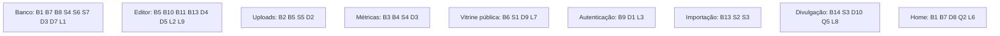

# Dívida técnica, bugs latentes e pegadinhas

## Visão geral (sem jargão)

Todo sistema tem "remendos" e coisas que funcionam por acaso. Este documento é a **lista honesta** do que está torto no MyVitri hoje, levantada lendo o código. Serve para três coisas: (1) não cair nas mesmas armadilhas, (2) entender por que algo se comporta de um jeito estranho e (3) priorizar correções.

Nada aqui foi corrigido nesta documentação — só registrado. Cada item aponta o arquivo e o documento onde há mais contexto.

**Legenda de prioridade**

| Prioridade | Significa |
|---|---|
| 🔴 Alta | Quebra um fluxo real, dá número errado para o usuário ou é risco de segurança |
| 🟠 Média | Comportamento errado em casos específicos, risco operacional ou de escala |
| 🟢 Baixa | Limpeza, consistência, legado |

## Lista consolidada

### Bugs latentes e comportamento incorreto

| # | Prioridade | Item | Onde | Detalhe |
|---|---|---|---|---|
| B1 | 🔴 | **Seed quebrado**: insere em `kits.tab`/`kits.title`, que não existem desde a migração `000500` | `supabase/seed.sql:38` | Num banco novo a vitrine `/marinacosta` não é criada, e ela é linkada no rodapé, na home e na landing. [database.md](database.md#pegadinhas-e-dívidas-de-modelagem) |
| B2 | 🔴 | **Uploads acima de 1 MB falham** (limite padrão do corpo de Server Actions) embora action e bucket aceitem 2 MiB | `next.config.ts`, `app/actions.ts:179-181` | [uploads.md](apps/uploads.md#pegadinhas-e-dívidas-técnicas) |
| B3 | 🔴 | **Métricas: "Cliques para a loja" e "Cupons copiados" usam a mesma fórmula** (`buy + copy`) | `components/editor/MetricsPanel.tsx:201-202` | Funil com duas barras sempre iguais. [metricas.md](apps/metricas.md#pegadinhas-e-dívidas-técnicas) |
| B4 | 🟠 | **"Hoje" em UTC** no app x `America/Sao_Paulo` nas métricas | `lib/vitrine/data.ts:23,56`, `app/editor/page.tsx:24`, migração `000700:39` | Cupons vencem ~3 h antes; gráfico desloca o dia. [architecture.md](architecture.md#datas-e-fuso-horário) |
| B5 | 🟠 | **Erros lançados por Server Actions travam a UI** ("Enviando…", "salvando…", "Procurando…") por falta de `try/finally` | `ImageField.tsx:65-73`, `LogoPicker.tsx:24-40`, `Editor.tsx:118-127` | [editor.md](apps/editor.md#pegadinhas-e-dívidas-técnicas) |
| B6 | 🟠 | **`generateMetadata` não normaliza o handle** (a página faz `decodeURIComponent().toLowerCase()`) | `app/[handle]/page.tsx:8-9` vs `:20` | `/MarinaCosta` abre com título "Vitrine não encontrada". [vitrine-publica.md](apps/vitrine-publica.md#pegadinhas-e-dívidas-técnicas) |
| B7 | 🟠 | **Feed da home pode ser truncado** pelo *Max Rows* do PostgREST (1000 por padrão) ao buscar cupons/produtos de 24 vitrines numa consulta | `lib/vitrine/store.ts:107-110` | Produtos somem da home em silêncio. [dominio.md](apps/dominio.md#pegadinhas-e-dívidas-técnicas) |
| B8 | 🟠 | **Qualquer erro `23505` vira "link já está em uso"** | `lib/vitrine/store.ts:19,199` | Mensagem enganosa em colisão de ID de item. |
| B9 | 🟠 | **Link escolhido na landing pode se perder** sem aviso (não é reservado; cookie de 10 min apagado no callback) | `app/auth/callback/route.ts:28-38` | [autenticacao.md](apps/autenticacao.md#pegadinhas-e-dívidas-técnicas) |
| B10 | 🟢 | `couponAlerts` conta cupons **vencidos** como "vencendo" | `components/editor/CouponsPanel.tsx:22-27` | |
| B11 | 🟢 | `parseBRL("1.189")` = R$ 1,19 (ponto sem vírgula é tratado como decimal) | `lib/vitrine/pricing.ts:72-78` | |
| B12 | 🟢 | Datas impossíveis (`2026-02-31`) e `priceCheckedAt` inválido passam no Zod e falham na RPC com erro genérico | `lib/vitrine/types.ts:20,60` | |
| B13 | 🟠 | **Produto importado como esgotado não volta a ficar disponível sozinho**: a reconferência ("Conferir na loja", `refreshPricesAction`) e o switch manual de "Esgotado" saíram; `soldOut` só é definido na importação | `components/editor/ProductsPanel.tsx:84-97` | Única saída: remover e importar de novo. Preço que mudou na loja também só muda à mão. [importacao.md](apps/importacao.md#pegadinhas-e-dívidas-técnicas) |
| B14 | 🟢 | Aba Divulgar mostra "Publique a vitrine para gerar a imagem." para **qualquer** falha da imagem (500, tempo esgotado), não só quando falta publicar | `components/editor/SharePanel.tsx:118-150` | [divulgacao.md](apps/divulgacao.md#pegadinhas-e-dívidas-técnicas) |

### Segurança

| # | Prioridade | Item | Onde | Detalhe |
|---|---|---|---|---|
| S1 | 🔴 | **Validação só no caminho da Server Action + `window.open` sem checar protocolo.** A RLS deixa a dona da vitrine escrever direto nas tabelas pela API do Supabase (pulando o Zod); a leitura não revalida URLs e `openStore` abre o que vier. **A verificar** como vetor de XSS armazenado. | `components/storefront/Storefront.tsx:43-45`, `lib/vitrine/store.ts:29-57` | Sugestão: validar `http(s)` em `toCoupon`/`toProduct` e/ou `CHECK` no banco. [dominio.md](apps/dominio.md#pegadinhas-e-dívidas-técnicas) |
| S2 | 🟠 | **SSRF com janela de DNS rebinding** e lista de IPs privados incompleta | `lib/vitrine/import-link.ts:20-43` | [importacao.md](apps/importacao.md#pegadinhas-e-dívidas-técnicas) |
| S3 | 🟠 | **Sem rate limit** em `/api/t`, nas Server Actions de importação e de upload e nas rotas públicas de imagem de divulgação (cada geração fora do cache baixa até 7 fotos externas) | `app/api/t/route.ts`, `app/actions.ts:155-202`, `lib/vitrine/share-image.tsx:33-56` | |
| S4 | 🟠 | **`events` aceita insert anônimo direto** pela API do Supabase (o filtro de robôs de `/api/t` não protege) | migração `000700:30-31` | Métricas infláveis. |
| S5 | 🟢 | Upload confia no `Content-Type` declarado pelo cliente | `app/actions.ts:191-192` | |
| S6 | 🟢 | `vitrines` é pública por inteiro: `owner_id` (UUID do Auth) e `tracking` ficam expostos | policy "vitrines são públicas" | |
| S7 | 🟢 | `products.coupon_id` pode apontar para cupom de **outra** vitrine (FK não checa o dono) | migração `000000:40` | |

### Dados, operação e escala

| # | Prioridade | Item | Onde | Detalhe |
|---|---|---|---|---|
| D1 | 🟠 | **Exclusão de conta não atômica**: apaga arquivos antes da RPC; ignora erros; só 1000 arquivos por bucket | `app/actions.ts:91-102` | |
| D2 | 🟠 | **Arquivos órfãos** a cada troca de imagem; buckets só crescem | `components/editor/ImageField.tsx`, `LogoPicker.tsx` | |
| D3 | 🟠 | **`events` cresce para sempre**; estatísticas calculadas na hora | `vitrine_stats()` | [admin.md](admin.md#7-conferir-métricas-e-volume-de-eventos) |
| D4 | 🟠 | **Último que salva vence** no rascunho; publicar não detecta conflito | `components/editor/Editor.tsx`, `app/actions.ts:114-137` | |
| D5 | 🟠 | **Trocar o handle quebra o link antigo** sem redirecionamento e libera o nome para terceiros | `publish_vitrine()` | |
| D6 | 🟠 | **Edições manuais no banco demoram até ~1 h** para aparecer (cache) e não há invalidação administrativa | `lib/vitrine/data.ts` | [admin.md](admin.md#ponto-de-atenção-antes-de-qualquer-edição-manual-o-cache) |
| D7 | 🟠 | **Buraco na numeração das migrações** (`000200`, `000300`) e deploy de banco manual | `supabase/migrations/` | [database.md](database.md#histórico-de-migrações) |
| D8 | 🟢 | Home considera só as **24 vitrines mais recentes** | `lib/vitrine/data.ts:57` | [home.md](apps/home.md#pegadinhas-e-dívidas-técnicas) |
| D9 | 🟢 | Imagens de produto/logo são *hotlink* sem fallback na vitrine | `components/storefront/ProductIcon.tsx:117-125` | |
| D10 | 🟠 | **Imagens de divulgação fazem requisições a lojas externas no momento da geração** (foto de perfil + até 5–6 fotos de produto, 4 s por requisição, até 4 MB cada), sem cache das fotos além do `max-age=600` da resposta | `lib/vitrine/share-image.tsx:26-56,86-94` | Geração mais lenta e dependente da loja; foto que falha some e pode mudar o layout da prévia. [divulgacao.md](apps/divulgacao.md#pegadinhas-e-dívidas-técnicas) |

### Processo e qualidade

| # | Prioridade | Item | Detalhe |
|---|---|---|---|
| Q1 | 🔴 | **Sem testes automatizados e sem CI** | Só `npm run lint`. Regras de preço (`pricing.ts`) e `import-link.ts` são ótimas candidatas a testes unitários. |
| Q2 | 🟠 | **Política de Privacidade não menciona a Vercel Web Analytics** (diz que não há rastreamento de terceiros) | `app/privacidade/page.tsx:84` x `app/layout.tsx:20` |
| Q3 | 🟢 | `database.types.ts` "gerado" mas aparentemente editado à mão | Regenerar após cada migração. |
| Q4 | 🟢 | Sem `supabase/config.toml` para desenvolvimento local | [README](../README.md#2-banco-supabase) |
| Q5 | 🟢 | Com o Supabase local (`http://127.0.0.1`), as imagens de divulgação saem **sem as fotos enviadas**: `photo()` exige `https://` e `fetchPublic` recusa IP privado | `lib/vitrine/share-image.tsx:33-37` |

### Legado e limpeza

| # | Prioridade | Item | Onde |
|---|---|---|---|
| L1 | 🟢 | Colunas legadas: `vitrines.show`, quase todo `vitrines.look`, `coupons.color`, `kits.style` | [database.md](database.md#pegadinhas-e-dívidas-de-modelagem) |
| L2 | 🟢 | Agendamento de cupom (`startsAt`) existe no banco e no domínio, mas o editor não cria mais | `components/editor/CouponDates.tsx:187-230` |
| L3 | 🟢 | `RESERVED_HANDLES` não inclui `auth` nem `icon.svg` | `lib/vitrine/types.ts:6-9` |
| L4 | 🟢 | Nome antigo "Vitri": pacote `vitri`, cookie `vitri_claim`, `vitri:visto:`, `VitriBot`, `vitri-categories` | vários |
| L5 | 🟢 | SVGs do template em `public/` sem uso | `public/` |
| L6 | 🟢 | `rank` considera qualquer % melhor que qualquer valor fixo | `lib/vitrine/data.ts:41` |
| L7 | 🟢 | Sem `sitemap`, `robots` e `canonical` para as vitrines | `app/` |
| L8 | 🟢 | Fontes das imagens OG/stories baixadas do Google Fonts em tempo de execução | `lib/vitrine/share-image.tsx:58-84` |
| L9 | 🟢 | `priceCheckedAt` / `products.price_checked_at` ainda é gravado na importação e publicado, mas nada no app lê o campo desde que a reconferência de preços saiu | `components/editor/ProductsPanel.tsx:94`, `lib/vitrine/types.ts:60` |

## Mapa por módulo

