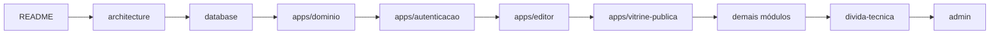

# Documentação do MyVitri

Bem-vindo(a)! Esta pasta explica o sistema inteiro para quem acabou de chegar. Todo documento começa com uma **visão geral sem jargão** e depois aprofunda nos detalhes técnicos, sempre apontando para arquivos e linhas reais do código.

> Revisado contra o código no commit `6f93ec3` (branch `main`, 3 de novembro de 2026), mais as mudanças do commit `28d79ca` (branch `editor-produtos-kits-divulgar`, 3 de novembro de 2026: foto e formulário do produto, layout dos kits, aba Divulgar e imagens de divulgação). As PRs #8 a #12 (home, tema editorial, SEO e `/criar-vitrine`) ainda **não** foram conferidas. Se o código mudou desde então, confie no código e atualize o documento.

## Ordem de leitura sugerida

1. **[README](../README.md)** — o que é o produto e como rodar localmente (30 min).
2. **[Arquitetura](architecture.md)** — visão geral, módulos, fluxo de uma requisição, cache, integrações.
3. **[Banco de dados](database.md)** — tabelas, RLS, a função `publish_vitrine` e o que apaga o quê.
4. **[Domínio](apps/dominio.md)** — as regras de negócio (cupom ativo, preço com desconto, UTM) que todo o resto usa.
5. **[Autenticação](apps/autenticacao.md)** → **[Editor](apps/editor.md)** → **[Vitrine pública](apps/vitrine-publica.md)** — o caminho da creator, do login à vitrine no ar.
6. Os demais módulos conforme a tarefa: [Home](apps/home.md), [Importação](apps/importacao.md), [Uploads](apps/uploads.md), [Métricas](apps/metricas.md), [Divulgação](apps/divulgacao.md).
7. **[Dívida técnica](divida-tecnica.md)** — antes de mexer em qualquer coisa, veja o que já se sabe estar torto.
8. **[Administração](admin.md)** — quando precisar operar produção (Supabase/Vercel).

## Documentos gerais

| Documento | Conteúdo |
|---|---|
| [README.md](../README.md) | Setup passo a passo (dependências, Supabase, Google OAuth, variáveis, servidor), resumo da arquitetura e principais pegadinhas |
| [architecture.md](architecture.md) | Stack, estrutura de pastas, mapa e dependências dos módulos, rotas, Server Actions, fluxos de requisição e de publicação, cache, proxy, integrações externas, tarefas assíncronas, configuração por ambiente, infraestrutura de produção, fuso horário, convenções |
| [database.md](database.md) | Diagrama ER, histórico de migrações, todas as tabelas com campos/tipos/índices, Storage, funções RPC, políticas RLS, regras de exclusão, mapeamento banco ↔ app, pegadinhas de modelagem |
| [admin.md](admin.md) | Não há painel admin: como operar pelo Supabase e pela Vercel (encontrar contas, trocar handle, excluir conta/LGPD, exportar dados, métricas, seed, migrações, Google OAuth, logs, chaves) |
| [divida-tecnica.md](divida-tecnica.md) | Lista consolidada e priorizada de bugs latentes, riscos de segurança, dívidas de dados/processo e legado |

## Documentação por módulo

O projeto é um único app Next.js; os "módulos" são fatias funcionais.

| Módulo | Documento | Arquivos principais | Em uma frase |
|---|---|---|---|
| Domínio | [apps/dominio.md](apps/dominio.md) | `lib/vitrine/{types,pricing,links,store,data}.ts` | Regras de negócio, validação, persistência e leitura cacheada |
| Autenticação e conta | [apps/autenticacao.md](apps/autenticacao.md) | `proxy.ts`, `app/auth/callback/route.ts`, `lib/supabase/server.ts`, `lib/vitrine/claim.ts`, `components/auth/forms.tsx` | Login com Google, criação da vitrine, sair e excluir conta |
| Editor | [apps/editor.md](apps/editor.md) | `app/editor/page.tsx`, `components/editor/*` | Rascunho com autosave, painéis, prévia e publicação |
| Vitrine pública | [apps/vitrine-publica.md](apps/vitrine-publica.md) | `app/[handle]/page.tsx`, `components/storefront/*` | A página `/{handle}` que o seguidor vê |
| Home e institucionais | [apps/home.md](apps/home.md) | `app/page.tsx`, `app/para-creators/`, `app/privacidade/`, `app/termos/`, `components/home/*`, `components/brand/*` | Descoberta, landing de creators, textos legais e marca |
| Importação por link | [apps/importacao.md](apps/importacao.md) | `lib/vitrine/import-link.ts` | Lê produto/preço/logo de páginas de loja com proteção contra SSRF |
| Uploads de imagem | [apps/uploads.md](apps/uploads.md) | `components/editor/{upload.ts,ImageField.tsx,LogoPicker.tsx}` | Reduz no navegador e guarda no Supabase Storage |
| Métricas | [apps/metricas.md](apps/metricas.md) | `app/api/t/route.ts`, `components/editor/MetricsPanel.tsx` | Eventos anônimos e gráficos para a creator |
| Divulgação | [apps/divulgacao.md](apps/divulgacao.md) | `lib/vitrine/share-image.tsx`, `app/[handle]/opengraph-image.tsx`, `app/[handle]/story/route.ts`, `components/editor/SharePanel.tsx` | Imagens OG e de stories com fotos, link com status de publicação, onde colar e UTM |

## Glossário rápido

| Termo | Significado |
|---|---|
| **Creator** | Quem cria a vitrine (influenciador/a, criador/a de conteúdo) |
| **Vitrine** | A página pública de uma creator, com cupons, produtos e kits |
| **Handle** | O "link" da vitrine: `marinacosta` em `myvitri.com/marinacosta` (3–30 caracteres `a-z 0-9 _ .`) |
| **Rascunho** | Versão em edição, salva sozinha em `vitrine_drafts`; o público não vê |
| **Publicar** | Gravar o rascunho como versão pública, de uma vez, pela função `publish_vitrine` |
| **Cupom ativo / agendado / vencido** | Já começou e não venceu / começa no futuro / já venceu. Só o ativo aparece |
| **Kit** | Combo de até 4 produtos com total e economia somados |
| **UTM** | Parâmetros `utm_*` acrescentados aos links das lojas para a marca identificar a origem da venda |
| **Claim** | A escolha de nome e link feita na landing, guardada num cookie de 10 minutos durante o login |
| **RLS** | *Row Level Security*: regras do Postgres que decidem quem lê/escreve cada linha |
| **Server Action** | Função do servidor chamada direto pelo React (todas em `app/actions.ts`) |
| **`"use cache"` / tag** | Marcação do Next 16 para guardar o resultado de uma função; a *tag* permite invalidar esse cache |
| **Hotlink** | Exibir uma imagem direto da URL de outro site, sem copiá-la |

## Convenções desta documentação

- **Idioma:** português do Brasil.
- **Estrutura de cada documento:** visão geral para leigos → detalhes técnicos → integrações → pegadinhas e dívidas técnicas.
- **Caminhos** são relativos à raiz do repositório; referências a código usam `arquivo:linha` (ex.: `app/actions.ts:114`). Linhas podem andar com o tempo — procure pelo nome da função citada.
- **Diagramas** em Mermaid (`graph`, `sequenceDiagram`, `erDiagram`, `stateDiagram-v2`, `classDiagram`), renderizados nativamente pelo GitHub.
- **Nada inventado:** quando algo não pôde ser confirmado no código (por exemplo, onde o app está hospedado), o texto diz que é inferido ou "a verificar".
- **Ao mudar o código, atualize o documento do módulo** e, se for o caso:
  - nova migração → [database.md](database.md) (tabela, histórico, RLS) e `lib/supabase/database.types.ts`;
  - nova rota ou Server Action → tabelas de [architecture.md](architecture.md#rotas) e do módulo;
  - nova variável de ambiente → `.env.example`, [README](../README.md#4-variáveis-de-ambiente) e [architecture.md](architecture.md#configuração-por-ambiente);
  - dívida resolvida → remova de [divida-tecnica.md](divida-tecnica.md) e da seção de pegadinhas do módulo.
